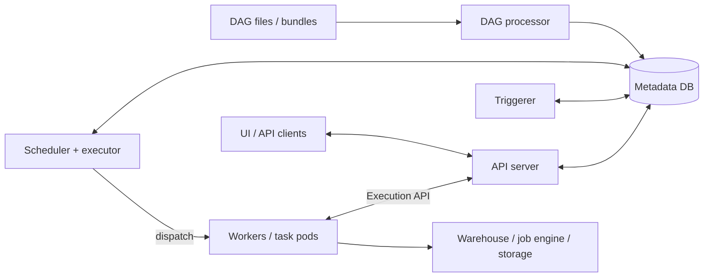

# Apache Airflow: Data Engineer Interview Guide

Apache Airflow orchestrates workflows: it decides when work is eligible to run, enforces dependencies, dispatches tasks, and records their outcomes. A strong interview answer connects those mechanics to a concrete pipeline: which data a run processes, where the computation happens, and what happens when execution is repeated.

**Example baseline:** Apache Airflow 3.1.6, using the public `airflow.sdk` authoring interface and compatible provider packages. This is a documentation baseline, not a claim about the latest release. Airflow 2 differences are called out because many interviews and deployments still use its terminology. Python examples are teaching DAGs; warehouse statements are illustrative and require the target system's transaction and parameter-binding support. [Airflow 3 migration guide](https://airflow.apache.org/docs/apache-airflow/3.1.6/installation/upgrading_to_airflow3.html).

## Contents

1. [Architecture](#1-architecture)
2. [DAG Lifecycle, Scheduling, Data Intervals & Timetables](#2-dag-lifecycle-scheduling-data-intervals--timetables)
3. [Executors: Local, Celery & Kubernetes](#3-executors-local-celery--kubernetes)
4. [Dynamic Task Mapping, TaskGroups & XCom](#4-dynamic-task-mapping-taskgroups--xcom)
5. [Sensors, Deferrable Operators & Triggers](#5-sensors-deferrable-operators--triggers)
6. [Pools, Queues, Concurrency & Priority Weights](#6-pools-queues-concurrency--priority-weights)
7. [Catchup, Backfills, Retries & Idempotency](#7-catchup-backfills-retries--idempotency)
8. [HA, Monitoring & Troubleshooting](#8-ha-monitoring--troubleshooting)
9. [Interview Questions & Scenarios](#9-interview-questions--scenarios)

## 1. Architecture

### What Airflow does

Airflow represents a workflow as a **DAG**, a directed acyclic graph. Tasks are vertices; dependencies are directed edges. A cycle would make the required execution order impossible.

For an analytics pipeline:

```text
wait_for_orders -> load_staging -> transform -> validate -> publish
```

Airflow can run Python or shell commands itself, but it often submits work to another engine. For a warehouse query, the warehouse processes the data; Airflow manages submission, waiting, retries, and dependencies. For a distributed processing job, the external cluster performs the computation. Airflow is primarily a workflow orchestrator for finite tasks, rather than the engine for a continuous event stream. [Architecture overview](https://airflow.apache.org/docs/apache-airflow/3.1.0/core-concepts/overview.html).

### Components and responsibilities

| Component | Main responsibility | Typical failure symptom |
| --- | --- | --- |
| **Scheduler** | Creates eligible DAG runs, evaluates task dependencies and capacity, submits task instances through an executor | New runs or runnable tasks stop progressing |
| **DAG processor** | Imports DAG Python files, discovers DAG objects, and serializes their definitions | New DAGs are missing, changes appear late, or import errors occur |
| **API server** | Serves the UI and APIs, including the task Execution API in Airflow 3 | UI/API failures; workers cannot report state or retrieve runtime resources |
| **Metadata database** | Stores orchestration state: DAG runs, task instances, serialized definitions, configuration records, and default XCom data | Broad control-plane failures, slow scheduling, connection exhaustion |
| **Workers** | Execute task code locally, on persistent remote workers, or in task pods | Queued tasks do not start; running tasks lose heartbeats |
| **Triggerer** | Runs asynchronous triggers for deferred tasks | Deferred tasks stop resuming |

The **executor** is the scheduler's dispatch mechanism. It determines where and how a task starts; its scheduler-side logic is not another service that you universally launch with an `airflow executor` command. A Celery broker and Kubernetes API are infrastructure used by particular executors. [Executor concepts](https://airflow.apache.org/docs/apache-airflow/3.1.6/core-concepts/executor/index.html), [DAG file processing](https://airflow.apache.org/docs/apache-airflow/3.1.6/administration-and-deployment/dagfile-processing.html).

### Control flow in Airflow 3



This is a simplified control-flow diagram. Workers also need the appropriate DAG code, provider packages, network access, credentials, and log configuration; the code-distribution and logging paths are omitted.

Airflow 3 task code uses the **Task SDK and Execution API** for runtime interactions with Airflow. It should not import internal ORM models or open a metadata DB session. The scheduler and other control-plane services still use the database; “workers use the API” does not mean every Airflow service has lost DB access. [Airflow 3 architecture and database restrictions](https://airflow.apache.org/docs/apache-airflow/3.1.6/installation/upgrading_to_airflow3.html#understanding-airflow-3-x-architecture-changes).

### Metadata, data, and logs are different

| Information | Appropriate location |
| --- | --- |
| Task state, run history, dependency metadata | Airflow metadata DB |
| Small task output such as a manifest URI | XCom, using the configured backend |
| Millions of business records | Warehouse, lake, database, or object storage |
| Task execution logs | Configured local or remote logging backend |
| External job status | External system, with its job identifier recorded by the task |

A successful metadata DB backup does not automatically preserve task logs, external data, or a Celery broker. A file written on one worker is not automatically available to another worker.

### Airflow 2 terminology to recognize

| Airflow 2 material often says | Airflow 3 baseline |
| --- | --- |
| Webserver | API server serves the UI and APIs |
| Workers access metadata DB directly | Task runtime uses the Execution API |
| `from airflow.decorators import dag, task` | `from airflow.sdk import dag, task` |
| Common operators bundled in core | Many are in `apache-airflow-providers-standard` |
| Dataset | Asset |
| `schedule_interval` in older examples | `schedule` |

Also verify scheduling defaults and concurrency scope when translating an answer between versions; those affect behavior, not just imports. [Migration guide](https://airflow.apache.org/docs/apache-airflow/3.1.6/installation/upgrading_to_airflow3.html).

## 2. DAG Lifecycle, Scheduling, Data Intervals & Timetables

### DAG, DAG run, task, and task instance

| Term | Meaning | Example |
| --- | --- | --- |
| DAG | Workflow definition | `daily_orders` |
| DAG run | One instantiation of that workflow | A scheduled run for a particular interval |
| Task | A node in the workflow definition | `validate_orders` |
| Task instance | A task instantiated within a DAG run; mapped instances also have a map index | `validate_orders` in one specific run |
| Attempt | An execution attempt for a task instance | The initial execution or a retry |

`task_id` alone does not identify one execution. When debugging, record the DAG ID, run ID, task ID, map index if applicable, and attempt. Multiple runs of the same DAG can be active concurrently. [Tasks and task instances](https://airflow.apache.org/docs/apache-airflow/3.1.6/core-concepts/tasks.html).

### From Python file to completed run

1. **Deploy code.** Make DAG files or a DAG bundle and compatible dependencies available to the relevant components.
2. **Parse.** The DAG processor imports the module and constructs DAG and task definitions.
3. **Serialize.** Airflow stores the structure used for scheduling and presentation.
4. **Create a run.** A timetable, manual request, asset event, or backfill determines the run's eligibility and context.
5. **Evaluate dependencies.** The scheduler checks upstream states, retry delays, pools, and applicable concurrency limits.
6. **Dispatch.** The executor hands eligible task instances to the execution environment.
7. **Execute and report.** Tasks run, produce external effects, and report their state. Downstream work becomes eligible as conditions are met.
8. **Complete the run.** Airflow determines the DAG run outcome from the resulting task states.

The DAG file is imported repeatedly. Keep module-level work limited to building the graph: no data extraction, slow network requests, or expensive database lookups. Calling a decorated task during DAG construction creates a task reference; its function body executes later on a worker. [DAG loading](https://airflow.apache.org/docs/apache-airflow/3.1.6/core-concepts/dags.html#loading-dags), [Parsing behavior](https://airflow.apache.org/docs/apache-airflow/3.1.6/administration-and-deployment/dagfile-processing.html).

### Task states

```text
none -> scheduled -> queued -> running -> success
                                  |
                                  +-> up_for_retry -> scheduled -> ...
                                  +-> failed
                                  +-> deferred -> scheduled -> ...
                                  +-> up_for_reschedule -> scheduled -> ...
```

Other useful states include `skipped`, `upstream_failed`, and `removed`. `scheduled` means Airflow has identified work to schedule; `queued` means the executor has received it and execution is pending. Neither proves that user code has started. A task in `up_for_retry` is waiting for another attempt, rather than actively running. [Task lifecycle](https://airflow.apache.org/docs/apache-airflow/3.1.6/core-concepts/tasks.html#task-instances).

### Logical date, data interval, and actual execution time

These answer different questions:

| Value | Question it answers |
| --- | --- |
| `logical_date` | What logical time identifies this run under its scheduling semantics? |
| `data_interval_start`, `data_interval_end` | What interval does this run represent? |
| Actual start time | When did the task or run begin executing? |
| `run_id` | Which particular DAG run is this? |

For an explicit daily **data-interval timetable** in UTC:

```text
Data interval:       [2026-10-20 00:00, 2026-10-21 00:00)
Logical date:        2026-10-20 00:00
Earliest scheduling: 2026-10-21 00:00
Actual task start:   2026-10-21 00:04, if capacity permits
```

The half-open interval includes its start and excludes its end, so adjacent windows do not overlap at midnight. In a warehouse query, bind the interval boundaries as parameters:

```sql
SELECT order_id, event_time, amount
FROM raw_orders
WHERE event_time >= :interval_start
  AND event_time < :interval_end;
```

Parameter syntax depends on the database driver. This filter selects the run's event-time window; it does not prove that all late records have arrived. [Data interval concepts](https://airflow.apache.org/docs/apache-airflow/3.1.6/core-concepts/dag-run.html#data-interval).

Do not derive a business partition from the worker's current date. A delayed run or retry can execute on a different day. Do not assume every timetable gives `logical_date` the same relationship to an interval, either.

### Timetables and the Airflow 3 default change

A **timetable** determines run times and interval semantics. A cron string is shorthand that Airflow translates into a timetable.

| Timetable | Meaning | Suitable example |
| --- | --- | --- |
| `CronDataIntervalTimetable` | Consecutive cron boundaries define an interval; the run becomes eligible after the interval closes | Process each completed calendar day |
| `CronTriggerTimetable` | Trigger at cron times; without an explicit `interval`, the interval has zero duration | Run a maintenance command at 03:00 |
| `DeltaDataIntervalTimetable` | Consecutive intervals of a specified duration | Process fixed-duration windows |
| `DeltaTriggerTimetable` | Trigger according to a duration-based schedule | Periodic execution without calendar-window semantics |
| Custom timetable | Defines application-specific schedule and intervals | Business days or irregular reporting periods |

**Airflow 3 defaults `create_cron_data_intervals` to `False`.** A plain cron schedule therefore uses trigger semantics by default. Do not repeat the old blanket answer that `schedule="@daily"` always means “process yesterday.” Explicit timetable objects make the intended behavior clear. Trigger timetables can also accept an explicit lookback interval. [Airflow 3 scheduling defaults](https://github.com/apache/airflow/blob/3.1.6/RELEASE_NOTES.rst), [Timetable definitions and comparisons](https://airflow.apache.org/docs/apache-airflow/3.1.0/authoring-and-scheduling/timetable.html).

### A small interval-aware DAG

```python
from datetime import datetime, timedelta, timezone

from airflow.sdk import dag, get_current_context, task
from airflow.timetables.interval import CronDataIntervalTimetable


@dag(
    dag_id="daily_interval_demo",
    start_date=datetime(2026, 10, 1, tzinfo=timezone.utc),
    schedule=CronDataIntervalTimetable("0 0 * * *", timezone="UTC"),
    catchup=False,
    max_active_runs=1,
    default_args={"retries": 2, "retry_delay": timedelta(minutes=5)},
)
def daily_interval_demo():
    @task
    def describe_window() -> str:
        context = get_current_context()
        start = context["data_interval_start"]
        end = context["data_interval_end"]
        return f"[{start.isoformat()}, {end.isoformat()})"

    @task
    def report_window(window: str) -> None:
        print(f"Process data for {window}")

    report_window(describe_window())


daily_interval_demo()
```

`describe_window()` returns an XCom reference while the graph is constructed. Airflow later resolves its small string result for `report_window`, and the reference creates the dependency automatically. The example reports a window; a real extraction task must use those boundaries in its source query. [TaskFlow API](https://airflow.apache.org/docs/apache-airflow/3.1.6/tutorial/taskflow.html).

### Start dates, time zones, and schedule choices

- **`start_date` is a scheduling boundary.** For the interval timetable above, the first complete window begins at that boundary and becomes eligible after its end. Enabling the DAG later with `catchup=False` changes which historical window is selected.
- **Use a fixed, timezone-aware start date.** A moving `datetime.now()` start date changes on every parse and makes scheduling hard to reason about.
- **A cron schedule follows calendar boundaries.** A duration-based timetable need not align with midnight or a calendar month.
- **Time zones are part of the contract.** Local-calendar schedules can cross daylight-saving transitions; a local day need not be 24 hours. UTC avoids DST ambiguity, but business reporting may require a local calendar.
- **`schedule=None` means no automatic time schedule.** A manual trigger still creates a run.
- **Asset scheduling follows declared data updates.** In Airflow 3 the term is Asset; Airflow 2 material often calls this Dataset scheduling. An asset event is orchestration metadata, not a transfer of the underlying records.

State the timezone, timetable, and catchup setting before predicting a run's dates. [Time-zone behavior](https://airflow.apache.org/docs/apache-airflow/3.1.6/authoring-and-scheduling/timezone.html), [Asset-aware scheduling](https://airflow.apache.org/docs/apache-airflow/3.1.6/authoring-and-scheduling/asset-scheduling.html).

### Dependencies and trigger rules

The default trigger rule, `all_success`, requires successful upstream tasks. After branching, a join often needs `none_failed_min_one_success`: at least one parent succeeded and none failed or became `upstream_failed`. `all_done` allows a task to run after all parents finish regardless of their outcome.

**A trigger rule is not a triggerer trigger.** A trigger rule evaluates upstream task states; a trigger watches an asynchronous condition for a deferred task.

DAG run success depends on leaf task states. An ordinary successful leaf using `all_done` can mask a failed task earlier in the graph. Design cleanup and validation so a green run still means the required business work succeeded. A state manually marked successful also does not establish that external work happened. [Trigger rules](https://airflow.apache.org/docs/apache-airflow/3.1.6/core-concepts/dags.html#trigger-rules), [DAG run status](https://airflow.apache.org/docs/apache-airflow/3.1.6/core-concepts/dag-run.html#dag-run-status).

## 3. Executors: Local, Celery & Kubernetes

### Comparison

| Aspect | LocalExecutor | CeleryExecutor | KubernetesExecutor |
| --- | --- | --- | --- |
| Execution location | Processes on the scheduler host | Persistent Celery worker hosts | A worker pod per task instance |
| Dispatch infrastructure | Local process queues | Message broker and Celery result backend | Kubernetes API |
| Startup overhead | Usually low | Usually low with ready workers | Pod scheduling, image pull, and startup |
| Isolation | Shared host and environment | Shared worker environments, optionally separated by queue | Per-pod resources and environment |
| Scaling | Limited by scheduler hosts | Add or autoscale workers | Add pod and cluster capacity |
| Operational concern | Task load competes with scheduling | Broker, backend, worker health, queue routing | Pod failures, quotas, RBAC, image availability |

Choose based on workload duration, isolation needs, existing infrastructure, and operating cost. An executor does not change what makes a task idempotent or how DAG dependencies work. [Executor tradeoffs](https://airflow.apache.org/docs/apache-airflow/3.1.6/core-concepts/executor/index.html).

### LocalExecutor

LocalExecutor runs tasks in separate processes on the scheduler node. It can execute multiple tasks concurrently and is useful for smaller deployments that fit on that host. A separate remote worker fleet is unnecessary.

Tasks and scheduling compete for CPU and memory. Excessive concurrency can make scheduling slower or cause the scheduler container to run out of memory. With multiple schedulers, each has its own LocalExecutor; losing one scheduler can also affect its local tasks. In Airflow 3, LocalExecutor requires positive `parallelism`; the old unlimited `parallelism=0` mode was removed. [LocalExecutor](https://airflow.apache.org/docs/apache-airflow/3.1.6/core-concepts/executor/local.html).

### CeleryExecutor

```text
Scheduler / CeleryExecutor -> Broker -> Celery workers -> Task execution
                ^                          |
                +---- Result backend <-----+
```

The broker transports execution messages. The Celery result backend tracks Celery execution results. The Airflow metadata database holds workflow state. They are distinct roles even when a database deployment serves more than one role.

Workers subscribe to named queues, which can separate workloads requiring different environments or resources. Workers need compatible dependencies and DAG code. Remote logs remain available when a worker disappears; logs kept only on that machine may not.

Common problems include no worker listening to a queue, a broker outage, insufficient worker concurrency, and a mismatched runtime environment. Adding workers will not fix a saturated pool. The Airflow 3 task-runtime API boundary still applies; older Celery architecture diagrams can show Airflow 2 DB access. [CeleryExecutor and queues](https://airflow.apache.org/docs/apache-airflow-providers-celery/stable/celery_executor.html).

### KubernetesExecutor

KubernetesExecutor requests a pod for each task instance. Kubernetes then schedules the pod on a node. The task requires an appropriate image, resources, configuration, credentials, DAG code, and access to the Execution API.

Per-task environments and resource requests suit heterogeneous workloads. The tradeoff is startup latency and Kubernetes operations. A task pod can remain `Pending` because of insufficient resources, quotas, node selectors, or storage requirements. Image failures happen before the Python task body runs. Increasing Airflow concurrency can simply create more pending pods.

**KubernetesExecutor and KubernetesPodOperator are different.** The executor chooses the runtime for Airflow task instances. KubernetesPodOperator is an operator that launches a workload pod and can be used with another executor, such as CeleryExecutor. [KubernetesExecutor](https://airflow.apache.org/docs/apache-airflow-providers-cncf-kubernetes/stable/kubernetes_executor.html), [KubernetesPodOperator](https://airflow.apache.org/docs/apache-airflow-providers-cncf-kubernetes/stable/operators.html).

## 4. Dynamic Task Mapping, TaskGroups & XCom

### Dynamic DAG generation vs. Dynamic Task Mapping

| Technique | When the task structure is determined | Typical input |
| --- | --- | --- |
| Dynamic DAG generation | While the DAG file is parsed | Stable configuration describing known tables |
| Dynamic Task Mapping | At runtime, after an upstream output becomes available | A discovered list of files or partitions |

A Python loop that creates tasks during parsing is dynamic generation. Mapping lets the scheduler expand task instances from runtime data. Use stable ordering and task IDs for generated DAGs; changing them unpredictably makes histories difficult to interpret. [Dynamic DAG generation](https://airflow.apache.org/docs/apache-airflow/3.1.6/howto/dynamic-dag-generation.html).

### `expand()`, `partial()`, and map/reduce

```python
from datetime import datetime, timezone

from airflow.sdk import dag, task


@dag(
    dag_id="mapping_demo",
    start_date=datetime(2026, 10, 1, tzinfo=timezone.utc),
    schedule=None,
    catchup=False,
)
def mapping_demo():
    @task
    def discover_batches() -> list[list[int]]:
        return [[1, 2], [3, 4, 5], [6]]

    @task(max_active_tis_per_dag=2)
    def count_batch(batch: list[int], source: str) -> int:
        print(f"Counting a batch from {source}")
        return len(batch)

    @task
    def total_counts(counts) -> int:
        return sum(counts)

    counts = count_batch.partial(source="orders").expand(batch=discover_batches())
    total_counts(counts)


mapping_demo()
```

This creates three mapped `count_batch` instances and a reduction returning `6`. `partial()` supplies a fixed argument; `expand()` supplies mapped values. In production, map over small batch descriptors or manifest URIs rather than returning the full business dataset in XCom.

`expand(x=[1, 2], y=[10, 20])` creates a Cartesian product of four combinations, rather than pairing positions. Use `expand_kwargs()` with explicit dictionaries or the supported zip operation when inputs must be paired. [Dynamic Task Mapping](https://airflow.apache.org/docs/apache-airflow/3.1.6/authoring-and-scheduling/dynamic-task-mapping.html).

### Mapping limits and edge cases

- An empty input produces no mapped instances and marks the mapped task as skipped. Account for this in downstream trigger rules.
- `max_map_length` bounds expansion; the documented default is `1024`. A source output beyond the configured limit fails rather than expanding without limit.
- `max_active_tis_per_dag` limits concurrent instances of that task across active runs. It does not reduce how many instances exist overall.
- Multiple mapped arguments can multiply the workload. Calculate the expansion size before introducing a large fan-out.
- Reduce operations can gather many outputs. Keep each output small and avoid eagerly materializing a huge result collection on one worker.

Mapping is orchestration overhead per unit of work. For a million tiny records, submit batches to the processing engine instead of creating a million task instances. [Mapping limits](https://airflow.apache.org/docs/apache-airflow/3.1.6/authoring-and-scheduling/dynamic-task-mapping.html#placing-limits-on-mapped-tasks).

### TaskGroups

A **TaskGroup** organizes tasks in the DAG and UI. It is not a separate DAG run, execution environment, or concurrency boundary. Its tasks still receive individual states, logs, retries, and executor dispatches.

```python
from airflow.sdk import task, task_group


@task
def normalize(value: str) -> str:
    return value.strip().lower()


@task
def validate(value: str) -> str:
    if not value:
        raise ValueError("An empty table name is invalid")
    return value


@task_group
def prepare_table(table: str):
    return validate(normalize(table))
```

Inside a DAG, call `prepare_table("Orders")` to construct its tasks. `prepare_table.expand(table=["Orders", "Customers"])` creates a mapped group. Each group's validation can follow its own normalization, rather than waiting for every normalization to finish. Group-prefixed task IDs help avoid collisions; they also matter for explicit XCom references. [TaskGroups](https://airflow.apache.org/docs/apache-airflow/3.1.6/core-concepts/dags.html#taskgroups), [Mapping a task group](https://airflow.apache.org/docs/apache-airflow/3.1.6/authoring-and-scheduling/dynamic-task-mapping.html#mapping-over-a-task-group).

### XCom and TaskFlow data passing

**XCom**, or cross-communication, carries small task outputs. TaskFlow returns are pushed automatically, and task arguments referencing those outputs establish dependencies. Traditional operators can explicitly push and pull values.

| Good XCom payload | Poor XCom payload |
| --- | --- |
| Manifest URI, object path, table identifier | Entire extracted dataset |
| External job ID | Large dataframe |
| Small count or status dictionary | Access token or password |
| A short list of partition descriptors | An unbounded list of business records |

By default, XCom values are stored through the metadata DB backend. An object-storage XCom backend can move payload storage elsewhere, but serialization, transfer cost, retention, and downstream memory use still matter. Variables are shared configuration; they are not the right place for one task's run-specific output. Retry behavior can clear XComs from an unsuccessful attempt, so do not use them as a durable external-job ledger. [XComs](https://airflow.apache.org/docs/apache-airflow/3.1.6/core-concepts/xcoms.html), [Object-storage XCom backend](https://airflow.apache.org/docs/apache-airflow-providers-common-io/stable/xcom_backend.html).

Use Connections or a configured secrets backend for credentials. A task should pass an external object's identifier to another task, which reads the object through its own authorized connection.

## 5. Sensors, Deferrable Operators & Triggers

### Three ways to wait

A **sensor** waits for a condition such as a completed upstream run, an available file, or an external job's completion. Choose its waiting mechanism deliberately:

| Mechanism | Worker occupied while waiting? | What checks the condition? | Main tradeoff |
| --- | --- | --- | --- |
| Sensor in `poke` mode | Yes | The running sensor | Simple and responsive, but idle waits consume workers |
| Sensor in `reschedule` mode | Only during each check | A worker on each rescheduled check | Frees workers between checks; repeated scheduling adds overhead |
| Deferrable operator or sensor | No during deferral | An asynchronous trigger in a triggerer | Efficient for many waits; requires triggerer capacity and operator support |

For ten short checks, a regular sensor may be sufficient. For thousands of long external-job waits, deferral can save substantial worker capacity. A deferrable operator is not restricted to waiting for files; it can submit a job, defer during execution, and then resume to inspect the result. [Sensors](https://airflow.apache.org/docs/apache-airflow/3.1.6/core-concepts/sensors.html), [Deferrable operators](https://airflow.apache.org/docs/apache-airflow/3.1.6/authoring-and-scheduling/deferring.html).

### Deferral lifecycle

```text
Worker:   execute -> submit job -> defer ---------------------> resume -> finish
Triggerer:                         wait asynchronously -> event
Scheduler:                                               queue resumed task
```

The trigger emits an event; the scheduler still needs to arrange resumed execution. A task may remain unable to resume if workers, pools, or other capacity limits block it.

Deferral does not preserve a worker's Python stack or local variables. The operator must explicitly provide the continuation method and serializable information needed to resume. It may resume on a different worker. Provider support matters: adding `deferrable=True` to an arbitrary operator or TaskFlow function does not make it deferrable. [Deferral and continuation](https://airflow.apache.org/docs/apache-airflow/3.1.6/authoring-and-scheduling/deferring.html#writing-deferrable-operators).

### Triggers and triggerer behavior

A trigger is a small asynchronous watcher. Its `run()` method yields an event when the awaited condition is satisfied, and its serialized class path and arguments allow reconstruction elsewhere.

Triggers share an event loop. Blocking network clients or `time.sleep()` can stall other waits in the same triggerer; use asynchronous operations. A trigger may restart or temporarily execute redundantly during recovery, so it should avoid non-idempotent side effects. The trigger watches a condition; the resumed operator decides whether the external outcome constitutes success or failure. [Writing triggers](https://airflow.apache.org/docs/apache-airflow/3.1.6/authoring-and-scheduling/deferring.html#writing-triggers).

Do not confuse these three concepts:

| Concept | Purpose |
| --- | --- |
| Trigger rule | Determines eligibility from upstream task states |
| Deferral trigger | Watches a condition and wakes a deferred task |
| Triggering a DAG run | Requests a new workflow run |

### Timeouts and failure behavior

For a conventional sensor, `poke_interval` controls how frequently it checks. In `reschedule` mode, sensor `timeout` bounds the overall waiting period across checks; `execution_timeout` bounds an individual execution. A sensor timing out is different from a task merely waiting for its next check.

`soft_fail=True` can convert supported sensor failures into skips. That is suitable only if skipping downstream work is an accepted business outcome. Deferrable operators have their own timeout and provider-specific failure behavior; check the operator rather than assuming all sensor parameters work identically. [Task and sensor timeouts](https://airflow.apache.org/docs/apache-airflow/3.1.6/core-concepts/tasks.html#timeouts).

### Cross-DAG waiting

An ExternalTaskSensor waits for a task or run in another DAG. Its date alignment must match the upstream workflow: hourly and daily DAGs do not automatically share equivalent logical dates. Configure allowed and failed states deliberately; a failed upstream task should not leave a downstream sensor waiting until timeout by accident.

For a dependency on a published dataset, asset scheduling can express the relationship more directly. Neither mechanism independently proves data quality or completeness; make validation part of the producer's publication contract. [ExternalTaskSensor](https://airflow.apache.org/docs/apache-airflow-providers-standard/stable/sensors/external_task_sensor.html).

## 6. Pools, Queues, Concurrency & Priority Weights

### Different controls solve different problems

| Control | What it controls | Example |
| --- | --- | --- |
| **Pool** | Shared admission budget for an arbitrary set of tasks, including tasks in different DAGs | At most four heavy warehouse operations |
| **Queue** | Routing to execution consumers, especially Celery workers | Send tasks requiring a special client library to dedicated workers |
| **Concurrency limit** | Number of active runs or task instances within a specified scope | No more than two active runs of one DAG |
| **Priority weight** | Relative scheduling preference among eligible tasks | Prefer current reporting work over historical rebuilds |

A queue does not impose a shared external-system limit. A pool does not select which worker image executes a task. Priority does not create resources.

### Pools and weighted slots

Create a pool for a constrained resource and assign all competing tasks to it, including tasks from other DAGs. `pool_slots` lets a heavy task consume more of the shared budget.

For a pool with six slots:

```text
Heavy transformation: pool_slots=3
Light query:          pool_slots=1

Possible admitted mix: 1 heavy + 3 light = 6 slots
Another mix:           2 heavy           = 6 slots
```

Pool slots are an accounting unit, not reserved CPU cores or database connections. If a task requests more slots than the pool contains, it cannot be admitted. A pool also limits concurrent admitted tasks, rather than requests per second; an API rate limit may need additional control within the task or client. [Pools](https://airflow.apache.org/docs/apache-airflow/3.1.1/administration-and-deployment/pools.html).

**Deferred tasks need special attention.** Pools can include deferred tasks when counting occupied slots. If a deferred task has already launched a warehouse query that is still consuming capacity, excluding it from the pool can admit too many external queries. Count deferred tasks when the pool is meant to represent those still-running external operations. [Pool handling of deferred tasks](https://airflow.apache.org/docs/apache-airflow/3.1.6/authoring-and-scheduling/deferring.html).

### Queues

With CeleryExecutor, a task's `queue` routes it to workers subscribed to that queue:

```bash
airflow celery worker -q default,warehouse
```

This is an example deployment command, not a command needed to read this guide. A task routed to `warehouse` needs a live worker listening there. Idle workers subscribed only to `default` cannot help. Every subscribed worker must have the required runtime and credentials. [Celery queue routing](https://airflow.apache.org/docs/apache-airflow-providers-celery/stable/celery_executor.html#queues).

Do not assume Celery queue names select Kubernetes nodes or grant security isolation. Kubernetes placement and permissions come from pod configuration and cluster policy.

### Concurrency settings and their scopes

| Setting | Scope in the Airflow 3.1.6 baseline | What to remember |
| --- | --- | --- |
| `[core] parallelism` | Scheduler/executor admission capacity | Multiple schedulers can increase aggregate capacity; this is not a universal external-system cap |
| DAG `max_active_runs` | Active runs of that DAG | Limits overlap of scheduled workflow runs |
| DAG `max_active_tasks` | Active task instances within a DAG run | The scheduler counts running and queued instances for admission |
| Task `max_active_tis_per_dag` | Instances of one task across active runs of its DAG | Useful for mapped tasks competing across dates |
| Task `max_active_tis_per_dagrun` | Instances of one task within one DAG run | Useful for limiting a run's mapped fan-out |
| `pool` and `pool_slots` | All tasks assigned to a pool | Provides a shared budget across DAGs |
| Worker concurrency / pod capacity | Execution infrastructure | Determines how much admitted work can actually execute |

**Version trap:** Airflow 2's DAG `max_active_tasks` applies across the DAG's runs. In the Airflow 3.1.6 scheduler it is checked per DAG run. With two active runs and `max_active_tasks=8`, do not assume an eight-task budget across both runs. Use a shared pool when you need a cross-run or cross-DAG resource cap. The versioned scheduler source shows the `(dag_id, run_id)` accounting. [Airflow 3.1.6 scheduler implementation](https://github.com/apache/airflow/blob/3.1.6/airflow-core/src/airflow/jobs/scheduler_job_runner.py), [Task SDK concurrency documentation](https://airflow.apache.org/docs/task-sdk/1.3.2/api.html).

For backfills in Airflow 3, the backfill's active-run limit is separate from the DAG's ordinary active-run limit. Both sets of work can still compete for pools and execution capacity. [Backfill concurrency](https://airflow.apache.org/docs/apache-airflow/3.1.0/core-concepts/backfill.html#concurrency-control).

### Reasoning about the effective limit

Suppose twenty mapped tasks are ready in one run:

```text
Available executor capacity:             12 task instances
Remaining DAG-run task budget:             8 task instances
Remaining max_active_tis_per_dag budget:    5 task instances
Pool free slots:                           6 slots
Each task needs:                           2 pool slots
Matching worker capacity:                  7 task instances
```

At most `min(12, 8, 5, floor(6 / 2), 7) = 3` can make progress under these assumptions. This is a capacity illustration, not the scheduler's implementation formula; real admission also depends on existing queued work and other eligible tasks. Increase the pool only if the constrained external system can handle more work.

### Priority weights

`priority_weight` gives eligible tasks a relative preference. `weight_rule` controls how the effective priority is calculated:

| Rule | Effective weight | Typical effect with positive weights |
| --- | --- | --- |
| `downstream` | Task's weight plus its downstream descendants' weights | Favors upstream work that unlocks more tasks |
| `upstream` | Task's weight plus its upstream ancestors' weights | Favors finishing downstream work |
| `absolute` | Task's own weight | Makes explicit priorities easier to reason about |

The default is `downstream`. A high priority does not preempt a running task, override a full pool, or bypass failed dependencies. Scheduling is batched, so weights do not promise a strict global execution order. If freshness matters, reserve suitable capacity as well as giving current work higher priority. [Priority weights](https://airflow.apache.org/docs/apache-airflow/3.1.8/administration-and-deployment/priority-weight.html), [Scheduler behavior](https://github.com/apache/airflow/blob/3.1.6/airflow-core/docs/administration-and-deployment/scheduler.rst).

## 7. Catchup, Backfills, Retries & Idempotency

### Catchup vs. backfill vs. clearing

| Mechanism | Purpose | Example |
| --- | --- | --- |
| **Catchup** | Automatically schedule missing eligible historical runs | A newly enabled interval-based DAG needs previous days |
| **Backfill** | Explicitly create historical runs for a chosen range | Recompute a month after fixing transformation logic |
| **Retry** | Repeat a failed task instance according to its policy | A temporary source connection failure |
| **Clear** | Reset selected task-instance state so it can execute again | Rerun a failed load and affected downstream validation |
| **Manual trigger** | Create an explicitly requested run | An operational run with validated parameters |

`catchup=False` prevents automatic enumeration of the backlog; it does not forbid an explicit backfill. A manual run does not necessarily have the same data interval as a historical scheduled run. Clearing or retrying work does not reverse its external effects. [Catchup and reruns](https://airflow.apache.org/docs/apache-airflow/3.1.6/core-concepts/dag-run.html), [Backfills](https://airflow.apache.org/docs/apache-airflow/3.1.0/core-concepts/backfill.html).

### Catchup example

Assume an explicit daily UTC data-interval timetable, `start_date` at October 1 midnight, no previous runs, and activation at October 5 noon:

- With `catchup=True`, the scheduler can create the completed intervals starting October 1, 2, 3, and 4, subject to capacity and run limits.
- With `catchup=False`, it selects the latest completed interval, October 4 to October 5, rather than creating all four.
- The interval October 5 to October 6 has not finished yet.

This example depends on the explicit interval timetable. A trigger timetable has different activation and interval semantics. A catchup-enabled task must read historical inputs correctly; querying only the source's current snapshot cannot reconstruct a lost historical snapshot.

### Airflow 3 backfill controls

```bash
airflow backfill create \
  --dag-id daily_orders \
  --start-date 2026-10-01 \
  --end-date 2026-10-07 \
  --reprocessing-behavior failed \
  --max-active-runs 2
```

This example creates historical work in a configured Airflow deployment; it is not a read-only diagnostic. Airflow 2 examples often use `airflow dags backfill`, which is not the command used by this baseline.

Airflow 3 supports `none`, `failed`, and `completed` reprocessing behavior. These respectively avoid dates with existing runs, allow reprocessing failed runs, or allow reprocessing finished runs including successful ones. The latest run being queued or running prevents creating another for that date. Use a dry run to inspect candidate dates before execution; actual creation also depends on run state at execution time. [Backfill behavior and CLI](https://airflow.apache.org/docs/apache-airflow/3.1.0/core-concepts/backfill.html).

Before a large reprocessing operation, establish:

1. **The input contract:** which source versions and windows are available, and how late data is included.
2. **The write contract:** which partitions or keys may change, and how old output is replaced safely.
3. **The dependency contract:** whether windows are independent or must execute in sequence.
4. **The capacity budget:** protect current production work and the source/target systems.
5. **The validation contract:** compare counts, totals, and business invariants before publication.

### Retries and timeout budgets

Set retries for transient failures, such as timeouts or temporary service unavailability. `retries=2` permits up to three ordinary attempts: the initial attempt and two retries. `retry_delay`, exponential backoff, and a maximum retry delay help avoid repeatedly hammering a struggling service.

Retries do not repair deterministic errors such as invalid SQL, a missing required column, or rejected business data. Configure an execution timeout so a hung attempt eventually stops. Also consider the total elapsed time across attempts, waiting, and backoff when defining a freshness target. An Airflow timeout does not necessarily cancel an already-submitted external job; verify the operator's cancellation behavior. [Task failure and timeout behavior](https://airflow.apache.org/docs/apache-airflow/3.1.6/core-concepts/tasks.html), [Operator retry parameters](https://airflow.apache.org/docs/task-sdk/1.3.2/api.html).

### Idempotency and the ambiguous-success window

An operation is **idempotent** if repeating it with the same intended input leaves the target in the same intended state.

Consider this failure:

```text
1. Worker inserts the day's orders.
2. Warehouse commits successfully.
3. Worker dies before reporting success to Airflow.
4. Airflow retries the task.
```

A plain append duplicates rows. Airflow cannot infer whether the commit happened from the missing success report. Treat task execution as potentially repeated, including after a manual clear; Airflow does not provide end-to-end exactly-once business effects by itself.

| Operation | Safer repeatable design | Remaining question |
| --- | --- | --- |
| Load a daily partition | Atomically replace that partition from validated staging | Can two writers target it concurrently? |
| Apply changed records | Merge/upsert on a stable business key and source version | Is the merge input deduplicated and deterministic? |
| Submit an external job | Stable idempotency key or lookup/reuse of an existing job | Can submission succeed before the job ID is recorded? |
| Publish files | Write to staging, validate, then atomically publish a manifest/pointer | Does the storage system support the chosen atomic operation? |
| Send a notification or charge a payment | Durable deduplication key supported by the receiving service | What happens after an ambiguous network failure? |

Idempotent output and identical input are separate requirements. If the source changes between attempts, an upsert may still produce a different result. Pin an input snapshot or record the source version when reproducibility matters. [Task design and repeatability](https://airflow.apache.org/docs/apache-airflow/3.1.6/best-practices.html#creating-a-task).

### Safe partition replacement

For a database that supports transactional DML, a conceptual pattern is:

```sql
BEGIN;

DELETE FROM daily_orders
WHERE order_date = :partition_date;

INSERT INTO daily_orders (order_id, order_date, amount)
SELECT order_id, order_date, amount
FROM validated_staging_orders
WHERE order_date = :partition_date;

COMMIT;
```

Build and validate staging before this transaction, use a stable source version, and roll back on failure. Execute the statements in one transaction on one connection. The target must support these semantics; some DDL and overwrite operations commit independently. Concurrent writers need serialization or an equivalent target-side safeguard. Never delete a production partition first and assume a later Airflow task will definitely refill it.

An idempotency key should reflect the business operation: dataset, interval, and possibly source or transformation version. `try_number` changes on retry, so it is unsuitable for deduplicating the same intended write. `run_id` distinguishes runs but may also differ across separate backfill runs for the same business interval.

### Late data and cross-run dependencies

An interval closing does not guarantee source completeness. Choose a business policy: wait for an upstream completion signal, delay publication, reprocess a bounded lookback, or run explicit corrections. A lookback must still deduplicate or replace output safely.

`depends_on_past=True` adds a dependency on the same task in the previous scheduled run. It is not the same as an upstream dependency within one run, and it can block later windows after a failure. `max_active_runs=1` reduces overlap but does not itself establish data correctness or a dependency on the previous run's successful output. [Cross-run dependencies](https://airflow.apache.org/docs/apache-airflow/3.1.6/core-concepts/dags.html#depends-on-past).

## 8. HA, Monitoring & Troubleshooting

### High availability by component

| Component | HA approach | What still needs attention |
| --- | --- | --- |
| Scheduler | Run multiple schedulers against a supported shared metadata DB | DB contention, aggregate task capacity, task recovery |
| API server | Multiple instances behind a load balancer | Shared compatible authentication configuration and Execution API reachability |
| Metadata DB | Managed failover or database replication, backups, tested restores | Failover disruption, connection limits, schema migrations |
| Workers | Multiple workers or replaceable task pods | Task retries, external effects, runtime consistency |
| Triggerer | Multiple triggerers with enough capacity | Trigger reassignment, async blocking, recovery delay |
| DAG processor | Supervise and scale parsing with the deployment's supported bundle configuration | Consistent code distribution and parse health |
| Celery infrastructure | Appropriate broker and result-backend availability | Transport recovery and preservation of queued work |
| Logs and DAG artifacts | Durable shared storage or versioned distribution | Retention, access, and availability after worker replacement |

Schedulers coordinate through database transactions and locking rather than requiring a separate leader-election cluster. A second scheduler improves availability only if the shared DB and execution path remain available. More schedulers can also increase database load. [Scheduler HA](https://github.com/apache/airflow/blob/3.1.6/airflow-core/docs/administration-and-deployment/scheduler.rst).

HA is not an exactly-once guarantee. After a crash, Airflow must reconcile recorded state with worker or external-system reality. Preserve the information needed to identify an external job and make a repeated attempt safe.

### Health is more than a reachable UI

In Airflow 3, `/api/v2/monitor/health` returns component health information. Its HTTP `200` means the endpoint responded; inspect the JSON component statuses and heartbeat timestamps to judge scheduler and other component health. Check individual instances as well as an aggregate endpoint when operating multiple replicas.

Example read-only CLI checks in an installed deployment:

```bash
airflow db check
airflow jobs check --job-type SchedulerJob --local
airflow dags list-import-errors
```

A healthy DB connection does not prove the scheduler is making progress, and a healthy scheduler does not prove a queue has workers. [Health-check behavior and commands](https://github.com/apache/airflow/blob/3.1.6/airflow-core/docs/administration-and-deployment/logging-monitoring/check-health.rst).

### Monitor the control plane and the business outcome

| Signal | What it helps detect |
| --- | --- |
| Scheduler heartbeat and scheduling delay | Dead scheduler or control-plane saturation |
| DAG parsing time and import errors | Slow discovery, broken dependencies, expensive top-level code |
| Task time in scheduled/queued states | Admission limits, missing workers, or execution startup problems |
| Running duration and retry/failure rate | Slow jobs, unstable integrations, deterministic failures |
| Pool utilization and waiting work | Pressure on a shared external resource |
| Worker CPU/memory and pod events | Overcommit, OOM termination, insufficient node capacity |
| Triggerer capacity, heartbeat, and errors | Deferred tasks that cannot resume |
| Metadata DB latency, connections, and locks | Database bottlenecks affecting the control plane |
| Data freshness, row counts, and reconciliation totals | Successful tasks that produced late or incorrect business data |

Airflow supports metric export through StatsD or OpenTelemetry. Exact metric names and dimensions depend on the version and configuration. Alert on symptoms that need action, such as a dataset missing its publication deadline, as well as component failures. [Metrics and metric descriptions](https://airflow.apache.org/docs/apache-airflow/3.1.6/administration-and-deployment/logging-monitoring/metrics.html).

### Logs and correlation

Keep logs accessible after a worker or pod disappears. Capture the full task identity, attempt, and external job ID so an operator can connect an Airflow failure to the source or compute engine's logs. DAG parsing errors, scheduler errors, triggerer errors, and task logs belong to different components; one log stream will not explain every failure.

Do not log credentials or unrestricted sensitive payloads. Use a small manifest, partition range, record count, and job identifier as evidence of progress. [Task logging](https://airflow.apache.org/docs/apache-airflow/3.1.6/administration-and-deployment/logging-monitoring/logging-tasks.html).

### Troubleshooting by symptom

| Symptom | Check first | Likely direction |
| --- | --- | --- |
| DAG absent from UI | Import errors, deployment/bundle path, DAG discovery, processor health | The definition may never have loaded |
| DAG exists but no scheduled run | Paused state, timetable, start/end dates, catchup, active-run limit | Scheduling eligibility or run capacity |
| Task waits without entering execution | Upstream states, trigger rule, retry time, pool and concurrency limits | Dependencies or admission capacity |
| Task remains queued | Executor health, matching Celery consumers, pod events, worker capacity | Dispatch or startup |
| Task remains deferred | Triggerer health/capacity, trigger errors, external condition, resume capacity | Async waiting or resumption |
| Task fails before useful user logs | Image/runtime availability, imports, permissions, API connectivity | Execution environment |
| Running task loses heartbeats | Worker/pod death, OOM, API/network failure, blocked process | Lost execution or reporting |
| Backfill duplicates records | Target keys, atomic replacement, input versions, overlapping writers | Non-idempotent output |
| Green DAG with incorrect output | Leaf trigger rules, skipped validation, weak quality checks | Success semantics do not match the business contract |
| Broad slowdown after scaling workers | DB load, external-system saturation, pool limits, queue growth | More execution has overloaded a shared dependency |

Use the task state to choose the next component to inspect. Changing global parallelism before locating the bottleneck can make an outage worse. [Troubleshooting task failures](https://airflow.apache.org/docs/apache-airflow/3.1.6/troubleshooting.html), [Parsing performance](https://airflow.apache.org/docs/apache-airflow/3.1.6/administration-and-deployment/dagfile-processing.html).

### A practical investigation sequence

1. Identify the first affected dataset, interval, run, task, and attempt; distinguish data lateness from orchestration failure.
2. Read the task state and dependency information before changing anything.
3. Check the responsible component's logs and capacity: parser, scheduler, executor, worker, triggerer, or API server.
4. Inspect the external job or target state. Work may have committed even if Airflow reports failure.
5. Fix the cause, then choose the narrowest safe retry, clear, or backfill scope.
6. Verify the resulting data and freshness, as well as the final task states.

Avoid bulk-clearing a production DAG before establishing whether the tasks are safe to repeat. Marking a task successful bypasses execution; it is appropriate only when the required external result has been independently established.

### Changes and upgrades

Deploy DAG code and dependencies consistently, preserve stable task identities where possible, and validate imports before deployment. For an upgrade, test representative scheduling, mappings, deferrals, retries, and backfills against the intended Airflow/provider combination. Back up the metadata DB and plan migrations and restore procedures. These checks matter because a syntactically valid DAG can still change which partitions it processes. [Upgrade preparation](https://airflow.apache.org/docs/apache-airflow/3.1.6/installation/upgrading_to_airflow3.html#step-2-clean-and-back-up-your-existing-airflow-instance).

## 9. Interview Questions & Scenarios

### Short answers to rehearse

**What does the scheduler do, and what does the DAG processor do?**

The processor imports and serializes workflow definitions. The scheduler uses those definitions and recorded state to create runs, evaluate dependencies and capacity, and submit tasks through an executor. Expensive parsing and slow task execution are different bottlenecks.

**Why does a daily DAG appear to run one day late?**

First identify its timetable. With a daily data-interval timetable, the run for October 20 becomes eligible after that day's interval ends on October 21. Its logical date describes the interval rather than its actual execution time. A default Airflow 3 cron trigger schedule should not automatically be explained this way.

**Is Airflow a processing engine?**

It can execute task code, but commonly orchestrates warehouse queries and external jobs. Explain where the records are processed and what the worker does while that processing runs.

**Can TaskGroups limit resource usage?**

Grouping tasks does not create a resource boundary. Use pools and the applicable run/task concurrency controls; configure worker or pod resources for execution capacity.

**Does passing an XCom copy a file between workers?**

No. Passing a path passes an identifier. The producer must write to storage the consumer can access, and the consumer needs its own permission to read it.

**Does a successful task mean exactly-once delivery?**

No. A task can commit externally and fail before reporting success. Use repeatable writes, stable deduplication keys, and reconciliation with the target system.

**Can a high-priority task start when its pool is full?**

No. Priority orders eligible work; it does not remove resource limits or preempt running work.

### Scenario: 5,000 tasks waiting for external jobs

**Question:** Workers are saturated, but CPU utilization is low. What would you investigate?

Check whether tasks are using `poke` sensors or blocking waits. Use compatible deferrable operators and enough triggerer capacity, or reschedule sensors when deferral is unavailable. Preserve external job IDs across resumption. If an external-job pool should count in-flight jobs, configure it to include deferred tasks. Verify completion latency and external concurrency after the change.

### Scenario: six months of history must be rebuilt

**Question:** How would you backfill without breaking current reporting?

Establish source availability, interval boundaries, target replacement semantics, and whether windows are independent. Validate a small range first. Use an explicit backfill with conservative concurrency, appropriate reprocessing behavior, and a shared external-resource budget. Account for the backfill's separate active-run limit. Protect current work with capacity allocation and priority, then compare data totals and completeness before publication.

### Scenario: retries duplicate rows

**Question:** The warehouse contains twice the expected count, although only one run eventually succeeded. Why?

The first attempt may have committed before losing its success acknowledgement. Inspect target write history and each attempt. Replace blind appends with a stable-key merge or atomic partition replacement, deduplicate the input, and handle overlapping writers. Reducing retries hides the failure window without repairing the write contract.

### Scenario: Kubernetes tasks never start

**Question:** Airflow shows queued tasks, but no task logs appear. What do you check?

Determine whether the executor created pods. If not, inspect scheduler/executor errors and Kubernetes API permissions. If pods exist, inspect their events: pending resource requests, quotas, placement constraints, image pulls, or configuration. After a container starts, check runtime imports and Execution API connectivity. Airflow worker capacity and Kubernetes node capacity are separate constraints.

### Scenario: mapping behaves differently from expected

**Question:** Two lists of length 100 created 10,000 task instances. What happened?

Two independently expanded arguments form a Cartesian product. If inputs represent pairs, build explicit argument dictionaries or use a supported zip operation. Then evaluate expansion limits, batch size, downstream reduction, and shared resource budgets before rerunning.

### Scenario: a successful DAG hides a transformation failure

**Question:** The transform failed, a final reporting task succeeded, and the DAG is green. How?

Inspect the leaf tasks and trigger rules. An ordinary leaf with `all_done` can succeed despite an upstream failure and determine a successful run outcome. Make required validation and publication depend on successful processing, and implement cleanup so it preserves the intended failure semantics. Confirm that a green run corresponds to correct, complete output.

### Scenario: an Airflow 2 to 3 migration changes behavior

**Question:** The code still imports, but partition selection and task concurrency changed. What should you compare?

Compare the actual timetable and scheduling configuration, logical dates and intervals, catchup settings, and concurrency scope. Check the Task SDK/provider versions and the worker-to-Execution-API path. Use explicit interval timetables and a shared pool where the business contract needs those guarantees. Passing an import check is only the first compatibility check.

### A useful answer structure

For any design or troubleshooting question, state the data window and output contract, describe the execution path, name the capacity constraint, and explain recovery after an ambiguous failure. Finish with the evidence you would inspect: task state, component logs, external job status, and data-quality results.
