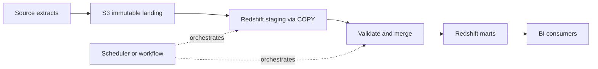
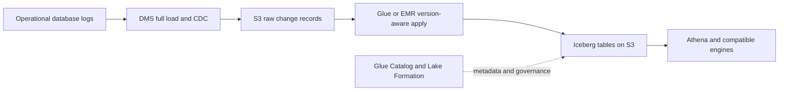
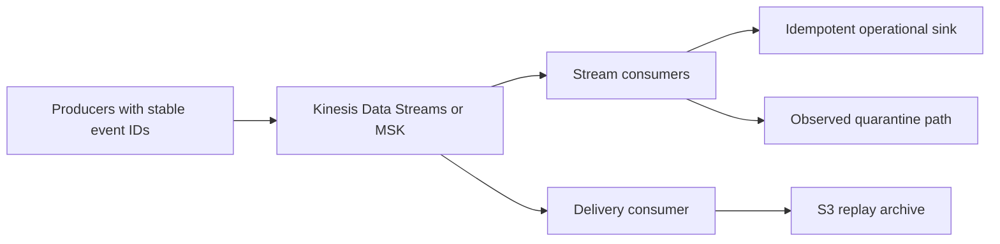

# AWS: Data Engineer Interview Guide

Documentation reviewed: 2026-10-25. Service capabilities, quotas, supported engine versions, regional availability, and pricing can change. Verify them for the deployment you discuss.

AWS interviews test whether you can turn data requirements into a secure, reliable, affordable system. Naming services is a starting point. A strong answer explains data flow, ownership, failure recovery, correctness, and the trade-offs behind each choice.

**A useful interview answer:** “I start with volume, freshness, access patterns, retention, and recovery requirements. Then I separate ingestion, durable storage, processing, orchestration, serving, and governance. I design retries and replay before choosing the final compute service.”

The examples below are teaching examples, not a deployment recipe. SQL dialects are labeled; SQL has not been executed against AWS. Bucket names, account IDs, schemas, and roles are illustrative. Architecture recommendations are worked design examples, rather than AWS service guarantees. This guide uses public documentation and contains no organization-specific access conventions.

## Contents

1. [Cloud Architecture & Fundamentals](#1-cloud-architecture--fundamentals)
2. [Storage & Data Lake](#2-storage--data-lake)
3. [Batch Processing & ETL](#3-batch-processing--etl)
4. [Streaming & Event-Driven Architecture](#4-streaming--event-driven-architecture)
5. [Data Warehousing & Analytics](#5-data-warehousing--analytics)
6. [Data Integration & CDC](#6-data-integration--cdc)
7. [Orchestration & Compute](#7-orchestration--compute)
8. [Databases & Caching](#8-databases--caching)
9. [Monitoring & Cost Optimization](#9-monitoring--cost-optimization)
10. [Infrastructure & Production](#10-infrastructure--production)
11. [Advanced Architecture & Design](#11-advanced-architecture--design)
12. [Interview Practice](#12-interview-practice)

## 1. Cloud Architecture & Fundamentals

### Regions, Availability Zones, and VPCs

A **Region** is a geographic deployment area. An **Availability Zone (AZ)** is an isolated location within a Region, made up of one or more data centers. Multiple AZs support resilience to a local infrastructure failure; another Region provides a separate geographic recovery boundary.

A **VPC** is a regional virtual network. A **subnet** occupies exactly one AZ. Putting resources in two subnets in the same AZ does not provide AZ redundancy. Choose Regions based on data residency, service availability, latency, disaster recovery, and cost. [Amazon VPC concepts](https://docs.aws.amazon.com/vpc/latest/userguide/what-is-amazon-vpc.html)

Distinguish three questions in an architecture discussion:

| Question | What it establishes |
| --- | --- |
| Where is the resource deployed? | Region, AZ, account, and network placement |
| What failure can it survive? | Instance, AZ, or regional failure |
| What must the application do? | Retry, reconnect, replay, fail over, or restore |

Managed infrastructure does not imply every configuration survives an AZ failure. For example, an application still needs to reconnect after database failover and handle uncertain write results.

### Shared Responsibility Model

AWS secures the underlying cloud infrastructure. Customers remain responsible for their data, identities, permissions, and configuration. The division changes with the service: customers patch an EC2 guest OS; AWS manages more of the runtime infrastructure for a managed service. Customers still own application code and data handling. [AWS Shared Responsibility Model](https://aws.amazon.com/compliance/shared-responsibility-model/)

**Interview example:** An encrypted S3 bucket exposed through an overly broad bucket policy is still a customer configuration problem. Encryption does not compensate for granting an unauthorized principal permission to read and decrypt data.

### Well-Architected Framework

The framework has six pillars. Connect each one to a data platform decision:

| Pillar | Data engineering application |
| --- | --- |
| Operational excellence | Versioned deployments, runbooks, clear ownership, safe replay |
| Security | Least privilege, encryption, private connectivity, audit trails |
| Reliability | Durable landing data, checkpoints, tested recovery, bounded retries |
| Performance efficiency | Appropriate engines, pruning, balanced partitions, measured sizing |
| Cost optimization | Cost per useful output, lifecycle policies, idle-capacity reduction |
| Sustainability | Avoiding unnecessary scans, copies, and permanently idle compute |

The pillars expose trade-offs. A second active Region can improve recovery while adding cost, replication work, and operational complexity. [AWS Well-Architected Framework](https://docs.aws.amazon.com/wellarchitected/latest/framework/the-pillars-of-the-framework.html)

### IAM roles, policies, and STS

An **IAM role** is an identity that a trusted principal can assume. Its **trust policy** controls who can assume it. Its **permissions policies** control what the resulting session can do. **AWS Security Token Service (STS)** supplies temporary credentials, including an expiration and session token.

| Policy or control | Main purpose |
| --- | --- |
| Identity policy | Allow or deny actions for an identity |
| Resource policy | Control access to a resource, such as a bucket |
| Role trust policy | Define which principals may assume the role |
| Permissions boundary | Limit permissions an identity can receive |
| Session policy | Restrict a particular temporary session |
| Organizations SCP | Limit permissions available within member accounts |

Access begins denied unless an applicable permission grants it, and an applicable explicit deny wins. Boundaries, session policies, and SCPs constrain access; they do not independently grant it. Actual evaluation depends on the principal and resource-policy form, so avoid reducing every same-account case to a simple policy intersection. [IAM policy types and evaluation](https://docs.aws.amazon.com/IAM/latest/UserGuide/access_policies.html)

Use workload roles for Glue, ECS tasks, EC2, and Lambda. Use federation and temporary sessions for people. Keeping an access key in a notebook or pipeline configuration creates credential rotation and exposure problems.

### Cross-account access

For the common assume-role pattern, a job in account A accesses data in account B as follows:

1. The job runs with a workload role in A.
2. That role is allowed to call `sts:AssumeRole` on a specific role in B.
3. The target role's trust policy accepts the caller, with appropriate conditions.
4. STS returns a temporary session for the role in B.
5. The target role's permissions and applicable resource controls authorize data access.

The target role's trust policy alone does not grant permission to read data. A different pattern grants a role in A direct access through a resource policy in B. Keep these two patterns distinct. For third-party role assumption, an external ID can address the confused deputy problem; it is not a substitute for a narrow trusted principal. [Cross-account role tutorial](https://docs.aws.amazon.com/IAM/latest/UserGuide/tutorial_cross-account-with-roles.html), [Role trust policies](https://aws.amazon.com/blogs/security/how-to-use-trust-policies-with-iam-roles/)

For an SSE-KMS object, S3 authorization and KMS authorization both matter. For a governed table, catalog and Lake Formation permissions may also matter.

### Networking: subnets, routing, NAT, and endpoints

| Component | What it does | Common mistake |
| --- | --- | --- |
| Route table | Selects the next hop for a destination | Assuming a security group creates a route |
| Internet gateway | Enables internet routing for appropriate public resources | Assuming an IPv4 instance can use it without a public address |
| Public NAT gateway | Allows private IPv4 workloads to initiate internet connections | Treating it as an inbound connection path |
| Security group | Stateful traffic filtering on supported resources/interfaces | Forgetting the database must accept the caller's traffic |
| Network ACL | Stateless subnet-level traffic filtering | Blocking return traffic or ephemeral ports |
| DNS | Resolves service and database names | Debugging IAM when the hostname cannot resolve |

A public subnet has a route to an internet gateway. A private subnet has no direct route to an internet gateway; it can still reach the internet through NAT. For a conventional zonal NAT deployment, a NAT gateway per AZ avoids dependence on another AZ, at extra cost. Check the chosen NAT deployment mode rather than assuming one topology fits every environment. [VPC routing](https://docs.aws.amazon.com/vpc/latest/userguide/VPC_Route_Tables.html)

**Gateway endpoints** route S3 or DynamoDB traffic through route-table entries without NAT and have no additional endpoint charge. **Interface endpoints** provide private service connectivity through network interfaces, generally using AWS PrivateLink. They bring endpoint, security-group, DNS, and pricing considerations. Gateway endpoints do not use PrivateLink. An endpoint policy restricts access through the endpoint; it does not replace service authorization. [Gateway endpoints](https://docs.aws.amazon.com/vpc/latest/privatelink/gateway-endpoints.html)

For a private Glue job reaching a database and S3, trace DNS, subnet IP capacity, routes, security groups, endpoint policies, and IAM separately. An S3 endpoint does not give access to every other AWS API that the job uses.

### KMS, encryption, and Secrets Manager

**Encryption in transit** protects network traffic, usually with TLS. **Encryption at rest** protects persisted data. **Envelope encryption** encrypts data with a data key and protects that data key with a higher-level key.

KMS manages cryptographic keys and controls key use. Customer managed keys provide control over policy and lifecycle, with associated charges. Permissions to read a storage object and permissions to use its KMS key are separate concerns. Deleting or disabling a needed key can make otherwise intact data unreadable. [AWS KMS keys](https://docs.aws.amazon.com/kms/latest/developerguide/concepts.html)

Secrets Manager stores and retrieves credentials or tokens and supports rotation. A job role should retrieve only the secrets it needs. Rotation must coordinate the stored secret with the target database or service; updating a secret value alone does not necessarily update the target credential. Cache secrets appropriately and handle refresh after rotation. [Secrets Manager](https://docs.aws.amazon.com/secretsmanager/latest/userguide/intro.html)

**Interview question:** “The Glue job can list a bucket but cannot read its data. What do you check?”

**Answer:** Identify the actual role session, then check object-level S3 permission and policy conditions, explicit denies, KMS decrypt access, and the network endpoint path. If access uses a governed table, also inspect Glue and Lake Formation authorization. Bucket listing and object reading are different actions.

## 2. Storage & Data Lake

### S3 objects, consistency, versioning, and lifecycle

S3 stores objects identified by bucket and key. A prefix resembles a directory but is part of the key. For general purpose buckets, successful object writes, overwrites, deletes, and subsequent reads/listing have strong consistency. This does not provide a transaction across several objects or make an incomplete multi-file dataset safe to publish. [S3 consistency model](https://docs.aws.amazon.com/AmazonS3/latest/userguide/Welcome.html#ConsistencyModel)

**Versioning** preserves separate object versions. An ordinary delete in a versioned bucket generally adds a delete marker; permanently deleting a specific version removes that version. **Lifecycle rules** transition or expire eligible objects and can manage noncurrent versions and incomplete multipart uploads. Retained versions consume storage. Versioning supports recovery, but permissions and retention still determine whether destructive actions are possible. [S3 Versioning](https://docs.aws.amazon.com/AmazonS3/latest/userguide/Versioning.html), [S3 Lifecycle](https://docs.aws.amazon.com/AmazonS3/latest/userguide/object-lifecycle-mgmt.html)

### Storage classes

| Class | Typical use | Trade-off |
| --- | --- | --- |
| S3 Standard | Active landing and frequently queried data | Higher storage cost than colder tiers |
| Intelligent-Tiering | Uncertain or changing access patterns | Object monitoring charges and tier-specific behavior |
| Standard-IA | Infrequently accessed data needing immediate reads | Retrieval charges and minimum billing rules |
| One Zone-IA | Re-creatable infrequent data | Data is stored in one AZ |
| Glacier Instant Retrieval | Rare reads that still require immediate access | Retrieval and retention economics |
| Glacier Flexible Retrieval | Archives that tolerate a restore step | Retrieval delay and charges |
| Glacier Deep Archive | Long-term archives with a long recovery window | Longer restore times and minimum storage duration |
| Express One Zone | Latency-sensitive access in one AZ | Different bucket capabilities and one-AZ placement |

Choose using access frequency, object size, retrieval latency, resilience, and retention. A cheaper storage rate can produce a larger total bill when retrieval and transition charges are included. Do not transition files still needed by an actively queried table into a class requiring restoration. [S3 storage classes](https://docs.aws.amazon.com/AmazonS3/latest/userguide/storage-class-intro.html)

### S3 performance, partitioning, and small files

S3 scales request throughput by prefix. AWS documents at least 3,500 write-class requests and 5,500 read-class requests per second per partitioned prefix; scaling is gradual and bursts can encounter `503 Slow Down`. These are request-rate figures, not a fixed bucket-wide throughput ceiling. Modern S3 does not require random characters at the start of every key. Use parallel requests, retries with backoff, and measurements of network and KMS constraints. [S3 performance guidelines](https://docs.aws.amazon.com/AmazonS3/latest/userguide/optimizing-performance.html)

A common Hive-style layout is:

```text
s3://example-interview-lake/raw/orders/ingest_date=2026-10-25/...
s3://example-interview-lake/curated/orders/order_date=2026-10-25/...
```

The dates have different meanings: arrival date supports ingestion and replay; business date supports analytical filtering. Late events may arrive today for an older business partition.

**Partitioning** reduces the data considered for a query when predicates align with the layout. Avoid high-cardinality keys that create huge numbers of tiny partitions. **Columnar formats** such as Parquet reduce reads of unused columns. Compression and row-group statistics can reduce I/O further.

Small files increase listing, planning, request, and task-scheduling overhead. A million tiny files can be expensive even if their total bytes are modest. Compact files, batch writes, and control writer parallelism. A few hundred MiB per compressed output file can be a starting experiment, not a universal target: balance parallelism, partition volume, latency, and engine behavior. For detailed layout reasoning, see [the Spark guide](spark.md) and [the Iceberg guide](iceberg.md).

### Glue Data Catalog and partition management

The **Glue Data Catalog** stores metadata such as databases, tables, schemas, locations, and Hive-style partitions. It does not store the table's data bytes or automatically make arbitrary files transactional.

For conventional external tables, new files in an existing registered partition usually require no new partition entry. A new partition may require registration. Common approaches are writer-managed catalog updates, explicit partition APIs/DDL, crawlers, or Athena partition projection. Projection computes partition locations from configured rules instead of fetching registered partitions; it is an Athena feature, so do not assume another engine uses it. [Athena partitions](https://docs.aws.amazon.com/athena/latest/ug/partitions.html), [Partition projection](https://docs.aws.amazon.com/athena/latest/ug/partition-projection.html)

Partition indexes accelerate supported Glue partition-metadata lookups. They do not create an index over the table's rows or replace pruning of data files. Index key order, supported predicates, and engine integration matter. [Glue partition indexes](https://docs.aws.amazon.com/glue/latest/dg/partition-indexes.html)

Do not apply Hive partition repair procedures to Iceberg as if it were a directory-based Hive table. Iceberg tracks partition and file membership through its own metadata.

### Lake Formation permissions and governance

Lake Formation adds data lake governance over catalog resources and registered data locations. Depending on engine integration, it supports table, column, row, and cell-level controls, as well as tag-based permission management. IAM still controls relevant service API actions; Lake Formation does not eliminate IAM or KMS. [Lake Formation access control](https://docs.aws.amazon.com/lake-formation/latest/dg/)

Distinguish **permission to register or create metadata at a data location** from **permission to query a table**. A data-location grant is not a general grant to read every table there. Likewise, being an IAM administrator does not automatically make someone a Lake Formation data lake administrator. [Lake Formation permissions](https://docs.aws.amazon.com/lake-formation/latest/dg/lf-permissions-reference.html), [Lake Formation personas](https://docs.aws.amazon.com/lake-formation/latest/dg/permissions-reference.html)

A governance design must close bypass paths. If a consumer has unrestricted direct S3 read access, catalog-level restrictions alone may not protect those bytes. Cross-account sharing must coordinate catalog sharing, Lake Formation grants, consumer integration, and underlying storage/key authorization.

### Apache Iceberg on S3

Iceberg is a table format above data files such as Parquet. Its metadata identifies committed files and snapshots. Writers create files, then atomically publish a new metadata state through an appropriate catalog implementation. Readers use a consistent snapshot, so uncommitted files are not part of the table. These mechanisms support table-level ACID operations; S3 object consistency alone does not supply them. [Iceberg reliability](https://iceberg.apache.org/docs/latest/reliability/)

Glue can run Spark jobs using Iceberg with the Glue catalog. Glue 4.0 and later use optimistic locking by default for the documented integration; older integrations have different requirements. Check the Glue runtime, bundled Iceberg library, catalog client, and reader engines together before enabling features. [Iceberg in AWS Glue](https://docs.aws.amazon.com/glue/latest/dg/aws-glue-programming-etl-format-iceberg.html)

Maintenance includes:

- Compacting small data files and managing delete-file overhead.
- Rewriting manifests when metadata layout harms planning.
- Expiring snapshots according to replay, audit, and reader requirements.
- Removing orphan files only with a retention window safe for active writers.

Snapshot expiration and orphan removal can permanently remove recovery data. Never delete files solely because they look old in S3, and never let a generic lifecycle rule remove files still referenced by retained snapshots. Use engine/table-aware maintenance. [Iceberg maintenance](https://iceberg.apache.org/docs/latest/maintenance/)

**Interview question:** “Why use Iceberg instead of only partitioned Parquet?”

**Answer:** Parquet specifies file encoding. Iceberg adds committed table state, snapshots, concurrent-write coordination, and schema/partition evolution. The benefit is reliable table operations across compatible engines; the cost is metadata, compatibility, and maintenance work.

## 3. Batch Processing & ETL

### AWS Glue Spark jobs and workers

Glue is managed data integration compute, commonly used for Spark ETL alongside the Data Catalog. The driver plans work; executors run distributed tasks. The Glue version determines the Spark/Python environment and bundled integrations. Pin that environment instead of assuming a job behaves identically after a runtime upgrade.

General-purpose **G workers** and memory-oriented **R workers** address different resource needs. Standard DPUs represent compute and memory capacity; memory-optimized workers have a different memory allocation. Worker count, per-worker resources, and available task parallelism jointly determine useful capacity. [Glue worker types](https://docs.aws.amazon.com/glue/latest/dg/worker-types.html)

Adding workers cannot fix a single hot partition, a driver collecting all rows, or a database that permits only a few connections. Inspect Spark execution plans, task duration, shuffle, spill, executor utilization, and driver memory first.

### Bookmarks and incremental processing

Glue bookmarks track progress for supported source readers. For S3, tracking uses object modification information. A modified file can be processed again. For supported JDBC sources, bookmark keys must satisfy the documented ordering requirements. Stable transformation contexts and successful job initialization/commit are part of correct bookmark use. [Glue job bookmarks](https://docs.aws.amazon.com/glue/latest/dg/monitor-continuations.md)

Bookmarks are not an output transaction. If a write succeeds and the job fails before recording progress, the next attempt may repeat output. Resetting or rewinding bookmarks does not clean the target. Pair incremental reads with an output strategy such as a version-aware merge, a transactional partition replacement, or a separate backfill destination.

### Crawlers and schema contracts

A crawler discovers data and infers catalog metadata. It is useful for exploration and heterogeneous landing areas. It is not proof that data matches a business contract. Configure how it handles schema changes, deleted objects, and recrawls; otherwise discovery can make unexpected catalog changes. [Glue crawlers](https://docs.aws.amazon.com/glue/latest/dg/add-crawler.html)

For a controlled curated table, an explicit schema and writer-managed metadata often make changes easier to review. Validate types, required columns, nullability expectations, and malformed records before publishing data. Keep rejected records and diagnostic context without exposing sensitive payloads in logs.

### EMR: EC2, Serverless, and EKS

EMR packages big-data engines and their AWS integrations. The deployment options change who manages capacity and how much control the team retains. [Amazon EMR](https://docs.aws.amazon.com/emr/latest/ManagementGuide/emr-what-is-emr.html)

| Option | Capacity model | Appropriate when | Main operational consideration |
| --- | --- | --- | --- |
| EMR on EC2 | Clusters on selected instances | You need instance, storage, engine, or cluster control | Cluster lifecycle, scaling, patches/configuration, interruptions |
| EMR Serverless | Managed capacity for submitted applications/jobs | You want Spark/Hive processing without managing clusters | Application limits, startup/pre-initialized capacity, job tuning |
| EMR on EKS | EMR jobs on Kubernetes capacity | Your platform already operates EKS and needs shared conventions | Kubernetes capacity, isolation, networking, scheduling |

Serverless removes cluster management, not resource sizing, skew, dependency compatibility, or IAM work. EKS adds little value if the only requirement is to run one periodic Spark job. [EMR Serverless](https://docs.aws.amazon.com/emr/latest/EMR-Serverless-UserGuide/emr-serverless.html), [EMR on EKS](https://docs.aws.amazon.com/emr/latest/EMR-on-EKS-DevelopmentGuide/emr-eks.html)

### ECS/Fargate vs. Lambda vs. Glue vs. EMR

| Service | Useful starting point | What to justify |
| --- | --- | --- |
| Lambda | Small event handlers, lightweight validation, API calls | Runtime mode/limits, payload size, concurrency, downstream capacity |
| ECS on Fargate | Containerized extraction or processing that fits task resources | Task sizing, dependency packaging, retries, output publication |
| Glue | Managed Spark ETL with AWS catalog integration | Runtime compatibility, startup overhead, worker sizing, bookmark semantics |
| EMR | Distributed processing needing EMR engines or more control | Deployment mode, operational burden, utilization, customization |

Fargate supplies container compute; it does not turn one Python process into a distributed engine. Glue and EMR are often appropriate when processing needs distributed joins or shuffles. A modest file transformation may be simpler in one container. [Fargate task model](https://docs.aws.amazon.com/AmazonECS/latest/developerguide/AWS_Fargate.html)

### Distributed processing, resource sizing, and autoscaling

Size based on the workload's bottleneck, not input bytes alone. A compressed input may expand substantially; a join may create much more shuffle than the source size suggests.

| Symptom | Investigate before adding capacity |
| --- | --- |
| One task runs far longer than the rest | Skewed join/partition keys, unsplittable inputs |
| Executors spill heavily | Partition size, join strategy, memory pressure |
| Driver runs out of memory | Large collect operations, file/partition metadata, oversized plans |
| Low CPU with long runtime | Network, source throttling, too few tasks, storage latency |
| Too many output files | Writer parallelism and output partition cardinality |

Glue Auto Scaling adjusts executors within configured limits for supported job types and versions. It can reduce idle resources between stages. It cannot split an indivisible task or overcome a source bottleneck. Benchmark with representative skew and output volume. [Glue Auto Scaling](https://docs.aws.amazon.com/glue/latest/dg/auto-scaling.html)

### Orchestration, retries, and idempotency

Treat a run as a logical unit such as `orders / business_date=2026-10-24 / input_version=7`. Keep its input range and output identity stable across retries.

A robust batch publication pattern is:

1. Resolve the input range and schema version.
2. Write output to an isolated attempt location or uncommitted table files.
3. Validate counts, required fields, uniqueness, and business checks.
4. Publish through a transactional table commit or an explicit manifest/pointer protocol.
5. Record completion and notify consumers only after publication succeeds.

For plain S3 files, moving or copying many objects is not an atomic directory rename. Every consumer must honor the publication protocol. With Iceberg, use its supported commit path rather than inventing a second file-membership mechanism.

Retry transient throttling and connectivity errors with backoff and jitter. Bound retries and total elapsed time. Quarantine invalid data; repeated execution cannot repair an incompatible schema or a permanently denied permission.

**Interview question:** “A Spark job failed after writing half its files. Can you just retry?”

**Answer:** Only after identifying how readers distinguish committed output from partial attempts. A retry must neither duplicate previously published rows nor expose mixed old/new data. Use the table's transaction mechanism or an agreed publication protocol, and clean abandoned attempts safely.

## 4. Streaming & Event-Driven Architecture

### Kinesis Data Streams

Kinesis Data Streams is a retained record stream with shards, partition keys, sequence numbers, and consumers. A partition key determines shard placement. Retention supports replay; checkpoints record consumer progress. Provisioned and on-demand capacity modes change capacity management, but a badly skewed key can still constrain throughput. [Kinesis concepts](https://docs.aws.amazon.com/streams/latest/dev/key-concepts.html)

Ordering is scoped to a shard's record sequence, not the entire stream or arbitrary business-event time. Producer concurrency, batching, and retries affect observed ordering. A retry after an uncertain acknowledgment can create duplicate records with different sequence numbers. Carry a stable business event ID when duplicates matter. [Kinesis duplicate handling](https://docs.aws.amazon.com/streams/latest/dev/kinesis-record-processor-duplicates.html)

Use a key such as customer or device ID when that entity's order matters. One constant key creates a hotspot; a random key spreads load but loses entity affinity. This is a throughput/correctness trade-off, not simply a naming decision.

### Amazon Data Firehose

Amazon Data Firehose, formerly Kinesis Data Firehose, delivers buffered data to supported destinations. For S3, buffering combines incoming records into objects. Smaller buffers reduce latency but can increase small-file overhead. For Redshift delivery, Firehose stages data in S3 and then issues `COPY`. [Firehose delivery](https://docs.aws.amazon.com/firehose/latest/dev/basic-deliver.html)

Firehose suits managed delivery and supported transformations/conversions; Kinesis Data Streams suits applications that need independent consumers, retained-log replay, and application-owned stream processing. Delivery retries can produce duplicates on documented delivery paths, so verify destination-specific semantics and preserve stable IDs. Firehose is not a general replacement for a transactional stream processor. [Firehose delivery guarantees](https://docs.aws.amazon.com/firehose/latest/dev/basic-deliver.html)

### Amazon MSK and Kafka Connect

MSK manages Apache Kafka infrastructure. Topics contain partitions; ordering is per partition. Consumer groups divide partition processing among consumers. More consumers than assigned partitions do not create more active partition readers within the group.

Kafka Connect uses **source connectors** to bring data into Kafka and **sink connectors** to deliver it elsewhere. MSK Connect manages compatible connector workers and scaling. Connector support, error handling, offsets, schema conversion, and destination behavior remain part of the design. [MSK Connect](https://docs.aws.amazon.com/msk/latest/developerguide/msk-connect.html)

Kafka's idempotent producers and transactions address particular Kafka boundaries. They do not automatically make a write to an external database or S3 happen exactly once. Choose MSK when Kafka compatibility, its connector ecosystem, or existing Kafka operations matter; compare that value with the operational and cost model. See [the Kafka guide](kafka.md) for partitioning and transaction details.

### SQS, SNS, and EventBridge

| Service | Core abstraction | Typical data engineering use |
| --- | --- | --- |
| SQS | Queue with acknowledgment/deletion | Buffer work and absorb downstream outages |
| SNS | Publish/subscribe topic | Fan out a notification to independent subscribers |
| EventBridge | Event routing and integrations | Route service/business events to workflows or targets |
| Kinesis/MSK | Retained partitioned log | Replay events and support independent stream consumers |

SQS Standard delivers at least once and can deliver out of order. Receiving a message hides it for a visibility interval; deletion acknowledges successful handling. Visibility timeout is not a lock that prevents every duplicate. FIFO queues provide ordering within a message group and send deduplication within their documented window, but consumers still need safe side effects. [SQS Standard](https://docs.aws.amazon.com/AWSSimpleQueueService/latest/SQSDeveloperGuide/standard-queues.html), [SQS FIFO delivery](https://docs.aws.amazon.com/AWSSimpleQueueService/latest/SQSDeveloperGuide/FIFO-queues-understanding-logic.html), [FIFO deduplication](https://docs.aws.amazon.com/AWSSimpleQueueService/latest/SQSDeveloperGuide/FIFO-queues-exactly-once-processing.html)

SNS fans a publication out to subscribers. SNS-to-SQS gives each consumer its own durable backlog and failure isolation; several workers on one queue instead compete for that queue's messages. [Amazon SNS](https://docs.aws.amazon.com/sns/latest/dg/welcome.html)

EventBridge routes events using the selected bus and integration model. For classic rule/target event buses, do not assume ordering. Retention, replay, and ordering capabilities depend on the bus type and configuration; verify these rather than treating every EventBridge mode as identical. [Amazon EventBridge](https://docs.aws.amazon.com/eventbridge/latest/userguide/eb-what-is.html)

### Lambda event sources, batching, retries, and DLQs

The invocation model determines retry behavior:

| Invocation path | Who drives retries? | Failure destination to understand |
| --- | --- | --- |
| Synchronous caller | Caller/client integration | Caller-specific recovery |
| Asynchronous invocation | Lambda's asynchronous queue | Configured on-failure destination or async DLQ |
| SQS event source mapping | Lambda polling plus queue visibility/redrive | Source queue's redrive DLQ |
| Kinesis/DynamoDB Streams mapping | Stream polling/checkpoint behavior | Mapping retry/age limits and supported failure destination |
| Kafka/MSK mapping | Mapping and consumer offset behavior | Kafka mapping-specific failure settings |

Do not assume the function's asynchronous DLQ catches failures from every source. Check the source mapping or caller's configuration. [Lambda invocation](https://docs.aws.amazon.com/lambda/latest/dg/lambda-invocation.html)

For SQS, a failed batch normally makes all its messages eligible for delivery again. Configure partial batch responses to report failed message IDs so successful records do not needlessly repeat. With FIFO processing, preserve message-group ordering when deciding which records to stop processing and return as failures. [SQS batch failure handling](https://docs.aws.amazon.com/lambda/latest/dg/services-sqs-errorhandling.md)

Set queue visibility long enough for processing and retries. AWS recommends at least six times the function timeout, plus the batching window where applicable. The function timeout cannot exceed queue visibility when configuring the mapping. Monitor the queue's oldest-message age and DLQ depth, not just invocation failures. [SQS mapping configuration](https://docs.aws.amazon.com/lambda/latest/dg/services-sqs-configure.md)

### Ordering, delivery guarantees, and backpressure

**At-most-once** allows loss but avoids repeat delivery. **At-least-once** permits duplicate processing. **Exactly-once effects** means the visible business result changes once for each logical event, even when execution repeats.

Exactly-once effects require cooperation at the sink: for example, an atomic transaction that stores a unique event ID and applies its mutation, or a conditional update that rejects an older source version. Storing a “processed” marker separately from an irreversible side effect leaves a crash gap.

**Backpressure** occurs when arrival exceeds processing capacity. The backlog grows until service recovers, retention expires, or storage limits are reached. If arrivals are 8,000 records/s and sustainable processing is 6,000 records/s, backlog grows by 2,000 records/s. Once arrival drops to 4,000, the 2,000 records/s surplus drains it. Recovery estimates must include new traffic.

Monitor consumer lag/iterator age, throttling, oldest-message age, sink latency, and poison records. Increasing consumers helps only when stream partitions, ordering requirements, and destination capacity permit more parallelism.

**Interview question:** “Why is queue age rising while Lambda errors stay low?”

**Answer:** Successful invocations may still process more slowly than events arrive. Check concurrency limits, batching, average duration, source parallelism, and downstream throttling. A zero error count does not demonstrate adequate throughput.

## 5. Data Warehousing & Analytics

### Redshift architecture, RA3, and Serverless

Redshift is a columnar, massively parallel analytical database. In the provisioned architecture, the leader plans and coordinates queries while compute nodes execute distributed work. Rows are spread across compute slices. Large scans and joins benefit from parallelism; skew and redistribution can dominate runtime. Redshift has PostgreSQL ancestry but different SQL, storage, and operational behavior. [Redshift architecture](https://docs.aws.amazon.com/redshift/latest/dg/c_high_level_system_architecture.html)

**RA3** nodes use managed storage, separating compute sizing from durable storage growth. Local SSDs cache data while managed storage uses S3. RA3 is an important interview topic, but it is not the only current node family; discuss the selected generation explicitly. [Provisioned node and storage options](https://docs.aws.amazon.com/redshift/latest/mgmt/working-with-clusters.html)

**Redshift Serverless** manages capacity using workgroups and namespaces. It reduces cluster administration, but queries, data layout, storage, workload limits, and cost controls still need design. Compute is billed differently from provisioned clusters, and persisted storage has its own cost. [Redshift Serverless](https://docs.aws.amazon.com/redshift/latest/mgmt/serverless-whatis.html)

### Distribution styles

| Style | Behavior | Typical trade-off |
| --- | --- | --- |
| EVEN | Spreads rows without a distribution key | Balanced storage, but joins can move data |
| KEY | Hashes rows by a column | Collocates compatible joins, but skew can overload slices |
| ALL | Replicates the table across compute nodes | Useful for small dimensions, at a storage/load cost |
| AUTO | Lets Redshift select and adjust the strategy | A strong default; still inspect workload behavior |

Choose a manual key based on large, frequent joins and balanced key distribution. A highly repeated null/default key or one dominant tenant can create skew. Read the query plan for redistribution rather than assuming that declaring a key guarantees a local join. [Redshift distribution](https://docs.aws.amazon.com/redshift/latest/dg/t_Distributing_data.html)

### Sort keys, statistics, and materialized views

Sort order helps Redshift skip blocks using min/max metadata. It is not a B-tree index. Compound keys favor predicates using the leading columns; interleaved keys support different predicate combinations but bring maintenance trade-offs. `SORTKEY AUTO` is a sensible starting point before workload evidence justifies a manual key. [Redshift sort keys](https://docs.aws.amazon.com/redshift/latest/dg/t_Sorting_data.html)

Statistics help estimate row counts and choose joins. Deletes and updates affect physical organization; understand automatic maintenance and when targeted analyze/vacuum work is needed. Always compare estimated and actual behavior before changing schema based on one slow query.

Materialized views store precomputed query results. They can accelerate repeated joins and aggregates, but freshness depends on refresh behavior. Incremental refresh and automatic query rewrite have eligibility rules. Include storage and refresh work in the cost calculation. [Redshift materialized views](https://docs.aws.amazon.com/redshift/latest/dg/materialized-view-overview.html)

### Spectrum, COPY, and UNLOAD

**Spectrum** queries supported external data in S3 through external metadata, and can join it with internal Redshift tables. It avoids loading every byte into internal tables, but file format, partition pruning, and external scan behavior still matter. An external table reference is not a copy of its data. [Spectrum external tables](https://docs.aws.amazon.com/redshift/latest/dg/c-spectrum-external-tables.html)

**COPY** loads data into Redshift tables in parallel. Prefer it to individual client inserts for bulk ingestion. It appends rows; rerunning a load is not inherently idempotent. A controlled file manifest, staging table, validation, and transactional merge can support safe retries. [Redshift COPY](https://docs.aws.amazon.com/redshift/latest/dg/r_COPY.html)

Redshift SQL, assuming `staging.orders` exists and the warehouse has an appropriate default IAM role:

```sql
COPY staging.orders
FROM 's3://example-interview-lake/load/orders/batch-0042/'
IAM_ROLE default
FORMAT AS PARQUET;
```

**UNLOAD** exports query results to S3, including Parquet output. Multiple files support parallel output; consumers must use the intended run's files rather than repeatedly ingesting all historical export prefixes. [Redshift UNLOAD](https://docs.aws.amazon.com/redshift/latest/dg/r_UNLOAD.html)

### Athena, SQL engines, and partition pruning

Athena provides serverless SQL over supported data sources, commonly files in S3 with Glue metadata. Its SQL engine has Presto/Trino lineage; engine version 3 incorporates Trino improvements. Athena is an AWS-managed engine, not a promise of feature parity with an arbitrary upstream Trino release. [Athena engine version 3](https://docs.aws.amazon.com/athena/latest/ug/engine-versions-reference-0003.html)

For a Hive-style external table, filter the actual partition columns. Filtering only a timestamp column does not necessarily prune a separate date partition. Iceberg can derive pruning through supported partition transforms. Inspect bytes scanned and the plan instead of inferring pruning from a short result set.

Athena SQL, assuming `order_date` is a string partition column:

```sql
SELECT customer_id, SUM(amount) AS total_amount
FROM curated.orders
WHERE order_date = '2026-10-24'
  AND event_time >= TIMESTAMP '2026-10-24 00:00:00'
  AND event_time < TIMESTAMP '2026-10-25 00:00:00'
GROUP BY customer_id;
```

`LIMIT 10` limits returned rows; it does not guarantee a small scan. Column selection, compression, columnar formats, partitions, and file statistics determine much of the I/O. Use workgroups to isolate workloads and enforce appropriate query controls. [Athena partitioning](https://docs.aws.amazon.com/athena/latest/ug/partitions.html)

### Athena vs. Redshift vs. EMR vs. Glue

| Workload | Candidate | Reason to consider another option |
| --- | --- | --- |
| Occasional exploration of S3 data | Athena | Frequent repeated scans or strict BI latency |
| Repeated BI joins with controlled performance | Redshift | Low utilization or predominantly raw lake exploration |
| Managed Spark transformation pipeline | Glue | Specialized engine/configuration requirements |
| Custom distributed processing and engine control | EMR | Team does not need the added control/operations |

This is a starting hypothesis, not a size-based rule. Redshift can query lake data, Athena can perform supported table writes, and both Glue and EMR can run Spark. Benchmark the actual joins, concurrency, freshness, and operating model.

**Interview question:** “Athena is serverless. Why pay for Redshift?”

**Answer:** Repeated queries may benefit from warehouse storage layout, reusable results, materialized views, and workload management. Compare total cost and measured latency under concurrency, including ingestion and maintenance, rather than comparing only the infrastructure label.

## 6. Data Integration & CDC

### DMS full load, CDC, and replication tasks

AWS Database Migration Service moves data from supported sources to supported targets. In the conventional replication-instance model, source and target endpoints describe connections; a replication task defines table selection, transformations, and execution behavior. DMS also has a serverless replication model, so distinguish the deployment being discussed.

| Mode | What it does | What to plan |
| --- | --- | --- |
| Full load | Copies existing rows | Source impact, parallelism, LOB handling, consistency boundary |
| CDC only | Reads changes from a valid source position | Log availability, starting position, compatible initial state |
| Full load plus CDC | Loads existing rows, applies captured changes, continues replication | Initial synchronization, retained logs, table readiness |

A full-load-plus-CDC pipeline must retain source changes while initial copying runs. A completed copy is not the same as a fully caught-up target. Snapshot and transaction behavior depend on the source/target and task settings; do not claim every table starts from one globally consistent instant. [DMS tasks](https://docs.aws.amazon.com/dms/latest/userguide/CHAP_Tasks.html)

### Endpoints, transformations, and latency

Endpoint configuration includes connection details, security, network reachability, and target-specific options. Test connectivity from the replication environment. CDC also needs database configuration: appropriate log mode/retention, replication privileges, and enough row identity to apply changes safely.

Selection rules choose tables. Transformation rules can rename schemas/tables/columns and make supported structural changes. DMS transformations are not a general replacement for arbitrary business joins or Spark ETL. [DMS table mappings](https://docs.aws.amazon.com/dms/latest/userguide/CHAP_Tasks.CustomizingTasks.TableMapping.html)

Monitor `CDCLatencySource`, `CDCLatencyTarget`, table statistics, task logs, throughput, and replication resource pressure. Both latency values high suggest investigating source capture first; target latency high while source latency is low points toward apply/destination work. Large open transactions and idle-source behavior affect interpretation. Neither metric proves downstream curated tables are fresh. [DMS monitoring](https://docs.aws.amazon.com/dms/latest/userguide/CHAP_Monitoring.html)

### DMS to S3, Kinesis, and MSK

| Target | Output model | Downstream responsibility |
| --- | --- | --- |
| S3 | Full-load/CDC files using configured formats and layout | Interpret operations, order, duplicates, and table state |
| Kinesis Data Streams | Change records mapped into a stream | Key design, consumer checkpoints, deduplication, sink updates |
| Kafka/MSK | Change records mapped into topics/partitions | Topic/key design, offsets, schema contracts, sink behavior |

DMS files in S3 do not automatically become a current-state analytical table. Inserts, updates, and deletes must be applied according to source identity and ordering. If S3 CDC transaction preservation is required, `PreserveTransactions` with `CdcPath` has specific constraints, including CSV output for the transaction-preserving path. Do not assume ordinary Parquet output preserves cross-table transaction order. [DMS S3 target](https://docs.aws.amazon.com/dms/latest/userguide/CHAP_Target.S3.html)

For Kinesis and Kafka, mapping and partition-key choices affect ordering and parallelism. A database transaction spanning several target partitions is not automatically applied atomically by independent consumers. [DMS Kinesis target](https://docs.aws.amazon.com/dms/latest/userguide/CHAP_Target.Kinesis.html), [DMS Kafka/MSK target](https://docs.aws.amazon.com/dms/latest/userguide/CHAP_Target.Kafka.html)

### Schema evolution, deduplication, and reconciliation

Keep a CDC envelope with source table, primary key, operation, source position/version, and ingestion metadata. Use a source ordering value with documented scope; timestamps alone may collide or arrive out of order. A position from one source partition may not be comparable with a position from another.

For a current-state table, a robust rule is: apply an event only if its source version is newer than the stored version. Record delete versions as tombstones or equivalent durable state until older events can no longer arrive. Otherwise, a late insert can resurrect a deleted row.

Schema changes need a compatibility policy. Adding a nullable column differs from changing a numeric type, dropping a key, or renaming a field. Preserve raw events, validate changes before publishing, and route incompatible records to an observable quarantine. Validate source/target-specific DMS DDL support rather than assuming every schema change propagates.

**Reconciliation** compares source and target at a meaningful shared boundary: row counts, key coverage, totals, checksums, and sampled records. For a changing source, compare an aligned snapshot or source position; comparing two live counts at different times can report false discrepancies. DMS validation support varies by endpoint and task. [DMS validation](https://docs.aws.amazon.com/dms/latest/userguide/CHAP_Validating.html)

### Migration, backfills, and exactly-once effects

A migration needs an explicit cutover procedure:

1. Establish initial load and ongoing replication.
2. Monitor catch-up and reconcile data.
3. Coordinate a final write boundary or controlled source pause if required.
4. Confirm changes through that boundary are applied.
5. Switch consumers, validate, and keep a defined rollback window.

Backfills should have explicit ranges, source versions, and precedence relative to live CDC. A historical snapshot must not overwrite newer CDC state merely because the backfill finishes later. Use version-aware merges, separate tables followed by a controlled swap, or another documented reconciliation strategy.

At-least-once transport can produce exactly-once effects when the target atomically deduplicates and mutates state. A DMS task, stream checkpoint, or Glue bookmark alone cannot guarantee that end-to-end property.

**Interview question:** “How would you maintain an Iceberg table from database CDC?”

**Answer:** Preserve raw changes, validate schema and keys, order/deduplicate by a valid source version, merge into the table transactionally, and retain delete/version information against stale replay. Track applied source progress, reconcile against the source, and operate compaction and snapshot retention separately from ingestion.

## 7. Orchestration & Compute

### MWAA and Step Functions

MWAA runs managed Apache Airflow environments. It fits Python DAGs, dependency management, scheduled data intervals, and workflows spanning many systems. Keep heavy data processing on appropriate external compute; passing huge datasets through the scheduler or task metadata store harms orchestration. An Airflow task should know which data interval it is processing, independent of the wall clock when a retry runs. [Amazon MWAA](https://docs.aws.amazon.com/mwaa/latest/userguide/what-is-mwaa.html)

Step Functions defines state-machine workflows with service integrations, branching, retries, catches, and supported wait/callback patterns. It is useful when the workflow naturally coordinates AWS APIs and jobs.

| Choice | Useful distinction |
| --- | --- |
| Step Functions Standard | Durable, auditable workflows; up to one year; supports documented job-wait/callback integrations |
| Asynchronous Express | Short, high-volume workflows; up to five minutes; at-least-once execution |
| Synchronous Express | Request/response execution; at-most-once workflow execution semantics |
| MWAA | Airflow ecosystem, Python DAGs, data scheduling/backfill workflows |

Standard's exactly-once workflow model does not make every remote side effect exactly once: explicit retries, ambiguous API results, and manual redrives still require care. Express does not support the same `.sync` and callback integration patterns as Standard. [Step Functions workflow types](https://docs.aws.amazon.com/step-functions/latest/dg/choosing-workflow-type.html)

### EventBridge schedules and event-driven workflows

EventBridge Scheduler invokes supported targets using one-time, rate, or cron schedules, with configured retry and dead-letter behavior. Specify timezone, daylight-saving expectations, flexible windows, and overlapping-run policy. A daily trigger does not itself define which business-date interval the job should process. [EventBridge Scheduler](https://docs.aws.amazon.com/scheduler/latest/UserGuide/what-is-scheduler.html)

Event-driven workflows reduce polling latency but must tolerate duplicate, delayed, or reordered notifications as applicable to the source. A file-arrival event says that a file exists; it does not prove all files for a dataset have arrived. Use a manifest, completeness condition, or producer-owned completion event before publishing a multi-file batch.

### Lambda concurrency, timeouts, and cold starts

Concurrency is the number of executions running at once. As a planning approximation:

```text
required concurrency ≈ requests per second × average execution seconds
```

At 200 requests/s and 0.5 seconds per request, steady-state demand is about 100 executions. This approximation excludes bursts, retries, batching, and source-specific scheduling.

**Reserved concurrency** reserves capacity for a function and caps its concurrency; it does not pre-initialize execution environments. **Provisioned concurrency** maintains initialized environments to reduce initialization latency, with an additional cost. Cold starts involve preparing a new execution environment; dependency size and initialization work affect their impact. [Lambda concurrency](https://docs.aws.amazon.com/lambda/latest/dg/lambda-concurrency.html)

For conventional Lambda functions, the per-invocation timeout is up to 15 minutes and memory can reach 10,240 MB; account limits and other execution modes differ. Current documentation includes Lambda Managed Instances with different duration rules, so identify the mode instead of calling 15 minutes a universal limit for every Lambda product. Increasing conventional Lambda memory also changes available CPU. [Lambda quotas](https://docs.aws.amazon.com/lambda/latest/dg/gettingstarted-limits.html)

Cap concurrency based on the downstream system. Hundreds of successful starts can overwhelm a small database's connection limit. Reuse connections where appropriate, use pooling/proxies, and make timed-out operations safe to retry.

### ECS/Fargate, EKS, and AWS Batch

ECS schedules containers; Fargate is a compute option that removes host management. Use standalone tasks for finite jobs and services for continuously running workloads. Distinguish the **task role**, used by application code, from the **task execution role**, used for actions such as pulling images and delivering logs. [ECS task IAM roles](https://docs.aws.amazon.com/AmazonECS/latest/developerguide/task-iam-roles.html)

EKS manages a Kubernetes control plane. It fits teams that need Kubernetes APIs, scheduling conventions, and a broader container platform. The team still owns workload configuration, capacity choices, upgrades, and isolation decisions appropriate to its mode.

AWS Batch adds job queues, scheduling, dependencies, retries, and compute-environment management for batch workloads. It can use supported ECS/EC2, Fargate, or EKS arrangements. It does not supply Spark semantics to an arbitrary container. [AWS Batch](https://docs.aws.amazon.com/batch/latest/userguide/what-is-batch.html)

### Cross-service failure handling

Pass identifiers and storage locations between services, rather than large datasets. Track a logical run ID and external job ID. If a “start job” request times out, determine whether a job started before submitting another one; use service-supported idempotency tokens when available.

Define per-task timeouts, total workflow deadlines, retryable errors, cleanup behavior, and ownership of cancellation. A failed orchestrator task does not necessarily terminate the remote job. A timed-out caller does not prove a remote transaction failed.

**Interview question:** “When would you choose MWAA over Step Functions?”

**Answer:** When Airflow's DAG ecosystem, Python workflow development, data intervals, and cross-system scheduling/backfills fit the team's needs. For an AWS-focused state machine with explicit API/job integrations, Step Functions may be simpler. Compare dependencies, execution duration, operations, and cost, not just syntax.

## 8. Databases & Caching

### RDS and Aurora: replication, backups, and performance

RDS manages relational database infrastructure, but customers still design schemas, indexes, queries, connection usage, and recovery. Operational extraction can harm OLTP performance through long scans, locks, replica lag, or retained transaction logs.

In a conventional **RDS Multi-AZ DB instance deployment**, a synchronous standby supports failover and does not serve read traffic. Read replicas generally provide asynchronous read scaling. **Multi-AZ DB clusters** are a different architecture and can have readable instances; do not generalize the single-standby limitation to every RDS deployment. [RDS Multi-AZ instance deployments](https://docs.aws.amazon.com/AmazonRDS/latest/UserGuide/Concepts.MultiAZSingleStandby.html)

Aurora separates compute from a distributed storage layer replicated across AZs. Reader instances can support reads and failover, but applications still need retry/reconnection behavior. Multi-AZ storage durability does not mean a query always has an immediately available replacement compute instance. [Aurora high availability](https://docs.aws.amazon.com/AmazonRDS/latest/AuroraUserGuide/Concepts.AuroraHighAvailability.html)

Automated backups and point-in-time recovery help restore data to a new database environment. Replication serves availability or read scaling; it can replicate accidental changes and is not a replacement for retained backups. Test restores, credential access, and connection switching. [RDS backups](https://docs.aws.amazon.com/AmazonRDS/latest/UserGuide/CHAP_CommonTasks.BackupRestore.html)

For slow reads, examine query plans, indexes, lock waits, I/O, working-set memory, and connection pressure. A larger instance can hide an inefficient query temporarily without fixing its scaling behavior.

### DynamoDB keys and GSIs

DynamoDB is a key-value/document database designed around explicit access patterns. A table has a partition key and optionally a sort key. The partition key influences data distribution; the sort key supports ordered/ranged access within a partition-key value.

Example access pattern: retrieve orders for one customer over a time range. A model might use customer ID as partition key and a sortable time/order identifier as sort key. A very large tenant can create a hot key; splitting that key improves distribution but makes reads fan out.

A **global secondary index (GSI)** provides another key-based access path. Its projected attributes consume storage and writes, and its updates are asynchronous. A `Query` uses key conditions; a filter expression is applied after items are read and does not make a broad read cheap. A `Scan` is usually a poor substitute for missing key design. [DynamoDB partition design](https://docs.aws.amazon.com/amazondynamodb/latest/developerguide/bp-partition-key-design.html), [DynamoDB query filtering](https://docs.aws.amazon.com/amazondynamodb/latest/developerguide/Query.FilterExpression.html)

### DynamoDB consistency and capacity

Base tables and local secondary indexes support eventually consistent or strongly consistent reads. GSIs and streams support eventual reads. A successful write does not guarantee an immediate GSI query reflects it. Strong reads are not a transaction covering several independently read items. Global-table consistency options have their own configuration and regional constraints; avoid blanket claims about every global-table mode. [DynamoDB read consistency](https://docs.aws.amazon.com/amazondynamodb/latest/developerguide/HowItWorks.ReadConsistency.html)

**On-demand** capacity reduces throughput provisioning work. **Provisioned** capacity sets read/write units and can use autoscaling. Request cost depends on operation, item size, and consistency; transactions have separate consumption rules. Neither mode removes hot-key or service-limit concerns. Conditional writes can implement optimistic concurrency and deduplication; transactions can atomically coordinate supported item mutations. [DynamoDB capacity modes](https://docs.aws.amazon.com/amazondynamodb/latest/developerguide/capacity-mode.html)

### ElastiCache and caching patterns

ElastiCache offers managed in-memory caching with Valkey, Redis OSS, and Memcached options. Know which engine and deployment mode are in use rather than referring to every cache as Redis. [Amazon ElastiCache](https://docs.aws.amazon.com/AmazonElastiCache/latest/dg/WhatIs.html)

| Pattern | Flow | Main failure/correctness concern |
| --- | --- | --- |
| Cache-aside | Read cache; on miss read source and populate | Staleness and many simultaneous misses |
| Write-through | Update authoritative storage and cache in the write path | Coordinating failures and write latency |
| Write-behind | Buffer writes and apply them later | Loss/reordering if the buffer or flush fails |
| TTL-based caching | Expire values after a chosen interval | Staleness window and synchronized expiry |

Set TTLs from acceptable staleness, use jitter to spread expirations, and consider request coalescing to avoid stampedes. Design invalidation around concurrent updates. Treating a cache as the only copy of irreplaceable data requires a very different durability design.

### Connectivity, pooling, and networking

Database access needs working DNS, routes, security groups, authentication, and TLS configuration. Check database connection limits against the maximum parallel workers, not just normal traffic. A Spark JDBC read with hundreds of partitions can create hundreds of concurrent database queries.

Use bounded connection pools, connection reuse, and a supported proxy where useful. RDS Proxy can pool connections, but transaction/session behavior can reduce reuse. Refresh credentials correctly after rotation and reconnect after failover. Keep extraction concurrency within the source's capacity. [RDS Proxy](https://docs.aws.amazon.com/AmazonRDS/latest/UserGuide/rds-proxy.html)

**Interview question:** “A Lambda deployment caused database connection failures. Why?”

**Answer:** Scaling application concurrency may have multiplied connections beyond the database limit. Inspect active connections, function concurrency, connection reuse, idle sessions, and proxy/pool behavior. Cap demand and repair the connection lifecycle before simply raising limits.

## 9. Monitoring & Cost Optimization

### CloudWatch metrics, logs, and alarms

Metrics are time-series measurements; logs preserve detailed events; alarms evaluate conditions and notify or trigger actions. Dimensions identify metric series, so a high-cardinality field such as request ID is usually better in logs than as a metric dimension. Choose periods, percentiles, and missing-data handling that match the failure you need to detect. [CloudWatch metric concepts](https://docs.aws.amazon.com/AmazonCloudWatch/latest/monitoring/cloudwatch_concepts.html)

Monitor platform health and data outcomes together:

| Layer | Useful signals |
| --- | --- |
| Ingestion | Source lag, input volume, missing partitions, oldest event |
| Processing | Duration, retries, skew, spill, executor failures |
| Streaming | Consumer lag, iterator age, throttling, backlog growth |
| Serving | Query latency, queue time, errors, concurrency |
| Data quality | Uniqueness, null rates, reconciliation, rejected rows |
| Business freshness | Time since the latest successfully published data interval |

A job can exit successfully while processing no new data. A useful freshness alarm checks the published dataset, not only whether the scheduler ran. Include run IDs, source positions, and input/output ranges in structured logs, while excluding secrets and unnecessary personal data.

### CloudTrail, Config, and operational auditing

CloudTrail records AWS activity such as API calls and the acting identity. Management events and data events have different coverage and configuration. Default event history does not mean every S3 object read is recorded; configure required data events and long-term storage explicitly. [AWS CloudTrail](https://docs.aws.amazon.com/awscloudtrail/latest/userguide/cloudtrail-user-guide.html)

AWS Config records supported resource configurations and relationships and can evaluate compliance rules. It answers questions about how a recorded resource was configured over time. CloudWatch answers operational questions; CloudTrail answers activity questions; Config answers configuration-history questions. [AWS Config](https://docs.aws.amazon.com/config/latest/developerguide/WhatIsConfig.html)

### Cost Explorer, Budgets, and tagging

Cost Explorer analyzes usage and spend by dimensions such as account, service, and activated cost-allocation tags. Use it to find the dominant cost before optimizing individual tasks. [Cost Explorer](https://docs.aws.amazon.com/cost-management/latest/userguide/ce-what-is.html)

Budgets tracks actual/forecast costs or usage and can notify or run configured actions. Cost data and alerts have processing delays. A budget is not an instantaneous hard spending cap. [AWS Budgets](https://docs.aws.amazon.com/cost-management/latest/userguide/budgets-managing-costs.html)

Tag resources with owner, environment, workload, and cost center where supported. Use workload metadata or allocation rules for shared costs that resource tags cannot separate. Measure cost per processed GiB, successful run, useful query, or fresh dataset interval; a low monthly bill can simply reflect missing work.

### Spot, On-Demand, and Savings Plans

| Option | Economic model | Suitable workload |
| --- | --- | --- |
| On-Demand | Pay for selected capacity without a long commitment | New, variable, or noninterruptible demand |
| Spot | Discounted spare capacity that may be interrupted | Replayable, checkpointed, flexible compute |
| Savings Plans | Discount in exchange for a one- or three-year hourly spend commitment | Predictable baseline of eligible usage |

Spot needs interruption-aware scheduling, durable checkpoints, and enough time/capacity to retry. Separate expendable workers from stateful components whose loss has a larger effect. [EC2 Spot Instances](https://docs.aws.amazon.com/AWSEC2/latest/UserGuide/using-spot-instances.html)

Compute Savings Plans cover eligible EC2, Fargate, and Lambda usage under the plan's rules. They are not a universal discount for Glue, EMR service charges, Redshift, storage, or networking. A spending commitment does not itself reserve physical capacity. Check plan scope and utilization before buying. [Savings Plans](https://docs.aws.amazon.com/savingsplans/latest/userguide/what-is-savings-plans.html)

### Serverless vs. provisioned economics

Serverless often helps intermittent work by reducing idle capacity and administration. Consistently busy workloads may favor provisioned resources with high utilization and suitable commitments. Include startup/pre-initialization, minimum billing units, managed-service charges, and engineering time.

A useful cost model is:

```text
total cost = compute + storage + requests + network transfer
           + orchestration + observability + governance/metadata
           + retries/reprocessing + operational effort
```

NAT processing, cross-AZ/Region traffic, excessive logs, KMS calls, tiny S3 objects, and repeated scans can dominate costs that a compute-only comparison misses.

### Performance, capacity, and cost trade-offs

Optimize the full pipeline. A larger worker may finish quickly enough to cost less; more concurrent jobs may overload a source and increase total runtime. Better pruning may save more than cheaper instances. Compaction costs compute now but can reduce many future reads.

Use a representative benchmark with fixed inputs and report duration, resource use, bytes scanned, output correctness, and total cost. Retain enough headroom for bursts and recovery; a system operating at sustained maximum capacity has little ability to drain a backlog.

**Interview question:** “The AWS bill doubled. What do you do first?”

**Answer:** Identify the account/service/usage category that changed, correlate it with workload volume and deployments, and check the unit cost. Then investigate the specific driver: scans, idle compute, retries, transfer, storage versions, or logs. Confirm the improvement without weakening correctness or recovery.

## 10. Infrastructure & Production

### Terraform, CloudFormation, and CDK

| Tool | Model | Operational concern |
| --- | --- | --- |
| Terraform | Provider-based declarative configuration with state | Secure state, locking, drift, provider/version compatibility |
| CloudFormation | AWS-managed template stacks | Change sets, replacement behavior, rollback, retention policies |
| AWS CDK | Code constructs synthesized into CloudFormation | Review generated changes as well as application code |

CloudFormation provisions related resources from templates. CDK generally deploys through CloudFormation, so its higher-level code does not remove underlying service behavior or resource replacements. [CloudFormation](https://docs.aws.amazon.com/AWSCloudFormation/latest/UserGuide/Welcome.html), [AWS CDK](https://docs.aws.amazon.com/cdk/v2/guide/home.html)

Terraform state can contain sensitive values. Marking a value `sensitive` hides it from some display paths; it does not inherently remove it from state. Protect remote state with encryption, access controls, and a supported locking mechanism. Use ephemeral/write-only features only where supported and understood. [Terraform sensitive data](https://developer.hashicorp.com/terraform/language/manage-sensitive-data)

Review plans/change sets for destructive replacement of buckets, databases, keys, and catalog resources. Infrastructure rollback does not necessarily reverse a destructive data migration or restore deleted records.

### CI/CD and multi-account deployment

A practical deployment path is:

1. Validate configuration, code, and data contracts in source control.
2. Build an immutable, versioned job artifact or container image.
3. Run targeted tests and a small integration workload in a nonproduction account.
4. Review infrastructure changes, especially IAM and resource replacement.
5. Promote the same artifact with environment-specific configuration.
6. Check published outputs, latency, and rollback readiness after deployment.

Use separate accounts for meaningful environment and ownership boundaries. CI should assume narrowly scoped deployment roles using short-lived federation where supported. Separate the deployment role from runtime roles. Keep logs/audit data in an appropriately controlled account. Do not give every developer or job administrative access merely to simplify deployments.

Cross-account pipelines must account for artifact access, image permissions, KMS policies, role trust, and target-account deployment permissions. A correct source-account policy is only one side of the path.

### High availability, backups, and disaster recovery

**High availability** keeps a service running through expected component failures. **Backups** preserve recoverable historical data. **Disaster recovery (DR)** restores service after a broader outage or destructive incident.

**RPO (Recovery Point Objective)** is the maximum acceptable data-loss window. **RTO (Recovery Time Objective)** is the maximum acceptable recovery duration. RPO of 15 minutes and RTO of two hours mean recovery may lose at most 15 minutes of data and must restore the required service within two hours. They are targets requiring evidence, not automatic properties of replication.

| DR approach | Recovery preparation | Relative trade-off |
| --- | --- | --- |
| Backup and restore | Backups plus infrastructure recreation | Lower standing cost, longer restoration |
| Pilot light | Essential data/core components remain ready | Less capacity ready at failover |
| Warm standby | Reduced but functioning environment | Faster recovery, ongoing cost |
| Multi-site active/active | Several sites serve traffic | Complex consistency, routing, and conflict handling |

Test against the actual RPO/RTO. Include detection, decision time, restore, replay, validation, and consumer reconnection. [AWS disaster recovery strategies](https://docs.aws.amazon.com/whitepapers/latest/disaster-recovery-workloads-on-aws/disaster-recovery-options-in-the-cloud.html)

### Cross-region replication

S3 replication can copy eligible objects asynchronously across Regions, subject to configuration. Existing objects and delete/version behavior need explicit consideration; a new replication rule is not proof that all historical data is present. Replication lag means a regional failure can still lose recently acknowledged source changes at the recovery site. [S3 replication](https://docs.aws.amazon.com/AmazonS3/latest/userguide/replication.html)

A replicated bucket is only one part of data platform recovery. Recreate or restore catalog metadata, table pointers, encryption-key access, secrets, networking, compute definitions, stream positions, and workflow state. For Iceberg, ensure metadata and all referenced files form a usable snapshot before directing readers to it. A bucket full of files can still be an unusable table.

### Observability, troubleshooting, and incident response

Start with the user-visible failure and trace upstream:

1. Which dataset or query is stale, wrong, unavailable, or slow?
2. What is the last known good publication/run/source position?
3. Did ingestion stop, processing fail, or serving become unavailable?
4. What changed in code, permissions, schema, traffic, or capacity?
5. Can recovery replay a bounded range without damaging correct outputs?

Use CloudWatch for operational signals, CloudTrail for relevant activity, Config for recorded configuration changes, and job/query plans for execution behavior. Preserve logs and identifiers needed to explain the incident before deleting failed attempts.

Contain the problem, restore the required service, validate data, and then fix the cause. A runbook should name the owner, alarm meaning, safe rerun procedure, duplicate/partial-write behavior, and escalation path. A DLQ without ownership and a tested redrive process is just a growing storage location.

### Security, isolation, and least privilege

Apply least privilege to the actual access path: workload identity, role assumption, service actions, storage paths, table permissions, keys, and network destinations. Narrow sensitive actions to known resources and justified conditions. Keep secrets out of code, logs, task metadata, and unprotected state.

Private networking reduces exposure but does not replace authorization. Encryption protects data but does not establish who should read it. Separate raw sensitive data from broadly shared curated outputs, and test both allowed access and denied access for representative consumer roles.

**Interview question:** “S3 is replicated to another Region. Is the lake disaster-recovery ready?”

**Answer:** Only if a tested recovery can reconstruct a consistent dataset, its metadata and permissions, required keys and secrets, processing/serving infrastructure, and source progress within the agreed RPO/RTO. Replicated objects alone do not prove that.

## 11. Advanced Architecture & Design

### A repeatable interview method

Before drawing boxes, establish:

- Sources, formats, daily volume, peak event rate, and growth.
- Freshness and correctness requirements, including late events and deletes.
- Query patterns, concurrency, and required response time.
- Sensitive fields, residency, access ownership, and retention.
- Replay/backfill needs, RPO/RTO, budget, and team operating skills.

Then describe the happy path, the commit boundary, and one failure/recovery path. Explain why the simplest viable design meets the requirements. The following are example designs, not universally preferred architectures.

### Batch vs. streaming platforms

| Dimension | Batch | Streaming |
| --- | --- | --- |
| Processing unit | Bounded dataset/interval | Continuing event flow, often micro-batches internally |
| Latency | Typically tied to schedule and job duration | Lower freshness delay when capacity keeps up |
| Recovery | Rerun a known input range | Replay retained events and restore state/checkpoints |
| Main challenges | Long jobs, overlapping runs, late inputs | Ordering, state, lag, late events, continuous operations |
| Cost shape | Intermittent compute can shut down | Always-on components or continuing consumption |

Streaming does not remove the need for backfills or reconciliation. Batch does not mean unreliable or obsolete. A five-minute micro-batch may meet a five-minute freshness requirement with less operating complexity than a continuously stateful system.

### Data lake vs. lakehouse vs. data warehouse

| Architecture | Core idea | Main responsibility |
| --- | --- | --- |
| Data lake | Store diverse data in object storage for multiple engines | Layout, discoverability, contracts, governance |
| Lakehouse | Add transactional table management to lake storage | Table metadata, compatibility, maintenance, concurrent writes |
| Data warehouse | Manage analytical tables in a SQL serving system | Modeling, workload management, ingestion, query performance |

A lakehouse can use S3, Iceberg, Glue metadata, Lake Formation, and compatible engines. A warehouse can use Redshift while retaining raw history in S3. These approaches often coexist: open lake storage for replay/exploration, warehouse marts for repeated BI. See [the warehouse guide](dwh.md) for dimensional modeling.

### Example A: daily batch reporting

**Requirements:** Daily source extracts, hourly freshness sufficient, moderate SQL transformations, and business dashboards. Assume the team already uses Redshift.



Use a manifest/run ID to define each input batch. Validate staging before merging. Preserve raw inputs for replay. If transformations fit SQL and the warehouse is already justified, adding Spark may provide no benefit. If input normalization requires distributed processing, add Glue or EMR at that specific stage.

Failure case: `COPY` succeeds but the workflow loses its acknowledgment. On retry, identify the logical batch and staging state before loading again. Publication must not append the same business rows twice.

### Example B: CDC lakehouse

**Requirements:** Database inserts/updates/deletes, minute-scale freshness, historical replay, and several analytical engines.



Carry source identity/version and operation metadata. Define how initial load meets CDC and how deletes survive replay. Transactionally merge changes, compact files, and reconcile at aligned source boundaries. Tune delivery/apply batch sizes to the freshness target rather than creating a tiny file per event.

Failure case: an older backfill completes after newer CDC. Source-version checks must prevent stale overwrite or deleted-row resurrection.

### Example C: low-latency event ingestion

**Requirements:** High event rate, independent consumers, replay, and a low-latency operational output.



Choose partition keys from ordering requirements and expected skew. Size sustained capacity and recovery headroom. Choose a stream-processing engine based on state/window requirements; a Lambda consumer may fit simple transformations, while complex stateful joins require a suitable engine.

Failure case: the sink is unavailable for one hour. The log must retain enough history, producers must handle admission failures, and consumers need enough spare throughput to catch up after recovery. A retry policy alone does not create that capacity.

### Event-driven vs. scheduled ingestion

Prefer events when producers expose meaningful arrival/completion signals and freshness benefits justify the coordination. Prefer schedules when the source is naturally periodic, needs polling, or requires bounded business intervals. A hybrid can use events for fast starts and scheduled reconciliation to discover missed or late inputs.

Prevent overlapping runs from writing the same logical partition without coordination. Define a watermark or completeness contract; quiet traffic alone does not prove no more data will arrive.

### Multi-account data platform

A possible split uses producer accounts for ingestion/domain ownership, a platform account for shared catalog/governance services, consumer accounts for analytics, and a separate security/logging account. The exact split should match ownership and isolation needs.

For a shared dataset, describe all boundaries:

1. Who owns the bytes and table definition?
2. Which role runs the consumer engine?
3. Is access direct, through an assumed role, or through governed sharing?
4. Which policies authorize catalog, S3, and KMS operations?
5. Who pays for scans, transfer, metadata, and shared compute?
6. How are access removal, schema changes, and incidents handled?

Accounts isolate permissions, quotas, and billing boundaries, but create cross-account deployment/access work. Add them for concrete ownership or security requirements rather than one account per pipeline.

### Scalability, resilience, and cost together

Scale the bottleneck with evidence. More Spark workers cannot fix a single JDBC source connection; more Lambda concurrency cannot increase a database's safe write rate; more consumers cannot bypass partition ordering.

For each proposed design, answer: what happens at ten times peak traffic, during a poison record, after a partial write, during an AZ outage, and when replaying last month? Then identify the first capacity limit, how it is observed, and the smallest upgrade that addresses it.

## 12. Interview Practice

### Questions to answer aloud

1. A role can assume a cross-account role but cannot read an encrypted object. Trace all authorization checks.
2. What is the difference between a public subnet, NAT, and a VPC endpoint?
3. Why does S3 strong consistency not make a multi-file overwrite transactional?
4. When should partitions be registered, projected, indexed, or managed by Iceberg metadata?
5. Why can a Glue bookmark-enabled job still duplicate data?
6. When is one Fargate task preferable to a Spark job?
7. How do you recover a consumer that is six hours behind without losing new traffic?
8. What ordering scope do Kinesis, Kafka, and SQS FIFO provide?
9. Where do SQS-triggered Lambda failures go, and how does that differ from async invocation?
10. How do you stop stale CDC events from resurrecting deleted rows?
11. How do distribution keys differ from sort keys in Redshift?
12. Why can an Athena query returning ten rows still scan a large dataset?
13. What do DMS source and target latency metrics tell you, and what do they not tell you?
14. When would you choose MWAA, Step Functions, Scheduler, or Batch?
15. Why can a DynamoDB GSI miss a recently written row?
16. How would you reconcile a live database and its analytical replica?
17. What costs can remain when serverless compute is idle?
18. Why are replication, backups, and disaster recovery different?
19. How would you test a lake's two-hour RTO without risking production data?
20. What is the atomic boundary that gives your design exactly-once effects?

### Common weak answers and stronger replacements

| Weak answer | Stronger answer |
| --- | --- |
| “Everything is serverless, so it scales automatically.” | Name the source, key, concurrency, quota, and destination limits. |
| “S3 is eventually consistent.” | Explain strong object consistency and the lack of multi-object transactions. |
| “Bookmarks guarantee exactly once.” | Separate source progress from transactional/idempotent output. |
| “A DLQ solves failures.” | Define ownership, alarm, root-cause repair, safe replay, and retention. |
| “Use the timestamp to deduplicate.” | Establish stable identity and a valid source ordering/version contract. |
| “More workers will fix it.” | Identify skew, I/O, memory, parallelism, or source pressure first. |
| “Private subnet means secure.” | Explain routing, identity, data permissions, and encryption separately. |
| “Replication is our backup.” | Explain how historical restore survives replicated mistakes. |
| “Athena is always cheaper.” | Compare workload frequency, bytes scanned, concurrency, and total cost. |
| “FIFO means exactly-once business processing.” | Explain deduplication scope and atomic sink-side effects. |

### A concise system-design answer structure

“The workload has these volume, freshness, security, and recovery requirements. Data enters through this mechanism and lands durably here. Processing publishes through this commit boundary. Consumers access it through these identities and permissions. Duplicate or late inputs are handled this way. On failure we replay this bounded range, monitor these signals, and verify these data checks. The main cost driver is this; the next scaling limit is that.”

Practice giving that answer for a scheduled extract, database CDC, and an event stream. Service names should support the reasoning, while the correctness and recovery model remain explicit.
