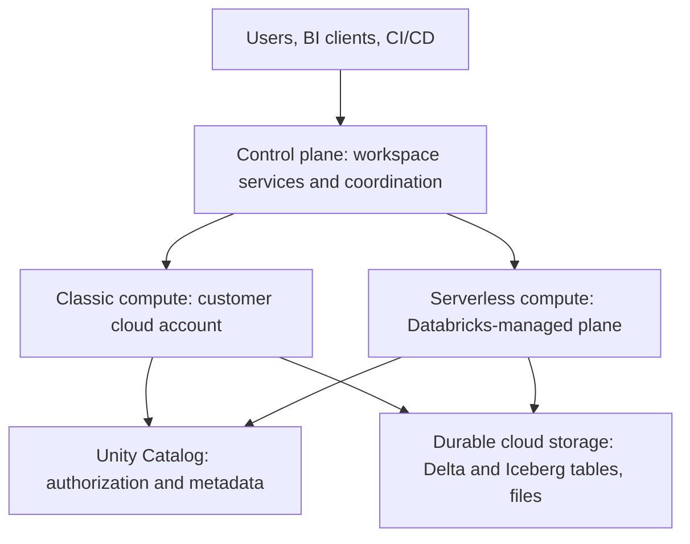
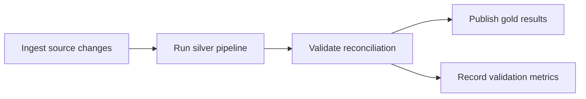

# Databricks: Data Engineer Interview Guide

Documentation reviewed: 2026-10-25. Examples and architecture references use Databricks on AWS; core concepts also apply to Azure and Google Cloud. Feature support depends on the runtime, compute product, cloud, region, and table features.

A lakehouse pipeline has to do several jobs at once: process large inputs, publish coherent tables, control access, and recover repeatable runs. Databricks brings distributed processing, transactional tables, governance, and managed pipelines into one platform. Understanding the pieces means asking which problem each solves, what it guarantees, and which operating cost remains.

**A useful interview answer:** “Databricks separates durable cloud storage from compute. Delta Lake provides transactional table semantics, Unity Catalog governs access, Spark and Photon execute transformations, and Lakeflow handles ingestion, pipelines, and orchestration. I choose the compute and ingestion pattern from the freshness requirement, recovery needs, and cost per successful run.”

**Study order:** Delta Lake internals → Unity Catalog → ingestion and CDC → Lakeflow → Spark optimization → production recovery and cost. Then revisit architecture, development, and interoperability.

Examples are independent teaching examples, not a deployment script. They assume a disposable Unity Catalog catalog named `prep`, the schemas and volumes mentioned, appropriate privileges, and compatible compute. SQL and PySpark examples have not been executed against a Databricks workspace. Background Spark concepts are covered in [spark.md](../processing/spark.md), and table-format comparisons in [iceberg.md](../storage-and-modeling/iceberg.md).

## Contents

1. [Architecture & Fundamentals](#1-architecture--fundamentals)
2. [Delta Lake](#2-delta-lake)
3. [Storage & Optimization](#3-storage--optimization)
4. [Data Ingestion & Streaming](#4-data-ingestion--streaming)
5. [Lakeflow & Orchestration](#5-lakeflow--orchestration)
6. [Unity Catalog & Governance](#6-unity-catalog--governance)
7. [Performance & Resource Management](#7-performance--resource-management)
8. [Data Engineering & Development](#8-data-engineering--development)
9. [Production & Advanced Topics](#9-production--advanced-topics)

## 1. Architecture & Fundamentals

### Control plane vs. compute plane

Opening a notebook and running its query involve different parts of Databricks. The **control plane** hosts Databricks-managed services such as the web application and backend coordination; the **compute plane** runs the workloads that process data. That distinction helps explain where work and its supporting services live.

On AWS, classic compute runs in the customer's AWS account. Serverless compute runs in a Databricks-managed compute plane in the workspace's region. Durable table storage is a separate concern: terminating a compute resource does not delete its persisted tables.

Distinguish three network paths: clients to Databricks, classic compute to the control plane, and compute to storage or other data sources. Configuring private workspace access does not automatically configure private access from serverless compute to a database. [Network architecture](https://docs.databricks.com/aws/en/security/network/deployment-architecture/)



This diagram shows responsibilities, not every network hop or a guarantee about where every piece of metadata resides.

### Accounts, workspaces, clusters, and SQL warehouses

| Object | Purpose | Interview distinction |
| --- | --- | --- |
| Account | Administrative scope for workspaces, identities, and account settings | An account can contain multiple workspaces |
| Workspace | Collaboration and execution environment for notebooks, jobs, and other assets | A workspace is not a database or storage format |
| Classic compute resource / cluster | Driver and worker resources for supported Spark workloads | Workers execute tasks; the driver coordinates execution |
| SQL warehouse | Compute endpoint for SQL workloads and BI clients | A warehouse executes queries; catalogs and schemas organize data |
| Unity Catalog object | Governed table, view, volume, function, or other asset | Access to an asset and permission to use compute are separate |

Different compute resources can access the same governed table. Separate compute improves workload isolation but does not remove transaction conflicts between writers to that table. [Compute overview](https://docs.databricks.com/aws/en/compute/)

A SQL warehouse supports SQL-oriented access through the editor, dashboards, and client connections. Serverless, pro, and classic warehouse types have different management and scaling behavior. Do not equate a SQL warehouse with a general-purpose PySpark cluster. [SQL warehouses](https://docs.databricks.com/aws/en/compute/sql-warehouse/)

### Databricks Runtime and Photon

**Databricks Runtime (DBR)** packages Spark and Databricks integrations, optimizations, and libraries. A runtime upgrade can change SQL semantics, dependency versions, connector behavior, and table-feature support. For classic production compute, choose a supported LTS release and validate upgrades against representative workloads. Serverless environments have their own versioning and upgrade controls. [Classic compute practices](https://docs.databricks.com/aws/en/compute/cluster-config-best-practices)

**Photon** is a native C++ execution engine for supported SQL and DataFrame operations. Catalyst still plans queries; supported physical work executes in vectorized columnar batches. Unsupported operations can fall back to Spark execution. Photon is an execution engine, while Delta Lake is a table format.

PySpark DataFrame code can benefit from Photon because it describes a relational plan. Arbitrary Python code does not become native C++: Python UDFs and unsupported operators can limit acceleration. Current documentation describes support for stateless streaming, not general stateful streaming acceleration. Benchmark the actual plan and workload rather than assuming a fixed speedup. [Photon](https://docs.databricks.com/aws/en/compute/photon)

### Classic vs. serverless compute

| Dimension | Classic | Serverless |
| --- | --- | --- |
| Infrastructure management | More control over instances, runtime, and supported configuration | Databricks manages provisioning and capacity |
| Customization | Useful for workloads needing supported low-level settings or custom environments | Product-specific API, library, and environment restrictions |
| Scaling and startup | Depends on provisioning, pools, and configuration | Managed startup and scaling; measure observed latency |
| Diagnosis | Spark UI and cluster-level tools | Query profiles and product-provided diagnostics |
| Cost decision | Include infrastructure, DBUs, idle time, and operations | Include serverless usage, duration, and workload behavior |

“Serverless” describes infrastructure management, not unlimited capacity or universally lower cost. Check support for the exact product: serverless SQL, serverless notebooks/jobs, and serverless pipelines have different capabilities. For example, serverless notebooks/jobs support `AvailableNow` streaming but not `ProcessingTime` triggers; continuous Lakeflow pipelines have different rules. [Serverless limitations](https://docs.databricks.com/aws/en/compute/serverless/limitations), [Serverless streaming](https://docs.databricks.com/aws/en/compute/serverless/streaming)

### Lakehouse architecture and Medallion layers

A lakehouse combines cloud object storage with table metadata, transactions, governance, and query engines. It supports engineering and analytics on shared data without requiring every workload to maintain a separate copy.

| Layer | Responsibility | Typical content |
| --- | --- | --- |
| Bronze | Preserve replayable source data and ingestion context | Raw payload, source identifiers, ingestion time, file or Kafka coordinates |
| Silver | Establish validated, typed, deduplicated business records | Clean events, current entities, CDC history |
| Gold | Serve a business use case | Dimensional models, aggregates, reporting metrics |

Medallion layers are a design pattern, not mandatory product objects. A schema can represent a layer, but naming a schema `silver` does not validate its contents. Define contracts, ownership, retention, and recovery separately.

**Interview check:** Why retain bronze after building silver? It supports replay after a transformation bug, reconciliation with the source, and controlled backfills. Balance this against sensitive-data handling and retention requirements. [Medallion architecture](https://docs.databricks.com/aws/en/lakehouse/medallion)

## 2. Delta Lake

### Table format vs. file format

A directory can contain both new files and files that a previous update logically removed. Reading all of them as raw Parquet can therefore return the wrong table. Parquet describes columnar files; **Delta Lake** uses data files, a transaction log, schema, and table features to describe a transactional table. Use a Delta-aware reader so removed records, duplicate versions, and rows masked by deletion vectors are interpreted correctly.

Delta Lake is open source; Databricks adds managed services and optimizations. Do not assume every Databricks feature exists in open-source Delta, or that every Delta client supports every table feature. [Delta Lake overview](https://docs.databricks.com/aws/en/delta)

### Transaction log, actions, checkpoints, and snapshots

The `_delta_log` records table changes. Traditional JSON commit files use zero-padded version numbers. Important actions include:

| Action | Meaning |
| --- | --- |
| `add` | Introduce an active data file, including metadata such as statistics |
| `remove` | Remove a file from the active snapshot; physical deletion is separate |
| `metaData` | Describe schema, partition columns, and table properties |
| `protocol` | Declare reader/writer compatibility and required table features |
| `txn` | Record an application transaction identifier for supported idempotent writes |
| `commitInfo` | Record operation context for history and diagnostics |

A **snapshot** is the logical state at a version: active files, schema, protocol, and related metadata. Readers reconstruct it from a checkpoint plus later log actions. A checkpoint summarizes table state; it does not copy all table rows or replace data-file backups. Modern checkpoint formats can include sidecar files. Do not depend on a fixed checkpoint interval. Catalog-managed commits add coordination requirements, so raw file manipulation is unsafe. [Delta protocol](https://github.com/delta-io/delta/blob/master/PROTOCOL.md), [Checkpoint V2](https://docs.databricks.com/aws/en/tables/features/checkpoint-v2)

**Worked example:** Version 40 contains files A and B. Version 41 records removal of B and addition of C. Readers of version 41 use A and C; an existing reader of version 40 can continue using A and B while its required files remain available. An abandoned file from a failed write is not visible merely because it exists in storage.

### ACID and optimistic concurrency

| Property | What to explain |
| --- | --- |
| Atomicity | A successful commit publishes the operation as one logical change |
| Consistency | Writes must respect enforced schema and constraints |
| Isolation | Reads use consistent snapshots; writes are validated against concurrent changes |
| Durability | Successfully committed data and metadata persist beyond compute termination |

The usual optimistic transaction path is:

1. Read a snapshot and determine the data the operation needs.
2. Produce new files or deletion-vector changes without modifying the visible snapshot.
3. Validate against intervening commits.
4. Publish the commit if valid; otherwise fail or retry as supported.

Readers do not need to wait for each writer to finish to see a consistent table. Concurrent writers can still conflict. Metadata changes, including schema and protocol changes, require particular care. [Isolation and conflicts](https://docs.databricks.com/aws/en/optimizations/isolation)

The default table isolation level is **WriteSerializable**: committed writes are equivalent to a serial ordering, but that ordering need not match every read or the history order. **Serializable** requires reads and writes to fit a serial execution consistent with commit order. Stronger isolation can reject more concurrent operations. Neither setting gives business-key uniqueness automatically. Row-level conflict detection also depends on table features and runtime support; see the production section. [Isolation levels](https://docs.databricks.com/aws/en/optimizations/isolation/isolation-levels)

Ordinary single-table Delta commits do not make a series of separate table writes atomic. Current Databricks supports multi-statement and multi-table transactions with requirements including Unity Catalog managed tables, catalog commits, and supported compute. Do not claim either that all workflows are atomic or that Databricks can never transact across tables. [Transactions and requirements](https://docs.databricks.com/aws/en/transactions)

### MERGE, UPDATE, and DELETE

`MERGE` matches source records to a target and conditionally updates, inserts, or deletes them. It is useful for upserts and CDC, but correctness depends on keys, event ordering, and duplicate handling.

```sql
MERGE INTO prep.silver.customers AS t
USING prep.staging.customer_updates AS s
ON t.customer_id = s.customer_id
WHEN MATCHED AND s.event_seq > t.event_seq THEN
  UPDATE SET
    t.customer_name = s.customer_name,
    t.event_seq = s.event_seq
WHEN NOT MATCHED THEN
  INSERT (customer_id, customer_name, event_seq)
  VALUES (s.customer_id, s.customer_name, s.event_seq);
```

This example assumes complete after-images, non-null keys and sequence values, one source row per key, and a stable source-defined ordering. Equal sequence values must represent the same logical event. Reapplying an older update then leaves the target unchanged.

Deduplicate the source before merging. Multiple source rows updating the same target can make a merge ambiguous; duplicates for a previously absent key can also be inserted. DBR 16.0+ considers both `ON` and `WHEN MATCHED` conditions when identifying duplicate matches; DBR 15.4 LTS and earlier use `ON`. Do not rely on this version difference as a deduplication strategy. [MERGE semantics](https://docs.databricks.com/aws/en/delta/merge)

```sql
UPDATE prep.silver.customers
SET customer_name = 'Corrected name'
WHERE customer_id = 101;

DELETE FROM prep.silver.customers
WHERE customer_id = 101;
```

These are logical table changes. Their physical rewrite or deletion-vector behavior depends on table capabilities. A logical delete is not proof that the bytes have been erased from historical files, replicas, or backups.

**CDC trap:** Physically deleting a target row also removes its stored sequence. An older update arriving afterward can look like a new insert and resurrect the entity. Preserve deletion ordering through tombstones or use a CDC implementation that handles it. Likewise, `WHEN NOT MATCHED BY SOURCE THEN DELETE` is appropriate only when the source represents an authoritative, correctly scoped snapshot; a normal incremental batch does not contain every live key.

### Change Data Feed: changes, not just new files

CDF exposes row changes with `_change_type`, `_commit_version`, and `_commit_timestamp`. Change types include `insert`, `delete`, `update_preimage`, and `update_postimage`.

Two implementations must be distinguished:

- **Legacy CDF:** Enable `delta.enableChangeDataFeed` on a Delta table before the changes you need. Changes can be materialized during writes or derived from the log.
- **Automatic CDF:** Current documentation requires DBR 19+ and eligible Unity Catalog tables with row tracking or Iceberg v3 row lineage. It computes changes during reads and has additional compatibility restrictions.

Both use the same read APIs. They cannot be enabled together on the same table.

```sql
ALTER TABLE prep.silver.customers SET TBLPROPERTIES (
  'delta.enableChangeDataFeed' = 'true'
);

SELECT customer_id, customer_name, _change_type, _commit_version
FROM table_changes('prep.silver.customers', 10, 15);
```

The first statement demonstrates **legacy** configuration; versions 10–15 must exist and have accessible changes. CDF is retention-bound, not a permanent audit log. Archive it into a separate table when durable change history is required. Rename/drop/type changes can prevent reads spanning a schema-change boundary. [CDF behavior and requirements](https://docs.databricks.com/aws/en/tables/features/change-data-feed)

**Interview check:** Why not stream every Delta table as append-only? Updates and deletes change existing logical rows. An ordinary append-oriented stream does not propagate them correctly. CDF plus explicit downstream change handling is appropriate; `skipChangeCommits` skips changing commits rather than applying their changes. [Delta streaming sources](https://docs.databricks.com/aws/en/structured-streaming/delta-lake)

### Schema enforcement and controlled evolution

**Enforcement** checks incoming data against the table schema. **Evolution** changes that schema intentionally, for example by adding a new column.

Prefer explicit DDL or per-write evolution options over globally permissive settings. Adding a column does not define its business meaning, validate its values, or make downstream consumers compatible. Type changes can require supported widening features or a migration; arbitrary incompatible changes are not free.

```sql
ALTER TABLE prep.silver.customers
ADD COLUMNS (country_code STRING);
```

```python
incoming.write.format("delta").mode("append").option(
    "mergeSchema", "true"
).saveAsTable("prep.bronze.customer_events")
```

The Python example assumes `incoming` is a prepared DataFrame. Approve the new fields before allowing them into a strict silver contract. Coordinate schema updates with writers and restart affected streaming readers as required. [Schema evolution](https://docs.databricks.com/aws/en/tables/update-schema)

### Column mapping and metadata-only changes

Column mapping separates logical column names from their physical representation, enabling supported renames and drops without rewriting every Parquet file. It changes client compatibility requirements.

```sql
ALTER TABLE prep.silver.customers SET TBLPROPERTIES (
  'delta.columnMapping.mode' = 'name'
);

ALTER TABLE prep.silver.customers
RENAME COLUMN customer_name TO full_name;
```

This demonstrates `name` mode on an existing table. Current documentation also supports `id` mode when creating a table. Check the relevant client and interoperability requirements before choosing a mode.

Dropping a column from metadata does not erase its values from old files. A physical rewrite and subsequent safe cleanup are separate steps. Check CDF, streaming schema tracking, and external-reader compatibility before deploying a non-additive schema change. [Column mapping](https://docs.databricks.com/aws/en/tables/features/column-mapping)

### Time Travel, RESTORE, VACUUM, and retention

| Operation | Purpose | Does not guarantee |
| --- | --- | --- |
| `VERSION AS OF` / `TIMESTAMP AS OF` | Query a historical state | Availability after its required metadata or files expire |
| `DESCRIBE HISTORY` | Inspect commit history and operation metrics | That historical rows remain readable |
| `RESTORE` | Make a previous state current through a new commit | Recovery of files already deleted |
| `VACUUM` | Physically remove eligible unreferenced files | Compaction or logical removal of current rows |

```sql
SELECT * FROM prep.silver.customers VERSION AS OF 12;
DESCRIBE HISTORY prep.silver.customers;
```

Time travel needs both historical metadata and referenced data files. Common defaults are 30 days for `delta.logRetentionDuration` and 7 days for `delta.deletedFileRetentionDuration`. A 30-day history listing therefore does not promise 30 days of data recovery. Configure both properties for the required window; runtime rules can also restrict historical access. `RESTORE` is a data-changing operation that downstream consumers may observe. [Table history and time travel](https://docs.databricks.com/aws/en/tables/history)

```sql
ALTER TABLE prep.silver.customers SET TBLPROPERTIES (
  'delta.deletedFileRetentionDuration' = 'interval 30 days',
  'delta.logRetentionDuration' = 'interval 30 days'
);

VACUUM prep.silver.customers DRY RUN;
```

Changing retention does not recover files or history already removed. Choose a retention window longer than the longest supported reader/writer duration, consumer outage, and replay requirement, with operating margin. Account for automatically scheduled cleanup through predictive optimization. Do not disable retention safety checks as a routine cost-saving measure. Log cleanup and data-file cleanup are different mechanisms. [VACUUM](https://docs.databricks.com/aws/en/tables/operations/vacuum)

**Interview check:** A stream is offline for ten days but required source history is retained for seven. Restarting the checkpoint cannot restore missing source data. Recover from retained raw data or a validated snapshot, reconcile the target, and establish a new consistent processing boundary.

## 3. Storage & Optimization

### Small files, compaction, and OPTIMIZE

A pipeline that writes frequent tiny batches can finish each write quickly yet leave expensive reads behind. Small files add listing, planning, scheduling, and file-open overhead. Frequent small micro-batches, too many output partitions, and high-cardinality table partitioning are common ways to create that problem.

`OPTIMIZE` rewrites files into a better physical layout while preserving logical rows. For partitioned tables, compaction stays within partitions. For liquid-clustered tables, it organizes data using clustering keys.

```sql
OPTIMIZE prep.silver.events;
```

Bin-packing an already compacted, unchanged layout is effectively idempotent. Clustering work has different behavior as data and keys change. Old files remain subject to retention and cleanup, so a rewrite can temporarily increase stored bytes. [OPTIMIZE](https://docs.databricks.com/aws/en/tables/operations/optimize)

Treat file size as a workload decision: tiny files waste overhead, while very large files can reduce parallelism and increase rewrite work. Inspect file counts, sizes, scan metrics, and write patterns before repeatedly scheduling maintenance.

### Z-ORDER vs. liquid clustering

`ZORDER BY` co-locates values across selected columns to improve file skipping for relevant predicates. It is useful for understanding and maintaining existing non-liquid Delta layouts. It is not a B-tree index and does not eliminate the need for statistics.

```sql
OPTIMIZE prep.silver.legacy_events
ZORDER BY (customer_id, event_type);
```

Liquid clustering is the recommended direction for new suitable Databricks tables. It allows clustering keys to evolve and maintains layout incrementally. It cannot be combined with table partitioning or `ZORDER` on the same table.

```sql
CREATE TABLE prep.silver.events (
  event_id STRING,
  customer_id BIGINT,
  event_time TIMESTAMP,
  event_type STRING
)
USING DELTA
CLUSTER BY (customer_id, event_time);
```

Changing keys changes future maintenance behavior; it does not immediately reorganize all existing files. A supported full reclustering operation can be expensive. Match keys to common selective filters and validate their effect on scans. [Liquid clustering](https://docs.databricks.com/aws/en/tables/clustering), [Data skipping and Z-order](https://docs.databricks.com/aws/en/tables/data-skipping)

### Automatic clustering and predictive optimization

**Automatic liquid clustering** uses `CLUSTER BY AUTO` and predictive optimization to select and maintain keys from workload information. It requires eligible Unity Catalog managed tables and supported compute. It may select no keys when clustering would not be worthwhile.

```sql
ALTER TABLE prep.silver.events CLUSTER BY AUTO;
```

**Predictive optimization** schedules `OPTIMIZE`, `VACUUM`, and `ANALYZE` for eligible Unity Catalog managed tables. It is an automated maintenance service, not another name for Photon or AQE. Maintenance consumes billable resources; evaluate total maintenance plus query cost.

Predictive optimization does not automatically run `ZORDER`. Avoid redundant scheduled maintenance, verify whether optimization is enabled, and establish retention requirements before automated cleanup. [Automatic clustering](https://docs.databricks.com/aws/en/tables/clustering#automatic-liquid-clustering), [Predictive optimization](https://docs.databricks.com/aws/en/optimizations/predictive-optimization)

### Data skipping, statistics, and partition pruning

| Mechanism | How work is avoided | Example |
| --- | --- | --- |
| Column pruning | Read only required columns | Select `customer_id`, not a large payload |
| Partition pruning | Eliminate table partitions using partition metadata | Filter an existing date-partitioned table by date |
| File skipping | Compare predicates with per-file statistics | Skip a file whose customer range excludes the requested customer |
| Predicate pushdown | Apply supported filters close to the scan | Reduce rows leaving the scan operator |
| Clustering | Improve value locality so skipping is more selective | Group related customer records into fewer files |

Delta file statistics include value bounds, null counts, and record counts. A filter on an untracked column cannot benefit from its missing file-level bounds. Unity Catalog external tables collect statistics on the first 32 columns by default; managed-table predictive optimization can select additional filter columns. Do not repeat “only 32 columns” as a universal limitation.

```sql
ALTER TABLE prep.silver.events SET TBLPROPERTIES (
  'delta.dataSkippingStatsColumns' = 'customer_id,event_time,event_type'
);

ANALYZE TABLE prep.silver.events COMPUTE DELTA STATISTICS;
```

Changing statistics properties alone does not backfill old file statistics. File-skipping statistics and optimizer statistics used for join planning serve different purposes. [Statistics and skipping](https://docs.databricks.com/aws/en/tables/data-skipping)

**Reasoning example:** If every file contains customer IDs from 1 to 1,000,000, min/max bounds cannot narrow an equality lookup much. Clustering can make each file's range narrower. A function-wrapped predicate can also be harder to push down or prune; compare actual plans and scanned bytes.

### Deletion vectors and amplification

A deletion vector marks rows as logically removed without immediately rewriting their entire Parquet file. Updates can add replacement rows while masking old ones. Reads resolve the file together with its deletion vector.

- **Write amplification:** Physical bytes written divided by logical bytes changed. Rewriting a large file to update a few rows can make this high.
- **Read amplification:** Physical read/processing work compared with useful returned data. Reading extra files and applying accumulated deletion metadata adds work.

Deletion vectors can reduce immediate write amplification and enable row-level concurrency, while leaving cleanup and some read work for later. Supported readers are required.

```sql
REORG TABLE prep.silver.events APPLY (PURGE);
```

`REORG ... APPLY (PURGE)` rewrites files to materialize metadata-only deletions. The replaced files still require safe retention and `VACUUM` before physical removal. Ordinary compaction is not a guarantee that every soft-deleted value has been purged. Include replicas and backups in an erasure design. [Deletion vectors](https://docs.databricks.com/aws/en/tables/features/deletion-vectors), [Metadata-only deletion cleanup](https://docs.databricks.com/aws/en/tables/operations/vacuum)

**Interview check:** A daily merge updates 0.1% of rows but rewrites much of the table. Inspect source deduplication, target scan scope, data locality, deletion-vector support, and file layout before adding compute.

## 4. Data Ingestion & Streaming

### Choose ingestion from source semantics

Before choosing an ingestion tool, ask what the source actually delivers. A new immutable file, a database change, and a complete authoritative snapshot have different identities and deletion rules. Match the pattern to those semantics, then define replay and progress tracking.

| Source and requirement | Suitable starting pattern | Main correctness question |
| --- | --- | --- |
| New immutable files | Auto Loader to bronze Delta | How are files discovered and replayed? |
| A modest scheduled file load | `COPY INTO` or a bounded batch job | What tracks processed files and handles reloads? |
| Kafka event stream | Structured Streaming to bronze | Are offsets, source retention, and event IDs preserved? |
| Database changes | CDC connector/feed followed by ordered application | How are snapshot and change positions aligned? |
| Periodic authoritative snapshot | Snapshot comparison or replacement within a defined scope | Does absence really mean deletion? |

These are design choices, not interchangeable delivery guarantees. First ask whether inputs are append-only events, mutable entity changes, or complete snapshots. Lakeflow Connect provides managed ingestion connectors where supported; connector capabilities and source prerequisites must be checked separately. [Ingestion options](https://docs.databricks.com/aws/en/ingestion/)

### Auto Loader and file discovery

Auto Loader is the `cloudFiles` Structured Streaming source for incrementally ingesting cloud files. It tracks discovered/processed files in checkpoint state and can resume after failures. File discovery can use directory listing or file-event mechanisms, depending on configuration.

Use immutable file paths and preserve source metadata. File-level ingestion guarantees do not remove duplicate business events contained in different files. Replacing an existing object is not equivalent to publishing an independently ordered business change. [Auto Loader](https://docs.databricks.com/aws/en/ingestion/cloud-object-storage/auto-loader/)

```python
raw = (
    spark.readStream.format("cloudFiles")
    .option("cloudFiles.format", "json")
    .option("cloudFiles.schemaLocation", "/Volumes/prep/ops/state/orders_schema")
    .option("cloudFiles.schemaEvolutionMode", "rescue")
    .load("/Volumes/prep/landing/orders")
)

query = (
    raw.writeStream.format("delta")
    .option("checkpointLocation", "/Volumes/prep/ops/state/orders_checkpoint")
    .trigger(availableNow=True)
    .toTable("prep.bronze.orders_raw")
)
query.awaitTermination()
```

This example infers the initial schema, rescues unexpected fields instead of adding columns automatically, processes available input, and exits. The state volume must be durable and separately permissioned.

### Auto Loader schema inference and evolution

Auto Loader schema state and the target Delta schema are distinct. The reader must understand the input; the writer must satisfy the target contract.

| Mode | Behavior to understand |
| --- | --- |
| `addNewColumns` | Detects new columns, updates tracked schema, and stops the stream; restart is normally required |
| `rescue` | Keeps the schema stable and captures unexpected data in rescued data |
| `failOnNewColumns` | Fails until the schema or offending input is handled |
| `none` | Does not evolve the tracked schema; handling depends on rescued-data configuration |

JSON/CSV inference defaults to strings unless type inference is enabled; typed formats have different behavior. Explicit schemas and hints can provide a more stable contract. Rescued data is evidence to inspect and alert on, not a reason to silently ignore changes.

In `addNewColumns` mode, configure safe job retries/restarts and compatible target evolution. Neither automatic inference nor adding a column validates business meaning or repairs incompatible historical types. [Auto Loader schema behavior](https://docs.databricks.com/aws/en/ingestion/cloud-object-storage/auto-loader/schema)

### Structured Streaming checkpoints and delivery guarantees

Structured Streaming expresses incremental processing as a query. A checkpoint records source offsets/progress, committed micro-batches, query identity, and state for stateful operators. Give every independent query its own durable checkpoint. Deleting it starts a fresh query, not a harmless cleanup.

Do not confuse these with Delta transaction-log checkpoints: one records a stream's processing progress; the other summarizes a table's transactional state. [Streaming checkpoints](https://docs.databricks.com/aws/en/structured-streaming/checkpoints)

**Failure example:** A batch writes to an external API, then the process fails before progress is recorded. On restart, the API call can run again. End-to-end exactly-once behavior requires replayable input plus transactional or idempotent output; a checkpoint alone cannot make an arbitrary side effect atomic.

`foreachBatch` provides at-least-once execution. Use stable keys, source ordering, or supported transaction/batch identifiers to make output idempotent. Its `batch_id` belongs to that query's checkpoint history; it is not a globally unique business-event identifier. Multiple sink writes in one callback are not automatically one cross-system transaction. [foreachBatch](https://docs.databricks.com/aws/en/structured-streaming/foreach)

### Triggers, latency, and cost

| Pattern | Behavior | Typical choice |
| --- | --- | --- |
| `processingTime="30 seconds"` | Repeatedly process micro-batches on supported compute | Ongoing ingestion with seconds-level freshness |
| `availableNow=True` | Process input available at run start, potentially in multiple batches, then exit | Scheduled incremental ingestion |
| Lakeflow triggered update | Process available work and stop | Periodic managed pipelines |
| Lakeflow continuous mode | Keep a pipeline running for new input | Continuous managed ingestion |

An interval is a scheduling target, not a guarantee that work finishes within that time. If a batch takes longer than the interval, throughput must improve or backlog grows. Rate limits bound work per batch; they do not create capacity.

`AvailableNow` preserves incremental progress between scheduled runs. It is often useful when minutes of latency are acceptable. For continuous streaming on serverless, select the supported pipeline product rather than copying a classic-compute trigger. Current real-time mode is a separate low-latency option with specific requirements; it is not Spark's experimental continuous trigger. [Trigger behavior](https://docs.databricks.com/aws/en/structured-streaming/triggers), [Serverless streaming choices](https://docs.databricks.com/aws/en/compute/serverless/streaming)

### Kafka, event time, and state

For Kafka, preserve topic, partition, offset, event key, event time, and raw payload in bronze where appropriate. Parse and validate into silver. A Kafka offset identifies position within a partition, not a global order across partitions. Business ordering needs a source-defined sequence or per-entity ordering contract.

Monitor both ingestion throughput and lag relative to source retention. A healthy restarted consumer cannot recover Kafka records that have already expired.

Watermarks bound state and define handling of late event-time data for supported stateful operations. They do not guarantee that every late event will be accepted, sort the source globally, or replace CDC ordering. Unbounded deduplication or joins can grow state indefinitely. Define a lateness policy and a correction path for data beyond it. See [Spark streaming fundamentals](../processing/spark.md) for watermarks, state, joins, and output modes.

### CDC, incremental processing, and SCD Types 1/2

**Source CDC** captures database changes. **Delta CDF** exposes changes to a lakehouse table. They can be connected in a pipeline, but they are different boundaries.

| Pattern | Stored result | Main challenge |
| --- | --- | --- |
| SCD Type 1 | Latest entity state | Ignore older updates and correctly apply deletes |
| SCD Type 2 | Historical versions with validity boundaries | Order changes, close intervals, and handle late arrivals |
| Incremental aggregation | Updated derived measures | Apply deletes and update pre/post images correctly |

For an update from amount 100 to 120, adding 120 alone overcounts a previously accumulated total. Apply a -100/+120 correction, recompute affected groups, or use a managed incremental result that handles changes.

An SCD2 interval commonly follows `[valid_from, valid_to)`. For one entity, intervals should not overlap and at most one row should be current. Delta time travel records physical table history; it does not replace business-effective SCD history.

For snapshot-to-CDC handoff, establish a source-consistent snapshot position and resume changes from the corresponding boundary. An arbitrary timestamp filter can leave a gap or duplicate changes. Lakeflow AUTO CDC provides managed application of ordered changes, covered next. [CDC and SCD processing](https://docs.databricks.com/aws/en/ldp/cdc)

### Batch vs. streaming architecture

Choose from the freshness SLA and the available recovery path:

- **Full batch:** Simple when data is small enough; repeated full scans become expensive as it grows.
- **Incremental scheduled processing:** Reuses checkpoints or source change positions while allowing compute to stop.
- **Continuous streaming:** Appropriate for lower latency; requires sustained capacity, state management, and operational ownership.

A unified incremental pipeline can reduce duplicated batch/streaming business logic. Backfills still need an explicit strategy for ordering, overlapping live writes, and publishing corrected results. The word “streaming” does not require every compute resource to run all day.

## 5. Lakeflow & Orchestration

### Names and responsibilities

A pipeline needs to obtain data, transform it, and coordinate execution, but those are separate responsibilities. The Lakeflow names below map to those jobs. Knowing the boundary is more useful than treating every pipeline feature as another scheduler.

| Name | Responsibility |
| --- | --- |
| Lakeflow Connect | Managed ingestion connectors where supported |
| Lakeflow Spark Declarative Pipelines | Declarative batch/streaming transformations, formerly Delta Live Tables (DLT) |
| Lakeflow Jobs | Task orchestration, dependencies, triggers, and execution monitoring |

Current documentation also uses “Spark Declarative Pipelines on Lakeflow.” Modern Python examples use `from pyspark import pipelines as dp`; older material uses the `dlt` module and `APPLY CHANGES`. Recognize the old names without treating every API as identical.

Lakeflow pipelines build on Apache Spark Declarative Pipelines and add Databricks capabilities. Features such as AUTO CDC are not automatically portable to the open-source framework. [Pipeline overview](https://docs.databricks.com/aws/en/ldp/)

### Streaming tables, materialized views, views, and flows

| Concept | Semantics | Suitable use |
| --- | --- | --- |
| Streaming table | Maintains results from incrementally processed streaming input | Append ingestion or a managed CDC target |
| Materialized view | Persists the current result of a query; refresh can be incremental or full | Aggregates and transformations over changing source state |
| View | Query definition without independently persisted results | Intermediate transformations |
| Flow | Defines how data is written into a target | Append ingestion, backfill, or AUTO CDC |
| Pipeline | Defines and manages a graph of datasets and flows | Related ingestion and transformation steps |

A streaming read of an append source processes new input; it does not automatically re-evaluate every old row after a dimension changes. A materialized view has current-result semantics, but incremental refresh depends on query eligibility and source features. Full recomputation can affect both cost and replay requirements. [Pipeline concepts](https://docs.databricks.com/aws/en/ldp/concepts)

### Declarative transformations and expectations

The following is a pipeline source file, not a standalone Python script. It assumes `prep.bronze.orders_raw` has `order_id`, `order_date`, and `amount` columns.

```python
from pyspark import pipelines as dp
from pyspark.sql import functions as F


@dp.table(name="orders_clean")
@dp.expect_or_drop("has_order_id", "order_id IS NOT NULL")
@dp.expect_or_drop("valid_amount", "amount IS NOT NULL AND amount >= 0")
@dp.expect_or_drop("valid_order_date", "order_date IS NOT NULL")
def orders_clean():
    return spark.readStream.table("prep.bronze.orders_raw").selectExpr(
        "order_id",
        "try_cast(order_date AS DATE) AS order_date",
        "try_cast(amount AS DECIMAL(18, 2)) AS amount",
    )


@dp.materialized_view(name="daily_sales")
def daily_sales():
    return spark.read.table("orders_clean").groupBy("order_date").agg(
        F.sum("amount").alias("revenue")
    )
```

Pipeline configuration determines the default catalog/schema for the outputs. The platform derives dependencies from table reads. Dataset functions should return DataFrames; avoid actions, writes, API calls, and other side effects inside them because planning can evaluate definitions more than once.

Expectations have three main policies:

- `expect`: Retain records and report violations.
- `expect_or_drop`: Remove violating records from that dataset.
- `expect_or_fail`: Fail the affected update when a violation occurs.

Choose policy from business impact. Dropping malformed telemetry can be acceptable; silently dropping financial transactions usually is not. Preserve rejected input in bronze or an explicitly designed quarantine dataset, and alert on violation counts. Expectations do not automatically create quarantine tables or enforce cross-table uniqueness. [Expectations](https://docs.databricks.com/aws/en/ldp/expectations)

### AUTO CDC and SCD2

AUTO CDC applies changes using declared keys, sequence, delete semantics, and SCD type. It replaces the older APPLY CHANGES naming and handles supported out-of-order change processing.

```python
from pyspark import pipelines as dp
from pyspark.sql import functions as F


@dp.table(name="customer_changes")
def customer_changes():
    return spark.readStream.table("prep.bronze.customer_cdc")


dp.create_streaming_table(name="customer_history")

dp.create_auto_cdc_flow(
    target="customer_history",
    source="customer_changes",
    keys=["customer_id"],
    sequence_by=F.struct("commit_position", "event_index"),
    apply_as_deletes=F.expr("operation = 'DELETE'"),
    except_column_list=["operation", "commit_position", "event_index"],
    stored_as_scd_type="2",
)
```

Assume complete after-images with valid keys and a deterministic, non-null ordering tuple per key. `commit_position` must sort in source order; an arbitrary string representation of a database log position may not. Reject contradictory events sharing the same ordering value.

SCD2 output uses `__START_AT` and `__END_AT` boundaries. A null end identifies the current version. Configure partial-update and null semantics deliberately if records are patches rather than complete rows. Deletes and out-of-order handling also have retention/tombstone considerations. [AUTO CDC Python API](https://docs.databricks.com/aws/en/ldp/developer/ldp-python-ref-apply-changes)

AUTO CDC applies an existing change feed; it does not enable source database logging. AUTO CDC FROM SNAPSHOT compares ordered snapshots when no source change feed is available. Availability depends on supported pipeline compute/edition. [AUTO CDC concepts](https://docs.databricks.com/aws/en/ldp/cdc)

### Lakeflow Jobs, dependencies, scheduling, and retries

A job coordinates tasks such as a notebook, Python wheel, SQL statement, or pipeline update. Dependencies form a DAG. A pipeline manages its internal data dependencies; a job manages the larger workflow around it.



Use task dependencies and run conditions to prevent publishing after validation fails. Pass small parameters or references between tasks; persist distributed datasets in tables. Define the run-as identity, maximum concurrent runs, queueing behavior, retries, timeouts, and notifications.

A retry is safe only if the task's side effects can be repeated. Repairing a failed run can avoid rerunning all successful tasks, but stale inputs or non-idempotent writes can still make a repair incorrect. For schedules, choose a time zone explicitly and account for daylight-saving changes; event triggers and a continuously running job are different mechanisms. [Lakeflow Jobs](https://docs.databricks.com/aws/en/jobs/)

### Monitoring and refresh safety

Monitor pipeline update duration, input/output counts, expectation failures, lag, and incremental versus full refresh behavior. For jobs, separate provisioning/queue time from task execution and inspect retries and dependency outcomes.

A full refresh is a data operation: if upstream retention no longer contains all required history, rebuilding a streaming result can lose records. Define which layers are fully replayable and test the recovery procedure. A green job status alone does not establish data freshness or reconciliation.

**Interview check:** When choose a pipeline over a custom Spark job? Use a pipeline when its declared datasets, managed incremental processing, quality metrics, and recovery behavior fit the workload. Use custom jobs when required side effects, algorithms, or supported execution controls do not fit those semantics. The tradeoff is less orchestration code versus less control over execution details.

## 6. Unity Catalog & Governance

### Metastores, catalogs, schemas, and securable objects

To follow access from a user to a table, start with the governed object and its identity. **Unity Catalog** manages data and AI assets through identities, privileges, lineage, and auditing. Tables and views use `catalog.schema.object`; storage credentials and external locations are also securable objects, with different placement in the hierarchy. [Unity Catalog overview](https://docs.databricks.com/aws/en/data-governance/unity-catalog/)

```text
Account
└── Regional Unity Catalog metastore
    ├── Catalog: prep
    │   ├── Schema: bronze
    │   │   └── Table: orders_raw
    │   ├── Schema: silver
    │   │   └── Table: orders
    │   └── Schema: landing
    │       └── Volume: source_files
    ├── Storage credential
    └── External location
```

A workspace attaches to a metastore in its region; multiple workspaces can share that metastore. Catalogs organize governed assets rather than duplicating them per compute resource. Workspace bindings can limit which workspaces can access particular catalogs or storage objects. [Metastore scope](https://docs.databricks.com/aws/en/data-governance/unity-catalog/create-metastore)

### Managed vs. external tables and volumes

| Asset | Governance | Data lifecycle | Appropriate use |
| --- | --- | --- | --- |
| Managed table | Unity Catalog | Unity Catalog manages layout and deletion lifecycle | Databricks-managed analytical tables |
| External table | Unity Catalog for access through governed paths | Data owner/external system controls underlying files | Existing storage with an independently owned lifecycle |
| Managed volume | Unity Catalog | Unity Catalog manages underlying files | Governed non-tabular files |
| External volume | Unity Catalog for governed file access | External lifecycle | Existing file collections exposed through UC |

Managed data generally remains in the customer's cloud storage; “managed” does not mean Databricks owns the data. Dropping a managed asset initiates its managed deletion lifecycle; dropping an external registration leaves the underlying files. Do not rely on a drop as immediate secure erasure.

Tables represent tabular data. Volumes govern files such as raw documents, libraries, and checkpoints and use paths like `/Volumes/catalog/schema/volume/path`. A Delta directory inside a volume is not a substitute for a properly registered governed table. [Managed and external assets](https://docs.databricks.com/aws/en/data-governance/unity-catalog/managed-versus-external)

### RBAC, privileges, and ownership

Grant privileges to account groups and service principals according to responsibility. Separate data readers, pipeline writers, and owners. A production job should not depend on the continued membership or employment of an individual notebook author.

```sql
GRANT USE CATALOG ON CATALOG prep TO `analytics_readers`;
GRANT USE SCHEMA ON SCHEMA prep.gold TO `analytics_readers`;
GRANT SELECT ON TABLE prep.gold.daily_sales TO `analytics_readers`;
```

Reading the table requires the relevant parent usage privileges and table access. `USE CATALOG` alone does not grant `SELECT`. Catalog/schema grants can inherit to contained objects; understand the scope before granting broadly.

Ownership, `MANAGE`, data privileges, workspace access, and permission to use compute are separate concepts. `BROWSE` helps discover metadata without granting access to rows. Unity Catalog privileges are not automatically equivalent to AWS IAM permissions. [Privilege reference](https://docs.databricks.com/aws/en/data-governance/unity-catalog/access-control/privileges-reference)

### Fine-grained access control

Baseline privileges determine who can access an object. Row filters restrict visible records; column masks transform visible values according to policy. Dynamic views can also expose a controlled projection.

Current Unity Catalog ABAC policies use governed tags to apply consistent filters and masks across collections of assets. Table-specific filters/masks remain useful for local rules. Choose centralized policies when the same rule must remain consistent across many tables.

Test policies with representative human and service identities. Check supported compute, write operations, CDF, and performance interactions; a policy can affect which optimizations are legal. Tags describe or drive policies, but an ordinary descriptive tag alone is not proof that row access is restricted. [Access-control mechanisms](https://docs.databricks.com/aws/en/data-governance/unity-catalog/access-control/), [Row filters and masks](https://docs.databricks.com/aws/en/data-governance/unity-catalog/filters-and-masks/)

### External locations, storage credentials, and IAM

A **storage credential** represents the cloud identity used to access storage. On AWS this commonly involves an IAM role with an appropriate trust relationship. An **external location** combines that credential with an allowed cloud storage path.

```text
Databricks principal
  → Unity Catalog authorization
  → External location: allowed path + storage credential
  → Cloud identity, storage policy, and encryption-key authorization
  → Data files
```

Users can query a registered table without receiving its underlying cloud credential directly. Prefer scoped table/volume access over broad raw-file access. Permission to create an external table and permission to read that table are distinct operations. [External locations](https://docs.databricks.com/aws/en/sql/language-manual/sql-ref-external-locations)

Unity Catalog cannot enforce a row mask against someone independently reading the same files with unrestricted cloud credentials. Restrict direct IAM access and legacy mounts; a second access path can bypass the intended governance boundary. Also align cloud permissions, encryption-key access, and network connectivity with the UC design. [Storage governance practices](https://docs.databricks.com/aws/en/data-governance/unity-catalog/best-practices/)

### Lineage, auditing, and discovery

Lineage answers where data came from and what depends on it. Supported Databricks queries capture table and column lineage across workspaces attached to the metastore. Use it for impact analysis and tracing a faulty metric upstream.

Lineage visibility depends on privileges and capture support. External systems and unsupported operations require additional integration; do not assume the graph proves every transformation in the organization. Audit logs answer a different question: who performed which action and when. [Lineage](https://docs.databricks.com/aws/en/data-governance/unity-catalog/data-lineage)

Catalog Explorer, descriptions, owners, tags, and discoverability privileges help users find trusted datasets. Operational auditing can use `system.access.audit` where enabled and authorized. Restrict audit access because metadata can contain sensitive information. [System tables](https://docs.databricks.com/aws/en/admin/system-tables/)

**Interview check:** An analyst has `SELECT` but cannot query a table. Check identity/group membership, `USE CATALOG`, `USE SCHEMA`, workspace bindings, compute permissions, access policies, and the relevant storage/network configuration. Do not immediately grant administrator access.

## 7. Performance & Resource Management

### Start with evidence

A slow dashboard may be waiting for compute rather than reading data slowly. Split its total latency into queueing, startup, planning, execution, and result delivery before tuning an operator. That separation tells you whether the next investigation belongs in capacity, configuration, or the query itself.

For classic Spark workloads, start with the jobs timeline, identify the longest stage, compare task duration distributions, then inspect skew, spill, shuffle, and I/O. For SQL/serverless workloads, use query history and query profiles to inspect expensive operators, rows, bytes, and pruning. Serverless notebooks/jobs do not expose the classic Spark UI. [Spark UI diagnosis](https://docs.databricks.com/aws/en/optimizations/spark-ui-guide/), [Query profiles](https://docs.databricks.com/aws/en/sql/user/queries/query-profile)

```sql
EXPLAIN FORMATTED
SELECT customer_id, SUM(amount) AS total_amount
FROM prep.silver.orders
WHERE order_date >= DATE '2026-10-01'
GROUP BY customer_id;
```

```python
orders = spark.read.table("prep.silver.orders")
orders.where("order_date >= DATE '2026-10-01'").groupBy(
    "customer_id"
).sum("amount").explain("formatted")
```

Read the plan for scan scope, filters, projections, exchanges, join strategy, and aggregation. Then inspect actual execution metrics: an estimated plan does not prove the final AQE decisions or observed runtime.

### Spark optimization, AQE, joins, and shuffle

AQE revises supported batch query plans using runtime statistics. It can switch join strategies, coalesce small post-shuffle partitions, handle supported skewed joins, and propagate empty results. Current documented AQE support excludes streaming queries.

A good initial join decision is based on size **after filtering**, join type, and key distribution. Broadcast a sufficiently small side when it fits safely; otherwise distributed joins may require shuffle. A hint cannot make a large table fit in memory.

AQE can reduce inefficient execution, but it cannot repair incorrect join conditions or a deliberate many-to-many explosion. Reduce avoidable rows and columns, preserve useful predicates, and check dimension-key uniqueness before tuning shuffle settings. [AQE](https://docs.databricks.com/aws/en/optimizations/aqe)

| Symptom | Likely investigation | Possible response |
| --- | --- | --- |
| One task runs far longer than others | Hot/null join key, skewed partition | Handle skewed keys, pre-aggregate, or use supported AQE skew handling |
| Many tiny tasks | Too many shuffle partitions or small files | Let AQE coalesce; improve file layout |
| Heavy disk spill | Large partitions, wide rows, insufficient memory | Reduce data width, revise join/partitioning, then consider memory |
| Join output grows unexpectedly | Non-unique keys or missing join predicate | Fix the data model/query |
| Driver out of memory | `collect()`, `toPandas()`, oversized local metadata | Keep processing distributed and bound local results |

Salting can distribute a hot key but adds complexity and can multiply one join side. Use it only after identifying skew and validating that the rewritten join preserves results. More workers cannot divide an indivisible hot task without changing the partitioning or execution strategy. [Spark joins and skew](../processing/spark.md)

### Photon vs. Spark execution

Use built-in SQL/DataFrame expressions when they express the transformation. They expose semantics to the optimizer and can execute through Photon when supported. A Python UDF introduces a different execution boundary and may limit pushdown or native acceleration.

Compare the actual plan's native and fallback regions. A workload dominated by external API calls, Python loops, startup, or queueing may gain little from accelerating relational operators. Evaluate cost per completed workload, not only a single operator's speed.

### Cluster sizing, autoscaling, and pools

Size from the bottleneck: memory pressure and spill, CPU-bound expression work, storage throughput, or insufficient task parallelism. Keep enough driver capacity for scheduling and metadata. Bigger workers and more workers solve different problems.

Autoscaling helps variable parallel load but has startup delay and cannot instantly cure a stateful streaming backlog. Use streaming-aware scaling and stable baseline capacity where appropriate. Avoid changing many settings at once. [Compute configuration guidance](https://docs.databricks.com/aws/en/compute/cluster-config-best-practices)

Instance pools reduce classic-compute provisioning delay by keeping reusable instances available. Idle pool instances incur cloud infrastructure charges even though Databricks does not charge DBUs while they are idle. Choose minimum idle capacity and termination settings from observed startup requirements. Pools do not apply to serverless compute. [Pool behavior and billing](https://docs.databricks.com/aws/en/compute/pool-index), [Pool configuration](https://docs.databricks.com/aws/en/compute/pools)

### Caching and concurrency

| Cache | Reuses | Tradeoff |
| --- | --- | --- |
| Disk cache | Local copies of remote data files | Depends on compute lifetime and local capacity |
| DataFrame/Spark cache | Materialized results of a chosen plan | Costs materialization time and memory/disk capacity |
| SQL result cache | Eligible complete query results | A cache hit is not a measure of scan-engine performance |

Cache repeated expensive work when reuse pays for materialization and resource use. Caching a large one-use DataFrame often adds work. Do not treat a cache as durable storage or a substitute for layout and query fixes. Supported cache APIs differ across compute products. [Caching](https://docs.databricks.com/aws/en/optimizations/disk-cache)

Concurrency is separate from single-query speed. Limit simultaneous jobs or isolate BI and ETL when they compete. More concurrent queries can increase queueing, memory pressure, and total spend without increasing useful throughput.

### Production cost management

Measure **cost per successful run**, **cost per input unit**, and **cost to meet the freshness SLA**. Include retries and maintenance.

```text
Workload cost ≈ platform compute usage
              + separately billed cloud infrastructure
              + storage and requests
              + network transfer
              + maintenance and failed/repeated work
```

Billing composition depends on the product and contract; do not double-count infrastructure already included in a service price.

A practical optimization order is:

1. Remove unnecessary full scans, duplicate transformations, and excessive refresh frequency.
2. Fix incorrect joins, skew, and small-file patterns.
3. Match ingestion cadence to the business SLA; stop idle compute.
4. Choose compatible serverless or jobs compute and suitable warehouse concurrency.
5. Benchmark Photon and alternative resource sizes with equivalent input/results.
6. Attribute usage by workload and investigate regressions, retries, and maintenance.

**Reasoning example:** A smaller cluster taking three hours can cost more than a larger cluster taking forty minutes. Include startup and retries, and compare actual billed usage rather than assuming cost scales exactly with worker count.

```sql
SELECT
  usage_date,
  workspace_id,
  sku_name,
  usage_unit,
  SUM(usage_quantity) AS usage_quantity
FROM system.billing.usage
WHERE usage_date >= current_date() - INTERVAL 7 DAYS
GROUP BY usage_date, workspace_id, sku_name, usage_unit
ORDER BY usage_date DESC, usage_quantity DESC;
```

This reports usage units, not currency. Preserve signed retractions/restatements when aggregating corrected billing records. For cost estimates, join to applicable time-bounded rates and account for negotiated pricing and separate cloud bills. Usage data is delayed, so it is not an immediate kill switch. [Billable usage schema](https://docs.databricks.com/aws/en/admin/system-tables/billing)

**Interview check:** A pipeline meets its SLA but costs twice as much this month. Compare input volume, scan/write amplification, retries, idle time, deployment changes, compute/SKU, refresh cadence, and optimization activity before proposing a cheaper instance.

## 8. Data Engineering & Development

### PySpark, SQL, notebooks, and Git folders

A transformation should be easy to understand in the language you choose. SQL often fits relational logic; PySpark can make Python composition or integration clearer. Both SQL and DataFrame expressions expose relational plans to Spark, so moving an operation into Python does not by itself make it more scalable.

Notebooks are useful for exploration and operational diagnosis. Production logic should have explicit inputs, outputs, parameters, and dependencies. Avoid hidden state such as cells run out of order, temporary views created manually, or configuration inherited from an earlier session.

Git folders connect workspace files to version control; older documentation calls them Repos. A production run should resolve a controlled code revision or deployed artifact, rather than depend on somebody's mutable development folder. [CI/CD practices](https://docs.databricks.com/aws/en/dev-tools/ci-cd)

### Databricks Connect and local development

Databricks Connect lets a local IDE submit supported Spark operations to remote Databricks compute. It is built on Spark Connect. Ordinary application code runs locally; DataFrame plans and distributed UDF work execute remotely.

This means a local file path or locally installed package is not automatically available to remote executors. `collect()` and `toPandas()` bring results back to the client and must be bounded. Match the Connect client, language environment, runtime, and compute support according to the compatibility documentation.

Use local tests for transformation semantics that do not depend on managed features, then run integration checks on the supported Databricks environment. A local Spark pass cannot validate Unity Catalog authorization, AUTO CDC, Photon plans, or serverless restrictions. [Databricks Connect](https://docs.databricks.com/aws/en/dev-tools/databricks-connect/)

### Declarative pipelines vs. custom Spark jobs

| Requirement | Declarative pipeline | Custom Spark job |
| --- | --- | --- |
| Data dependency graph | Derived from declared datasets | Implemented through jobs/code |
| Incremental state and quality | Managed pipeline capabilities | Explicit implementation and monitoring |
| Specialized application control flow | Must fit pipeline semantics | Greater control over program execution |
| External side effects | Keep outside dataset definitions | Possible, with explicit idempotency/error handling |
| Operational burden | Less infrastructure/state orchestration | More responsibility for checkpoints, retries, and recovery |

Choose by semantics and supported behavior. A short custom script can become expensive to maintain if it reimplements CDC ordering, tombstones, quality metrics, and recovery. Conversely, declarative syntax is not a reason to force an unrelated application into a table pipeline.

### CI/CD and bundles

**Declarative Automation Bundles**, formerly **Databricks Asset Bundles**, define deployable resources and project configuration alongside source code. The name changed; the CLI remains `databricks bundle`.

```bash
databricks bundle validate -t dev
databricks bundle deploy -t dev
databricks bundle run -t dev orders_job
```

These commands assume an authenticated, already defined bundle with a `dev` target and an `orders_job` resource. Validation checks configuration; it does not prove business correctness or deploy the project. Deployment and execution are separate steps.

Define environment-specific catalogs, permissions, identities, and compute in targets. Promote the same tested code/artifact through environments. Use service principals and supported federated authentication in CI rather than storing personal access tokens in source control. [Bundles](https://docs.databricks.com/aws/en/dev-tools/bundles), [CI/CD](https://docs.databricks.com/aws/en/dev-tools/ci-cd)

### Testing, environments, and dependency management

Useful tests target semantics and operational boundaries:

| Test | Example assertion |
| --- | --- |
| Transformation unit test | Null, decimal, time-zone, and boundary-date handling is correct |
| CDC ordering test | Replay/older updates do not overwrite newer state |
| Delete test | A late old event does not resurrect a deleted key |
| SCD2 test | Intervals do not overlap; the correct current row is selected |
| Data-quality test | Invalid rows follow the chosen fail/drop/quarantine policy |
| Integration test | Service identity has only the required table/storage permissions |
| Recovery test | A failed run resumes without loss or duplicate external effects |
| Performance check | Representative volume meets latency and cost targets |

Separate development, staging, and production data and write permissions. A test job must not silently resolve a production target from session defaults. Prefer explicit catalog/schema configuration.

Pin direct dependencies and use reproducible artifacts/environments. Keep local-client dependencies separate from remote UDF dependencies. Test runtime upgrades for changed SQL behavior, connectors, and library compatibility. Avoid ad hoc installation of a conflicting Spark distribution into the managed runtime. [Compute/environment practices](https://docs.databricks.com/aws/en/compute/cluster-config-best-practices), [Connect dependency boundaries](https://docs.databricks.com/aws/en/dev-tools/databricks-connect/)

## 9. Production & Advanced Topics

### Jobs vs. all-purpose vs. serverless compute

A scheduled **job** describes orchestrated work, rather than one particular compute type. Depending on task support, it can use serverless, jobs compute, or task-specific SQL compute. Choose the execution environment around the workload's configuration, startup, isolation, and operating needs.

| Choice | Good fit | Main concern |
| --- | --- | --- |
| All-purpose compute | Interactive development and investigation | Idle time, mutable session state, competing users |
| Classic jobs compute | Repeatable workloads needing supported custom configuration | Provisioning delay and explicit sizing |
| Serverless jobs compute | Supported production tasks with managed infrastructure | API/environment limits and usage attribution |
| SQL warehouse | SQL tasks, analytics, and BI | Queueing, concurrency, and warehouse lifecycle |
| Pipeline compute | Managed declarative transformations | Refresh semantics and pipeline-specific support |

Use production execution identities and reproducible environments. Shared compute between tasks can reduce startup overhead but also introduces resource contention and potential state/dependency interaction. Make that an explicit workload decision. [Compute choices](https://docs.databricks.com/aws/en/compute/)

### Streaming recovery and checkpoint management

Treat checkpoint state as production data. Keep it on durable governed storage, exclude it from unrelated lifecycle deletion, and prevent unrelated queries from reusing the path. Do not run two active copies of the same query against one checkpoint.

Before restarting or changing a stream:

1. Identify the failure and the last successfully committed processing boundary.
2. Verify source data, Delta/CDF history, or Kafka offsets remain available.
3. Check whether the code change is compatible with the existing checkpoint.
4. Resume with the original checkpoint when supported.
5. If a rebuild is necessary, define the new input boundary, target reconciliation, and duplicate policy before starting it.

Changes to sources, stateful operators, state schemas, or sink type can require a new checkpoint. Trigger/rate changes are often safer, but still require a semantic check. A new checkpoint can replay input or start at an unintended position depending on source configuration. [Checkpoint compatibility](https://docs.databricks.com/aws/en/structured-streaming/checkpoints)

**Interview scenario:** A deployment changes an aggregation key. Do not delete the old checkpoint and blindly append into the existing result. Decide whether to rebuild a replacement table, backfill and swap, or perform a supported state migration; reconcile before publication.

### Concurrent writes and transaction conflicts

Conflict behavior depends on operation, isolation level, predicates, metadata changes, and row-level concurrency support.

For current row-level concurrency, use a supported runtime and eligible unpartitioned tables with deletion vectors. Liquid-clustered tables can qualify. Writers modifying different rows in one physical file can avoid conflicts that file-level detection would produce. Updating the same rows can still conflict, and schema/protocol changes remain special.

Blind appends often coexist; an insert that reads the target is not necessarily a blind append. Avoid broad merge predicates, coordinate schema changes, and serialize overlapping maintenance or writes where needed. [Row-level concurrency and requirements](https://docs.databricks.com/aws/en/optimizations/isolation/row-level-concurrency)

A retry should rerun against a fresh snapshot and remain idempotent. Repeating the same application decision made from stale data can preserve the original bug. Backoff reduces contention, but repeated retries are not a substitute for fixing overlapping writers or invalid assumptions.

**Interview check:** Can two pipelines safely upsert the same customer key concurrently? ACID protects table integrity, but the application still needs a deterministic source-of-truth and ordering rule. It does not automatically reconcile competing business facts.

### Delta Lake and Iceberg interoperability

Separate three questions: file compatibility, table metadata compatibility, and catalog/commit coordination.

| Mechanism | What it provides | Boundary to remember |
| --- | --- | --- |
| Native Delta table | Delta log and Delta client semantics | Clients must support required Delta features |
| Delta with Iceberg reads / UniForm | Generates Iceberg metadata over shared data files | Read interoperability does not grant arbitrary Iceberg writes |
| Unity Catalog managed Iceberg table | Native Iceberg table governed by UC | Engine/catalog/feature support must be checked |
| External catalog integration | Discover/access externally managed tables | Ownership and supported writes depend on integration |

UniForm generates Iceberg metadata asynchronously without rewriting the underlying Parquet data into another full copy. Metadata publication can lag the Delta commit. Current Iceberg-read requirements include column mapping and feature restrictions; the documented path does not support deletion vectors. External readers must use the supported catalog/access path. [Iceberg reads / UniForm](https://docs.databricks.com/aws/en/delta/iceberg-reads)

Unity Catalog also supports managed Iceberg tables, including supported external-engine access through the Iceberg REST Catalog. This is different from making a Delta table readable as Iceberg. Do not enable two independent writers/catalogs to mutate one directory without supported commit coordination. [Iceberg in Databricks](https://docs.databricks.com/aws/en/iceberg/), [Managed table interoperability](https://docs.databricks.com/aws/en/tables/managed)

**Interview check:** “Both use Parquet, so can any engine write either table?” No. Correct writers must understand metadata, delete semantics, schema IDs, table features, and the catalog's commit protocol.

### Monitoring, observability, and system tables

Monitor four related outcomes: execution health, data health, source/consumer lag, and cost.

| Signal | Operational question |
| --- | --- |
| Job/task failures and retries | Is execution reliable, and are failures transient? |
| Stream backlog and throughput | Can processing keep up before source retention expires? |
| Table freshness and row-count reconciliation | Are successful runs publishing complete, current data? |
| Expectation violations and rescued data | Is source/schema quality deteriorating? |
| Scan/shuffle/spill and query queueing | Where is time and resource usage going? |
| Billed usage and maintenance activity | Which workload or deployment changed cost? |

Useful system tables include `system.billing.usage`, `system.query.history`, `system.lakeflow.job_run_timeline`, `system.lakeflow.job_task_run_timeline`, `system.access.audit`, and table/column lineage tables. Availability, retention, regional scope, and access differ by table.

System tables are historical observability data, with ingestion delays. Pair them with immediate job/pipeline notifications and source-lag monitoring where required. Restrict access: query text, identities, and audit metadata can be sensitive. [System table reference](https://docs.databricks.com/aws/en/admin/system-tables/)

### Disaster recovery and multi-workspace architecture

Define **RPO** as acceptable data loss and **RTO** as acceptable restoration time. Regional disaster recovery must cover more than notebooks:

- Table data and the metadata needed to interpret and authorize it.
- Jobs, pipelines, code artifacts, configuration, and deployment state.
- Identities, credentials, encryption keys, network routes, and source access.
- Streaming checkpoints or a tested replay/reconciliation strategy.
- Dependent ingestion systems, schedulers, and BI connections.

Current Databricks documentation recommends managed disaster recovery where supported; check its replication scope and exclusions. For unsupported assets or custom designs, establish explicit replication and failover procedures. Object replication alone does not ensure a transactionally valid latest table state or a consistent source-to-sink recovery point.

Test failover and failback. Prevent both regions from running overlapping writers during recovery, and reconcile source progress with restored output. A shallow clone that depends on original files is not an independent disaster-recovery copy. [Disaster recovery](https://docs.databricks.com/aws/en/admin/disaster-recovery)

Multiple workspaces can isolate development, production, teams, or network policies while sharing a regional metastore. Use catalog design, groups, and workspace bindings deliberately. A separate workspace alone does not prevent access to shared production data. [Regional metastore design](https://docs.databricks.com/aws/en/data-governance/unity-catalog/create-metastore)

### Security, networking, and cloud IAM

Explain authorization as several boundaries: identity authentication, workspace/compute access, Unity Catalog access, cloud storage/key permissions, and network reachability. A successful IAM authorization does not imply a successful UC grant, and a valid UC grant does not repair a blocked network route.

Use least-privilege service identities, supported short-lived authentication, controlled egress, and governed secret handling. Keep sensitive payloads and credentials out of notebooks, Git, task parameters, and logs. Review direct storage access so it cannot bypass table policies.

For classic and serverless compute, validate the appropriate networking model separately. Private connectivity for users, control-plane traffic, and outbound data access solve different problems. Security design also needs retention-aware deletion and audit visibility; encryption does not replace authorization. [Network reference architecture](https://docs.databricks.com/aws/en/security/network/deployment-architecture/), [Governance practices](https://docs.databricks.com/aws/en/data-governance/unity-catalog/best-practices/)

### Interview scenarios to practice

For each scenario, state the requirement, gather evidence, explain the correctness boundary, propose the smallest change, and name its cost/recovery tradeoff.

| Scenario | Strong answer should cover |
| --- | --- |
| Explain a Delta read at version 100 | Snapshot reconstruction, checkpoints, later log actions, active files, deletion semantics |
| A daily merge becomes expensive | Source size/duplicates, target scan, predicate correctness, statistics/layout, write amplification |
| Two writers conflict despite different keys | File vs. row conflict detection, deletion vectors, partitioning, runtime, metadata changes |
| Source adds a JSON field overnight | Auto Loader schema mode, rescued data, reader vs. target evolution, restart and contract policy |
| Kafka-to-Delta restarts after a failure | Durable checkpoint, retained offsets, transactional sink, business-event deduplication |
| A delete arrives before an older update | Source ordering, tombstones, AUTO CDC or equivalent sequence-aware logic |
| A CDC consumer falls behind retention | Alerting, retained bronze/archive, controlled snapshot/replay, reconciliation |
| Finance asks for customer history | SCD2 business validity vs. Delta time travel and retention |
| An analyst sees forbidden rows through S3 | Direct IAM bypass, external locations, governed identities, storage access restrictions |
| A materialized view becomes costly | Incremental eligibility, refresh behavior, source changes, query shape, freshness need |
| A dashboard is slow only at peak hours | Queueing vs. execution, concurrency, isolation, cache state, workload scaling |
| Reduce spend while keeping a 15-minute SLA | AvailableNow cadence, idle compute, repeated scans, retries, maintenance, attributed usage |
| Recover after a regional outage | RPO/RTO, data plus metadata, identity/network restoration, source progress, writer fencing |

### Common misconceptions

- Delta files on object storage are a transactional table only when read through their table protocol.
- A Delta checkpoint, a streaming checkpoint, and a backup serve different purposes.
- `OPTIMIZE` rewrites layout; `VACUUM` removes eligible obsolete files.
- CDF is retention-bound change access; SCD2 is modeled business history.
- A checkpoint does not make an arbitrary external side effect exactly-once.
- Unity Catalog governs external tables too; direct cloud access can bypass that governance.
- A streaming table and a materialized view have different update semantics.
- Photon accelerates supported execution; AQE changes supported execution plans.
- More workers do not automatically fix skew, unnecessary scans, or idle cost.
- A successful job and an affordable job can still publish stale or incomplete data.
