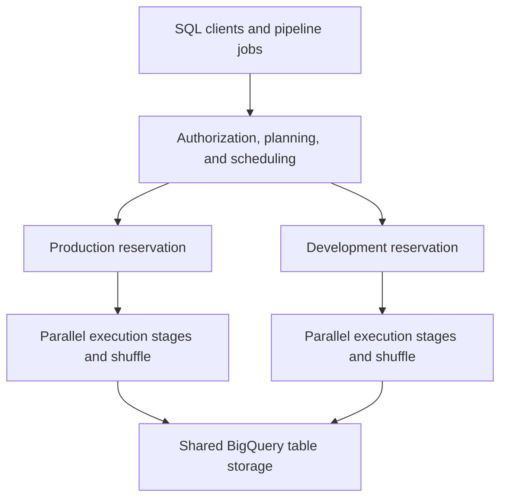
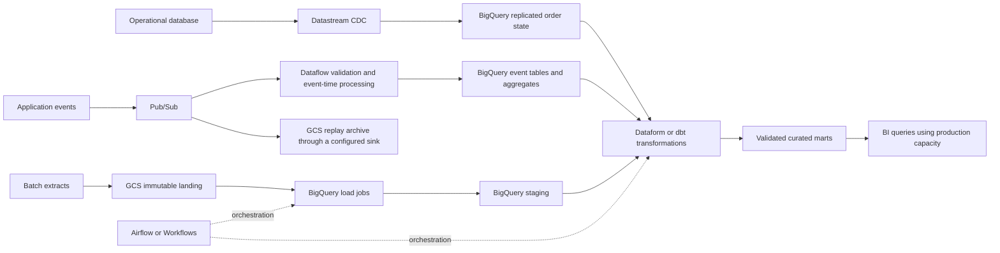

# GCP: Data Engineer Interview Guide

Documentation reviewed: 2026-10-25. Google Cloud services evolve continuously; check current regional availability, launch stage, quotas, editions, and pricing before applying a design.

Google Cloud Platform (GCP) provides managed storage, databases, distributed processing, and analytics. A strong interview answer connects the services to workload requirements: data volume, freshness, correctness, latency, access control, recovery, and cost.

**A useful interview answer:** “I would use Cloud Storage for durable landing and replay, BigQuery for analytical storage and SQL, Pub/Sub for event transport, and Dataflow when the pipeline needs event-time processing or state. I would choose the simplest combination that meets the freshness and recovery requirements, then design identity, governance, monitoring, and cost controls around it.”

**Study order:** Resource hierarchy and IAM → BigQuery architecture → modeling and query optimization → ingestion and CDC → streaming semantics → orchestration → security, operations, and system design.

Examples use GoogleSQL unless marked otherwise. They are independent teaching examples, not a deployment script. Replace project, dataset, bucket, identity, and region placeholders. SQL examples have not been executed against a Google Cloud project.

### Current names and familiar interview terminology

| Familiar name | Current documentation terminology | What to remember |
| --- | --- | --- |
| Cloud Composer | Managed Service for Apache Airflow | Managed Airflow orchestration; existing `composer` API and command names still appear |
| Dataproc | Managed Service for Apache Spark | Managed clusters and serverless Spark; existing `dataproc` interfaces still appear |
| Dataplex Universal Catalog | Knowledge Catalog | Discovery, metadata, lineage, and data quality |
| Cloud Functions | Cloud Run functions | Function-oriented deployment on Cloud Run; distinguish older generations |
| Legacy streaming inserts, `tabledata.insertAll` | Storage Write API (REST) | Distinguish this API from the Storage Write API (gRPC) |

The older names remain common in interviews, repositories, and API identifiers. This guide uses both where useful. [Managed Airflow](https://docs.cloud.google.com/composer/docs), [Managed Spark](https://docs.cloud.google.com/managed-spark/docs), [Knowledge Catalog](https://docs.cloud.google.com/knowledge-catalog/docs/introduction), [Cloud Run functions](https://docs.cloud.google.com/run/docs/functions/overview), [REST streaming](https://docs.cloud.google.com/bigquery/docs/write-api-rest).

## Contents

1. [Cloud Architecture & Fundamentals](#1-cloud-architecture--fundamentals)
2. [Storage & Data Lake](#2-storage--data-lake)
3. [BigQuery Architecture & Internals](#3-bigquery-architecture--internals)
4. [BigQuery Data Modeling & Optimization](#4-bigquery-data-modeling--optimization)
5. [Data Ingestion & Integration](#5-data-ingestion--integration)
6. [Distributed Processing & ETL](#6-distributed-processing--etl)
7. [Orchestration & Transformation](#7-orchestration--transformation)
8. [Databases & Analytics](#8-databases--analytics)
9. [Security & Data Governance](#9-security--data-governance)
10. [Monitoring & Cost Optimization](#10-monitoring--cost-optimization)
11. [Infrastructure & Advanced Architecture](#11-infrastructure--advanced-architecture)

## 1. Cloud Architecture & Fundamentals

### Organizations, folders, projects, and resources

The resource hierarchy provides ownership, policy inheritance, and administrative boundaries.

```text
Organization: example.com
├── Folder: production
│   ├── Project: ingestion-prod
│   │   └── Pub/Sub topics, Dataflow jobs, service accounts
│   ├── Project: data-prod
│   │   └── BigQuery datasets, Cloud Storage buckets
│   └── Project: analytics-prod
│       └── Query jobs and workload assignments
└── Folder: development
    └── Project: analytics-dev
```

| Level | Responsibility | Interview implication |
| --- | --- | --- |
| Organization | Company-level ownership and governance | Apply shared policies and delegate administration |
| Folder | Group projects or other folders | Separate environments, departments, or regulated workloads |
| Project | API enablement, resource ownership, many quotas, billing attribution | Useful isolation boundary, but cross-project access is possible |
| Resource | Dataset, table, bucket, VM, topic, and other service objects | Grant permissions at the narrowest supported scope |

A project has a human-readable name, a project ID, and a numeric project number. Service agents often contain the project number. A billing account pays for linked projects; it is not the parent of those projects in the resource hierarchy.

Allow policies inherited from ancestors contribute permissions. A narrower allow policy does not remove an inherited grant. Deny policies and organization policy constraints add separate restrictions. Organization Policy controls permitted configurations, such as allowed locations; IAM controls which identities can perform actions. [Resource hierarchy](https://docs.cloud.google.com/resource-manager/docs/resource-manager-overview), [Folders](https://docs.cloud.google.com/resource-manager/docs/creating-managing-folders).

### IAM: principals, roles, permissions, and policy evaluation

IAM answers **who can do what on which resource**, potentially under a condition.

- A **principal** is a user, group, service account, or federated identity.
- A **permission** authorizes an operation, such as creating a BigQuery job.
- A **role** bundles permissions. Prefer suitable predefined roles over broad basic roles such as Owner or Editor.
- An **allow policy binding** associates principals with a role on a resource. Conditions can restrict when the binding applies.

For a cross-project BigQuery query, the caller typically needs permission to create a job in the execution project and permission to read the referenced data in the data project. A fully qualified table name does not grant either permission.

**Example:** Analysts run queries from `analytics-prod` against tables in `data-prod`. Grant job execution in the analytics project and dataset access in the data project. Query compute is attributed to the execution project; table storage remains attributed to the data project. Avoid granting project-wide Editor simply to make a query work.

### Service accounts, impersonation, and Workload Identity

A service account is a workload identity and also an IAM resource. These are different relationships: a role granted **to** a service account controls what it can access; a role granted **on** a service account controls who can use or administer that identity.

| Mechanism | Purpose | Main distinction |
| --- | --- | --- |
| Attached service account | Give a runtime its identity | Libraries can obtain short-lived credentials through the runtime |
| Service account impersonation | Act as a service account using short-lived credentials | Requires permission to mint the relevant token |
| Workload Identity Federation | Trust an external workload identity, such as CI OIDC | Avoid storing a long-lived Google service account key |
| Workload Identity Federation for GKE | Give Kubernetes workloads Google Cloud access | Bind access to workload identities rather than sharing node credentials |

`roles/iam.serviceAccountUser` grants `iam.serviceAccounts.actAs`, commonly needed to attach a service account to a resource. `roles/iam.serviceAccountTokenCreator` enables token creation for impersonation. They are not interchangeable. Federation can grant supported resource access directly or use service account impersonation.

For CI, constrain the trusted issuer, audience, repository, and deployment context through provider attributes and conditions. Accepting an identity from an entire external provider without narrowing who can deploy creates an overly broad trust boundary.

**Interview trap:** Application Default Credentials (ADC) is credential discovery, not a particular credential type. ADC can find local user credentials, federation configuration, or runtime credentials. [Impersonation](https://docs.cloud.google.com/iam/docs/service-account-impersonation), [Service account roles](https://docs.cloud.google.com/iam/docs/service-account-permissions), [Workload Identity Federation](https://docs.cloud.google.com/iam/docs/workload-identity-federation).

### Regions, zones, quotas, and service limits

A **region** is a geographic service location. A **zone** is a deployment area within a region and a useful failure boundary. Some resources are global, others regional or zonal; the service determines the scope.

BigQuery datasets have a location, including supported single regions and multi-regions. Job execution and referenced datasets must satisfy location rules. A GCS bucket in a region and a BigQuery dataset in a similarly named multi-region are not automatically colocated for every operation. Verify the specific load, external-table, transfer, and replication rules.

Quotas constrain consumption, request rates, or capacity, often per project and region. Some can be raised. Hard system limits usually cannot. An approved quota increase permits a higher ceiling; it does not necessarily reserve physical capacity or guarantee immediate autoscaling.

When a pipeline cannot scale, check worker or slot limits, regional CPU and IP capacity, API rate limits, source throughput, and sink throughput. Increasing workers cannot solve a bottleneck in an external database. [BigQuery locations](https://docs.cloud.google.com/bigquery/docs/locations), [Cloud quotas](https://docs.cloud.google.com/docs/quotas/overview).

### VPC, subnets, firewall rules, Cloud NAT, and private access

Google Cloud VPC networks are global; subnets are regional and can serve resources in multiple zones of that region. Shared VPC allows service projects to use networking centrally managed in a host project.

| Component | What it provides | What it does not establish by itself |
| --- | --- | --- |
| VPC and subnet | Network address space and connectivity | Authorization to read a BigQuery table |
| Firewall rules or policies | Control allowed traffic to supported network resources | IAM authorization for Google service APIs |
| Cloud NAT | Managed address translation; Public NAT commonly gives private workers outbound internet access | Arbitrary unsolicited inbound access |
| Private Google Access | Reach supported Google APIs from resources without external IPs | A private endpoint for every external service |
| Private Service Connect (PSC) | Private endpoints or backends for supported services and Google APIs | Automatic routing, DNS, and IAM configuration |

A private Dataflow worker may need access to Google APIs, a private database, and an external package repository. Treat these as separate paths. Configure routes, DNS, firewall rules, API access, and any required NAT. A private IP alone does not make a pipeline functional or prevent all data exfiltration.

Private services access, which uses an allocated address range and service networking for supported producer services, is another mechanism. Do not confuse it with Private Google Access or PSC. [VPC networks](https://docs.cloud.google.com/vpc/docs/vpc), [Private access options](https://docs.cloud.google.com/vpc/docs/private-access-options), [Cloud NAT](https://docs.cloud.google.com/nat/docs/overview).

### Cloud KMS, Secret Manager, and VPC Service Controls

Cloud KMS manages cryptographic keys and their lifecycle. Secret Manager stores versioned secret values, such as passwords and API credentials. Put a password in Secret Manager; use KMS when a service needs a customer-managed encryption key (CMEK).

VPC Service Controls adds service perimeters and context-based ingress/egress restrictions around supported Google-managed services. It reduces exfiltration risk even when a principal has IAM permissions. It complements IAM and network controls; it is not a general packet firewall.

**Practice question:** A service account has BigQuery permissions but a query is denied. Investigate the actual caller, execution project, table permissions, IAM conditions or deny policies, service perimeter rules, and KMS access. More IAM grants will not fix every denial. [Secret Manager](https://docs.cloud.google.com/secret-manager/docs/overview), [CMEK](https://docs.cloud.google.com/kms/docs/cmek), [VPC Service Controls](https://docs.cloud.google.com/vpc-service-controls/docs/overview).

## 2. Storage & Data Lake

### Cloud Storage objects and storage classes

Cloud Storage (GCS) is object storage. A bucket contains objects identified by names; object generations identify versions. It is suitable for landing data, retaining source extracts, lake tables, backups, and replay.

In a flat-namespace bucket, `/` in an object name is a naming convention, not a filesystem directory. Hierarchical namespace is a separate bucket capability. Do not assume POSIX append, locking, or rename behavior from filesystem experience.

| Common storage class | Typical use | Minimum storage duration | Cost consideration |
| --- | --- | --- | --- |
| Standard | Frequently accessed data and active pipelines | None | Higher storage price, no class-specific retrieval charge |
| Nearline | Infrequent access, roughly monthly | 30 days | Retrieval and early-deletion charges can matter |
| Coldline | Infrequent access, roughly quarterly | 90 days | Lower storage price, higher access cost |
| Archive | Long-term retention, rarely accessed | 365 days | Retrieval and early-deletion costs matter |

These classes remain online; Archive does not require a tape-style restore delay before reading an object. Storage class and geographic location are separate choices. The current catalog also includes specialized options such as Rapid storage; check their location and workload constraints rather than treating every class as interchangeable. Autoclass can manage transitions for appropriate access patterns. [Storage classes](https://docs.cloud.google.com/storage/docs/storage-classes).

### Lifecycle, versioning, soft delete, and retention

These mechanisms solve different problems:

- **Lifecycle rules:** Apply actions such as changing class or deleting eligible objects. Execution is asynchronous, so a rule is not an exact-time scheduler.
- **Object Versioning:** Retain noncurrent generations when live objects are replaced or deleted according to versioning behavior.
- **Soft delete:** Retain deleted objects or buckets for a configured recovery period on supported buckets.
- **Retention policies and object holds:** Prevent deletion or replacement until retention requirements are met. Locking a retention policy has lasting consequences.

Versioning and soft delete can increase storage usage substantially for temporary files and frequently overwritten data. Lifecycle actions still respect retention policies and holds. A lifecycle deletion may move data into a recoverable state rather than immediately removing all billable bytes.

For a raw data zone, choose retention based on replay needs, source availability, legal requirements, and cost. For temporary processing output, use a separate policy suited to its recovery needs. Keep ingestion identities from deleting raw history unless the pipeline requires that permission. [Lifecycle management](https://docs.cloud.google.com/storage/docs/lifecycle), [Soft delete](https://docs.cloud.google.com/storage/docs/soft-delete), [Object Versioning](https://docs.cloud.google.com/storage/docs/object-versioning).

### Consistency, atomicity, and safe publication

GCS provides strong consistency for object reads after successful writes, object deletion, and object listing. New objects do not need an arbitrary delay before listing can discover them. Permission changes and publicly cached content have separate propagation or caching behavior.

A successful object write publishes the object atomically. It does not make a group of objects a transaction. A reader can observe a partial logical dataset while a producer uploads many files.

Use immutable object names, object generation preconditions for conditional changes, and a manifest or committed table snapshot when readers need a complete batch. A manifest is useful only if readers follow it and referenced files remain stable. Generation preconditions can prevent a retry from overwriting someone else's object.

**Interview trap:** Strong object consistency does not provide relational transactions across a lake directory. Iceberg adds table-level commit semantics above object storage. [GCS consistency](https://docs.cloud.google.com/storage/docs/consistency), [Request preconditions](https://docs.cloud.google.com/storage/docs/request-preconditions).

### Performance and request optimization

GCS scales throughput, but a sudden jump to a high request rate can require ramp-up. Many tiny objects increase listing, scheduling, opening, and request overhead. Repeated writes to one object name also encounter different constraints from writes distributed across many objects.

Use parallel transfers where supported, bounded concurrency, retries with exponential backoff and jitter, and sufficiently large files for analytical scans. Read only required columns and row groups when the format and engine support it. Avoid repeatedly listing an entire bucket to discover a small set of new files; track processed generations or use a manifest/event-driven discovery with reconciliation.

File size is a workload decision. A few hundred MiB per compressed columnar file can be a starting point for a lake, but it is not a universal GCS requirement. Benchmark with the reader, compression codec, partitions, and available parallelism. Check naming guidance when designing for extreme request rates. [Request-rate guidelines](https://docs.cloud.google.com/storage/docs/request-rate), [Storage best practices](https://docs.cloud.google.com/storage/docs/best-practices).

### BigLake and lakehouse architecture

A **data lake** retains data in object storage, often in multiple formats. A **warehouse** provides managed analytical tables and query execution. A **lakehouse** adds table metadata, transactional commits, schema management, and governance to open-format lake data.

BigLake capabilities connect governed lake data with analytics engines. Distinguish the specific table product rather than saying “BigLake stores everything in BigQuery.”

| Table approach | Data location and management | Main trade-off |
| --- | --- | --- |
| Standard BigQuery table | BigQuery-managed storage | Deep integration and low table-maintenance effort |
| External or BigLake external table | Files in external storage; capabilities depend on table type | Query data in place, with format, metadata, and performance constraints |
| Apache Iceberg managed table in BigQuery | BigQuery manages the table; data is in a customer-owned GCS bucket | Open-format access with product-specific write and feature rules |
| Iceberg table managed by another supported catalog/engine | GCS files plus authoritative catalog metadata | More engine flexibility, with compatibility and maintenance responsibilities |

An external table is not automatically an ACID Iceberg table. A shared file format is not enough for safe multi-engine writes: the engines must use compatible table metadata and commit protocols. [Iceberg managed tables](https://docs.cloud.google.com/bigquery/docs/biglake-iceberg-tables-in-bigquery), [BigLake tables](https://docs.cloud.google.com/bigquery/docs/biglake-intro).

### Managed Iceberg tables and metadata catalogs

Iceberg tracks snapshots, manifests, data files, and schema/partition metadata. A catalog identifies tables and coordinates access to their current metadata. Readers use a committed snapshot rather than guessing membership from a directory listing.

Separate an **operational table catalog**, which engines use to resolve and commit tables, from a **discovery/governance catalog**, which helps people find assets and understand ownership and lineage. An Iceberg REST catalog and Knowledge Catalog have different jobs, even when integrations connect them.

For BigQuery-managed Iceberg tables, let BigQuery manage the files. Use a unique, empty storage prefix for each new table. Direct file edits, overlapping table prefixes, or unrelated files in a managed prefix can cause unreadable data or garbage-collection data loss. Open-format read access does not imply arbitrary external write access. Exported metadata visibility can also lag recent writes; check the supported freshness path for each engine.

Catalog names and capabilities are evolving; Google documentation distinguishes the Iceberg REST catalog and older BigLake metastore integrations. Verify the supported catalog, authentication, engine version, and table ownership model before proposing interoperability. [Managed-table restrictions](https://docs.cloud.google.com/bigquery/docs/biglake-iceberg-tables-in-bigquery), [Iceberg REST catalog](https://docs.cloud.google.com/lakehouse/docs/use-lakehouse-metastore-iceberg-rest-catalog), [Classic metastore](https://docs.cloud.google.com/bigquery/docs/manage-open-source-metadata).

### Partitioning, file formats, compaction, and schema evolution

| Concern | Good default reasoning | Failure to avoid |
| --- | --- | --- |
| Partitioning | Match common selective filters and reasonable partition sizes | Millions of tiny partitions or a partition key absent from queries |
| Parquet / ORC | Columnar analytical scans and compression | Assuming all readers support identical logical types |
| Avro | Row-oriented interchange with an embedded schema | Treating it as equivalent to columnar pruning |
| JSON / CSV | Interoperability and simple exchange | Weak typing, parsing cost, ambiguous nulls, and schema drift |
| Compaction | Rewrite many small files into fewer larger files | Deleting files still referenced by retained snapshots |
| Schema evolution | Add compatible fields and manage type/name changes explicitly | Assuming a producer change is safe for every downstream reader |

Iceberg field IDs let supported schema changes preserve column identity. Partition evolution can let old and new layouts coexist in Iceberg generally, but a managed service can support a narrower subset; current BigQuery-managed Iceberg partitioning has its own restrictions.

Compaction changes physical layout. Snapshot expiration and orphan-file cleanup reclaim old or untracked files under separate rules. Coordinate all three with retention and active readers. For standard BigQuery tables, BigQuery manages physical files; do not propose running Spark compaction on Capacitor storage.

**Practice question:** Why can a lake with only 2 TB perform poorly? Explain small files, weak pruning, excessive partitions, metadata overhead, skew, compression choices, and insufficient reader parallelism before blaming the volume alone.

## 3. BigQuery Architecture & Internals

### Dremel, Colossus, Jupiter, and Capacitor

BigQuery is a managed distributed analytical engine. Its commonly discussed building blocks explain why compute can scan large durable datasets without owning their disks.

| Component | Role | Interview relevance |
| --- | --- | --- |
| Dremel | Distributed query execution technology | Parallel scans, aggregation, and execution across workers |
| Colossus | Google's distributed durable storage infrastructure | Table data persists independently of query workers |
| Jupiter | High-bandwidth data-center networking | Moves data between storage, compute, and distributed operators |
| Capacitor | BigQuery's native columnar storage format | Column projection, compression, and efficient analytical reads |

These are architecture concepts, not knobs a data engineer configures. BigQuery's implementation continues to evolve; a classic Dremel tree is a useful explanation, but actual query plans contain a dynamic graph of stages and shuffle exchanges. [Storage and compute separation](https://cloud.google.com/blog/products/bigquery/separation-of-storage-and-compute-in-bigquery), [Architecture background](https://cloud.google.com/blog/products/bigquery/bigquery-under-the-hood), [Columnar representation](https://docs.cloud.google.com/bigquery/docs/migration/schema-data-overview).

### Separation of compute and storage

BigQuery stores table data independently of the compute allocated to jobs. You do not provision a database server that permanently owns each table's CPU, RAM, and local disk.

This allows multiple workloads to read shared tables while using separately managed capacity. It does not eliminate contention: jobs can compete for slots, and writes can conflict on shared data. Storage and query compute also have separate billing dimensions.



**Interview answer:** “A dataset owns analytical objects and has a location. A reservation manages compute capacity for assigned work in a location. Assigning a project to a reservation does not move its tables or create another copy of them.”

### Slots, reservations, editions, and autoscaling

A **slot** is a virtual unit of query computation, including compute resources used to execute tasks. It is not a customer-managed VM or a guarantee that a query gets one fixed CPU for its entire lifetime.

| Concept | Meaning |
| --- | --- |
| Slot | Unit of execution capacity allocated as a job's stages run |
| Reservation | Pool of capacity for workload management and isolation |
| Assignment | Routes supported job types from a project, folder, or organization to a reservation |
| Edition | Capacity feature and pricing tier: Standard, Enterprise, or Enterprise Plus |
| Baseline capacity | Capacity allocated to a reservation independently of current job activity |
| Autoscaling | Adds and removes capacity under configured limits and service behavior |
| Capacity commitment | Purchase arrangement for capacity over a term; separate from creating a reservation |

Reservations and assignments are location-specific. Match the job type and execution project, including inherited assignments. A data project's reservation does not automatically serve a query billed to another project.

Idle baseline or committed capacity can be shared under applicable reservation rules; autoscaled capacity is not a pool to assume other workloads can borrow. Sharing depends on administrative scope, location, edition, and configuration. Newer scaling modes and maximum-slot settings affect whether borrowed idle capacity can exceed a configured target, so read the actual reservation settings.

More slots improve execution only when there is useful parallel work. A skewed key, serial stage, expensive UDF, remote dependency, or metadata operation can remain slow. Edition features and autoscaling allocation/billing rules change; avoid memorizing one universal scaling increment or minimum charge. [Slots](https://docs.cloud.google.com/bigquery/docs/slots), [Reservations](https://docs.cloud.google.com/bigquery/docs/reservations-workload-management), [Editions](https://docs.cloud.google.com/bigquery/docs/editions-intro).

### Columnar storage and nested data

Columnar storage lets a query read referenced columns without reading every field in each row. Similar values compress efficiently, reducing storage and scan work. Nested data can be represented column-wise while preserving parent/child structure.

`SELECT *` references every column. `LIMIT 10` does not generally limit bytes scanned from a standard table. To reduce scan work, project fewer columns and prune partitions or clustered blocks.

The bytes processed by a query are not simply the compressed size of files on disk. BigQuery uses its query billing rules and logical column data sizes; inspect estimates and actual job statistics rather than multiplying bucket storage size by a query rate. [Query cost controls](https://docs.cloud.google.com/bigquery/docs/best-practices-costs).

### Distributed execution, stages, and shuffle

A typical query path is:

1. Authenticate, authorize access, parse SQL, and resolve metadata.
2. Optimize the query and construct execution stages.
3. Read required columns and eligible partitions/blocks in parallel.
4. Filter, join, aggregate, and exchange intermediate data through shuffle.
5. Combine results and write the output.

**Shuffle** redistributes intermediate rows between workers, commonly by join or grouping key. A large input does not always mean a large shuffle; filtering and partial aggregation can shrink data first. A small input can still produce a huge intermediate result through a many-to-many join.

Look for stages that emit far more rows than they read, high shuffle volume, spill, large differences between average and maximum worker time, and time spent waiting for resources. Broadcast versus repartitioned joins are optimizer choices; SQL table order is not a universal physical-plan guarantee. [Query plan explanation](https://docs.cloud.google.com/bigquery/docs/query-plan-explanation), [Compute optimization](https://docs.cloud.google.com/bigquery/docs/best-practices-performance-compute).

**Practice question:** Two queries scan the same bytes but have very different runtimes. Discuss joins, intermediate cardinality, shuffle, skew, CPU-intensive expressions, available slots, and caching.

## 4. BigQuery Data Modeling & Optimization

### Grain, keys, partitioning, and clustering

Define the row grain first: one order, one order line, one event, or one current entity state. Record the business key, event identity, source ordering fields, and update/delete behavior. Physical optimization cannot repair a model that double-counts facts.

BigQuery supports primary and foreign key declarations that are **not enforced**. They can inform optimization, so declare them only when the data satisfies them. Validate uniqueness and referential integrity in the pipeline.

**Partitioning** divides a table into segments using supported time-unit columns, ingestion time, or integer ranges. **Clustering** organizes adaptive storage blocks by selected column values, improving block pruning for suitable filters.

```sql
CREATE TABLE `example-project.analytics.orders` (
  order_id STRING NOT NULL,
  order_date DATE NOT NULL,
  customer_id STRING,
  country STRING,
  amount NUMERIC
)
PARTITION BY order_date
CLUSTER BY customer_id, country
OPTIONS (require_partition_filter = TRUE);

SELECT customer_id, SUM(amount) AS revenue
FROM `example-project.analytics.orders`
WHERE order_date >= DATE '2026-10-01'
  AND order_date < DATE '2026-11-01'
  AND customer_id = 'customer-42'
GROUP BY customer_id;
```

The date predicate enables partition pruning; the customer predicate can reduce blocks within eligible partitions. Clustering column order matters, especially the leading columns. Choose it from real filter patterns, not from a blanket rule to sort by highest cardinality.

Prefer direct, constant or parameterized bounds on the partition column. Supported expressions can still prune, but dynamic predicates and transformations can prevent it; verify bytes and the plan. `require_partition_filter` requires an eligible filter, not necessarily a selective one. It does not make a query cheap by itself.

Avoid date-sharded tables when a partitioned table provides the required behavior. Excessively small partitions add overhead. Clustering is not a B-tree index, does not enforce uniqueness, and does not guarantee ordered query results. [Partitioned tables](https://docs.cloud.google.com/bigquery/docs/partitioned-tables), [Clustering](https://docs.cloud.google.com/bigquery/docs/clustered-tables), [Key constraints](https://docs.cloud.google.com/bigquery/docs/primary-foreign-keys).

### Nested and repeated fields: STRUCT, ARRAY, and UNNEST

A `STRUCT` groups named fields. An `ARRAY` holds repeated values. An `ARRAY<STRUCT<...>>` models repeated child records, such as items belonging to an order.

```sql
WITH orders AS (
  SELECT
    'order-1' AS order_id,
    STRUCT('customer-42' AS id, 'DE' AS country) AS customer,
    [STRUCT('sku-a' AS sku, 2 AS quantity, NUMERIC '10.00' AS price),
     STRUCT('sku-b' AS sku, 1 AS quantity, NUMERIC '5.00' AS price)] AS items
)
SELECT
  o.order_id,
  o.customer.country,
  SUM(item.quantity * item.price) AS order_total
FROM orders AS o
CROSS JOIN UNNEST(o.items) AS item
GROUP BY o.order_id, o.customer.country;
```

The result contains one order totaling 25.00. Flattening creates one intermediate row per item. Summing an order-level amount after that flattening would duplicate it unless the query handles the changed grain.

`CROSS JOIN UNNEST` removes parents with empty or null arrays. A correlated `LEFT JOIN UNNEST(...) ... ON TRUE` preserves those parents. Flattening two independent arrays can create their Cartesian product; correlate them by a real relationship or offsets only when positional alignment is part of the data contract.

Nest tightly related, bounded child data frequently read with its parent. Keep reusable dimensions separate when independent updates and many relationships make that model clearer. Denormalization is a choice, not a requirement to turn every dataset into one enormous nested table. [Nested-field performance](https://docs.cloud.google.com/bigquery/docs/best-practices-performance-nested), [Arrays](https://docs.cloud.google.com/bigquery/docs/arrays).

### Query plans, slot utilization, and shuffle optimization

Use the execution graph and job statistics to identify the bottleneck before rewriting SQL.

| Symptom | Likely causes | Useful response |
| --- | --- | --- |
| Excessive scanned bytes | Broad projection or missing pruning | Select needed columns and bound partitions |
| Large shuffle | Wide rows, large joins, high-cardinality grouping | Reduce inputs, pre-aggregate where semantics permit |
| Join output explosion | Duplicate keys or incorrect join grain | Validate cardinalities and fix the relationship |
| One slow worker/stage | Hot key, skew, or uneven work | Separate hot keys or change aggregation strategy |
| Queueing / resource waiting | Capacity or concurrency contention | Inspect reservations and workload overlap |
| High CPU with modest bytes | Parsing, regex, UDFs, repeated expressions | Materialize useful intermediate results or simplify computation |

Filter before expensive operations where possible. Aggregate before joining only if doing so preserves the required grain and measures. Prefer set-based SQL to many tiny statements. A common table expression improves readability but does not guarantee the engine materializes and reuses its result.

Approximate aggregations can be useful when the business accepts bounded approximation; explain the accuracy trade-off. Do not replace exact financial or reconciliation results with approximate functions merely to improve speed. [Compute best practices](https://docs.cloud.google.com/bigquery/docs/best-practices-performance-compute).

### Materialized views, BI Engine, and result caching

| Mechanism | What it reuses | Suitable use | Main limitation |
| --- | --- | --- | --- |
| Logical view | Stored SQL definition | Reusable semantics and access patterns | Usually still executes the underlying computation |
| Materialized view | Stored derived results | Repeated supported aggregations or transformations | Query-shape, source, refresh, and rewrite restrictions |
| BI Engine | In-memory acceleration for supported queries | Interactive dashboards with a suitable working set | Capacity and SQL/source support determine coverage |
| Query result cache | Prior result of an eligible repeated query | Identical repeated queries over unchanged inputs | Cache eligibility and invalidation rules |

Some materialized views can update incrementally; others require different refresh behavior. Smart tuning can rewrite eligible queries to use a materialized view, but it is not guaranteed for every view or query. Compare maintenance cost and freshness requirements with scheduled table materialization.

BI Engine can accelerate supported portions of a query; inspect acceleration statistics rather than assuming an entire dashboard stays in memory. It is separate from ordinary query result caching and reservation compute.

Cached results generally require identical query text and eligible unchanged inputs. Nondeterministic functions, recently streamed data, security features, and destination settings can affect eligibility. Results are typically cached for about 24 hours, with no guarantee a particular entry remains available. Disable result caching for a meaningful execution benchmark. [Materialized views](https://docs.cloud.google.com/bigquery/docs/materialized-views-intro), [BI Engine](https://docs.cloud.google.com/bigquery/docs/bi-engine-intro), [Result cache](https://docs.cloud.google.com/bigquery/docs/cached-results).

### Incremental MERGE: deduplication, ordering, and deletes

An incremental pipeline must define **which changes belong to the batch**, **which version wins**, and **what a replay does**. Filtering on `MAX(updated_at)` alone can miss late records, ties, and deletes. Ingestion time records arrival, not source transaction order.

This example maintains current order state, including tombstones. Assume:

- `order_id`, `source_version`, and `op` are non-null and validated; `op` is `I`, `U`, or `D`.
- `source_version` is strictly ordered per key across the entire source lifecycle. The integer is a teaching simplification; a real log position may require a compound representation.
- Duplicate copies of one source version agree on their payload; conflicting copies are rejected before this step.
- `order_changes_batch` contains the complete records selected for one replayable batch. Non-delete events carry the full after-image.
- The target starts with at most one row per order and has no partition-filter requirement for this example.

```sql
CREATE TABLE `example-project.analytics.order_state` (
  order_id STRING NOT NULL,
  amount NUMERIC,
  source_version INT64 NOT NULL,
  is_deleted BOOL NOT NULL
)
CLUSTER BY order_id;

MERGE `example-project.analytics.order_state` AS target
USING (
  SELECT order_id, amount, source_version, op
  FROM `example-project.staging.order_changes_batch`
  QUALIFY ROW_NUMBER() OVER (
    PARTITION BY order_id
    ORDER BY source_version DESC
  ) = 1
) AS source
ON target.order_id = source.order_id
WHEN MATCHED AND source.source_version > target.source_version THEN
  UPDATE SET
    amount = IF(source.op = 'D', NULL, source.amount),
    source_version = source.source_version,
    is_deleted = source.op = 'D'
WHEN NOT MATCHED THEN
  INSERT (order_id, amount, source_version, is_deleted)
  VALUES (
    source.order_id,
    IF(source.op = 'D', NULL, source.amount),
    source.source_version,
    source.op = 'D'
  );
```

Replaying the batch changes nothing once its versions are applied. An older update cannot overwrite newer state. A delete arriving before an older insert still leaves a tombstone that blocks resurrection. Publish active rows through a view filtering `is_deleted = FALSE`.

Physically deleting the row also deletes its remembered version unless that version is retained elsewhere. Tombstones need a retention contract tied to source replay and lateness; keeping them forever is not the only design, but dropping them arbitrarily is unsafe. Partial-update CDC needs field-aware reconstruction before this full-after-image merge.

For partitioned targets, explicitly constrain source and target partitions when the affected range is proven complete. A recent-date condition added to `ON` can make an existing older row appear unmatched and create a duplicate. Handle partition-key changes, historical corrections, and unbounded late changes deliberately. Verify pruning; a source-only filter does not guarantee the desired target scan. [MERGE semantics](https://docs.cloud.google.com/bigquery/docs/reference/standard-sql/dml-syntax), [MERGE partition pruning](https://docs.cloud.google.com/bigquery/docs/using-dml-with-partitioned-tables).

### DML concurrency and transactions

A successful individual DML statement is atomic. BigQuery limits concurrent mutating DML and queues some standalone statements; quotas and table types determine the exact behavior. Conflicting mutations can fail, so retries must preserve source ordering and idempotency.

Standalone DML on different partitions can avoid conflicts. Multi-statement transactions have stricter concurrency behavior: concurrent transactions mutating the same table can conflict even when they target different partitions. Do not wrap a single `MERGE` in a transaction merely to make it atomic.

Use a multi-statement transaction when several supported operations must commit together, for example updating related analytical tables and a batch checkpoint in BigQuery. Transactions provide a consistent snapshot and atomic commit within their supported scope. They do not make a GCS write, Pub/Sub acknowledgment, or external API call part of the same transaction.

Recently ingested rows have API-specific DML restrictions. Do not transfer a restriction from legacy REST streaming to gRPC streaming without checking documentation. Keep transactions short and retry the whole transaction when required. [DML behavior](https://docs.cloud.google.com/bigquery/docs/data-manipulation-language), [Transactions](https://docs.cloud.google.com/bigquery/docs/transactions).

### On-demand versus capacity-based pricing

| Model | Primary query-compute charge | Good fit | Main control |
| --- | --- | --- | --- |
| On-demand | Billable bytes processed, subject to pricing rules | Variable or modest query usage | Projection, pruning, maximum bytes billed, query quotas |
| Capacity-based | Allocated slot capacity over time under edition/reservation rules | Sustained workloads and explicit workload management | Capacity sizing, assignments, autoscaling, commitments |

Capacity pricing does not make inefficient SQL harmless: it consumes shared capacity, delays other jobs, and may trigger autoscaling. On-demand pricing still uses slots internally; it simply bills query compute differently.

Storage, streaming, data transfer, BI Engine, and other services can add charges. `total_slot_ms` measures consumed work and is useful for attribution; it is not a direct invoice for a reservation's allocated capacity. Dry-run estimates are helpful, but clustered block pruning and dynamic execution can make actual bytes differ from estimates. [Pricing](https://cloud.google.com/bigquery/pricing), [Cost controls](https://docs.cloud.google.com/bigquery/docs/best-practices-costs).

**Practice question:** A dashboard query became slower after switching to reservations. Check workload assignment, region, edition, baseline and autoscaling, concurrent jobs, idle-slot assumptions, cache status, and the query plan before concluding that capacity pricing is slower.

## 5. Data Ingestion & Integration

### Load jobs, REST streaming, and the Storage Write API

| Method | Visibility and usage | Correctness responsibility |
| --- | --- | --- |
| Batch load job | Load bounded files, commonly from GCS | Track the batch and immutable inputs; reuse job identity when resolving ambiguous submission |
| REST streaming / `tabledata.insertAll` | Low-latency row ingestion through the older interface | Handle partial row errors; `insertId` deduplication is best effort |
| gRPC default stream | Immediately queryable acknowledged writes, at-least-once semantics | Deduplicate business events when retries or upstream duplicates are possible |
| gRPC application-created committed stream | Immediate visibility with optional offset-based exactly-once writes within a stream | Persist and recover stream identity and offsets correctly |
| gRPC pending streams | Buffer data and commit supported streams atomically | Coordinate stream finalization and commit/retry behavior |

For new streaming integrations, Google recommends the gRPC Storage Write API. “Committed” describes visibility; exactly-once behavior also requires correct offset handling on an application-created stream. The default stream is committed but does not provide offset-based deduplication.

Exactly-once appends within one stream do not remove duplicate business events published twice upstream or coordinate arbitrary writes across different streams. Connector-specific guarantees depend on its configuration and recovery implementation. [gRPC write API](https://docs.cloud.google.com/bigquery/docs/write-api-intro), [Stream semantics](https://docs.cloud.google.com/bigquery/docs/write-api-streaming), [REST streaming](https://docs.cloud.google.com/bigquery/docs/write-api-rest).

### Reliable batch loads and Data Transfer Service

A successful load job publishes its accepted output atomically; a failed job does not expose a partial load. If a job allows bad records, atomic success does not mean every input record was accepted. For reconciliation-critical ingestion, use strict validation or explicitly account for rejected records.

Give the logical load a stable job ID, retain the source manifest, and inspect the existing job after a timeout before creating another append job. Idempotent job submission and idempotent business ingestion are related but different: submitting the same files under a new successful append job can duplicate data.

Choose append, overwrite, or staging-and-merge according to the source contract. Overwrite is suitable for a complete validated snapshot; it is dangerous when the extract is accidentally incomplete. Verify GCS/BigQuery location compatibility and runtime permissions.

BigQuery Data Transfer Service schedules and automates supported source transfers. Connector behavior controls incremental extraction, backfills, credentials, and destination semantics. Scheduled queries also use Data Transfer Service features. It does not replace a general workflow engine for arbitrary multi-service dependencies. [Batch loading](https://docs.cloud.google.com/bigquery/docs/batch-loading-data), [Load job retries](https://docs.cloud.google.com/bigquery/docs/loading-data-cloud-storage-csv), [Transfer sources](https://docs.cloud.google.com/bigquery/docs/dts-data-sources-intro), [Scheduled queries](https://docs.cloud.google.com/bigquery/docs/scheduling-queries).

### Datastream: CDC, replication, and backfills

Datastream captures changes from supported sources and delivers them to supported destinations. For database CDC, it reads source change logs instead of repeatedly scanning the entire source table.

- **Backfill:** Copy existing records so the destination has an initial history or state.
- **CDC:** Continue applying inserts, updates, and deletes after the initial load.
- **Log position:** Identify source progress and ordering; source timestamps alone may be insufficient.
- **Apply lag:** Delay between captured changes and their incorporation into queryable destination state.

Backfill and CDC can overlap. The pipeline must combine them using connector-supported ordering and reconciliation rather than assuming “backfill finishes, then all changes start.” Configure source logs and retention to survive outages and backfills; losing required log history can force reinitialization.

For BigQuery destinations, distinguish append-only change history from merged current-state replication. Datastream can deliver change records through the Storage Write API, while BigQuery applies them according to CDC behavior and staleness settings. A successful stream connection does not prove that analytical state is current.

Datastream events can arrive more than once and out of order; use source metadata and destination-specific apply behavior. Tables without source primary keys have different replication behavior and can remain append-only rather than becoming a deduplicated current-state table.

Keys, supported DDL changes, type mapping, source privileges, and destination mode all affect correctness. Monitor capture lag and destination apply freshness separately, then reconcile counts, deletes, and selected aggregates at a comparable source position. [Datastream behavior](https://docs.cloud.google.com/datastream/docs/behavior-overview), [Datastream FAQ](https://docs.cloud.google.com/datastream/docs/faq), [BigQuery destination](https://docs.cloud.google.com/datastream/docs/destination-bigquery), [BigQuery CDC](https://docs.cloud.google.com/bigquery/docs/change-data-capture).

### Pub/Sub, Dataflow, and GCS ingestion patterns

| Pattern | When to choose it | What still needs design |
| --- | --- | --- |
| Files → GCS → BigQuery load | Minutes-to-hours freshness and efficient bounded loads | Completion detection, manifests, schema checks, replay |
| Pub/Sub → BigQuery subscription | Supported direct event delivery with limited transformation needs | Schema behavior, delivery errors, duplicates, dead-letter handling |
| Pub/Sub → Dataflow → BigQuery | Parsing, enrichment, windows, state, or complex routing | Event-time semantics, sink guarantees, scaling, recovery |
| Database → Datastream → BigQuery | Supported database replication | Keys, backfill, log retention, DDL compatibility, apply lag |

Pub/Sub decouples publishers from subscribers and buffers messages subject to retention. Default delivery is at least once and unordered. Ordering is opt-in for messages sharing an ordering key, under its regional and publication rules; it is not a global order across all events.

Exactly-once delivery is available for supported pull-subscription scenarios with regional constraints. It prevents certain redeliveries after successful acknowledgment; it does not atomically commit a subscriber's external database write and acknowledgment. Separate publications of the same business event can still be duplicates.

GCS object events can also be duplicated. Key file ingestion by immutable object identity, including generation when appropriate, rather than relying on event delivery count. Acknowledge only after durable processing or a durable handoff. A dead-letter queue needs an owner and replay process. [Pub/Sub delivery](https://docs.cloud.google.com/pubsub/docs/subscription-overview), [Exactly-once delivery](https://docs.cloud.google.com/pubsub/docs/exactly-once-delivery), [Ordering](https://docs.cloud.google.com/pubsub/docs/ordering).

### Schema evolution, deduplication, and reconciliation

Treat the schema as a contract across producers, transport, processing, and consumers. Adding a nullable field is often compatible, but a particular connector or downstream model can still require an update. A rename may look like a drop plus an add. Narrowing types or making a nullable field required can reject historical data.

Keep raw payloads or an equivalent replayable source, validate required fields, quarantine invalid records with reasons, and version breaking changes. Do not silently replace malformed financial amounts with zero.

Deduplicate at the correct grain: transport message ID, event ID, source key/version, or file generation. A business key alone may collapse legitimate multiple events. Finite streaming deduplication state gives a finite duplicate-detection horizon; longer replays need durable history or a stateful sink.

Reconciliation compares equivalent source and destination boundaries: source position, snapshot, partition, or completed batch. Compare row counts, distinct keys, null rates, sums, version ranges, and deletion behavior. Counts alone cannot detect offsetting missing and duplicate records.

**Practice question:** A pipeline reports zero errors but revenue is wrong. Investigate duplicated events, out-of-order updates, lost deletes, partial snapshots, type conversion, time-zone boundaries, and join grain before examining infrastructure capacity.

## 6. Distributed Processing & ETL

### Dataflow and Apache Beam

Apache Beam defines a portable programming model for batch and streaming. Dataflow is Google's managed runner for Beam pipelines. A Beam pipeline describes work; the runner distributes and executes it.

| Beam concept | Meaning | Example |
| --- | --- | --- |
| Pipeline | Graph of processing and I/O | Read events, validate, aggregate, write |
| PCollection | Distributed collection of elements | Bounded files or an unbounded event stream |
| PTransform | Operation producing another collection | Parse, filter, group, join, or write |
| ParDo / DoFn | Per-element processing function | Validate and normalize an event |
| Keyed aggregation | Combine values by key and window | Revenue per customer per hour |
| Side input | Additional input made available to a transform | Small reference dataset |

PCollections are conceptually immutable. Transforms create new collections rather than mutating a shared Python list. Avoid collecting an entire distributed dataset into worker memory or calling an external service once per element without rate and retry controls.

Batch input is bounded. Streaming input is unbounded, so aggregations need a policy for grouping events over time and deciding when to publish results. The same Beam model supports both, but operational behavior and connector capabilities differ. [Beam programming guide](https://beam.apache.org/documentation/programming-guide/), [Dataflow](https://docs.cloud.google.com/dataflow/docs/overview).

### Windows, event time, watermarks, and triggers

**Event time** is when the event occurred according to the data. **Processing time** is when the system processes it. A delayed event can have an old event timestamp even though it arrived just now.

| Concept | Question it answers |
| --- | --- |
| Fixed / tumbling window | Which non-overlapping time interval owns an event? |
| Sliding window | Which overlapping intervals include the event? |
| Session window | Which activity session contains the event, based on an inactivity gap? |
| Watermark | How far does the system estimate event-time progress has advanced? |
| Trigger | When should a window emit a result or pane? |
| Allowed lateness | How long can supported late updates be accepted after the watermark passes the window end? |
| Accumulation mode | Does a later pane contain all accumulated values or only values since a previous firing? |

A watermark is an estimate, not proof that no earlier event can arrive. Slow sources and pipeline stages can hold it back. Allowed lateness is relative to event-time/window progress, not simply “wait this many wall-clock minutes after receiving the first event.”

Example: aggregate the window `[10:00, 10:05)` with early output, an on-time firing, and accepted late updates.

| Observation | Meaning | Sink consequence |
| --- | --- | --- |
| At processing time 10:04, receive an event timestamped 10:02 | In-window event | May contribute to an early pane |
| Watermark passes 10:05 | Estimated end-of-window progress | On-time pane can fire |
| Receive an event timestamped 10:03 after that firing | Late event | May update the window if policy and retained state allow |
| Watermark passes the window's lateness horizon | Window state becomes eligible for cleanup | Later data needs a correction/replay policy |

If accumulating panes emit totals 100 and then 130, blindly appending and summing them produces 230. Use a sink contract that supports replacement/upsert by key and window, or emit correct deltas under a defined pane policy. “Late data supported” does not specify how downstream consumers should interpret updates. [Beam windows, triggers, and lateness](https://beam.apache.org/documentation/programming-guide/#windowing).

### Stateful processing, timers, and exactly-once boundaries

Stateful transforms maintain state scoped by key and window under Beam's model. Timers schedule event-time or processing-time actions. They support bounded deduplication, custom sessions, buffering, and other logic that ordinary stateless transforms cannot express.

State needs a cleanup policy. A global window with an unbounded set of keys or event IDs can grow indefinitely. A hot key can route too much work to a small execution path; adding workers does not automatically parallelize one indivisible key's state.

Dataflow's exactly-once processing commits internal results once even when processing attempts repeat. Batch uses exactly-once processing; streaming supports exactly-once and at-least-once modes. External side effects inside a `DoFn`, such as sending an email or charging an API, are not automatically committed exactly once.

Use suitable sink connectors, idempotency keys, transactional destinations, or durable outbox-style handoffs where necessary. Verify the end-to-end contract for the chosen source, mode, transform, and sink. A log line appearing twice does not alone prove the final table has duplicate committed output. [Dataflow exactly-once](https://docs.cloud.google.com/dataflow/docs/concepts/exactly-once), [Beam state and timers](https://beam.apache.org/documentation/programming-guide/#state-and-timers).

### Dataproc / Managed Service for Apache Spark

Managed Spark provides managed infrastructure for Spark and related open-source processing. Cluster-based deployments suit workloads needing explicit environment control, reusable clusters, or ecosystem components. Serverless Spark runs supported workloads without requiring the user to manage a persistent cluster.

Choose Spark when existing Spark code, libraries, open-format lake operations, or complex distributed processing make it a good fit. Separate durable data in GCS or another suitable store from ephemeral compute where the application allows it. Cluster-local storage can serve temporary processing needs without becoming the only copy of important data.

Spark tuning still matters: shuffle partitions, skew, executor memory, small files, joins, and serialization can dominate runtime. Autoscaling is not a cure for an inefficient plan. Use ephemeral job clusters or serverless execution when they meet the workload's startup, dependency, and runtime requirements; persistent clusters can make sense for sustained shared usage. [Managed Spark documentation](https://docs.cloud.google.com/managed-spark/docs).

### Dataflow versus Dataproc versus BigQuery SQL

| Requirement | Usually start with | Why |
| --- | --- | --- |
| Joins, aggregations, and ELT over BigQuery tables | BigQuery SQL | Avoid moving analytical data into a separate engine |
| Event-time windows, timers, or custom streaming state | Dataflow / Beam | Explicit streaming semantics with a managed runner |
| Existing Spark estate or Spark-specific libraries | Managed Spark / Dataproc | Reuse code and ecosystem tools |
| Large open-table transformations already built in Spark | Managed Spark | Suitable connectors and table maintenance capabilities |
| Small service call or lightweight event handler | Cloud Run or functions | Distributed data engines add unnecessary overhead |

This is a starting point, not an exclusivity rule. Services overlap and gain capabilities. Compare existing skills, runtime support, latency, data movement, connectors, operability, and total cost. BigQuery can ingest streams without requiring Dataflow, and Dataflow can run batch jobs.

**Practice question:** A streaming job falls behind while CPU is low. Check source/sink limits, hot keys, blocked RPCs, worker concurrency, watermark progress, and state/shuffle pressure. Increasing worker count may be ineffective.

## 7. Orchestration & Transformation

### Managed Service for Apache Airflow, formerly Cloud Composer

Managed Airflow schedules and monitors DAGs of dependent tasks. Use it to coordinate extraction, processing jobs, validation, and publication across services. Let the data engines perform heavy computation.

- A DAG defines dependencies; task instances execute for particular runs and data intervals.
- Retries rerun task work, so external operations must be safe to repeat.
- Backfills process historical intervals; derive paths and parameters from the interval, not `now()`.
- Pools and concurrency limits protect databases, APIs, and compute capacity.
- Sensors or deferrable operators can wait for external completion; choose behavior that avoids wasting worker resources.

Pass small identifiers and metadata through XCom rather than moving large datasets through the scheduler's metadata store. Avoid network calls and heavy computation at DAG parse time. Monitor scheduler health, task queue time, worker saturation, and dependency failures separately from the jobs they launch.

If a task submits a Dataflow or BigQuery job and then loses its worker, the retry should find or reconcile the existing job. A successful submission request is not proof the remote job completed. [Managed Airflow documentation](https://docs.cloud.google.com/composer/docs).

### Dataform: SQLX, dependencies, incremental models, and assertions

Dataform manages SQL transformation workflows in BigQuery. SQLX combines SQL with configuration and dependency references. Compilation produces executable actions; workflow execution runs them in dependency order.

```sqlx
config {
  type: "table",
  assertions: {
    uniqueKey: ["order_id"],
    nonNull: ["order_id", "amount"]
  }
}

SELECT order_id, amount
FROM ${ref("order_state")}
WHERE is_deleted = FALSE
```

`ref()` resolves a relation and records a dependency. Assertions check expectations such as non-null fields and unique keys. An assertion does not automatically turn every dependent publication into an atomic operation; configure downstream dependencies so critical validation gates the intended consumers.

For an incremental table, `type: "incremental"` changes build behavior. An incremental `uniqueKey` config controls merge matching; without an appropriate merge setup, incremental data can append. This is distinct from the similarly named uniqueness assertion, which checks data after construction. Neither fixes duplicated source keys or stale updates by itself.

Use `incremental()`, `self()`, and explicit source selection to avoid reprocessing unnecessary data. A lookback window handles only lateness within its contract. `updatePartitionFilter` can restrict target work but can also exclude a real existing row, producing incorrect matches if the bound is unsafe. Require a source-version policy when changes arrive out of order.

Release configurations and workflow configurations separate compiled code from scheduled execution. Use version-controlled changes and isolated development datasets. [Dataform overview](https://docs.cloud.google.com/dataform/docs/overview), [Incremental tables](https://docs.cloud.google.com/dataform/docs/create-tables), [Assertions](https://docs.cloud.google.com/dataform/docs/test-data#assertions).

### Workflows, Cloud Scheduler, and Eventarc

| Service | Responsibility | Typical use |
| --- | --- | --- |
| Workflows | Durable orchestration of supported API calls with branching, retries, and state | Start a job, poll for completion, branch on its result |
| Cloud Scheduler | Time-based invocation | Start a daily workflow or publish a scheduled message |
| Eventarc | Route events from supported providers to targets | Invoke a service when a relevant event occurs |

Choose Airflow for richer data DAGs, historical scheduling, and an established operator ecosystem. Choose Workflows for a relatively small API orchestration sequence when running an Airflow environment adds little value. Scheduler supplies a clock trigger; Eventarc supplies event routing. Neither alone defines all pipeline dependencies and recovery behavior.

Delivery and retries can repeat requests. Authenticate service-to-service calls and distinguish transient errors from invalid inputs. An HTTP timeout is an ambiguous outcome when the target may have completed the work. [Workflows](https://docs.cloud.google.com/workflows/docs/overview), [Scheduler](https://docs.cloud.google.com/scheduler/docs/overview), [Eventarc](https://docs.cloud.google.com/eventarc/docs/overview).

### Cloud Run, Cloud Functions, and Batch

Cloud Run executes managed container services and jobs. Services handle requests and events; jobs execute tasks to completion. Cloud Run functions, historically Cloud Functions, offers a function-oriented deployment model. Check generation-specific concurrency, timeout, networking, and trigger behavior.

Batch provisions and schedules compute for batch workloads such as containerized processing or specialized VM-based jobs. It can fit work needing particular machine resources or execution controls that a simple request handler does not provide.

Use these services for lightweight integration, APIs, validation, or suitable bounded jobs. A function can start a large distributed job and return its identity; it need not perform the entire dataset transformation inside an event handler. Constrain concurrency to protect downstream databases and handle termination or retry safely. [Cloud Run](https://docs.cloud.google.com/run/docs/overview/what-is-cloud-run), [Functions](https://docs.cloud.google.com/run/docs/functions/overview), [Batch](https://docs.cloud.google.com/batch/docs/get-started).

### dbt, CI/CD, idempotency, and backfills

dbt integrates with BigQuery through its adapter and provides SQL models, tests, macros, dependencies, and documentation. Prefer a consistent transformation framework for a given workflow unless mixing tools has a concrete benefit. Airflow or another orchestrator can invoke dbt; orchestration and transformation remain separate responsibilities.

A practical delivery path is: compile → validate references and configuration → build/test selected changes in an isolated dataset → review → deploy a known revision → monitor the run. CI identities should use federation or another suitable short-lived mechanism, with separate development and production permissions.

Idempotency means rerunning the same logical work has the same intended effect. Examples include overwriting a proven-complete partition, merging by stable key and source version, and reusing a remote job ID after a timeout. Appending a batch twice or generating new event IDs during each retry is not idempotent.

Track the logical interval, source boundary, code revision, input manifest, job IDs, and completion state. Advance a checkpoint only after durable output and required validation. When output and checkpoint cannot commit together, design retries to close that failure gap safely. [dbt BigQuery setup](https://docs.getdbt.com/docs/local/connect-data-platform/bigquery-setup).

**Practice question:** A DAG task failed after its BigQuery job succeeded. Explain how stable job identity, output reconciliation, and idempotent writes prevent a task retry from double-loading data.

## 8. Databases & Analytics

### Cloud SQL and AlloyDB

Cloud SQL provides managed relational databases, including PostgreSQL, MySQL, and SQL Server. It fits conventional application transactions, relational constraints, indexes, and engine compatibility. Managed operation does not remove connection limits, slow queries, locking, or storage/CPU capacity planning.

AlloyDB is PostgreSQL-compatible and separates compute from distributed storage. Read pools scale read traffic. Its columnar engine can accelerate eligible analytical queries over selected data, supporting mixed transactional and analytical needs without making it identical to BigQuery.

For both, distinguish write scaling from read scaling. Adding a read replica or read-pool node does not automatically distribute arbitrary writes. Inspect transaction duration, indexes, lock contention, connection pooling, query plans, and replica lag before increasing instance size.

Cloud SQL regional HA uses a standby arrangement for zonal failure recovery; a normal read replica is not that HA standby. Replicas can be asynchronous and stale, so use the primary or an appropriate consistency strategy when a read must observe a just-committed write. Backups and point-in-time recovery address different failure cases from automatic failover. [Cloud SQL HA](https://docs.cloud.google.com/sql/docs/postgres/high-availability), [Replication](https://docs.cloud.google.com/sql/docs/postgres/replication), [AlloyDB overview](https://docs.cloud.google.com/alloydb/docs/overview), [Columnar engine](https://docs.cloud.google.com/alloydb/docs/columnar-engine/about).

### Spanner: distributed SQL and consistency

Spanner combines relational schemas and transactions with horizontal distribution. Replication and consensus support availability and consistency across the configured instance topology.

Its external consistency orders committed transactions consistently with real time. If transaction A finishes before transaction B begins, their order reflects that relationship. TrueTime exposes bounded clock uncertainty and helps coordinate commit timestamps; it is not merely “all machines have exactly the same clock.”

Distribution has costs. Multi-region write latency depends on quorum placement, leaders, and network distance. Hot key ranges and poorly distributed writes still limit throughput. Choose primary keys and access patterns that spread load while supporting efficient reads, and keep transactions appropriately scoped.

**Interview trade-off:** Choose Spanner when transactional scale, consistency, and geographic availability justify its architecture and cost. A small PostgreSQL workload may be better served by Cloud SQL or AlloyDB. Spanner is not a cheaper replacement for a scan-oriented analytical warehouse. [TrueTime and external consistency](https://docs.cloud.google.com/spanner/docs/true-time-external-consistency).

### Bigtable: wide-column storage and row-key design

Bigtable is a distributed wide-column/key-value database optimized for high-throughput, low-latency key and range access. Data is organized by row key, column family, column qualifier, and cell version. It is commonly useful for telemetry, time-series access, and large sparse datasets.

Rows are sorted lexicographically by key. Design the key from read patterns and write distribution. A timestamp as the leading key component concentrates sequential writes into a narrow range and can create a hotspot.

```text
device-42#2026-10-25T10:00:00Z
device-42#2026-10-25T10:00:01Z
device-97#2026-10-25T10:00:00Z
```

This layout supports a device-specific time range if device traffic is sufficiently distributed. It does not efficiently retrieve every device for one timestamp. A single extremely hot device may still require bucketing or another layout. Salting spreads writes but increases read fan-out; it is a trade-off, not a default to add everywhere.

Bigtable provides atomic operations within a row, not general relational transactions spanning arbitrary rows. GoogleSQL access and newer indexing features do not change that transactional model. Replication consistency depends on routing and replication configuration; multi-cluster reads can observe replication lag. Configure column-family garbage collection deliberately for retained cell versions. [Schema design](https://docs.cloud.google.com/bigtable/docs/schema-design), [Replication](https://docs.cloud.google.com/bigtable/docs/replication-overview).

### Firestore: document-oriented application data

Firestore stores documents in collections. Documents can contain fields, maps, arrays, and subcollections. It suits application data requiring indexed document queries, managed scaling, and supported transactional operations.

Model from actual access patterns. Denormalization can reduce reads but creates update fan-out. Indexing affects query support, write amplification, storage, and cost. Avoid concentrating writes on a single document or narrow sequential key range. Transaction retries mean transaction callbacks must not perform non-repeatable external side effects.

APIs, query features, and indexing behavior differ by edition and mode, including Native and MongoDB-compatible offerings. Specify which one a design uses. Export, replicate, or otherwise integrate operational data with BigQuery for broad analytical scans instead of treating a document database as a warehouse. [Firestore overview](https://docs.cloud.google.com/firestore/native/docs/overview), [Data model](https://docs.cloud.google.com/firestore/native/docs/data-model), [Scaling behavior](https://docs.cloud.google.com/firestore/native/docs/understand-reads-writes-scale).

### Database selection and workload trade-offs

| Workload | Candidate | Main reason | Main caution |
| --- | --- | --- | --- |
| Conventional relational application | Cloud SQL | Familiar engine, transactions, indexes | Instance resources and primary write capacity |
| Demanding PostgreSQL-compatible workload | AlloyDB | Managed architecture and read/analytical acceleration | Validate compatibility, sizing, and cost |
| Horizontally distributed relational transactions | Spanner | Distributed consistency and availability | Key design, geographic latency, cost |
| Very high-throughput key/range access | Bigtable | Predictable access by row key at scale | Model around keys; limited transaction scope |
| Document-centric application | Firestore | Managed document access and supported transactions | Index and document-contention costs |
| Large scans, joins, aggregations, BI | BigQuery | Distributed columnar analytics | Unsuitable as a general low-latency OLTP replacement |
| Durable files and open lake tables | GCS with suitable table/catalog layer | Object storage and engine interoperability | Objects alone do not provide table transactions |

**Practice question:** Choose a store for device events queried by device and time, then analyzed across all devices daily. A reasonable answer combines Bigtable for operational range reads with BigQuery for analytics, while justifying whether the duplicated serving layer is actually needed.

## 9. Security & Data Governance

### Knowledge Catalog: discovery, metadata, lineage, and quality

Knowledge Catalog, formerly Dataplex Universal Catalog, helps discover and govern data across the estate. Technical metadata describes assets and schemas; business metadata adds meaning, ownership, definitions, and classifications.

**Lineage** records data relationships and transformations. It helps explain where a metric came from, assess change impact, and trace failures. Automatic coverage depends on supported services and integrations; custom jobs can require explicit lineage reporting. A catalog entry alone does not prove end-to-end lineage is complete.

**Data quality** evaluates rules such as completeness, uniqueness, validity, freshness, and referential integrity. A failed rule needs an operational policy: block publication, quarantine data, alert an owner, or accept a documented threshold. Scanning a table after consumers have already read it is different from gating publication.

Governance also requires ownership, access approval, retention, and incident processes. Catalog descriptions improve discoverability; they do not themselves grant or revoke access to source systems. [Knowledge Catalog overview](https://docs.cloud.google.com/knowledge-catalog/docs/introduction), [Data lineage](https://docs.cloud.google.com/knowledge-catalog/docs/about-data-lineage), [Data quality](https://docs.cloud.google.com/knowledge-catalog/docs/auto-data-quality-overview).

### BigQuery row-level and column-level security

| Control | Restricts | Example |
| --- | --- | --- |
| Project/dataset/table IAM | Which resources a principal can use | Analysts can read a curated dataset |
| Row access policy | Which rows are visible | Regional analysts see their permitted countries |
| Column-level policy | Whether a principal can read classified columns | Restrict clear-text personal identifiers |
| Dynamic data masking | What representation a principal sees | Return masked or hashed sensitive values |
| Authorized view/dataset | Access through an approved relation | Publish a restricted projection without broad base-table access |

```sql
CREATE ROW ACCESS POLICY germany_analysts
ON `example-project.analytics.orders`
GRANT TO ('group:de-analysts@example.com')
FILTER USING (country = 'DE');
```

This illustrates row filtering; readers still need the applicable base resource permissions. Give maintenance identities an appropriate full-row policy where their work requires it. Multiple applicable row policies can broaden the visible set through their combination, so review the effective access, not one policy in isolation.

Policy tags classify columns and connect them to fine-grained access policies. Current documentation also describes Resource Manager-based data governance tags as an alternative. Labels used for cost organization are not equivalent security controls. Check taxonomy/tag scope, policy administration, and edition support.

Masking is not anonymization by default. A stable hash can still reveal relationships or be vulnerable to guessing when input values have a small domain. Check exports, copies, derived tables, caches, and authorized views as possible paths to differently governed data. [Row policies](https://docs.cloud.google.com/bigquery/docs/managing-row-level-security), [Column-level access](https://docs.cloud.google.com/bigquery/docs/column-level-security-intro), [Authorized views](https://docs.cloud.google.com/bigquery/docs/authorized-views).

### IAM, audit logging, and separation of duties

Separate data readers, data writers, pipeline deployers, policy administrators, and key administrators where requirements justify it. A deployer able to attach a powerful service account can indirectly gain that account's effective privileges through the deployed workload.

Cloud Audit Logs includes Admin Activity, Data Access, System Event, and Policy Denied categories. Enable and route the required categories for each service; defaults and coverage differ. BigQuery has service-specific audit metadata useful for understanding jobs and data access.

Audit logging is not the same as application logging. Retain evidence in an appropriately restricted log destination and monitor changes to access policies and log configuration. Logs can contain SQL, identifiers, or payload details, so control access and avoid logging secrets. [Audit Logs](https://docs.cloud.google.com/logging/docs/audit), [BigQuery audit logs](https://docs.cloud.google.com/bigquery/docs/reference/auditlogs).

### CMEK, service perimeters, and data residency

Google Cloud encrypts data at rest by default. CMEK adds customer control over keys and their lifecycle for supported resources; it does not replace IAM, row security, or network restrictions.

The relevant service identity must be able to use the key, and key location must satisfy the service's rules. Disabling or destroying a required key can make data unavailable; design key recovery, rotation, and administrative separation accordingly. Rotation does not imply every existing byte is immediately re-encrypted under a new key version.

Use VPC Service Controls to constrain supported service access and egress paths. Start with a verified perimeter design and inspect dry-run/audit evidence where available; cross-project pipelines, CI runners, and external clients need deliberate ingress/egress paths.

Data residency is broader than the primary table's location. Include raw buckets, replicas, backups, exports, temporary datasets, log destinations, keys, and downstream consumers. Organization resource-location policies help enforce supported placement constraints, but each service's guarantees and exclusions still matter. [CMEK](https://docs.cloud.google.com/kms/docs/cmek), [VPC Service Controls](https://docs.cloud.google.com/vpc-service-controls/docs/overview), [Resource location constraints](https://docs.cloud.google.com/organization-policy/restrict-locations).

**Practice question:** “The bucket is private and encrypted. Is the lake secure?” Explain runtime identity, least privilege, external sharing, perimeter rules, column/row policies, key administration, auditability, and where copies of the data can go.

## 10. Monitoring & Cost Optimization

### Cloud Monitoring, Cloud Logging, and Audit Logs

Cloud Monitoring tracks metrics, dashboards, and alerts. Cloud Logging stores and queries logs. Cloud Audit Logs records service audit events. Correlate them using pipeline run IDs, source boundaries, job IDs, and consistent resource labels.

Monitor both infrastructure and data outcomes:

| Layer | Useful signals | What a failure may mean |
| --- | --- | --- |
| Source/transport | Log retention headroom, backlog age, publish errors | Data at risk or ingestion falling behind |
| Processing | Throughput, retries, CPU/memory, watermark lag | Bottleneck, poison record, state pressure |
| Sink | Write errors, quota errors, CDC apply lag | A healthy processor may still deliver stale data |
| Data product | Freshness, completeness, uniqueness, reconciliation | A technically successful job produced wrong or late data |
| Consumer | Dashboard latency and availability | Service quality differs from pipeline job health |

Define freshness precisely: arrival in raw storage, event-time coverage, last applied source position, or availability of validated marts. `MAX(event_time)` alone can hide missing older data. Alerts should indicate ownership and a useful recovery action, not only that a graph crossed a threshold.

### BigQuery INFORMATION_SCHEMA and job statistics

`INFORMATION_SCHEMA.JOBS_BY_PROJECT` exposes job metadata for operational analysis. Region-qualified views must be queried from the matching execution location, and viewing other users' jobs requires suitable permissions.

```sql
SELECT
  job_id,
  user_email,
  reservation_id,
  TIMESTAMP_DIFF(start_time, creation_time, MILLISECOND) AS queue_ms,
  TIMESTAMP_DIFF(end_time, start_time, MILLISECOND) AS run_ms,
  total_bytes_processed,
  total_bytes_billed,
  total_slot_ms,
  SAFE_DIVIDE(
    total_slot_ms,
    TIMESTAMP_DIFF(end_time, start_time, MILLISECOND)
  ) AS avg_slots,
  cache_hit,
  error_result.reason AS error_reason
FROM `example-project.region-us.INFORMATION_SCHEMA.JOBS_BY_PROJECT`
WHERE creation_time >= TIMESTAMP_SUB(CURRENT_TIMESTAMP(), INTERVAL 1 DAY)
  AND job_type = 'QUERY'
  AND state = 'DONE'
  AND (statement_type IS NULL OR statement_type != 'SCRIPT')
ORDER BY total_slot_ms DESC
LIMIT 20;
```

`avg_slots` is consumed slot-milliseconds divided by elapsed running milliseconds. It is an average, not peak demand, reservation utilization, or a concurrency limit. Cached or failed jobs can have zero or missing durations; `SAFE_DIVIDE` handles a zero denominator.

Exclude parent `SCRIPT` jobs when aggregating their child jobs to avoid double-counting. Some fields are unavailable or restricted for particular security configurations, including row-level policies. Use job timelines and reservation metrics for interval-level contention, and the execution graph for stage-level diagnosis. [JOBS view](https://docs.cloud.google.com/bigquery/docs/information-schema-jobs), [Query execution graph](https://docs.cloud.google.com/bigquery/docs/query-plan-explanation).

### Slot utilization, reservations, and query cost

Measure queue time, running time, throughput, allocated capacity, consumed slots, and autoscaling separately. A reservation can be paid for while mostly idle. A query can be slow despite spare capacity if its plan has little useful parallelism.

For on-demand queries, use dry runs, maximum bytes billed, and suitable custom quotas. For capacity workloads, inspect assignments, baseline, scaling limits, commitments, and concurrent workload peaks. A maximum bytes billed setting is not a hard cap on total capacity-based spend.

Optimize repeated work first: remove unnecessary scans, materialize useful shared results, fix join explosions, and avoid accidental full-history rebuilds. Add job labels for team, environment, and pipeline; record the execution project so cross-project query costs do not become invisible to the data owner.

BigQuery storage can be billed on logical or physical storage under supported settings. Time travel, fail-safe, retained versions, and long-term storage rules affect the comparison. Evaluate the actual dataset configuration and update patterns rather than equating logical table size with invoice size. [Slot metrics](https://docs.cloud.google.com/bigquery/docs/slots), [Cost controls](https://docs.cloud.google.com/bigquery/docs/best-practices-costs), [Storage billing](https://docs.cloud.google.com/bigquery/docs/storage_overview).

### Dataflow worker utilization and autoscaling

Inspect backlog growth, system lag, data freshness, watermark movement, worker CPU/memory, shuffle/state metrics, and sink errors. Low CPU with growing lag often points to blocked I/O, a source/sink constraint, or a hot key rather than insufficient total worker count.

Autoscaling reacts to supported workload signals within configured bounds and resource availability. Maximum workers, regional quota, subnet IP space, startup time, and pipeline parallelism can prevent the desired scale-out. Streaming Engine and Dataflow Shuffle move parts of processing into managed services with their own behavior and billing.

Reduce cost by fixing inefficient transforms and excessive external calls, choosing a suitable worker shape, and removing unnecessary processing. Spot resources can suit retryable work where supported, but their interruptions and feature compatibility must fit the completion objective. [Dataflow monitoring](https://docs.cloud.google.com/dataflow/docs/guides/using-monitoring-intf), [Autoscaling](https://docs.cloud.google.com/dataflow/docs/guides/tune-horizontal-autoscaling).

### Billing exports, budgets, and cost attribution

Export Cloud Billing data to BigQuery for project, service, SKU, label, and time-based analysis. Account for credits, adjustments, currency, and reporting delay. Attribute shared reservation and platform costs using an explicit policy, such as consumed slot time plus allocated overhead; query statistics alone do not exactly reproduce the invoice.

Standard alerts-only budgets notify; they do not automatically stop spending. Current billing options can include service-limited spend-cap mechanisms, so specify the actual budget type rather than assuming every budget behaves the same. Automated shutdown actions can also interrupt critical services and are not a substitute for precise job or resource limits.

Watch for cross-region transfers, retained raw versions, soft-deleted temporary data, idle Airflow environments, abandoned Spark clusters, excessive logs, and repeated backfills. Include network and operational costs when comparing services; the cheapest compute price may not yield the cheapest working pipeline. [Billing exports](https://docs.cloud.google.com/billing/docs/how-to/export-data-bigquery), [Budgets](https://docs.cloud.google.com/billing/docs/how-to/budgets).

**Practice question:** BigQuery job slot consumption fell but the bill did not. Investigate fixed baseline/commitment allocation, autoscaling billing, storage and ingestion charges, other workloads, credits, and the time window used for comparison.

## 11. Infrastructure & Advanced Architecture

### Terraform and Infrastructure as Code

Terraform expresses desired infrastructure and tracks managed resources in state. For a data platform, manage projects or project configuration, API enablement, service accounts, IAM, networks, buckets, datasets, topics, and job/orchestrator configuration as appropriate.

Keep state in a controlled backend with supported locking, versioning, and recovery. Restrict state access because it can contain sensitive values. Marking a value sensitive in output does not remove it from state. Fetch secret values at runtime when possible instead of embedding them in IaC.

Review plans for destructive changes, especially dataset/bucket deletion, retention changes, key destruction, and resource replacement. Use deletion protection and lifecycle safeguards where supported, with backups and restore procedures. A Terraform state backup is not a backup of the data stored in a managed resource.

Google provider IAM resources differ in authority: policy, binding, and member resources manage different scopes. An authoritative binding can remove grants not represented in that binding. Avoid overlapping ownership by several Terraform stacks or manual automation. Pin compatible provider versions and review plan output from the exact deployment revision. [Terraform on Google Cloud](https://docs.cloud.google.com/docs/terraform/maturity), [Google provider IAM resources](https://registry.terraform.io/providers/hashicorp/google/latest/docs/resources/google_project_iam).

### Cloud Build, Artifact Registry, and CI/CD

Cloud Build runs build and delivery steps. Artifact Registry stores versioned build outputs such as container images and packages. A reproducible deployment ties infrastructure, SQL, pipeline code, container digest, dependencies, and configuration to a known revision.

A useful pipeline validates source → builds an artifact → tests the relevant transformation or runtime → checks the infrastructure plan → deploys → checks health and data correctness. Reuse the tested artifact rather than rebuilding a potentially different image for production.

Separate build and runtime identities. A runtime does not need deployment permissions, and a build generally does not need unrestricted access to production data. Authenticate artifact downloads and scan or validate artifacts according to the environment's requirements. [Cloud Build](https://docs.cloud.google.com/build/docs/overview), [Artifact Registry](https://docs.cloud.google.com/artifact-registry/docs/overview).

### Cross-project architecture and service accounts

A common architecture separates shared networking, ingestion/processing, governed data storage, and consumer query execution. This improves ownership and attribution but introduces explicit permission, perimeter, quota, and location relationships.

Trace one concrete data path:

1. The orchestrator's identity submits a job in the processing project.
2. The runtime service account reads an allowed source or bucket.
3. The job creates or updates tables in the data project.
4. Analysts submit queries from a consumer project with read access to curated data.
5. The applicable reservation assignment serves the execution project and job location.

The submitting identity, runtime identity, and Google-managed service agent can be different principals. Grant each only the permissions needed for its part of the path. With Shared VPC, network permissions can be needed in the host project even when the job is owned by a service project.

**Interview trap:** “All permissions are in the data project” is incomplete. Job creation, networking, artifact access, KMS, logging, and source access can belong to other projects or resources.

### High availability, disaster recovery, RPO, and RTO

**High availability (HA)** keeps a service operating through expected component failures. **Disaster recovery (DR)** restores service after a larger failure. Replication, backup, and replay address different failure modes.

| Term | Meaning | Example requirement |
| --- | --- | --- |
| RPO | Maximum acceptable data loss measured as a time interval | Lose no more than 15 minutes of source changes |
| RTO | Maximum acceptable time to restore the required service | Validated reporting available within one hour |
| Backup | Recoverable historical copy | Restore a table after a bad overwrite |
| Replication | Maintain another copy with defined lag and semantics | Continue after a regional failure |
| Replay | Reconstruct derived data from retained inputs | Rebuild marts after correcting pipeline code |

Replication can propagate an erroneous deletion. Backup restoration can meet an RPO but miss an RTO if rebuilding downstream data takes too long. Source log retention and raw data retention must cover the outage plus catch-up time.

Do not assume a BigQuery multi-region dataset gives user-controlled active-active execution or automatic failover to an arbitrary region. Cross-region replication and managed disaster recovery are separate features with edition, capacity, object-coverage, and failover requirements. Verify that a secondary location has the required compute, permissions, keys, artifacts, and dependencies.

Test recovery end to end: source connectivity, replication/replay, orchestration, data validation, and consumer cutover. Include duplicate prevention when two regions might ingest overlapping data. Measure actual recovery time and restored source position against the objective. [BigQuery managed DR](https://docs.cloud.google.com/bigquery/docs/managed-disaster-recovery), [Cross-region replication](https://docs.cloud.google.com/bigquery/docs/data-replication).

### Batch versus streaming platform design

| Dimension | Batch | Streaming |
| --- | --- | --- |
| Freshness | Bounded by extract and run schedule | Potentially seconds or minutes end to end |
| Correctness boundary | Completed batch, manifest, or snapshot | Event identity, ordering, windows, and retained state |
| Cost shape | Work can run periodically and stop | Continuous resources and operational attention |
| Recovery | Replay affected intervals or snapshots | Restore state and offsets; handle overlap and late data |
| Common complexity | Partial extracts and expensive full rebuilds | Duplicates, ordering, late data, backpressure |

Choose streaming because a concrete business decision needs the freshness. A five-minute micro-batch may meet a ten-minute SLA with less state and operational complexity than a custom event-time pipeline.

If batch and streaming both update the same product, define which path is authoritative, how historical corrections replace prior output, and how overlap is deduplicated. A unified processing model can reduce duplicated business logic, but it does not eliminate source and sink recovery design.

### End-to-end interview architecture

**Scenario:** A company needs current operational order state within a few minutes, clickstream aggregates with late-event correction, and validated daily financial reporting. Raw inputs must remain replayable, and production BI must be isolated from development.



Explain the decisions and failure handling:

1. **Source contract:** Identify primary keys, event IDs, source order, deletes, schema versions, and supported CDC behavior. Define “within a few minutes” at the consumer-visible state.
2. **Raw recovery:** Preserve immutable batch inputs and an intentionally configured event archive. The database needs sufficient logs and backups; an archive of application events does not automatically preserve database CDC history.
3. **Processing choice:** Use BigQuery SQL for relational ELT, Dataflow for required event-time state, and Spark only if existing code or lake processing requirements justify it.
4. **Correctness:** Deduplicate by event identity, apply CDC in source order, make retries safe, and define how late aggregate panes update the sink.
5. **Publication:** Build and validate a complete reporting interval, then expose it through a deliberate publication boundary. Pipeline completion alone is insufficient.
6. **Isolation:** Separate development identities/data and assign consumer workloads to suitable reservations. Define how backfills share or isolate capacity.
7. **Security:** Trace IAM across projects, classify sensitive columns, constrain network/service access, and audit reads and policy changes.
8. **Operations:** Alert on source-to-mart freshness, reconciliation failures, backlog, and cost. Record input boundaries and code versions for replay.
9. **Recovery:** Specify RPO/RTO, log retention, regional dependencies, and a tested restore/cutover procedure.

This is a discussion architecture, not a requirement to deploy every service. If all inputs are daily files and freshness is daily, GCS → BigQuery loads → SQL transformations may solve the entire problem.

### Scalability, reliability, and performance troubleshooting

| Interview scenario | Investigate first | Avoid assuming |
| --- | --- | --- |
| Query suddenly costs much more | Projection, partition bounds, schema changes, repeated runs | A price increase caused it |
| CDC is running but tables are stale | Source capture position and BigQuery apply lag | A connected stream means current data |
| Dataflow backlog grows after scale-out | Sink throttling, hot keys, blocking I/O, watermark | More workers always add throughput |
| Spark job is slower on a larger cluster | Shuffle, skew, task count, file layout, serialization | More executors fix the plan |
| Replaying yesterday duplicates data | Batch identity, source versions, write mode | Orchestrator retries imply idempotency |
| Private workers cannot reach an API | DNS, routes, firewall, private API access, NAT where needed | IAM is the only control involved |
| A deleted order reappears | Retained delete version, replay order, key reuse | A delete followed by any insert is valid |
| Region fails but a replica exists | Compute, keys, permissions, endpoint cutover, replication lag | A replica alone meets the recovery objective |

### Common interview traps

- A project, dataset, and reservation are different boundaries.
- A service account key is not required for every workload; short-lived identities are usually preferable.
- `actAs` and token creation authorize different uses of a service account.
- GCS object listing is strongly consistent, but a set of files is not automatically one committed table.
- Archive storage remains online; lower storage price can bring retrieval and minimum-duration charges.
- BigLake external tables and BigQuery-managed Iceberg tables have different ownership and write rules.
- More slots or workers help only when the workload can use additional parallelism.
- `LIMIT` does not generally cap BigQuery scan bytes.
- Partitioning prunes partitions; clustering prunes blocks. Neither enforces keys.
- `UNNEST` changes grain and can multiply measures or remove empty-array parents.
- A source deduplication key and a current-state business key are not always the same thing.
- Storage Write API default-stream writes are at least once; “committed” alone does not mean exactly once.
- Exactly-once delivery or processing does not make arbitrary external side effects exactly once.
- Watermarks estimate progress; they do not guarantee the absence of late data.
- A successful task or zero error count does not prove complete, correct, fresh data.
- An alerts-only budget is a notification mechanism, not an automatic spending cap.
- HA, replicas, backups, and replay serve different recovery needs.

**Final preparation exercise:** Explain the end-to-end scenario in five minutes. For each selected service, state its responsibility, why it is needed, one failure mode, how to detect it, and how to recover without losing or duplicating data.
