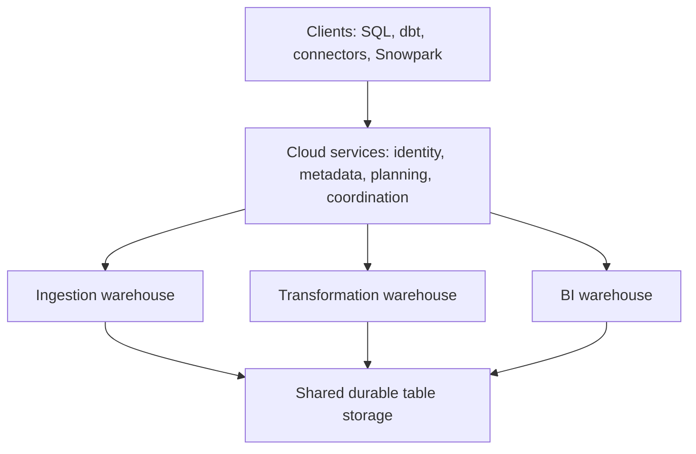

# Snowflake: Data Engineer Interview Guide

Documentation reviewed: 2026-10-21. Snowflake is a continuously updated service; feature availability, editions, regions, and billing rules can change.

An ingestion job and a dashboard can work on the same Snowflake table using separate compute resources. That separation is central to the platform, but it raises useful questions: what persists when compute stops, where do queries spend their time, and what happens when writers conflict or retry? This guide follows those boundaries from architecture to query performance, pipeline correctness, and cost.

**A useful interview answer:** “Snowflake stores data centrally and lets independent compute warehouses process it. Its cloud services layer manages metadata, access, and query planning. This lets ingestion, transformation, and analytics share data while scaling compute separately.” [Architecture](https://docs.snowflake.com/en/user-guide/intro-key-concepts)

**Study order:** Architecture → query optimization → ingestion → Streams and Tasks → transactions → cost management. Then cover modeling, governance, and advanced features.

Examples use Snowflake SQL unless marked otherwise. They are independent teaching examples, not a migration or a script to execute in order. Use a disposable database, suitable privileges, and your own stage locations. SQL examples have not been executed against a Snowflake account.

## Contents

1. [Architecture & Fundamentals](#1-architecture--fundamentals)
2. [Storage & Data Modeling](#2-storage--data-modeling)
3. [Query Processing & Optimization](#3-query-processing--optimization)
4. [Data Ingestion & Integration](#4-data-ingestion--integration)
5. [Transformations & Orchestration](#5-transformations--orchestration)
6. [Transactions & Data Lifecycle](#6-transactions--data-lifecycle)
7. [Security & Governance](#7-security--governance)
8. [Cost & Resource Management](#8-cost--resource-management)
9. [Advanced & Production Topics](#9-advanced--production-topics)

## 1. Architecture & Fundamentals

### Storage, compute, and cloud services

Suspending a warehouse stops its compute; it does not remove the tables that warehouse queried. Snowflake separates durable storage from query compute and supporting cloud services. Keeping those layers distinct helps explain both workload isolation and the costs that remain when a warehouse is idle.

| Layer | Responsibility | Engineering implication |
| --- | --- | --- |
| Storage | Durable table data in cloud storage | Data survives warehouse suspension |
| Compute | Virtual warehouses execute queries and DML | Different workloads can use independent compute |
| Cloud services | Authentication, authorization, metadata, optimization, and coordination | A small query can still involve planning and service work |

A warehouse is a compute resource, not a database containing its own copy of the data. Two warehouses can query the same table. Warehouse isolation reduces competition for CPU and memory; it does not prevent conflicting writes to shared tables. [Key concepts](https://docs.snowflake.com/en/user-guide/intro-key-concepts)



Snowflake combines shared storage across warehouses with parallel processing inside a warehouse. Within a cluster, workers divide scans, joins, and aggregations. Across warehouses, workloads access the same committed data through separate compute resources.

### Warehouses, databases, schemas, and tables

| Object | Meaning | Example |
| --- | --- | --- |
| Organization | Groups Snowflake accounts | Production and development accounts |
| Account | Administrative environment in a cloud/region | An account hosting the warehouse platform |
| Database | Logical container for schemas | `ANALYTICS` |
| Schema | Namespace for tables, views, stages, tasks, and other objects | `ANALYTICS.CORE` |
| Table | Stored records with a schema | `ANALYTICS.CORE.ORDERS` |
| Virtual warehouse | Compute selected to execute work | `TRANSFORM_WH` |

```sql
USE WAREHOUSE transform_wh;
USE DATABASE analytics;
USE SCHEMA core;

SELECT order_id, amount
FROM analytics.core.orders
WHERE order_date >= DATE '2026-10-01';
```

Database/schema context resolves names; warehouse context selects compute. Permissions are required for both. A fully qualified table name does not remove the need for warehouse privileges. [Name resolution](https://docs.snowflake.com/en/sql-reference/name-resolution)

### Micro-partitions, columnar storage, and metadata

Standard Snowflake tables are automatically divided into micro-partitions. Snowflake documents approximately **50–500 MB of uncompressed data** per micro-partition; actual persisted data is compressed. Columns are stored independently, allowing a query to read selected columns rather than every field.

Metadata includes column value ranges, distinct-value information, and other optimization properties. A date predicate can exclude micro-partitions whose ranges cannot match. This is **partition pruning**.

Micro-partitions are immutable storage units. DML creates a new logical table version using new and retained partitions rather than editing arbitrary stored bytes in place. This supports consistent reads and historical versions, but updates can rewrite much more data than the changed logical rows.

Do not confuse micro-partitions with user-defined date partitions, Spark partitions, or warehouse clusters. Users do not manage native table partition directories. [Micro-partitions](https://docs.snowflake.com/en/user-guide/tables-clustering-micropartitions)

### Multi-cluster warehouses and concurrency

A multi-cluster warehouse runs multiple clusters under one warehouse name. Auto-scale mode adds/removes clusters between configured limits as workload demand changes. Each active cluster contributes to compute cost.

- **Scale up:** increase the size of each cluster for more resources per query.
- **Scale out:** add clusters to serve more concurrent queries and reduce queuing.
- **Separate warehouses:** isolate workloads with different priorities or operating schedules.

A single ordinary query does not become distributed across every cluster in a multi-cluster warehouse. Adding clusters primarily improves concurrency. Standard scaling policy favors responsiveness; Economy favors reducing cluster runtime and can tolerate more waiting. Multi-cluster warehouses require Enterprise Edition or higher. [Multi-cluster warehouses](https://docs.snowflake.com/en/user-guide/warehouses-multicluster)

**Interview check:** A query is fast at midnight but slow during business hours. First compare queue time, execution time, cache state, and workload overlap. High queuing suggests concurrency pressure; a slow isolated execution suggests query shape, data layout, or warehouse size.

### Editions, deployment, and regions

| Edition | Interview-level distinction |
| --- | --- |
| Standard | Core warehouse capabilities and up to one day of Time Travel |
| Enterprise | Adds capabilities such as multi-cluster warehouses and extended Time Travel for permanent tables |
| Business Critical | Adds security/compliance capabilities and account failover/failback |
| Virtual Private Snowflake | Higher isolation for organizations with stricter requirements |

Features such as materialized views, search optimization, Query Acceleration Service, and advanced governance have edition requirements. Confirm the particular feature instead of assuming every paid account includes it. [Edition matrix](https://docs.snowflake.com/en/user-guide/intro-editions)

Snowflake runs on AWS, Azure, and Google Cloud. An account has a cloud and region; selecting one does not automatically place its tables in all regions. Region choice affects latency, residency, integration availability, and transfer costs. Cross-region availability requires an explicit replication/sharing design. [Replication across clouds and regions](https://docs.snowflake.com/en/user-guide/account-replication-intro)

## 2. Storage & Data Modeling

### Permanent, transient, temporary, and external tables

A scratch table and an authoritative sales table may need very different recovery protection. Snowflake's table types encode choices about lifetime, storage, and recovery. Choose the type from how the data will be used and rebuilt, rather than assuming all persisted tables have the same safeguards.

| Table type | Lifetime and storage | Recovery | Typical use |
| --- | --- | --- | --- |
| Permanent | Persists until dropped; Snowflake-managed native storage | Time Travel, then seven-day Fail-safe | Business-critical data |
| Transient | Persists until dropped; Snowflake-managed native storage | Zero or one day of Time Travel; no Fail-safe | Rebuildable intermediate data |
| Temporary | Visible in its creating session; removed when the session ends | Zero or one day of Time Travel, bounded by session lifetime; no Fail-safe | Session scratch work |
| External | Snowflake metadata over files in external storage | File protection belongs to the external storage design | Query existing lake files |

Transient means reduced recovery protection, not memory-only or automatically deleted. Temporary tables still use billable storage while they exist, and long-lived sessions can accumulate them. A temporary table can also hide a permanent table with the same name in the session. [Temporary and transient tables](https://docs.snowflake.com/en/user-guide/tables-temp-transient)

External tables are read-only through Snowflake DML and require metadata that reflects the relevant files. They are distinct from Iceberg tables, which have transactional table metadata and different write capabilities. Querying external files still consumes compute. [External tables](https://docs.snowflake.com/en/user-guide/tables-external-intro)

```sql
CREATE TRANSIENT TABLE intermediate_orders (
    order_id NUMBER,
    amount NUMBER(18, 2)
) DATA_RETENTION_TIME_IN_DAYS = 1;

CREATE TEMPORARY TABLE selected_order_ids AS
SELECT order_id
FROM orders
WHERE order_date = CURRENT_DATE();
```

### Modeling: grain, keys, and constraints

Start with the **grain**: one order, one order line, or one change event. Then define business keys, relationships, deletion semantics, and how historical versions are represented. Snowflake does not remove the need for dimensional modeling or a clear data contract.

For standard tables, primary key, unique, and foreign key declarations do **not** enforce uniqueness or referential integrity. Enforce those properties in ingestion/transformations and validate them with data tests. `NOT NULL` and supported `CHECK` constraints are enforced. Hybrid tables have different enforcement and locking behavior; avoid applying their rules to standard analytical tables. [Constraints](https://docs.snowflake.com/en/sql-reference/constraints-overview)

**Interview check:** Will `PRIMARY KEY(order_id)` prevent duplicate orders in a standard table? No. A deduplication rule and correctly coordinated writers must protect that invariant.

### Pruning and clustering keys

Pruning works best when a filter matches a narrow range of micro-partitions. If every partition contains dates from every month, a one-day filter can still scan much of the table.

A clustering key identifies columns or expressions Snowflake should use to improve physical locality. It is not a B-tree index, uniqueness constraint, or a guarantee that every query benefits. Consider it for large tables with repeated selective filters and poor existing locality.

```sql
ALTER TABLE orders CLUSTER BY (order_date, customer_id);

SELECT SYSTEM$CLUSTERING_INFORMATION('ORDERS');
```

Choose keys from actual filters and workloads. Very low cardinality can give weak pruning; extreme cardinality can make maintenance expensive. A date expression can be more useful than a nanosecond timestamp. Key order matters; assess overlapping partitions and clustering depth alongside query scans. Smaller depth generally means less overlap, but there is no universal “good depth” independent of data and access pattern. [Clustering keys](https://docs.snowflake.com/en/user-guide/tables-clustering-keys)

### Automatic Clustering and Search Optimization Service

**Automatic Clustering** maintains clustering using Snowflake-managed compute. It rewrites physical data as changes accumulate. The benefit is better locality; the costs include maintenance credits and historical storage for replaced partitions. Frequent writes can make maintenance outweigh scan savings. [Automatic Clustering](https://docs.snowflake.com/en/user-guide/tables-auto-reclustering)

**Search Optimization Service** maintains a search access path for supported predicates. It is often a better candidate for selective lookups, such as finding a few orders by identifier, than clustering a huge table by a near-unique key. Supported cases include selected equality, text, semi-structured, and other search patterns; eligibility depends on the expression and data type. It adds maintenance and storage costs and requires Enterprise or higher. [Search optimization](https://docs.snowflake.com/en/user-guide/search-optimization-service)

| Need | Candidate | What to measure |
| --- | --- | --- |
| Repeated selective date/range scans | Clustering | Partitions and bytes scanned versus maintenance cost |
| Selective identifier lookup | Search optimization | Lookup latency versus access-path cost |
| Repeated expensive eligible aggregation | Materialized view | Reuse frequency versus refresh cost |
| Materialized transformation pipeline | Dynamic table | Actual freshness, refresh work, and total cost |

### Materialized views and dynamic tables

A materialized view persists a restricted query result and is maintained automatically. Snowflake can rewrite eligible queries to use it even when the SQL references the base table. Current limitations include a single base table and no joins. Maintenance is billable and the feature requires Enterprise or higher. It is useful when repeated eligible queries save more work than maintenance consumes. [Materialized views](https://docs.snowflake.com/en/user-guide/views-materialized)

A dynamic table maintains a materialized transformation result using refresh compute and a freshness target. It supports pipelines that can include joins and aggregations. Users normally query the dynamic table explicitly; do not expect the transparent base-table query rewrite behavior of a materialized view. Section 5 covers refresh behavior and the choice against Streams and Tasks. [Dynamic tables](https://docs.snowflake.com/en/user-guide/dynamic-tables/overview)

### VARIANT, OBJECT, ARRAY, and typed columns

`VARIANT` can hold values with different underlying types, including nested objects and arrays. Semi-structured `OBJECT` represents key/value data; semi-structured `ARRAY` represents ordered elements. Snowflake also supports structured forms with declared element/field types, so an untyped JSON array and `ARRAY(NUMBER)` are different contracts. [Semi-structured types](https://docs.snowflake.com/en/sql-reference/data-types-semistructured), [structured types](https://docs.snowflake.com/en/sql-reference/data-types-structured)

```sql
WITH events AS (
    SELECT PARSE_JSON(
        '{"order_id":42,"items":[{"sku":"A1","qty":2}]}'
    ) AS payload
)
SELECT
    e.payload:order_id::NUMBER AS order_id,
    item.value:sku::VARCHAR AS sku,
    item.value:qty::NUMBER AS quantity
FROM events AS e,
LATERAL FLATTEN(INPUT => e.payload:items) AS item;
```

Use path expressions to access nested fields and casts to establish SQL types. JSON keys are case-sensitive. Distinguish SQL `NULL` from JSON `null`; a missing path and an explicitly present JSON null need not mean the same thing. `FLATTEN` expands nested data into rows, which can change the grain and multiply records. [Querying semi-structured data](https://docs.snowflake.com/en/user-guide/querying-semistructured)

A practical design keeps source payloads for replay while promoting frequently filtered or joined fields into typed curated columns. This makes contracts and invalid-value handling explicit. Using `TRY_*` conversions can avoid aborting a batch, but rejected values need monitoring or quarantine rather than silently becoming acceptable nulls.

## 3. Query Processing & Optimization

### Optimizer, statistics, and execution profiles

A query's SQL does not prescribe every scan and join the engine will run. Snowflake resolves names and privileges, optimizes the logical query, and executes a distributed physical plan. Automatically maintained metadata and statistics help it estimate work, choose join order, push predicates, and skip unnecessary scans. Standard tables therefore do not normally require a manual `ANALYZE TABLE` workflow.

`EXPLAIN` helps inspect a proposed plan; Query Profile shows what happened during execution. Estimated work can differ from runtime behavior, especially for skew, complex expressions, and intermediate result sizes. A plan alone cannot prove that a warehouse has sufficient memory. [EXPLAIN](https://docs.snowflake.com/en/sql-reference/sql/explain), [Query History and Profile](https://docs.snowflake.com/en/user-guide/ui-snowsight-activity)

Use the profile to ask:

1. Was the time spent waiting, compiling, scanning, joining, sorting, or returning results?
2. How many partitions were scanned relative to the table total?
3. Did joins produce far more rows than they consumed?
4. Did operators spill, or transfer large intermediate results between workers?
5. Was scan data read from warehouse cache or remote storage?

Check absolute values as well as percentages. Scanning every partition of a tiny dimension table is often fine. Scanning most of a huge fact table for one order usually deserves investigation.

### Pruning and filter design

```sql
SELECT customer_id, SUM(amount) AS total_amount
FROM orders
WHERE order_ts >= '2026-10-01 00:00:00'::TIMESTAMP_NTZ
  AND order_ts <  '2026-11-01 00:00:00'::TIMESTAMP_NTZ
GROUP BY customer_id;
```

The half-open range expresses precise boundaries and gives the optimizer a direct predicate on the stored field. Choose types and time-zone semantics that match the data contract. A month number without a year, or conversion through strings, can change the result as well as scan efficiency.

Do not claim that *every* function on a column prevents pruning; Snowflake can optimize some expressions. Prefer simple predicates when equivalent, then inspect actual partitions scanned. Pruning depends on the predicate and physical value distribution. Reading fewer columns also reduces work. [Pruning and micro-partition metadata](https://docs.snowflake.com/en/user-guide/tables-clustering-micropartitions)

### Join strategies and redistribution

Parallel joins must bring matching keys together. Conceptually, a plan can broadcast a small input to workers or redistribute inputs by join key. Large redistribution consumes network and memory. Snowflake chooses the physical strategy; inspect the plan rather than assuming a fixed user-managed distribution key.

Before changing compute, verify the join's intended cardinality. Joining two tables with multiple rows per business key can create a many-to-many expansion. Fix the grain or missing predicate. Apply valid filters early and pre-aggregate when the required output permits it. Do not add `DISTINCT` merely to hide an incorrect join.

**Skew** means some workers receive far more work than others. A heavily repeated key, many null keys, or an oversized group can make one part of the plan dominate. Correct inappropriate joins and handle special keys according to business rules before introducing complex redistribution workarounds. [Exploding joins and other query insights](https://docs.snowflake.com/en/user-guide/query-insights)

### Warehouse sizing: scale up versus scale out

| Observed problem | First investigation | Possible response |
| --- | --- | --- |
| High queued overload time, acceptable execution time | Concurrent workload and cluster count | Scale out or isolate workloads |
| Slow isolated query with large memory-intensive operators | Join cardinality, aggregation size, spill | Reduce work; benchmark a larger warehouse |
| Large scan for a selective filter | Partition pruning and physical layout | Improve predicates/layout or assess search optimization |
| Cold query after every suspension | Warehouse-cache value versus idle cost | Adjust suspension policy from measurements |
| Query blocked by another writer | Transaction history and shared targets | Coordinate writes and shorten transactions |

Warehouse sizes typically increase resources and hourly credit rate with each step, but runtime does not necessarily halve. Small queries may lack parallel work; a bad join can remain expensive on every size. Warehouse generation/type and availability also matter, so benchmark the actual configuration rather than memorizing one universal size-to-price table. [Warehouse considerations](https://docs.snowflake.com/en/user-guide/warehouses-considerations)

Compare both latency and credits for a representative workload. For example, **hypothetical measured rates** of 4 credits/hour for 10 minutes and 8 credits/hour for 4 minutes produce approximately 0.67 and 0.53 compute credits respectively, before other charges. A larger warehouse can cost less per completed job if it finishes sufficiently faster; this is a measurement, not a scaling guarantee.

### Result cache, warehouse cache, and metadata cache

| Cache | What is reused | Key distinction |
| --- | --- | --- |
| Persisted query results | A previously computed result | Can avoid executing the query again |
| Warehouse data cache | Previously read table data on warehouse-local storage | Execution still happens, with fewer remote reads |
| Metadata cache/services | Table and partition metadata used in planning/optimization | Helps find or avoid data; not a cache of arbitrary answers |

Result reuse requires applicable validity conditions, such as compatible SQL/session context, unchanged underlying data, and sufficient privileges. Identical SQL is not an unconditional guarantee. Persisted results normally expire after 24 hours; reuse can renew retention up to 31 days from initial execution. [Persisted query results](https://docs.snowflake.com/en/user-guide/querying-persisted-results)

Warehouse suspension discards its data cache. That does not remove centrally persisted query results. A new cluster also needs its own cache warm-up. Overly aggressive suspension can trade idle savings for repeated cold scans. [Warehouse cache](https://docs.snowflake.com/en/user-guide/performance-query-warehouse-cache)

```sql
ALTER SESSION SET USE_CACHED_RESULT = FALSE;
ALTER SESSION SET QUERY_TAG = 'interview_pruning_benchmark';

SELECT SUM(amount)
FROM orders
WHERE order_date >= DATE '2026-10-01'
  AND order_date < DATE '2026-11-01';

ALTER SESSION SET USE_CACHED_RESULT = TRUE;
ALTER SESSION UNSET QUERY_TAG;
```

This disables result reuse for the benchmark; it does not disable warehouse data caching. State whether a benchmark is warm or cold, control data and concurrency, and run enough representative queries to avoid drawing a conclusion from one timing.

### Spilling and bottleneck analysis

An operator spills when its intermediate state exceeds available memory. Snowflake can spill to local disk and, if necessary, remote storage. Remote spill is usually more expensive in latency. Large sorts, wide joins, and high-cardinality aggregations are common causes.

Investigate the operator before resizing: remove unnecessary columns, correct join multiplication, filter appropriately, or reduce intermediate groups. A larger warehouse can help a valid memory-heavy workload. Reducing concurrent work can also leave more resources for each query. A small remote-spill metric with Query Acceleration enabled can have a different explanation, so interpret it with the profile. [Queries too large for memory](https://docs.snowflake.com/en/user-guide/performance-query-warehouse-memory)

```sql
SELECT
    query_id,
    warehouse_name,
    total_elapsed_time / 1000.0 AS elapsed_seconds,
    queued_overload_time / 1000.0 AS overload_queue_seconds,
    transaction_blocked_time / 1000.0 AS blocked_seconds,
    partitions_scanned,
    partitions_total,
    bytes_spilled_to_local_storage,
    bytes_spilled_to_remote_storage
FROM snowflake.account_usage.query_history
WHERE start_time >= DATEADD('hour', -24, CURRENT_TIMESTAMP())
  AND warehouse_name IS NOT NULL
ORDER BY total_elapsed_time DESC
LIMIT 20;
```

These are diagnostic measurements, not direct dollar costs. Account Usage Query History can lag by up to 45 minutes; use recent Information Schema history or Snowsight when appropriate. [QUERY_HISTORY columns and latency](https://docs.snowflake.com/en/sql-reference/account-usage/query_history)

### Query Acceleration Service

QAS offloads eligible portions of query execution to additional Snowflake-managed compute. It can help selected large scans and other supported workloads, particularly resource-heavy outliers. It is different from adding warehouse clusters for more concurrent queries.

Eligibility depends on the plan; it does not accelerate every operator or repair bad SQL. Use `QUERY_ACCELERATION_ELIGIBLE` and `SYSTEM$ESTIMATE_QUERY_ACCELERATION` to assess candidates, then compare runtime and total credits. QAS requires Enterprise or higher and incurs separate serverless charges. Its scale-factor setting limits the amount of acceleration compute relative to warehouse size; it is not a guaranteed speedup. [Query Acceleration Service](https://docs.snowflake.com/en/user-guide/query-acceleration-service)

## 4. Data Ingestion & Integration

### Internal and external stages

Before loading a file, Snowflake needs to know where it is and how access works. A **stage** describes a file location for loading or unloading. Internal stages use Snowflake-managed storage, with user (`@~`), table (`@%table_name`), and named stages providing different scopes. An external stage references cloud object storage and its access configuration.

Stages hold or reference files; they do not automatically turn every file into a queryable native table. A file format defines parsing settings such as CSV delimiters, compression, or JSON behavior. Prefer reusable named formats when several pipelines share a contract. Use storage integrations for external access rather than embedding long-lived cloud credentials in SQL. [Stages](https://docs.snowflake.com/en/user-guide/data-load-overview), [storage integrations](https://docs.snowflake.com/en/sql-reference/sql/create-storage-integration)

### COPY INTO and load correctness

Bulk `COPY INTO <table>` runs on a selected warehouse and loads staged files into a table. Choose error handling explicitly. Aborting on bad data avoids silently treating a partial load as complete; a pipeline that continues on errors needs rejection counts, quarantine, and reconciliation.

```sql
CREATE FILE FORMAT orders_csv_format
    TYPE = CSV
    SKIP_HEADER = 1
    FIELD_OPTIONALLY_ENCLOSED_BY = '"';

CREATE STAGE orders_stage
    FILE_FORMAT = orders_csv_format;

COPY INTO landing_orders
FROM @orders_stage/orders_batch/
FILE_FORMAT = (FORMAT_NAME = 'orders_csv_format')
ON_ERROR = 'ABORT_STATEMENT';
```

Assume files already exist in the stage and their fields match `landing_orders`. A validation-only COPY can check compatible loads before ingestion; transformation loads have validation limitations. Capture file names, source row identifiers, ingestion timestamps, and batch IDs where needed for replay and auditing. [COPY INTO table](https://docs.snowflake.com/en/sql-reference/sql/copy-into-table)

Snowflake maintains per-table load metadata to avoid reloading previously loaded files. Its 64-day metadata window is separate from the retention of monitoring views. Older files can have uncertain load status and be skipped by default. `FORCE = TRUE` can reload files and create duplicates. File-level tracking does not deduplicate business events delivered in different files. [Load metadata and uncertain files](https://docs.snowflake.com/en/user-guide/data-load-considerations-load)

`LOAD_HISTORY` covers bulk COPY, while `COPY_HISTORY` supports bulk and Snowpipe history. For example, the Information Schema `LOAD_HISTORY` view covers the last 14 days and excludes Snowpipe. Do not confuse this with the 64-day bulk-load deduplication metadata or longer Account Usage history. [LOAD_HISTORY](https://docs.snowflake.com/en/sql-reference/info-schema/load_history), [COPY_HISTORY function](https://docs.snowflake.com/en/sql-reference/functions/copy_history)

### Snowpipe versus Snowpipe Streaming

| Mechanism | Input and compute | Choose when |
| --- | --- | --- |
| Bulk COPY | Staged files; user-managed warehouse | Scheduled batches and controlled backfills |
| Snowpipe | Files discovered/submitted for a pipe; serverless compute | Continuous file arrivals |
| Snowpipe Streaming | Rows through streaming APIs/SDKs; serverless service | Lower-latency row ingestion without staging files |

Snowpipe stores a COPY definition in a pipe and processes files asynchronously. Auto-ingest uses supported cloud event integration; delivery timing is not a strict end-to-end SLA. Monitor file discovery, pipe state, load failures, and data freshness separately. [Snowpipe](https://docs.snowflake.com/en/user-guide/data-load-snowpipe-intro)

Current Snowpipe file-ingestion billing is a fixed credit amount per GB across editions. Text formats use uncompressed bytes; binary formats use observed size. Older answers describing per-file plus per-core billing are outdated. File sizing still affects throughput and latency. [Snowpipe costs](https://docs.snowflake.com/en/user-guide/data-load-snowpipe-billing)

Current Snowpipe Streaming documentation describes the high-performance architecture, including pipes and named channels. Older classic-architecture examples differ. Channels provide ordering within a channel, not globally across channels. Exactly-once ingestion requires the producer to retain source records, track committed offset tokens, and replay from committed progress after failure. Tokens alone do not persist an application's unsent memory or deduplicate unrelated events with the same business key. [Streaming overview](https://docs.snowflake.com/en/user-guide/snowpipe-streaming/data-load-snowpipe-streaming-overview), [channels and offset tokens](https://docs.snowflake.com/en/user-guide/snowpipe-streaming/snowpipe-streaming-channels)

### Streams: a transactional bookmark for CDC

A stream exposes changes since an offset in a source object's version history. It does not store an independent queue of row payloads. Querying it with plain `SELECT` does not consume it. Using it in a consuming DML transaction advances its offset **when that transaction commits**; rollback leaves the offset unchanged.

| Stream type | Main behavior | Common use |
| --- | --- | --- |
| Standard | Net inserts/deletes; an update appears as a DELETE/INSERT pair | Changes to mutable source tables |
| Append-only | Inserts; excludes updates/deletes/truncates | Immutable landing event tables |
| Insert-only | New rows from newly recognized external data; no delete reconciliation | Supported external sources, including external tables |

Standard streams expose `METADATA$ACTION`, `METADATA$ISUPDATE`, and `METADATA$ROW_ID`. An insert followed by a delete between offsets can disappear from the net delta. A stream therefore is not an audit log of every intermediate business event. Exact source/type compatibility differs for dynamic and Iceberg tables. [Stream definitions and types](https://docs.snowflake.com/en/sql-reference/sql/create-stream)

Inside an explicit transaction, stream reads use its transaction-start advance point. A consuming DML statement can advance past **all** changes in that interval even if its filter returns only some of them. Do not split processing into separate autocommitted filtered statements that expect the same stream contents. Use one transaction for coordinated consumers, or separate streams for independent consumers. [Stream consumption semantics](https://docs.snowflake.com/en/user-guide/streams-intro)

### Tasks, task graphs, and scheduling

A task runs SQL or invokes a stored procedure. It can use a user-managed warehouse or serverless task compute. A scheduled task uses an interval/CRON schedule; a triggered task can run when a stream has changes. `AFTER` dependencies connect tasks into a directed acyclic graph.

New tasks are suspended until resumed. A task's owner role needs privileges on referenced objects and suitable execution/compute permissions. It does not inherit the interactive user's current worksheet permissions at runtime. [Tasks](https://docs.snowflake.com/en/user-guide/tasks-intro), [task troubleshooting](https://docs.snowflake.com/en/user-guide/tasks-ts)

A task graph coordinates execution, but does **not** provide one transaction across all task nodes. If one node commits and a later node fails, the earlier changes remain. Avoid overlapping writers unless their work is safely isolated. Configure retry/suspension policy and alerts; retries do not make non-idempotent side effects safe. [Task graphs](https://docs.snowflake.com/en/user-guide/tasks-graphs)

`SYSTEM$STREAM_HAS_DATA` is an efficient scheduling predicate, not an exact row count. It can return true while the net change set is empty. The task body must handle that case. For an empty stream, a false result can help prevent staleness, but it does not replace consuming non-empty changes. [Stream management](https://docs.snowflake.com/en/user-guide/streams-manage)

### Incremental MERGE: deduplication, ordering, and deletes

There are two distinct CDC designs:

1. A stream on a mutable source table exposes net row changes; interpret the stream's metadata correctly.
2. A stream on an append-only **event log** exposes event rows. An `op = 'D'` event is still a physical INSERT into that log; the payload defines the business deletion.

The following example uses the second design. `source_version` is a strictly ordered version per order, including delete/recreate events. Insert/update events contain full after-images; delete events can omit the amount. Duplicate deliveries of a version must have identical business payloads; conflicting duplicates must be rejected before this step. Input validation also restricts `op` to `I`, `U`, or `D`. Timestamps alone are insufficient when two events can share a timestamp.

```sql
CREATE TABLE order_events (
    order_id NUMBER NOT NULL,
    source_version NUMBER NOT NULL,
    event_id VARCHAR NOT NULL,
    op VARCHAR NOT NULL,
    amount NUMBER(18, 2)
);

CREATE STREAM order_event_stream
    ON TABLE order_events
    APPEND_ONLY = TRUE;

CREATE TABLE order_state (
    order_id NUMBER NOT NULL,
    source_version NUMBER NOT NULL,
    amount NUMBER(18, 2),
    is_deleted BOOLEAN NOT NULL
);

CREATE TASK apply_order_events
    WAREHOUSE = transform_wh
    SCHEDULE = '1 MINUTE'
    WHEN SYSTEM$STREAM_HAS_DATA('ORDER_EVENT_STREAM')
AS
MERGE INTO order_state AS t
USING (
    SELECT order_id, source_version, amount, op
    FROM order_event_stream
    QUALIFY ROW_NUMBER() OVER (
        PARTITION BY order_id
        ORDER BY source_version DESC, event_id DESC
    ) = 1
) AS s
ON t.order_id = s.order_id
WHEN MATCHED AND s.source_version > t.source_version THEN
    UPDATE SET
        source_version = s.source_version,
        amount = s.amount,
        is_deleted = (s.op = 'D')
WHEN NOT MATCHED THEN
    INSERT (order_id, source_version, amount, is_deleted)
    VALUES (s.order_id, s.source_version, s.amount, s.op = 'D');

ALTER TASK apply_order_events RESUME;
```

Run this in a scratch schema with `transform_wh` available. Create the stream before inserting the events you want it to capture. This is a single-writer current-state example; it intentionally retains tombstones. Serving queries exclude `is_deleted = TRUE`. Retaining the last delete version prevents an older replayed update from recreating a deleted order. Define a business policy for whether higher-version events can recreate it.

Deduplication makes the source at most one row per key for this batch. The version condition prevents an older batch from overwriting newer state. A single MERGE atomically updates the target and consumes the stream. A failed statement does neither. This does not make two concurrent writers safe; standard-table key constraints still do not enforce uniqueness.

When several source rows match one target row, MERGE updates/deletes can be nondeterministic; the default `ERROR_ON_NONDETERMINISTIC_MERGE = TRUE` detects applicable cases. Multiple unmatched source duplicates can still produce duplicate inserts, so that setting is not a substitute for deduplication. [MERGE semantics](https://docs.snowflake.com/en/sql-reference/sql/merge)

**Reason through these cases:** versions 8 and 9 in one batch → keep 9; replay 8 after 9 → ignore it; delete 10 followed by replay 9 → retain tombstone 10; statement failure → no target commit or stream advancement. Keeping only the final event is appropriate for current state, but loses intermediate events required for a full SCD Type 2 history.

## 5. Transformations & Orchestration

### ELT and SQL transformations

Keeping a source extract before transforming it gives you a basis for explanation and replay. In **ELT**, data is loaded first and transformed with warehouse compute. A common flow moves from append-only landing data to typed and validated models, then business-facing facts and dimensions. Those boundaries establish ownership and replayability; they do not require three physical copies of every dataset.

Use set-based SQL for joins, aggregations, deduplication, and business rules. Keep the raw source identity and ordering fields needed to explain or replay outputs. Define where malformed rows go and how they are reconciled. A successful SQL statement does not prove the business data is complete.

Choose the smallest orchestration mechanism that satisfies freshness and recovery requirements. Existing dbt scheduling may be enough for batch models; a dynamic table may remove custom refresh logic; a task may be needed for procedural work.

### Dynamic tables versus Streams and Tasks

| Question | Dynamic tables | Streams and Tasks |
| --- | --- | --- |
| Who tracks changes and schedules transformation work? | Snowflake manages refresh dependencies | Engineer defines streams, tasks, and control flow |
| How is the result usually defined? | Declarative SELECT-based transformation | Explicit SQL/DML or procedure |
| Freshness model | Target lag with actual-lag monitoring | Schedule/trigger plus runtime and backlog |
| Multi-table DML in one transaction? | Not a transaction across independently refreshed outputs | A task can invoke a transaction updating several tables |
| Arbitrary procedure/API side effects? | Not part of a SELECT-based definition | Possible, with appropriate integrations and retry design |
| Typical tradeoff | Less orchestration code; refresh constraints and costs | More control; more state and recovery logic |

```sql
CREATE DYNAMIC TABLE daily_order_totals
    TARGET_LAG = '10 minutes'
    WAREHOUSE = transform_wh
    REFRESH_MODE = INCREMENTAL
AS
SELECT
    order_date,
    SUM(amount) AS total_amount
FROM orders
GROUP BY order_date;
```

For SELECT-based dynamic tables, `INCREMENTAL` processes supported changes, `FULL` recomputes the result, and `AUTO` resolves a mode at creation. Inspect the resolved mode rather than assuming AUTO always means incremental. Incremental work can still be large when changes affect many groups or joins. Current documentation also includes `ADAPTIVE`, which can reinitialize expensive change sets, and `CUSTOM_INCREMENTAL`, which allows user-defined refresh DML. Verify availability before relying on these newer modes. [Refresh modes](https://docs.snowflake.com/en/user-guide/dynamic-tables/refresh-modes)

`TARGET_LAG` expresses desired staleness relative to the pipeline's base data, not a fixed refresh interval or guaranteed SLA. The documented minimum is 60 seconds. Monitor actual lag and refresh duration. `TARGET_LAG = DOWNSTREAM` lets downstream dynamic tables drive refresh; a leaf with no downstream consumer needs an explicit lag or manual refresh. [Target lag](https://docs.snowflake.com/en/user-guide/dynamic-tables-target-lag)

**Interview choice:** For a continuously refreshed SQL aggregate, start by assessing a dynamic table. For a transaction that updates current state and an audit/control table together, use explicit transactional DML, potentially invoked by a task. Neither choice removes data validation or monitoring.

### Stored procedures, UDFs, and Snowpark Python

| Tool | Purpose | Important limit |
| --- | --- | --- |
| SQL | Set-based relational transformations | Often the clearest and most optimizable option |
| UDF | Reusable scalar/table computation callable from SQL | Not a general transactional write orchestrator |
| Stored procedure | Multi-step operations, DML, control flow, administration | Must define transaction and execution-rights behavior |
| Snowpark Python | Build DataFrame operations and Python processing executed with Snowflake | Avoid unnecessarily transferring large data to the client |

Use a UDF when a computation belongs in an expression. Use a procedure when coordinating operations or writes. Procedures can execute with owner or caller rights; this changes the security boundary. Do not use an elevated owner-rights procedure to execute unchecked user-supplied SQL. [Procedures versus UDFs](https://docs.snowflake.com/en/developer-guide/stored-procedures-vs-udfs), [procedure execution rights](https://docs.snowflake.com/en/developer-guide/stored-procedure/stored-procedures-rights)

Snowpark DataFrame transformations are generally lazy: they construct a plan until an action executes it. `collect()` returns results to the client/process, so collecting a huge table defeats in-platform processing and can exhaust memory. Python UDF execution also has overhead; prefer native expressions for work SQL already handles well. [Snowpark DataFrames](https://docs.snowflake.com/en/developer-guide/snowpark/python/working-with-dataframes)

### dbt integration, incremental models, and snapshots

dbt defines model dependencies, compiles SQL, and executes transformations on Snowflake through its adapter. `ref()` expresses model dependencies; `source()` identifies input sources. Materialization determines whether a model becomes a view, table, incremental target, or another supported object.

An incremental model restricts each run's input and applies a supported incremental strategy, commonly MERGE. `is_incremental()` must leave valid SQL for both initial/full and incremental runs. A filter based only on `updated_at > MAX(updated_at)` can miss equal timestamps, late events, and corrections with old timestamps. Use the source's change contract, an overlap window when appropriate, and deterministic deduplication. [Incremental models](https://docs.getdbt.com/docs/build/incremental-models)

`unique_key` tells dbt how to match rows; it is not a uniqueness test or an enforced Snowflake constraint. Validate non-null keys and uniqueness independently. Also review target-side incremental predicates: a predicate that hides an existing target key can turn an intended update into another insert. [unique_key](https://docs.getdbt.com/reference/resource-configs/unique_key)

dbt snapshots maintain business change history using an SCD Type 2 approach. A timestamp strategy relies on a reliable modification timestamp; a check strategy compares selected values. Hard-delete handling requires an explicit supported configuration. Snapshots observe state when they run and cannot reconstruct intermediate source states that disappeared between runs. They are different from Snowflake Time Travel, whose history is bounded by physical retention. [dbt snapshots](https://docs.getdbt.com/docs/build/snapshots)

### Idempotency, transactions, and backfills

An idempotent pipeline produces the same intended state when the same input is retried. Define this with stable keys, source versions, and deterministic transformations. `CURRENT_TIMESTAMP()`-dependent business values, blind inserts, or additive updates such as `total = total + batch_total` can make retries change the result.

For a backfill, state the source range, target range, ordering rule, and reconciliation checks. A replay of old events must not replace newer current state. A time-window rebuild should use explicit boundaries and a consistent source view where required.

```sql
EXECUTE IMMEDIATE $$
BEGIN
    BEGIN TRANSACTION;

    DELETE FROM daily_sales
    WHERE sales_date >= DATE '2026-09-01'
      AND sales_date < DATE '2026-10-01';

    INSERT INTO daily_sales (sales_date, total_amount)
    SELECT order_date, SUM(amount)
    FROM orders
    WHERE order_date >= DATE '2026-09-01'
      AND order_date < DATE '2026-10-01'
    GROUP BY order_date;

    COMMIT;
EXCEPTION
    WHEN OTHER THEN
        ROLLBACK;
        RAISE;
END;
$$;
```

This block owns its transaction and must run outside any existing transaction. It replaces a fixed target window and rolls back/rethrows on failure. Without that handler, a runner could commit the DELETE after a failed INSERT because a statement failure does not necessarily abort the whole transaction. Coordinate concurrent writers. The DELETE and INSERT are separate statement snapshots, so stabilize the source separately if one historical source point is required. Keep DDL outside this transaction. [Exception handling](https://docs.snowflake.com/en/developer-guide/snowflake-scripting/exceptions), [transaction errors](https://docs.snowflake.com/en/sql-reference/transactions)

## 6. Transactions & Data Lifecycle

### ACID, MVCC, and isolation

If a transformation updates several rows, the transaction defines which changes commit together and what other work can observe. ACID covers atomic changes, applicable integrity rules, isolation under the supported level, and durability after commit. MVCC lets queries read committed versions while writes create new ones, but it does not eliminate blocking or conflicts between arbitrary concurrent writes.

For standard tables, Snowflake uses **READ COMMITTED** isolation. A statement sees data committed before that statement began, plus earlier changes in its own transaction. Two statements in one transaction can see different externally committed data. Do not describe a normal multi-statement transaction as one immutable snapshot of every table.

DDL executes in its own transaction and implicitly commits an active transaction before it runs. A later ROLLBACK does not undo that DDL or recover the preceding committed DML. This includes common setup operations such as creating a scratch table. Keep transaction scope explicit, handle errors, and avoid sharing one transactional session across independent concurrent workers. [Transaction boundaries and isolation](https://docs.snowflake.com/en/sql-reference/transactions)

**Interview check:** Does `BEGIN; SELECT ...; SELECT ...; COMMIT;` guarantee both SELECTs see the same source version? No. Ordinary tables use statement-level READ COMMITTED; stream reads have their own documented transaction-start behavior.

### Time Travel, Fail-safe, and retention

| Mechanism | Purpose | User-controlled recovery? |
| --- | --- | --- |
| Time Travel | Query historical data, clone historical state, restore supported dropped objects | Yes, within retained history |
| Fail-safe | Last-resort recovery for supported permanent data after Time Travel expires | Snowflake-managed recovery process, not normal historical SQL |
| Business archive/backups | Meet longer-term recovery and historical requirements | Requires a deliberate retention and restore design |

Native permanent tables support up to one day of Time Travel on Standard and up to 90 days on Enterprise or higher, subject to configuration. Native transient and temporary tables allow zero or one day; temporary history ends with the session. Retention can be inherited and constrained by account-level settings, so inspect the effective value rather than assuming the default. [Time Travel retention](https://docs.snowflake.com/en/user-guide/data-time-travel)

Fail-safe is a separate, non-configurable seven-day period for native permanent tables. It is not queryable Time Travel, a routine backup interface, or an availability failover mechanism. Transient and temporary tables have no Fail-safe. Recovery is best effort through Snowflake and should not be the pipeline's normal recovery plan. [Fail-safe](https://docs.snowflake.com/en/user-guide/data-failsafe)

```sql
SELECT order_id, amount
FROM orders AT (OFFSET => -3600);

CREATE TABLE orders_before_bad_write CLONE orders
    BEFORE (STATEMENT => 'replace_with_bad_statement_query_id');

UNDROP TABLE accidentally_dropped_orders;
```

`AT` selects a historical point; `BEFORE (STATEMENT => ...)` selects the state before a particular statement. Recovery depends on available history and privileges. An UNDROP can conflict with an existing object of the same name; inspect and resolve names before restoration. A historical query uses the current schema, so Time Travel is not an unrestricted reconstruction of every past schema definition. [Time Travel operations](https://docs.snowflake.com/en/user-guide/data-time-travel)

### Zero-copy cloning and snapshot consistency

Cloning creates a new object referencing existing storage at a selected consistent point. It initially avoids copying unchanged native table data; later changes create independent versions. Source and clone do not synchronize subsequent writes.

“Zero-copy” does not mean zero cost forever. A clone can retain shared partitions after the source changes or is dropped, and changed data consumes storage. A clone inside the same account is also not an independent regional disaster-recovery copy. When several related tables need consistent test state, prefer a supported database/schema clone at a common point over separately cloning tables at unrelated times. Review grants, dependencies, tasks, and streams before treating a clone as an operational copy. [Cloning considerations](https://docs.snowflake.com/en/user-guide/object-clone)

### Schema evolution and historical recovery

File-based schema evolution can add columns and relax NOT NULL constraints for missing source fields under supported conditions. It requires `ENABLE_SCHEMA_EVOLUTION = TRUE`, COPY's `MATCH_BY_COLUMN_NAME`, and a loading role with `EVOLVE SCHEMA` or `OWNERSHIP`; CSV has additional parsing conditions. It does not mean every arbitrary type change, rename, or destructive source change propagates safely. [Schema evolution](https://docs.snowflake.com/en/user-guide/data-load-schema-evolution)

Treat schema evolution as a governed input contract. Check downstream models, casts, policies, and stream compatibility. Preserve an immutable source or recovery copy when retention cannot cover the expected incident window. Replacing a source table can invalidate its streams even if the new object has the same name.

### Storage lifecycle and deletion

The lifecycle of native permanent data is active state → retained historical state → Fail-safe → physical removal, with sharing/cloning references affecting when bytes can be reclaimed. Removing current rows does not immediately remove every retained copy. Retention settings control historical availability; they do not automatically expire live rows.

For live-data expiration, use an explicit policy or scheduled process with a validated cutoff. Current Snowflake storage lifecycle policies can archive or expire eligible rows asynchronously on a managed schedule and incur serverless execution charges. Their schedule and semantics differ from a synchronous DELETE. Review clone/archive/history retention together when defining deletion requirements. [Storage costs for history](https://docs.snowflake.com/en/user-guide/data-cdp-storage-costs), [storage lifecycle policies](https://docs.snowflake.com/en/user-guide/storage-management/storage-lifecycle-policies)

## 7. Security & Governance

### RBAC, privileges, ownership, and role hierarchy

A user may hold several roles, and the direction of role grants determines which privileges they inherit. **RBAC** assigns object privileges to roles and roles to users. A role inherits from the roles granted to it: to let a functional role use a narrow access role's privileges, grant the access role to the functional role. Reversing that grant reverses the inheritance.

Querying a table generally requires `USAGE` on its database/schema, `SELECT` on the table, and `USAGE` on the executing warehouse. Creating objects requires separate privileges. `OWNERSHIP` is powerful control over an object, not merely permission to read it. Managed access schemas centralize grant decisions with the schema owner or a role with `MANAGE GRANTS`.

Future grants cover newly created objects; grants on all existing tables cover the current objects. One does not replace the other. Prefer dedicated service roles and review `PUBLIC` access. Database roles scope privileges to one database and are granted to account roles for session use. [Access control](https://docs.snowflake.com/en/user-guide/security-access-control-overview)

```sql
CREATE ROLE analyst_reader;

GRANT USAGE ON WAREHOUSE bi_wh TO ROLE analyst_reader;
GRANT USAGE ON DATABASE analytics TO ROLE analyst_reader;
GRANT USAGE ON SCHEMA analytics.core TO ROLE analyst_reader;
GRANT SELECT ON ALL TABLES IN SCHEMA analytics.core
    TO ROLE analyst_reader;
GRANT SELECT ON FUTURE TABLES IN SCHEMA analytics.core
    TO ROLE analyst_reader;
```

These grants require an appropriately authorized administration role. They do not grant access to every kind of object in the schema, such as all views or procedures. Assign the role only to intended users or parent roles.

### Row Access Policies and Masking Policies

A **Row Access Policy** decides which rows a query can see. A **Masking Policy** changes the values visible in selected columns based on execution context. For example, regional analysts see only their region, and only an authorized role sees clear-text email addresses.

```sql
CREATE MASKING POLICY email_mask
    AS (value VARCHAR) RETURNS VARCHAR ->
    CASE
        WHEN IS_ROLE_IN_SESSION('PII_READER') THEN value
        ELSE '***'
    END;

ALTER TABLE customers
    MODIFY COLUMN email SET MASKING POLICY email_mask;
```

The role and column must exist, with appropriate policy privileges. Choose context functions deliberately: `CURRENT_ROLE()` is the primary active role, while role-in-session checks can account for applicable role hierarchy. Test authorized, unauthorized, inherited-role, and service-user contexts. Dynamic masking controls query output; it does not rewrite the underlying stored values. [Masking](https://docs.snowflake.com/en/user-guide/security-column-intro)

Policies are normally evaluated at query time. A row policy restricts visibility but is not a general validator preventing unauthorized values from being inserted or changed. When row and masking policies apply together, row filtering precedes masking. These governance features have edition requirements and can affect optimization, so benchmark representative secured queries. [Row access policies](https://docs.snowflake.com/en/user-guide/security-row-intro)

### Secure views and data sharing

A secure view reduces exposure of its definition and information that could leak through certain optimizations. It can have performance tradeoffs. “Secure” does not automatically mean that the SQL filters every sensitive row correctly; the definition and grants still establish what the consumer may read. [Secure views](https://docs.snowflake.com/en/user-guide/views-secure)

Secure Data Sharing lets providers expose supported objects to consumers. For direct sharing in the same region, consumers query shared data using their own compute without copying the provider's base data into their account. The shared database is read-only to the consumer. Cross-region/cloud distribution requires replication or applicable listing/auto-fulfillment mechanisms and can add storage and transfer costs.

Use secure views or other supported governed objects when consumers should see a subset. A reader account is another model: its compute charges are generally the provider's responsibility. Sharing removes parts of data movement, not governance or cost responsibility. [Secure Data Sharing](https://docs.snowflake.com/en/user-guide/data-sharing-intro)

### Authentication, network policies, and private connectivity

Keep three controls separate:

- **Authentication:** prove the identity using supported mechanisms such as SSO, OAuth, key-pair authentication, or workload identity. Use MFA and authentication policies appropriate to interactive users; service identities need an appropriate non-interactive flow.
- **Network access:** restrict allowed ingress through network policies/rules and supported endpoint controls.
- **Authorization:** role/object/policy privileges determine what the identity can do after connecting.

Rotate credentials, keep secrets out of SQL and source control, and use dedicated service identities. Do not assume password-only automation remains permitted as Snowflake's authentication requirements evolve. [Authentication policies](https://docs.snowflake.com/en/user-guide/authentication-policies)

AWS PrivateLink, Azure Private Link, and Google Cloud Private Service Connect provide private connectivity in supported configurations. Private connectivity does not automatically turn off public access; configure the intended restrictions explicitly. AWS PrivateLink requires Business Critical or higher. Client access, internal-stage access, and Snowflake's outbound access to other services are separate paths to evaluate. [PrivateLink](https://docs.snowflake.com/en/user-guide/admin-security-privatelink), [private-only enforcement](https://docs.snowflake.com/en/user-guide/security-disable-public-access-privatelink)

### Access History, auditing, and governance

Query History explains query execution; Access History helps identify accessed base/direct objects and columns, modified objects, and referenced policies. Access History requires Enterprise or higher and has latency/coverage limits; it is not an immediate row-by-row audit of every value returned to a client.

Combine it with login history, grant changes, query tags, ownership, data classification, and retention controls. Sensitive query text and audit records also need restricted access. A practical governance answer identifies the data owner, access rule, evidence, and review/revocation process. [Access History](https://docs.snowflake.com/en/user-guide/access-history)

## 8. Cost & Resource Management

### Credits, storage, and the billing model

A warehouse's credit consumption is only one part of the bill. Separate warehouse compute, serverless services, billable cloud services, storage, and applicable transfer costs. A **credit** measures usage; it is not a universal dollar price. The commercial price depends on the agreement, edition, and deployment, while feature-specific rates come from the service consumption table. [Compute costs](https://docs.snowflake.com/en/user-guide/cost-understanding-compute)

Warehouse compute uses per-second billing with a **60-second minimum each time compute is provisioned/resumed**. Additional resources provisioned by an upscale also have a minimum charge. Suspending a warehouse stops its compute consumption; stored data and separately running serverless services remain billable.

For example, twelve separate 10-second runs, each with a fresh resume, incur at least twelve minutes of the relevant cluster's compute billing rather than two minutes. Grouping work can reduce repeated minimum charges, but must still meet freshness requirements. Every active multi-cluster cluster contributes cost. [Warehouse billing](https://docs.snowflake.com/en/user-guide/warehouses-considerations)

Cloud-services billing includes a daily adjustment based on 10% of warehouse compute credits. Only cloud-services usage beyond that daily allowance is billed; serverless compute does not contribute to that allowance. Use billing-adjusted metering data rather than summing raw cloud-services consumption as an invoice amount. [Cloud-services adjustment](https://docs.snowflake.com/en/user-guide/cost-understanding-compute)

### Auto-suspend, auto-resume, and scaling

```sql
ALTER WAREHOUSE transform_wh SET
    AUTO_SUSPEND = 60
    AUTO_RESUME = TRUE;
```

This is an illustrative setting, not a universal recommendation. Batch work can benefit from short idle suspension; frequently repeated BI queries may benefit from retaining warehouse cache. Auto-resume only helps when the warehouse and permissions allow it. Choose the setting from idle cost, resume overhead, cache reuse, and user latency requirements. [Warehouse cache tradeoffs](https://docs.snowflake.com/en/user-guide/performance-query-warehouse-cache)

For multi-cluster warehouses, cap cluster count according to measured concurrency needs. Standard versus Economy scaling policy changes the latency/cost tradeoff. Use a separate warehouse when a workload needs independent sizing or limits, but remember that many tiny always-on warehouses can increase total idle cost.

### Resource monitors versus budgets

| Tool | Scope | Action and limit |
| --- | --- | --- |
| Resource monitor | Assigned user-managed warehouses/account warehouse consumption | Notify and optionally suspend warehouses; does not cap serverless services |
| Budget | Supported account/grouped resources, including supported serverless features | Monitor/forecast spending and notify; custom actions can invoke configured procedures |

```sql
CREATE RESOURCE MONITOR transform_monthly_limit
    WITH CREDIT_QUOTA = 100
    FREQUENCY = MONTHLY
    START_TIMESTAMP = IMMEDIATELY
    TRIGGERS
        ON 80 PERCENT DO NOTIFY
        ON 100 PERCENT DO SUSPEND;

ALTER WAREHOUSE transform_wh
    SET RESOURCE_MONITOR = transform_monthly_limit;
```

The quota is an example, not a sizing recommendation. `SUSPEND` lets running statements finish; `SUSPEND_IMMEDIATE` can cancel them. Usage reporting and completion time can produce overshoot, so a monitor is not a perfectly precise hard financial cap. [Resource monitors](https://docs.snowflake.com/en/user-guide/resource-monitors)

Budgets cover a broader supported set of costs but a spending limit alone does not automatically stop every resource. Current budgets support custom actions, such as invoking a procedure that suspends selected resources. Those actions need explicit configuration, privileges, and recovery handling; they do not turn the budget into a universal instant account cap. [Cost controls](https://docs.snowflake.com/en/user-guide/cost-controlling), [budget custom actions](https://docs.snowflake.com/en/user-guide/budgets/custom-actions)

### Serverless feature costs

Examples include Snowpipe, Snowpipe Streaming, serverless tasks, Automatic Clustering, Search Optimization, materialized-view maintenance, QAS, and storage lifecycle policy execution. Their units and billing rules differ. Stopping all user warehouses does not stop every service.

Ask whether the feature removes more warehouse work than it adds in maintenance/ingestion cost. A frequently changing table with little reuse can make a materialized view expensive; a tight dynamic-table freshness target can cause frequent refresh work. Prefer measuring **cost per completed pipeline run or business workload** over just comparing warehouse sizes. [Exploring compute costs](https://docs.snowflake.com/en/user-guide/cost-exploring-compute), [dynamic-table costs](https://docs.snowflake.com/en/user-guide/dynamic-tables-cost)

### ACCOUNT_USAGE and ORGANIZATION_USAGE

`SNOWFLAKE.ACCOUNT_USAGE` provides historical account-level telemetry. `ORGANIZATION_USAGE` aggregates supported organization-level information; premium views have organization-account, access, edition/contract, and cost considerations. Visibility, latency, and retention differ by view, so do not assign every view a single freshness guarantee. [Account Usage](https://docs.snowflake.com/en/sql-reference/account-usage), [Organization Usage](https://docs.snowflake.com/en/sql-reference/organization-usage)

```sql
SELECT
    warehouse_name,
    SUM(credits_used_compute) AS compute_credits,
    SUM(credits_used_cloud_services) AS raw_cloud_services_credits
FROM snowflake.account_usage.warehouse_metering_history
WHERE start_time >= DATEADD('day', -7, CURRENT_TIMESTAMP())
GROUP BY warehouse_name
ORDER BY compute_credits DESC;
```

This reports warehouse consumption, not the complete invoice. Use `METERING_DAILY_HISTORY` for billing-adjusted compute totals, relevant feature histories for serverless usage, and storage/transfer views for those categories. Query attribution and `QUERY_TAG` can help assign work to teams, but query-level attribution does not automatically allocate all idle warehouse time. Restrict access to metering views and bound time ranges. [Warehouse metering](https://docs.snowflake.com/en/sql-reference/account-usage/warehouse_metering_history), [daily metering](https://docs.snowflake.com/en/sql-reference/account-usage/metering_daily_history)

## 9. Advanced & Production Topics

### Iceberg tables and external catalogs

When Snowflake works with an Iceberg table, ask three separate questions: who owns the catalog, who owns the physical storage, and which engines may write? Iceberg defines snapshots and metadata over data files, commonly Parquet; Snowflake can act as its catalog or integrate with supported external catalogs. Those choices do not collapse catalog ownership, storage ownership, and writer support into one decision.

Current options include Snowflake-managed storage as well as customer-managed external volumes. Externally stored Iceberg data does not have Snowflake Fail-safe; protection depends on the selected storage/catalog design. Snowflake-managed Iceberg tables can have different recovery support. Supported remote REST catalogs can allow writes from Snowflake, so “external catalog always means read-only” is outdated. Check catalog, format version, operations, and transaction limitations. [Iceberg tables and catalog options](https://docs.snowflake.com/en/user-guide/tables-iceberg)

An external volume grants storage access; a catalog integration locates/interacts with catalog metadata. Neither alone proves the other layer is correctly configured. Multi-engine access also requires compatible schema/types, delete-file support, commit coordination, maintenance ownership, and authorization in each engine. Snowflake role grants do not automatically become the remote catalog's user permissions.

### Sharing, replication, and failover

Sharing grants data access. Replication creates secondary copies in other accounts. Failover promotes a supported secondary to become the writable primary. These mechanisms solve different needs.

Database/share replication is available across editions, while replication of additional account objects and failover/failback require Business Critical or higher. Replication/failover groups coordinate supported objects and consistent refreshes. Their costs include replication work, target storage, and applicable transfer. [Replication and failover](https://docs.snowflake.com/en/user-guide/account-replication-intro)

State the **RPO** (acceptable data loss window) and **RTO** (acceptable recovery time). Asynchronous replication can leave a gap since the last successful refresh. Recovery also needs clients redirected, credentials/integrations available, task/pipe behavior understood, and external sources able to replay. Test the runbook and failback; a replicated database alone is not a complete operational recovery plan.

### Query, task, load, and freshness monitoring

| Signal | Where to investigate | What it answers |
| --- | --- | --- |
| Query latency, queue time, scans, spill | Query History and Profile | Why execution slowed |
| Task execution, failures, skipped runs | TASK_HISTORY and graph history | Whether orchestration ran and succeeded |
| File loads and errors | COPY_HISTORY; bulk LOAD_HISTORY | Which files loaded or failed |
| Pipe status/backlog | `SYSTEM$PIPE_STATUS` | Whether ingestion is running/backed up |
| Stream state | `SHOW STREAMS`, `STALE_AFTER`, `STALE` | Whether the change interval remains consumable |
| Dynamic-table refreshes | Refresh history and actual lag | Whether materialized outputs meet freshness needs |
| Spend | Metering and feature-specific histories | Which services consumed resources |

Use recent Information Schema functions for operational checks where supported and Account Usage for longer history. Apply the time filter **inside** a table-function call when needed before its result limit is applied. A successful task or zero query errors does not prove the source delivered all expected records; monitor business freshness, volume, duplicates, and reconciliation separately. [TASK_HISTORY](https://docs.snowflake.com/en/sql-reference/functions/task_history), [COPY_HISTORY](https://docs.snowflake.com/en/sql-reference/functions/copy_history), [dynamic-table monitoring](https://docs.snowflake.com/en/user-guide/dynamic-tables/monitoring)

### Stream staleness and recovery

A stream becomes stale when required source history is no longer available. Monitor `STALE_AFTER` with enough recovery margin. Snowflake can extend source retention for streams subject to configured limits, including `MAX_DATA_EXTENSION_TIME_IN_DAYS`; this is not unlimited event retention. Source replacement or incompatible changes can also break consumption. [Managing streams](https://docs.snowflake.com/en/user-guide/streams-manage)

If a stream is stale, recreating it at the current source position does not recover the missing interval. Reconcile the target against a retained snapshot/source, or replay durable events and recreate the stream at an appropriate supported point. If neither the source history nor an independent replay source exists, some changes may be unrecoverable. Do not drop/recreate healthy streams as a routine retry strategy.

### Task failures, retries, and partial graph completion

Check whether the task was resumed, its owner still has privileges, its compute can run, its predecessor succeeded, its WHEN condition passed, and its SQL completed within timeout. Follow the task run to its query ID and error details. A resource monitor suspension can stop an otherwise correct pipeline. [Task troubleshooting](https://docs.snowflake.com/en/user-guide/tasks-ts)

Configure automatic retry attempts or use supported graph retry commands after correcting the cause. Earlier successful graph nodes may already have committed. Re-run only with idempotent outputs or a clear reconciliation plan. External side effects need their own deduplication/transaction pattern because a Snowflake rollback cannot undo an already sent external request. [Task graph recovery](https://docs.snowflake.com/en/user-guide/tasks-graphs)

### Concurrent MERGE and transaction conflicts

Two independent writers merging the same business keys are not protected by a standard table's declared primary key. Conflicting modifications can block or fail; overlapping unmatched-key decisions can also threaten application-level uniqueness. Do not assume a single MERGE statement acts as an enforced unique-key upsert across all concurrent writers.

Prefer one coordinated writer per logical target, or divide writers into provably disjoint key ranges. Serialize overlapping backfills and live writes when needed. On a retriable conflict, roll back and retry the intended transaction using deterministic input and version guards, rather than continuing from an unknown partial business operation. Short transactions reduce contention but do not establish uniqueness by themselves. [Transactions and locking](https://docs.snowflake.com/en/sql-reference/transactions), [MERGE](https://docs.snowflake.com/en/sql-reference/sql/merge)

### Production troubleshooting: interview scenarios

| Scenario | Strong answer |
| --- | --- |
| BI queries queue after a new dashboard launch | Separate queue time from execution; inspect concurrency, isolate BI from ELT, and assess scale-out |
| One query scans terabytes for one customer | Inspect pruning and predicates; assess layout or search optimization before buying more compute |
| A join starts spilling after a source change | Check row-count growth, new duplicate keys, join grain, and skew; then assess warehouse memory |
| A pipeline runs twice and duplicates orders | Check load-file identity, event keys, source deduplication, and concurrent writers; add deterministic replay semantics |
| An older update recreates a deleted order | Keep a delete version/tombstone or another durable ordering guard; verify replay boundaries |
| A task graph fails halfway | Identify committed nodes; recover with idempotent retry or reconciliation, not an assumed graph-wide rollback |
| A stream stops after a long outage | Check staleness and retained source history; backfill/reconcile before starting a new offset |
| Spend grows while user warehouses are suspended | Inspect serverless services, storage, replication, and billable cloud services |
| A table was accidentally overwritten | Capture the statement ID; assess Time Travel recovery into a separate object and validate before replacement |
| A bigger warehouse costs more with little speedup | Look for serial work, poor pruning, skew, contention, or overhead; compare completed-work cost |

For each answer, explain **what you measure, the likely cause, the smallest corrective action, and how you verify both correctness and cost**. Avoid treating every performance problem as a warehouse-sizing problem.

### Common interview traps

- A warehouse contains compute; suspending it does not delete table data.
- Scaling out mainly increases concurrency; it does not pool all clusters for one query.
- A result-cache hit, warm warehouse cache, and good pruning are different effects.
- A standard-table primary key does not enforce uniqueness.
- A stream is a change-tracking offset, not a durable copy of every source event.
- Plain SELECT does not consume a stream; committed consuming DML does.
- Standard streams expose net changes; an update's DELETE row is not necessarily a business deletion.
- A task graph is not one transaction across all its nodes.
- READ COMMITTED does not guarantee one snapshot across every statement in a transaction.
- DDL can commit earlier DML even if a later statement rolls back.
- Time Travel, Fail-safe, clones, business history, and regional failover serve different purposes.
- Transient tables reduce recovery protection, not compute charges.
- Resource monitors do not cover every serverless cost; budget limits need explicit actions to stop selected resources.
- File-level load tracking and streaming offsets do not establish business-key uniqueness.
- Dynamic-table target lag is a freshness target, not a fixed schedule or strict SLA.
