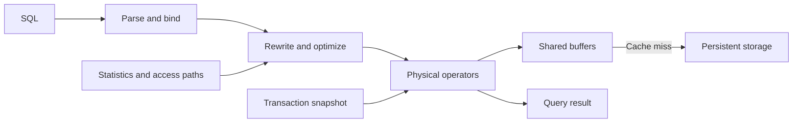

# PostgreSQL Internals: Data Engineer Interview Guide

An orders table must support customer lookups, concurrent updates, bulk loads, and revenue reports. In PostgreSQL, these requests share heap storage, indexes, MVCC, WAL, and the query executor. Understanding how those parts interact helps explain both slow queries and correctness failures.

**Scope:** PostgreSQL 18 internals for data engineering interviews. SQL snippets illustrate individual concepts; they assume the relevant tables exist. A short comparison with MySQL and Microsoft SQL Server appears at the end.

**Running example:** An online store keeps `orders` in PostgreSQL and copies changes downstream through CDC. Each order has `order_id`, `customer_id`, `order_date`, `status`, `region`, and `total_amount`.

## Contents

1. [Heap Storage and Pages](#1-heap-storage-and-pages)
2. [Indexes and Bitmap Scans](#2-indexes-and-bitmap-scans)
3. [WAL, Checkpoints, and Crash Recovery](#3-wal-checkpoints-and-crash-recovery)
4. [MVCC, Transaction Isolation, and Locking](#4-mvcc-transaction-isolation-and-locking)
5. [VACUUM, ANALYZE, and Version Cleanup](#5-vacuum-analyze-and-version-cleanup)
6. [Query Planner, CBO, and Cardinality Estimation](#6-query-planner-cbo-and-cardinality-estimation)
7. [Buffer Pools, Caching, and Execution Operators](#7-buffer-pools-caching-and-execution-operators)
8. [Replication, Consistency, and Failover](#8-replication-consistency-and-failover)
9. [Connecting the Internals](#9-connecting-the-internals)
10. [Interview Practice](#10-interview-practice)
11. [PostgreSQL, MySQL, and Microsoft SQL Server](#11-postgresql-mysql-and-microsoft-sql-server)

## 1. Heap Storage and Pages

PostgreSQL's standard tables use **row-oriented heap storage**: tuple versions live in table pages, separately from indexes. Fetching an order can read its attributes together, but a revenue report may still scan pages containing columns it does not need. Selecting fewer columns reduces processing and output; it does not turn a heap scan into a columnar scan.

A heap page contains a header, item identifiers, tuple data, and free space. An item identifier points to a tuple within the page. Large variable-length values can be compressed or moved out of line through **TOAST**. Pages are normally 8 KiB, with the size selected when PostgreSQL is built. [PostgreSQL page layout](https://www.postgresql.org/docs/18/storage-page-layout.html), [TOAST](https://www.postgresql.org/docs/18/storage-toast.html).

A primary-key index locates tuple versions in the heap; it does not keep the heap continuously sorted by that key. `CLUSTER` can reorder a table using an index, but later writes do not preserve that ordering automatically. Physical locality affects how many pages an index scan must visit. [PostgreSQL CLUSTER](https://www.postgresql.org/docs/18/sql-cluster.html).

For a large orders table partitioned by date, **partition pruning** can exclude partitions outside the requested month. Within the remaining partitions, the planner still chooses between sequential scans and available index paths. Pruning, indexing, and selecting fewer output columns solve different parts of the query's work.

## 2. Indexes and Bitmap Scans

### B-Tree and B+ tree

To find an order by ID, the engine needs a way to reach its key without examining every order. A **B-Tree** keeps keys ordered in a balanced structure with many children per internal node. PostgreSQL B-tree indexes use internal pages to route searches and leaf pages to associate keys with heap tuple locations. Links between leaves also make ordered range scans practical.

For `order_id = 103`, the engine descends from root to leaf and locates the key. For an ID range, it finds the first matching leaf entry and walks forward. High fan-out keeps the tree shallow; cached upper levels can make most traversal work memory-resident.

- Point lookup requires roughly `O(log_B N)` page visits, where `B` reflects fan-out. A range scan adds the cost of visiting matching entries and fetching required records.
- Inserts and deletes modify pages and may cause splits, merges, or deferred cleanup. Random keys can scatter writes; sequential keys can concentrate concurrent inserts on a hot edge.
- PostgreSQL indexes are separate from the heap. An index lookup may require heap visits both to retrieve columns and to check tuple visibility.
- A **covering index** contains the values needed by a query. It can reduce table reads, but visibility checks may still require them. PostgreSQL index-only scans use a visibility map to avoid heap visits when safe. [PostgreSQL index-only scans](https://www.postgresql.org/docs/18/indexes-index-only-scans.html).

A composite index on `(customer_id, order_date)` is useful for a customer's orders within a date range. Leading-key constraints usually determine how much of the index can be bounded efficiently. PostgreSQL 18 can also use skip scans when repeated searches over leading-key values are estimated to be worthwhile. [PostgreSQL multicolumn indexes](https://www.postgresql.org/docs/18/indexes-multicolumn.html).

Every additional index consumes space, memory, and write work. An index that speeds one report may slow ingestion because each inserted order must update it.

### Bitmap scans

When a predicate matches enough rows that individual heap fetches would be scattered, PostgreSQL can build a temporary bitmap of tuple locations from an index and visit heap pages in physical order. It can also combine multiple indexes with `BitmapAnd` or `BitmapOr`.

For example, separate indexes on `status` and `region` might be combined for `status = 'paid' AND region = 'EU'`. The planner can instead choose one index and filter, a composite index, or a sequential scan according to estimated cost.

A bitmap scan is an execution strategy, not a persistent bitmap index type. Memory pressure can make the bitmap lossy, recording whole pages instead of exact tuple positions and requiring predicate rechecks. [PostgreSQL bitmap scans](https://www.postgresql.org/docs/18/indexes-bitmap-scans.html).

### Choosing an access structure

| Index type | Useful access pattern | Main consideration |
| --- | --- | --- |
| B-tree | Equality, ranges, and ordered retrieval | Default choice; adds maintenance work to writes |
| Hash | Equality comparisons | Does not support ordered range scans |
| GIN | Membership searches in arrays, JSONB, or full-text data | Supported operators depend on the operator class; updates add maintenance work |
| GiST / SP-GiST | Specialized searches, including spatial data | Suitability depends on the data type and operator class |
| BRIN | Large tables where values correlate with physical location | Small summaries of page ranges; candidate ranges need rechecking |

A BRIN index on `order_date` can help when orders arrive mostly in date order. If every page range contains a wide spread of dates, its summaries exclude little data. PostgreSQL's built-in index methods do not include an LSM-tree or persistent bitmap index. [PostgreSQL index types](https://www.postgresql.org/docs/18/indexes-types.html).

## 3. WAL, Checkpoints, and Crash Recovery

### What WAL guarantees

Suppose a database reports that an order was saved, then loses power before its changed data page reaches disk. **Write-ahead logging (WAL)** makes that recovery possible by recording enough information to reconstruct changes. Its central rule concerns write order: the recovery log for a change must be durable before the corresponding changed data page reaches persistent storage. The engine can modify a page in memory earlier; it cannot safely flush that page ahead of the required log.

With durable local commit settings, the required log records, including the commit record, reach durable storage before the database acknowledges success. Data pages can be flushed later. **Group commit** lets multiple transactions share a log synchronization, reducing the cost per transaction. [PostgreSQL WAL introduction](https://www.postgresql.org/docs/18/wal-intro.html).

For an order update:

```text
Modify cached record and generate recovery log records
    -> flush required WAL through commit
    -> acknowledge durable commit
    -> flush the dirty data page later
```

This is a conceptual order; PostgreSQL can interleave work and flush uncommitted pages after satisfying the WAL rule. Synchronous replication may add a remote acknowledgment requirement before commit returns.

Durability depends on the failure model and configuration. An operating-system write is not necessarily a durable device flush. Asynchronous commit can acknowledge before local WAL is durable and therefore lose recent acknowledged transactions after a crash. Disabling required synchronization has broader consequences than simply accepting replica lag.

### Checkpoints

A **checkpoint** records a recovery boundary after flushing the required dirty buffers. Recovery can begin from an appropriate log position associated with that boundary rather than replaying the entire log history.

PostgreSQL checkpoints are **fuzzy**: transactions continue while dirty pages are written over time. A checkpoint is neither a transaction commit nor a backup. It does not make all transactions committed, and it does not mean all log files can immediately be deleted.

| More frequent checkpoints | Less frequent checkpoints |
| --- | --- |
| Usually less redo work after a crash | Usually more redo work after a crash |
| More frequent page flushing and possible I/O pressure | More opportunity to combine repeated page modifications |
| More full-page images when `full_page_writes` is enabled | Potentially larger retained recovery-log volume |

PostgreSQL spreads checkpoint writes to reduce I/O bursts. It also uses full-page images, under the relevant setting, to protect against torn-page writes. Log recycling must respect recovery, archiving, and replication requirements. [PostgreSQL WAL configuration](https://www.postgresql.org/docs/18/wal-configuration.html).

### Crash recovery

After an unclean shutdown, PostgreSQL starts from checkpoint information and replays required WAL records. Transaction status and MVCC visibility prevent incomplete transactions from appearing committed; recovery does not need to physically undo every uncommitted heap change before queries can resume. Later vacuuming can reclaim obsolete versions.

**Log sequence numbers (LSNs)** identify WAL positions. Recovery requires intact storage and the necessary WAL; it does not replace restoring a backup after media loss. [PostgreSQL WAL internals](https://www.postgresql.org/docs/18/wal-internals.html).

| Failure point | Expected outcome under durable local commit |
| --- | --- |
| Before a durable commit record | The transaction must not become a visible committed transaction |
| Commit durable, modified data page not yet persisted | Recovery restores the committed change from the log |
| Commit durable, response lost in the network | The transaction may have succeeded; the client has an unknown outcome |
| Local durable storage permanently lost | Recovery requires a suitable replica or backup and retained logs |

An unknown commit outcome matters for ingestion and payments: retrying an insert blindly can duplicate its effect. Use a stable operation identity and a uniqueness or idempotency mechanism to resolve retries.

### Recovery logs, CDC, and backups

WAL supports recovery and can feed physical replication or logical decoding. A CDC stream typically adds transaction interpretation, schema handling, positions, and delivery semantics; raw WAL is not automatically an application event log.

**Point-in-time recovery (PITR)** combines a compatible base backup with an uninterrupted sequence of required archived log records up to the recovery target. A checkpoint alone cannot recover an accidentally dropped table. A stalled replication or CDC consumer can retain logs until disk fills; retention needs monitoring rather than arbitrary manual log deletion.

## 4. MVCC, Transaction Isolation, and Locking

### ACID and transaction boundaries

An order update is useful only if its guarantees match what the application expects. Can half the transaction survive? Can another transaction see an intermediate state? Will an acknowledged commit survive a crash? ACID gives names to these questions, but the transaction boundary and engine configuration determine what the application actually receives.

| Property | Meaning | Engineering implication |
| --- | --- | --- |
| Atomicity | The transaction's changes commit together or do not become committed effects | Avoid an order update without its corresponding ledger update inside the transaction boundary |
| Consistency | Correct transactions preserve declared invariants | Constraints help; ACID does not discover missing business rules |
| Isolation | Concurrent execution obeys the chosen isolation contract | Weaker levels permit some anomalies |
| Durability | Acknowledged commits survive failures covered by the configuration | Asynchronous flushing or failover can weaken the practical guarantee |

ACID consistency concerns application and database invariants. CAP consistency concerns the observed behavior of replicated operations; they are different uses of the word.

### MVCC and snapshots

**Multiversion concurrency control (MVCC)** keeps enough version history to give each read an appropriate view of the data. The engine evaluates version visibility using a snapshot, transaction status, and version metadata. PostgreSQL keeps old tuple versions in heap storage until they can be reclaimed safely.

Suppose an order starts as `status = unpaid`:

1. Transaction A takes a snapshot that includes the unpaid version.
2. Transaction B changes the order to paid and commits.
3. A read using A's original snapshot can still see unpaid; a sufficiently new snapshot sees paid.
4. The engine can reclaim the old version only after no supported reader or retention requirement needs it.

MVCC reduces conflicts between ordinary readers and writers by letting them use different versions. It does not eliminate writer conflicts, schema locks, or synchronization inside the engine. [PostgreSQL MVCC introduction](https://www.postgresql.org/docs/18/mvcc-intro.html).

### Isolation levels and anomalies

**Isolation** defines which interactions between concurrent transactions are allowed. A consistent-looking snapshot is useful, but it does not prove the entire concurrent execution is serializable.

| PostgreSQL isolation level | Snapshot behavior | Remaining concern |
| --- | --- | --- |
| Read Uncommitted | Behaves as Read Committed | No separate dirty-read mode |
| Read Committed (default) | Generally a new snapshot per statement | Successive statements can observe different committed states |
| Repeatable Read | Transaction snapshot; prevents phantoms | Write skew and other serialization anomalies remain possible |
| Serializable | Snapshot-based reads plus serializable conflict detection | Serialization failures require whole-transaction retries |

PostgreSQL Repeatable Read provides snapshot isolation. Serializable adds Serializable Snapshot Isolation (SSI), which tracks dependencies and can abort transactions whose combination would violate serializability. [PostgreSQL transaction isolation](https://www.postgresql.org/docs/18/transaction-iso.html).

The anomalies to explain are:

- **Dirty read:** reading another transaction's change before it commits.
- **Non-repeatable read:** reading the same record twice and seeing a committed change between reads.
- **Phantom:** repeating a predicate query and seeing a changed set of matching records.
- **Lost update:** one read-modify-write sequence overwrites another's result; prevention depends on the operation and concurrency controls.
- **Write skew:** transactions read overlapping data but update different rows, jointly breaking an invariant.

**Write-skew example:** A rule requires at least one active approver. Alice and Bob are both active. Two transactions each observe both active, then each deactivates a different person. Under snapshot isolation, both can commit because they changed different rows, leaving nobody active. Serializable execution can reject such a schedule; an alternative is to make all changes contend on a shared guard row under a correct locking protocol.

### Optimistic vs. pessimistic concurrency control

**Optimistic concurrency control (OCC)** permits work, then validates that committing it will not violate the protocol. A version-based conditional update is a common application-level example: update only if `version = expected_version`, and detect whether a row changed. A stale writer must reread and retry or report a conflict.

**Pessimistic concurrency control** reserves access with locks before proceeding. It can avoid wasted work under contention but introduces waiting, deadlocks, and possible long lock holds.

OCC often suits relatively rare conflicts; locking can suit frequent conflicts where waiting is cheaper than redoing work. Neither is universally faster. Keep transactions short and avoid slow external calls while holding locks.

**Example:** Two consumers try to update an order. Comparing a source version prevents an older update from silently overwriting the newer value; unconditional upsert does not provide that protection.

### Transaction locks, internal synchronization, and deadlocks

A **transaction lock** coordinates operations such as concurrent updates or DDL. PostgreSQL also uses internal synchronization, including lightweight locks (`LWLock`), to protect shared structures. Waiting on an internal lock is a different bottleneck from waiting for another transaction to commit.

| Mechanism | Purpose |
| --- | --- |
| Shared/exclusive locks | Permit compatible readers or exclude conflicting access, according to engine rules |
| Row/key locks | Coordinate updates to particular records or keys |
| Serializable predicate locks (`SIReadLock`) | Track read dependencies for SSI; do not block writers like range locks |
| Table/schema locks | Coordinate DDL and operations that require broader protection |

PostgreSQL example, assuming `order_id` uniquely identifies an existing row:

```sql
BEGIN;
SELECT status
FROM orders
WHERE order_id = 101
FOR UPDATE;

UPDATE orders
SET status = 'paid'
WHERE order_id = 101;
COMMIT;
```

The row lock coordinates concurrent writers while application logic inspects the order. It does not lock a missing row or automatically protect an arbitrary multi-row business rule. A single conditional update can often express a state transition with less work; use constraints for invariants they can enforce.

A **deadlock** is a wait cycle: A holds order 101 and wants 102, while B holds 102 and wants 101. PostgreSQL detects the cycle and aborts a transaction. Acquire resources in a consistent order, keep transactions short, and retry aborted transactions with bounded backoff. A lock timeout alone is not proof of a deadlock. [PostgreSQL locking and deadlocks](https://www.postgresql.org/docs/18/explicit-locking.html).

### Data engineering implications

A multi-statement extraction under Read Committed can combine data from different moments. If a consistent extract is required, use a consistent PostgreSQL snapshot and coordinate it with the CDC starting position. Long snapshots retain history and can interfere with cleanup; correctness and retention costs must both be part of the design.

Transaction retries must preserve application semantics. Retrying only the last statement after a serialization failure can reuse stale decisions; retry the whole transaction, and keep external side effects idempotent or coordinate them through a durable mechanism.

## 5. VACUUM, ANALYZE, and Version Cleanup

### Why deleted data can remain on disk

Delete a million orders and the table file may barely shrink. PostgreSQL first changes tuple visibility; older snapshots may still need the deleted versions. Once versions are safely dead, vacuum can make their space reusable.

Deleting rows, reclaiming space for reuse within a table, and returning bytes to the operating system are different outcomes. WAL retention is another concern: replication slots or archiving failures can retain WAL even when heap cleanup is healthy.

### PostgreSQL VACUUM and ANALYZE

PostgreSQL generally creates a new tuple version for an update and leaves the old version for cleanup. Standard **VACUUM** makes safely dead tuple space reusable and cleans up associated structures. It also maintains visibility information and handles transaction-ID freezing to prevent wraparound problems.

| Operation | Main purpose | Operational consequence |
| --- | --- | --- |
| `VACUUM` | Reclaim reusable space and maintain visibility/freezing metadata | Runs alongside ordinary reads and writes, but consumes resources and can conflict with some operations |
| `ANALYZE` | Collect sampled distributions for query planning | Improves estimates when statistics capture the relevant data shape |
| `VACUUM ANALYZE` | Perform both operations | Cleanup and distribution-statistics refresh are separate tasks |
| `VACUUM FULL` | Rewrite a table into a compact representation | Requires extra working space and an exclusive table lock |

Standard vacuum usually keeps freed space inside the table for reuse; it can sometimes truncate empty tail pages. It does not normally shrink a fragmented table to the size of its live records. Autovacuum schedules cleanup and auto-analyze work; it needs capacity and suitable thresholds for the workload. [PostgreSQL routine vacuuming](https://www.postgresql.org/docs/18/routine-vacuuming.html).

**Interview distinction:** Vacuum can update some relation-level information, but the detailed value distributions used by the planner come from `ANALYZE`. A cleanup problem and a stale-statistics problem can coexist and need different remedies.

### Version retention and the oldest reader

An old active snapshot can hold back the horizon beyond which versions are safe to remove. Long transactions and forgotten idle transactions can therefore cause growing storage and extra read work, even when vacuum runs frequently. Some replication mechanisms also retain required history; distinguish retained tuple/catalog versions from retained WAL.

Before increasing cleanup resources, determine whether cleanup is slow or prohibited by a still-valid retention requirement. More vacuum workers cannot safely remove a version still visible to a supported reader.

**Operational signals:** dead tuple estimates, oldest transaction/snapshot age, autovacuum progress, transaction-ID age, retained WAL, maintenance I/O, and free disk space. Cleanup competes with queries and ingestion; it needs capacity to keep up.

## 6. Query Planner, CBO, and Cardinality Estimation

### From SQL to a physical plan

Between writing a query and receiving its result, the engine must establish what the query means and choose how to do the work. A useful way to follow that journey is through four stages:

1. **Parsing and binding:** check syntax, resolve tables and columns, validate types and permissions.
2. **Logical rewriting:** simplify expressions and transform the relational plan while preserving semantics.
3. **Physical planning:** choose access paths, join order, algorithms, and parallel execution paths.
4. **Execution:** run operators and return results under the required snapshot and resource limits.

Prepared statements can use generic or parameter-specific custom plans. If customer order counts differ greatly, check whether the chosen plan suits the parameters used.

The **logical plan** describes operations such as filtering and joining. The **physical plan** specifies how to perform them: a sequential scan or an index scan, a hash join or an indexed nested loop, and serial or parallel execution.

### Cost-based optimization

A **cost-based optimizer (CBO)** compares candidate plans using estimates of input sizes, selectivity, row width, CPU, I/O, and memory costs. Search is bounded: join-order possibilities grow quickly, so optimizers use pruning, heuristics, or search limits rather than exploring every plan.

Cost is an estimate in an engine-specific model, not a promise of elapsed milliseconds. A planner can prefer a low-startup-cost plan for `LIMIT`, while an aggregate usually needs to process its full input. Parallelism helps only when its benefit exceeds scheduling, synchronization, and exchange costs.

Common transformations include predicate pushdown, projection pruning, constant folding, partition pruning, join reordering, and partial aggregation. They must preserve SQL semantics. Pushing a predicate across an outer join incorrectly can change results; expressions with side effects or special null behavior also constrain rewrites.

### Cardinality and selectivity

**Cardinality** is the number of rows at a plan node. **Selectivity** is the fraction of input rows satisfying a condition. Statistics can include row counts, distinct counts, null fractions, common values, histograms, and relationships between columns.

For a simple filter:

```text
estimated output rows = input rows × estimated selectivity

10,000,000 orders × 0.02 = 200,000 matching orders
```

For an equality predicate, a uniformity assumption gives selectivity near `1 / distinct_values`, with adjustments for nulls and known frequent values. For an equijoin, a simplified estimate is:

```text
|A JOIN B| ≈ |A| × |B| / max(distinct(A.key), distinct(B.key))
```

This heuristic assumes conditions such as roughly uniform frequencies and sufficient overlap between key domains. Skew, nulls, disjoint domains, filters, and key constraints can change the answer dramatically. A valid foreign-key relationship to a unique parent supports a much stronger estimate than an unconstrained many-to-many join.

### Why estimates fail

| Cause | Example | Possible response |
| --- | --- | --- |
| Stale statistics | Yesterday's count remains after today's large load | Refresh statistics after material data changes |
| Skew | One customer generates half the orders | Inspect most-common-value statistics and the statistics target |
| Correlated predicates | Country and city are treated as independent | Use supported multicolumn statistics or a clearer model |
| Expressions or opaque functions | Filtering a transformed timestamp hides its distribution | Use a semantically equivalent searchable predicate or supported expression statistics |
| Parameter-sensitive data | One prepared plan serves both tiny and huge customers | Inspect representative parameter values and plan-cache behavior |
| Join propagation | An early underestimate becomes the input to several later joins | Fix the earliest important estimation error |

For example, suppose all Berlin orders have `country = DE`. Multiplying independent country and city selectivities can underestimate `country = 'DE' AND city = 'Berlin'`: the country condition adds no further restriction to that city. PostgreSQL supports extended statistics for some relationships between columns, collected by `ANALYZE`; support does not imply every join or expression estimate is solved. [PostgreSQL planner statistics](https://www.postgresql.org/docs/18/planner-stats.html).

A severe underestimate may choose repeated index probes when a scan and hash join would be cheaper. An overestimate may choose unnecessary scans or a large hash build. Bad plans can also arise with accurate row estimates because of cost assumptions, resource contention, or skew.

### Reading EXPLAIN

PostgreSQL example, assuming the running-example table exists:

```sql
EXPLAIN (ANALYZE, BUFFERS)
SELECT region, SUM(total_amount)
FROM orders
WHERE order_date >= DATE '2026-01-01'
  AND order_date < DATE '2026-02-01'
  AND status = 'paid'
GROUP BY region;
```

`EXPLAIN ANALYZE` executes the statement. Even a read can be expensive, and statements with writes or side-effecting functions retain their effects. Use representative test data or an appropriate controlled environment.

Inspect estimated versus actual rows, actual work, loops, buffers, spill, and elapsed time. In PostgreSQL, actual rows and timing at a repeatedly executed node are reported per-loop averages; multiply by loops to understand repeated work. Parent times and buffer counts can include child work, so summing every node double-counts it. [PostgreSQL EXPLAIN guide](https://www.postgresql.org/docs/18/using-explain.html).

**Example diagnosis:** A nested-loop inner lookup returning one row per execution looks cheap until it runs five million times. Find why the outer input was much larger than expected before adding indexes or increasing memory.

## 7. Buffer Pools, Caching, and Execution Operators

### Buffer pools and the memory hierarchy

An order lookup need not reach disk every time. A **buffer pool** keeps database pages in engine-managed memory, where a read can locate or load a page and pin it for use. Updates mark pages dirty. When the engine needs to reuse memory, it selects an unpinned page; a dirty page must first be persisted safely, including meeting WAL's write-ordering rule.

Replacement policies such as clock or LRU variants approximate which pages will be useful again. A large sequential scan can evict frequently used pages unless the engine uses scan-resistant policies or separate strategies.

| Layer | Cached content | Important limitation |
| --- | --- | --- |
| CPU caches | Cache lines containing instructions and data | Poor locality or branching can limit CPU efficiency |
| PostgreSQL shared buffers | Heap and index pages | Large scans and concurrency compete for capacity |
| OS page cache | Filesystem data | May duplicate engine caching; direct I/O can bypass it |
| Plan cache | Prepared statement plans | Reused plans can be unsuitable for different parameters |

A high cache-hit ratio does not prove efficiency: a query can repeatedly process too many cached pages. A database-level cache miss is also not necessarily a physical device read if the OS serves it from memory.

Distinguish **data cache** from **execution memory**. Hash tables, sort buffers, and aggregate states need memory too. PostgreSQL uses `work_mem` as a base allowance for many such operations, with hash operations also affected by `hash_mem_multiplier`. Per-operation memory allowances multiply across operators, workers, and concurrent queries, so increasing one setting can increase total memory pressure considerably. [PostgreSQL memory settings](https://www.postgresql.org/docs/18/runtime-config-resource.html#RUNTIME-CONFIG-RESOURCE-MEMORY).

### Iterator execution and JIT

PostgreSQL's executor generally passes tuples between plan nodes: a parent requests rows from its children, enabling operations such as filters and nested loops to stream results. Storage layout and execution strategy are separate concerns.

PostgreSQL can use **just-in-time compilation (JIT)** to accelerate expression evaluation and tuple deforming when available and enabled. Compilation adds startup cost, so it is more useful for sufficiently expensive queries than for short lookups. [PostgreSQL JIT](https://www.postgresql.org/docs/18/jit-reason.html).

### Execution operators

| Operator | Work performed | Main pressure or failure mode |
| --- | --- | --- |
| Sequential scan | Read heap pages and return visible qualifying tuples | Pages read, visibility checks, and filtering work |
| Index scan | Find keys and fetch required records | Many scattered fetches or repeated probes |
| Filter/project | Evaluate predicates and expressions | CPU-heavy expressions and late filtering |
| Nested-loop join | Evaluate an inner input for each outer row | Huge repetition unless the outer is small or inner lookup is cheap |
| Hash join | Build a hash table, then probe matching keys | Build-side memory, skew, spill, and many-to-many output |
| Sort-merge join | Walk compatible ordered inputs | Sorting cost unless useful ordering already exists |
| Hash aggregate | Maintain state per grouping key | Many groups or large states can exceed memory |
| Sort/ordered aggregate | Group compatible adjacent keys | Input ordering or an added sort is required |
| Sort/top-N | Order all rows or retain the best candidates | Memory and spill; top-N still may need to inspect all candidates |
| Gather / Gather Merge | Collect parallel worker output, preserving order with Gather Merge | Worker availability, transfer overhead, and uneven work |

An equijoin's small build side should be measured after its filters, including row width and hash overhead. The physically smaller base table is not necessarily the smaller build input. A join with duplicate keys can produce a huge output regardless of the chosen algorithm.

### Pipelining, blocking, and spill

A **pipelined operator** can emit output as input arrives. A simple filter can do this. A full sort is **blocking** because it must examine its input before returning ordered results; a hash join generally needs its build phase before probing. Partial blocking and partitioned strategies vary by implementation.

When state exceeds available memory, supported operators **spill** intermediate data to temporary storage. External sort creates sorted runs and merges them; a spilling hash join partitions work so pieces can be processed separately. Spill preserves execution capability at additional I/O and CPU cost; operators that cannot spill may fail or be throttled instead.

Parallel execution still has coordination costs. Uneven work or a busy leader can limit speedup even when several workers are available.

### Measuring execution performance

For a slow revenue query, establish whether time is spent queueing, planning, reading, computing, spilling, coordinating workers, or waiting on locks. Compare cold and warm cache runs only when their difference answers the question being investigated. Record workload concurrency and data size; an isolated warm query does not establish production throughput.

**Interview trap:** More memory or workers helps only when it addresses the limiting resource. It cannot repair a wrong join condition, missing pruning, a long lock wait, or an inherently enormous result.

## 8. Replication, Consistency, and Failover

### Physical and logical replication

PostgreSQL streaming **physical replication** transfers WAL to standbys that replay the primary's storage changes. A hot standby can serve read-only queries, but replay and queries can conflict: recovery may cancel a query, while settings that preserve standby snapshots can increase cleanup pressure on the primary.

**Logical replication** publishes changes to subscribed tables using logical row identities. A subscription is not a complete replacement-primary image: schema changes and sequence state need separate handling. Updates and deletes require an appropriate replica identity. [PostgreSQL standby replication](https://www.postgresql.org/docs/18/warm-standby.html), [logical replication restrictions](https://www.postgresql.org/docs/18/logical-replication-restrictions.html).

### Asynchronous vs. synchronous acknowledgment

**Asynchronous replication** lets the primary acknowledge without waiting for a remote copy. It reduces commit-path network coupling, but a promoted replica can lack recently acknowledged transactions.

**Synchronous replication** waits for a specified remote condition. State exactly which condition: receipt in memory, operating-system write, durable log flush, or application of the change. Waiting for more replicas or a distant region increases latency and can reduce write availability when the required replicas are unavailable.

For PostgreSQL 18, with synchronous standbys configured:

| Commit setting | Remote condition before acknowledgment |
| --- | --- |
| `remote_write` | Required standbys have written WAL to the OS; their OS crash can still lose it |
| `on` | Required standbys have durably flushed WAL |
| `remote_apply` | Required standbys have also replayed the commit so sufficiently new snapshots can see it |

These settings also wait for local durable WAL. Waiting for durable remote WAL is different from waiting for query visibility. The guarantee applies to the standbys required for that commit; another replica can still lag. [PostgreSQL synchronous commit settings](https://www.postgresql.org/docs/18/runtime-config-wal.html#GUC-SYNCHRONOUS-COMMIT).

### Consistency of reads

For a newly paid order, reading from a lagging replica can still return unpaid. Options include reading from the authoritative primary, waiting until a replica applies the write's position, or using a protocol that provides the needed consistency. A transaction with an older snapshot may still see older state even after replay catches up.

Track replication progress at separate stages: generated, sent, received/written, durably flushed, and applied. A time-based lag value alone may not reveal retained byte volume or the amount of work needed before promotion.

### Promotion and split-brain

PostgreSQL streaming replication does not by itself provide automatic failure detection, leader election, or fencing. A failover manager or operational procedure must decide which standby to promote and prevent the old primary from continuing to accept writes. [PostgreSQL failover](https://www.postgresql.org/docs/18/warm-standby-failover.html).

**Split-brain** means competing nodes act as authoritative writers. A health-check timeout establishes suspicion, not proof that the old primary has stopped. Promotion needs reliable fencing and routing so isolated clients cannot continue writing to the former primary.

### Failover sequence and recovery objectives

A safe failover design must:

1. Detect a suspected primary failure and obtain authoritative permission to change leadership.
2. Prevent the old primary from continuing authoritative writes through fencing or protocol enforcement.
3. Select an eligible replica according to the durability and log-history rules; recover/apply the required history.
4. Promote it and redirect clients, accounting for connection pools and stale routing.
5. Resolve in-flight transaction outcomes and reconnect replication/CDC consumers at valid positions.
6. Rejoin or rebuild the former primary safely, rather than allowing divergent history to continue.

Implementations may combine these steps. The important invariant is that conflicting authoritative writes are prevented and promotion preserves the promised committed history.

**Recovery point objective (RPO)** is the tolerated data-loss window. **Recovery time objective (RTO)** is the tolerated restoration time. RTO includes detection, authority transfer, log replay, routing, reconnection, and application recovery. A low replay delay alone does not prove a low RTO.

Synchronous durability can support zero loss of acknowledged commits within its defined failure model and promotion rules. It does not protect against losing every required durable copy, promoting an unsuitable node, or a bad delete replicated everywhere. Backups and tested restores cover different failure cases from replication.

### Data engineering implications

A failover can change source connections, log histories, or CDC positions. Resume from positions the connector can validate for the new source, preserve transaction boundaries where needed, and make downstream application idempotent. A replica suitable for reports is not automatically a suitable CDC source or failover candidate.

## 9. Connecting the Internals

### One read through the engine

Now follow one request through the whole engine: calculate revenue from the orders visible to a transaction. The plan determines how to find and combine the data, the snapshot determines which versions count, and the cache determines how much storage access is necessary. The diagram connects the mechanisms covered so far.



The planner estimates how to access the orders. The executor runs scans, filters, joins, and aggregates. Storage layout determines what bytes are available together; indexes and metadata reduce the work; MVCC determines which versions count. Caches reduce access cost, while memory limits influence spill and concurrency.

### One write through the engine

In PostgreSQL, updating an order involves locating its record, obtaining the necessary concurrency protection, producing a new state/version and recovery records, satisfying commit durability, and releasing transaction resources. The exact internal order follows the engine's locking and logging protocol.

The committed version can become visible without its data page already being persisted. Later page flushing respects WAL ordering. Old versions remain until cleanup is safe. Replication progresses through receipt, flush, and replay; which stage commit waits for depends on policy. A checkpoint reduces future recovery work but does not replace any of these guarantees.

### Symptoms and first evidence to inspect

| Symptom | Plausible mechanism | First evidence |
| --- | --- | --- |
| Table grows after many deletes | Reusable internal space, retained snapshots, or delayed cleanup | Live/dead estimates, oldest snapshot, cleanup progress, file layout |
| Ingestion slows periodically | Checkpoint I/O, index maintenance, vacuum work, or contention | Wait events, device latency, vacuum activity, checkpoint timing |
| Query reads little data but stays slow | CPU-heavy expressions, locks, spill, queueing, or network waits | Operator times and resource/wait profile |
| Query slows after a bulk load | Changed distributions, stale statistics, or increased heap/index size | Estimated vs. actual rows, partition pruning, relation sizes, statistics age |
| New orders disappear briefly after checkout | Reads routed to a replica behind the write | Read destination and applied replication position |
| Database disk fills during a CDC outage | Required logs retained for a stalled consumer | Consumer positions, retained log bytes, retention policy |
| Adding workers gives little speedup | Skew, serial stages, coordination overhead, or saturated storage | Per-worker rows/time and stage-level resource use |
| Failover loses acknowledged writes | Async lag or promotion outside the durability contract | Commit policy, replica durable positions, election/promotion history |

Treat these as hypotheses, not diagnoses. Establish the bottleneck or correctness boundary before changing configuration.

## 10. Interview Practice

### A structure for technical answers

For practice, take an ordinary order lookup and explain what the engine does from start to finish. Then change one condition: the relevant page is missing from cache, another transaction updates the order, or the server crashes during a write. A clear answer connects the mechanism to the changed outcome. Use the sequence below to keep that explanation grounded.

1. **Define the mechanism:** name the data structure or protocol and its invariant.
2. **Walk through an operation:** use one order lookup, update, scan, or failure.
3. **State the tradeoff:** identify extra reads, writes, memory, latency, or retained history.
4. **Cover concurrency and failure:** explain snapshots, incomplete work, retries, or replica loss.
5. **Name the evidence:** say which plan, metric, wait, or log position would validate the explanation.
6. **Qualify engine details:** separate a general principle from a particular implementation.

### Questions to rehearse

| Question | What a strong answer includes |
| --- | --- |
| How does a B+ tree range scan work? | Root-to-leaf seek, ordered leaf traversal, and record-fetch cost |
| Is a bitmap scan a bitmap index? | Persistent representation versus a temporary execution structure |
| Why is a table scan sometimes better than an index? | Many matching rows, scattered fetches, sequential I/O, and heap visibility checks |
| How can a committed update survive without its data page on disk? | Durable WAL and recovery replay |
| Does a checkpoint commit active transactions? | Checkpoint recovery boundaries are separate from transaction outcomes |
| What happens if a client times out during commit? | Unknown outcome, stable operation identity, and safe retry handling |
| Does MVCC remove locking? | Versioned reads coexist with writer conflicts, schema locks, and internal latches |
| Why can snapshot isolation violate a business rule? | Write skew across different records and a concrete invariant |
| Why does an old extract increase storage use? | Its snapshot retains versions and can hold back safe cleanup |
| Why does DELETE not immediately shrink a table? | Logical visibility, safe reclamation, internal reuse, and file rewriting |
| How do VACUUM and ANALYZE differ? | Version cleanup/freezing versus statistics collection |
| Why can a fresh CBO estimate still be wrong? | Sampling, skew, correlation, expression visibility, and model assumptions |
| Why is an inner lookup with one result still expensive? | Repetition count and total work across outer rows |
| What causes a hash join to spill? | Filtered build size, row width, overhead, memory allowance, and concurrency |
| Does synchronous replication mean every replica is current? | Required acknowledgments, flush versus replay, and replica/snapshot selection |
| How do you make failover safe? | Authoritative leadership, fencing, eligible history, routing, and retry handling |
| Why is replication not a backup? | It propagates bad changes; recovery needs independent retained history |
| How do engine internals affect a CDC pipeline? | Source log retention, snapshot handoff, ordering, failover positions, and idempotent apply |

### Scenario: a report slows down after loading a month of orders

Start with a representative execution plan and resource profile. Compare estimated and actual rows at the first major divergence. Confirm that the date predicate prunes the expected partitions and that the join keys preserve the intended grain.

Then inspect statistics, heap/index growth, spill, cache state, and concurrent load. Run `ANALYZE` when statistics no longer reflect the loaded data. Consider index changes only when the plan and access pattern justify them; more memory helps only when an appropriate operation is spilling.

### Scenario: a large delete frees no disk space

Separate visibility from reclamation. Check whether old snapshots or retention policies require the deleted data, whether cleanup has completed, and whether the engine retains freed pages for reuse. Determine whether logs or temporary rewrite outputs account for the space instead of the table itself.

Explain the cost of a rewrite before proposing one: an exclusive table lock for `VACUUM FULL`, extra free-space requirements, I/O, and effects on replication or readers. For routine turnover, internal reuse may already be the desired outcome.

### Scenario: a successful order update is missing after failover

Establish whether the client received a success or merely timed out. Inspect the old primary's commit policy and the promoted replica's durable/applied positions. Determine whether the update is missing from the new authoritative history or only hidden by a lagging read path or old snapshot.

If the commit existed only on the lost asynchronous primary, promotion can lose it. If the system promised synchronous durability, verify the required replica acknowledgments, eligible promotion rules, and actual failure scope. Reconcile application operations using durable identities before replaying uncertain work.

### Common claims to challenge

- “An index is always faster than a scan.” Selectivity, locality, visibility, and required columns determine the work.
- “Commit flushes every changed table page.” WAL can provide durability before those pages are persisted.
- “A checkpoint is a backup.” It establishes recovery state within the running storage system.
- “MVCC means no locks.” It reduces some conflicts while other concurrency controls remain necessary.
- “A stable snapshot is serializable.” Write skew can still break a cross-row invariant.
- “VACUUM immediately returns all deleted bytes to the OS.” Snapshot retention and internal space reuse determine what can be reclaimed.
- “The optimizer knows the data.” It estimates from incomplete statistics and assumptions.
- “A 99% cache-hit ratio proves the query is efficient.” It can still do enormous unnecessary work in memory.
- “Automatic failover guarantees zero data loss.” Durability, eligible promotion, fencing, and the failure model determine that guarantee.

## 11. PostgreSQL, MySQL, and Microsoft SQL Server

All three support relational transactions, indexes, recovery, and replication. Their isolation defaults differ, so the same transaction boundaries can produce different blocking and visibility behavior.

| Aspect | PostgreSQL 18 | MySQL 8.4 with InnoDB | Microsoft SQL Server |
| --- | --- | --- | --- |
| Standard row storage | Heap with separate indexes | Clustered index, usually keyed by the primary key | Heap or clustered index |
| Default isolation | Read Committed | Repeatable Read | Read Committed |
| Ordinary reads | MVCC snapshots; generally a new snapshot per statement at the default level | Nonlocking consistent reads use MVCC; default-level reads share a transaction snapshot | Default Read Committed uses shared locks unless `READ_COMMITTED_SNAPSHOT` is enabled |
| Stronger isolation | Repeatable Read provides snapshot isolation; Serializable adds SSI and may abort | Locking reads at Repeatable Read can use next-key/gap locks to protect scanned ranges | Snapshot isolation requires configuration; Serializable uses range locks for qualifying ranges |
| Practical consequence | Plan for vacuum and whole-transaction retries | Distinguish snapshot reads from locking reads | Check row-versioning configuration before assuming readers and writers avoid blocking |

These defaults are configurable. Azure SQL Database enables `READ_COMMITTED_SNAPSHOT` by default, unlike SQL Server. Compare the actual isolation and database settings before porting a workload. Storage references: [InnoDB clustered indexes](https://dev.mysql.com/doc/refman/8.4/en/innodb-index-types.html), [SQL Server indexes](https://learn.microsoft.com/en-us/sql/relational-databases/indexes/clustered-and-nonclustered-indexes-described?view=sql-server-ver17). Isolation references: [PostgreSQL isolation](https://www.postgresql.org/docs/18/transaction-iso.html), [MySQL InnoDB isolation](https://dev.mysql.com/doc/refman/8.4/en/innodb-transaction-isolation-levels.html), [SQL Server isolation](https://learn.microsoft.com/en-us/sql/t-sql/statements/set-transaction-isolation-level-transact-sql?view=sql-server-ver17).

Related guides: [Core Engineering Concepts](core.md), [Data Warehousing](../storage-and-modeling/dwh.md), [Data Replication](../ingestion/replication.md), and [SQL](sql.md).
