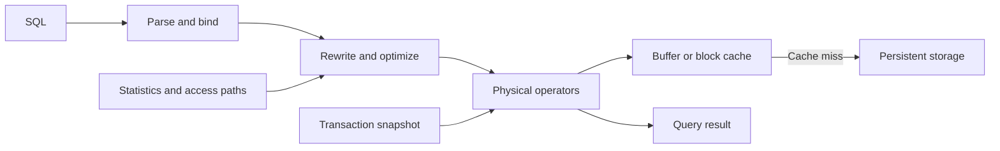

# Database & DWH Engine Internals: Data Engineer Interview Guide

A database engine turns SQL into reads and writes while preserving the visibility, durability, and recovery guarantees promised to applications. In an interview, explain both the mechanism and its consequence: which work becomes cheaper, which work moves into the background, and what happens when a transaction or server fails.

**Scope:** Platform-neutral fundamentals with explicitly labeled PostgreSQL 18, RocksDB, and DuckDB examples. Product documentation was checked on October 25, 2026. Implementation details vary by engine, version, configuration, and deployment. SQL snippets illustrate individual concepts; they are not a complete runnable database setup.

**Running example:** An online store keeps operational orders in a transactional database and copies changes into a warehouse. An order has `order_id`, `customer_id`, `order_date`, `status`, `region`, and `total_amount`. Operational queries fetch or update individual orders; analytical queries aggregate revenue across millions of orders.

## Contents

1. [Row-Oriented vs. Column-Oriented Storage](#1-row-oriented-vs-column-oriented-storage)
2. [B-Tree, LSM-Tree, and Bitmap Indexes](#2-b-tree-lsm-tree-and-bitmap-indexes)
3. [WAL, Checkpoints, and Crash Recovery](#3-wal-checkpoints-and-crash-recovery)
4. [MVCC, Transaction Isolation, and Locking](#4-mvcc-transaction-isolation-and-locking)
5. [VACUUM, Garbage Collection, and Storage Compaction](#5-vacuum-garbage-collection-and-storage-compaction)
6. [Query Planner, CBO, and Cardinality Estimation](#6-query-planner-cbo-and-cardinality-estimation)
7. [Buffer Pools, Caching, and Execution Operators](#7-buffer-pools-caching-and-execution-operators)
8. [Replication, Consistency, and Failover](#8-replication-consistency-and-failover)
9. [Connecting the Internals](#9-connecting-the-internals)
10. [Interview Practice](#10-interview-practice)

## 1. Row-Oriented vs. Column-Oriented Storage

### Physical layout

**Row-oriented storage** places a record's attributes together. **Column-oriented storage** places values from the same column together within a storage unit, such as a row group or segment. A columnar table is usually many bounded groups of column chunks, rather than one enormous file per column.

For three orders, the conceptual layouts are:

```text
Rows:
[101, 7, paid,   EU, 40.00]
[102, 8, unpaid, US, 25.00]
[103, 7, paid,   EU, 60.00]

Columns:
order_id:     [101, 102, 103]
customer_id:  [7,   8,   7]
status:       [paid, unpaid, paid]
region:       [EU,  US, EU]
total_amount: [40.00, 25.00, 60.00]
```

| Aspect | Row-oriented | Column-oriented |
| --- | --- | --- |
| Typical strength | Fetch or modify a few complete records | Scan a few columns across many records |
| I/O for a wide analytical table | May read many attributes the query never uses | Can read only the required column chunks |
| Compression | Possible, but adjacent values often have different types | Similar types and repeated values support efficient encoding |
| Single-row lookup | Often efficient with an appropriate index | May need to locate and reconstruct values across chunks |
| Small updates | Often update pages or create row versions | May use deltas, delete markers, or rewritten segments |
| Bulk ingestion | Benefits from batching and appropriate indexes | Benefits from forming reasonably sized compressed groups |

**Example:** `SELECT * FROM orders WHERE order_id = 101` often suits a row store with a primary-key index. A revenue query reading `order_date`, `region`, and `total_amount` across a billion orders often suits a column store.

The useful distinction is the workload's access pattern. A row store can execute analytical SQL, and a column store can support transactions and updates. Hybrid transactional/analytical processing (HTAP) designs combine layouts or keep a write-friendly delta alongside an analytical representation.

### Pages, records, and row groups

A **page** is a storage and caching unit used by many database engines. A row-store page may contain a header, a directory of record slots, records, and free space. A slot lets a record move within the page without requiring every reference to know its byte offset. Large values may live outside the main record.

A columnar row group usually has separate chunks for its columns, plus metadata. Its size trades compression and scan efficiency against memory use, write latency, and pruning granularity. Database pages, filesystem blocks, compressed blocks, and warehouse files are different units; do not assume they have the same size.

### Compression, encoding, and data skipping

Common techniques include:

- **Dictionary encoding:** store repeated values as compact codes plus a dictionary.
- **Run-length encoding:** represent a run such as `EU, EU, EU, EU` as a value and count.
- **Delta encoding:** store differences between nearby numeric or timestamp values.
- **Bit packing:** use only the bits required by a bounded integer range.
- **General compression:** compress encoded bytes with a codec, balancing CPU against I/O savings.

**Projection pruning** avoids unneeded columns. **Partition pruning** excludes partitions using partition metadata. **Zone maps/min-max statistics** exclude groups whose value ranges cannot match a predicate. **Predicate pushdown** evaluates a filter closer to storage; whether it avoids reading bytes depends on storage metadata and reader capabilities.

Sorting orders by `order_date` can make each group's date range narrow. A monthly filter can then skip most groups. If every group contains orders from every month, min/max metadata is much less selective.

**Interview trap:** Compression, column layout, indexing, and sort order are separate choices. Columnar storage alone does not guarantee that a selective query reads little data.

Parquet is a concrete example of column chunks grouped into row groups, with file metadata locating those chunks. Its encoding specification illustrates dictionary, run-length, bit-packed, and delta representations. A file format provides layout rules; the database engine supplies query planning and transaction behavior. [Parquet file layout](https://parquet.apache.org/docs/file-format/), [Parquet encodings](https://parquet.apache.org/docs/file-format/data-pages/encodings/).

## 2. B-Tree, LSM-Tree, and Bitmap Indexes

### B-Tree and B+ tree

A **B-Tree** maintains ordered keys in a balanced structure with many children per internal node. Database indexes commonly use a **B+ tree** variant: internal pages route searches, while leaf pages contain keys and record references or records, depending on the engine. Linked leaves support ordered range scans.

For `order_id = 103`, the engine descends from root to leaf and locates the key. For an ID range, it finds the first matching leaf entry and walks forward. High fan-out keeps the tree shallow; cached upper levels can make most traversal work memory-resident.

- Point lookup requires roughly `O(log_B N)` page visits, where `B` reflects fan-out. A range scan adds the cost of visiting matching entries and fetching required records.
- Inserts and deletes modify pages and may cause splits, merges, or deferred cleanup. Random keys can scatter writes; sequential keys can concentrate concurrent inserts on a hot edge.
- A **clustered index** organizes the table around its key in engines that support that design. A **secondary index** points to data elsewhere, sometimes through the primary key. The extra lookup cost depends on the engine.
- A **covering index** contains the values needed by a query. It can reduce table reads, but visibility checks may still require them. PostgreSQL index-only scans use a visibility map to avoid heap visits when safe. [PostgreSQL index-only scans](https://www.postgresql.org/docs/18/indexes-index-only-scans.html).

A composite index on `(customer_id, order_date)` is useful for a customer's orders within a date range. Leading-key constraints usually determine how much of a conventional ordered index can be bounded efficiently. Optimizations such as skip scans are engine-specific; do not claim that a non-leading column can never use the index.

Every additional index consumes space, memory, and write work. An index that speeds one report may slow ingestion because each inserted order must update it.

### LSM-Tree

A **log-structured merge tree (LSM-Tree)** absorbs writes into memory and organizes persistent data as sorted files. A typical write path is:

1. Append a recovery record to a WAL, with durability governed by the commit settings.
2. Insert the key and value, together with ordering/version information, into a **memtable**.
3. Freeze a full memtable and flush it into an immutable sorted table file, often called an **SSTable**.
4. Compact files in the background to control overlap and remove obsolete entries when safe.

A lookup checks memory and candidate files, using file metadata and indexes to narrow the search. A **Bloom filter** can rule out a file when a key is definitely absent; a possible match still requires a lookup. Correctly maintained Bloom filters can have false positives, but not false negatives. Range scans merge ordered iterators across relevant runs. [RocksDB overview](https://github.com/facebook/rocksdb/wiki/RocksDB-Overview).

Updates append newer versions; a delete commonly writes a **tombstone**. Removing a tombstone too early can expose an older value still present in another file. Safe cleanup must account for overlapping files, snapshots, and the engine's replication or retention rules.

LSM designs batch persistent writes, but they also rewrite data during compaction. If flushing or compaction cannot keep up, files and pending work accumulate; the engine may throttle or stall writes.

### Read, write, and space amplification

| Measure | Meaning | Example |
| --- | --- | --- |
| Read amplification | Extra reads or bytes needed to answer a logical read | Checking several sorted runs for one key |
| Write amplification | Physical bytes written divided by logical bytes written, with scope stated | WAL, flushes, and repeated compaction writes |
| Space amplification | Physical storage divided by the size of the current logical dataset | Old versions, tombstones, redundant runs, and temporary outputs |

State what each measurement includes: filesystem or SSD-internal amplification may add another layer. These ratios depend on workload, caching, compression, and maintenance policy; “LSM always has lower write amplification than B-Tree” is too broad.

### Bitmap indexes

A **bitmap index** represents membership using bits associated with row positions. For a categorical column, one bitmap can identify the rows having a particular value. Compressed representations make sparse or repetitive patterns practical.

```text
Orders:          [101, 102, 103, 104, 105]
status = paid:   [ 1,   0,   1,   1,   0]
region = EU:     [ 1,   1,   0,   1,   0]
AND:             [ 1,   0,   0,   1,   0]
```

The combined predicate matches orders 101 and 104. Bitwise `AND`, `OR`, and other operations combine filters without fetching every full record first. This is useful for analytical queries combining several dimensions.

Low-cardinality columns often produce compact bitmaps, but value distribution, compression, and index design matter too. High-cardinality bitmap structures can also work. Persistent bitmap index maintenance under frequent concurrent updates can be expensive; locking behavior is engine-specific.

**Bitmap index vs. bitmap scan:** PostgreSQL can scan ordinary indexes, build temporary bitmaps of matching tuple locations, combine them, and visit heap pages in physical order. This is an execution strategy, not a persistent bitmap index type. Memory pressure can make these bitmaps lossy, requiring predicate rechecks. [PostgreSQL bitmap scans](https://www.postgresql.org/docs/18/indexes-bitmap-scans.html).

### Choosing an access structure

**Hash indexes** map hashes to buckets and verify actual keys to handle collisions. They suit equality access but do not naturally support ordered ranges.

| Structure | Good fit | Main tradeoff |
| --- | --- | --- |
| B+ tree | Selective equality, ordered access, range lookups | Page maintenance and potentially scattered writes |
| LSM-Tree | Sustained ingestion and updates with background merge capacity | Compaction, multiple read sources, and write stalls |
| Bitmap index | Combining analytical predicates over many rows | Update maintenance and distribution-dependent compression |
| Sequential/columnar scan | Queries touching a large fraction of relevant data | Reads many values, but can avoid random record fetches |

B-Tree and LSM describe how ordered data is maintained; bitmap describes a membership representation. They are not mutually exclusive database categories. A system may combine multiple structures, and a columnar engine may use sparse indexes and min/max metadata instead of per-row B-Trees.

## 3. WAL, Checkpoints, and Crash Recovery

### What WAL guarantees

**Write-ahead logging (WAL)** records enough information to recover changes after failure. Its central ordering rule is that the recovery log for a change must be durable before the corresponding changed data page is written to persistent storage. Modifying an in-memory page before its WAL is durable is allowed; flushing that page early is not.

With durable local commit settings, the required log records, including the commit record, reach durable storage before the database acknowledges success. Data pages can be flushed later. **Group commit** lets multiple transactions share a log synchronization, reducing the cost per transaction. [PostgreSQL WAL introduction](https://www.postgresql.org/docs/18/wal-intro.html).

For an order update:

```text
Modify cached record and generate recovery log records
    -> flush required WAL through commit
    -> acknowledge durable commit
    -> flush the dirty data page later
```

This is a conceptual order; engines can interleave work and flush uncommitted pages after satisfying the WAL rule. Synchronous replication may add a remote acknowledgment requirement before commit returns.

Durability depends on the failure model and configuration. An operating-system write is not necessarily a durable device flush. Asynchronous commit can acknowledge before local WAL is durable and therefore lose recent acknowledged transactions after a crash. Disabling required synchronization has broader consequences than simply accepting replica lag.

### Checkpoints

A **checkpoint** records a recovery boundary and establishes the persisted state required by an engine's recovery protocol. Recovery can begin from an appropriate log position associated with that boundary rather than replaying the entire log history.

Checkpoints are often **fuzzy**: transactions continue while dirty pages are written over time. A checkpoint is neither a transaction commit nor a backup. It does not make all transactions committed, and it does not mean all log files can immediately be deleted.

| More frequent checkpoints | Less frequent checkpoints |
| --- | --- |
| Usually less redo work after a crash | Usually more redo work after a crash |
| More frequent page flushing and possible I/O pressure | More opportunity to combine repeated page modifications |
| In some engines, more full-page log records | Potentially larger retained recovery-log volume |

PostgreSQL spreads checkpoint writes to reduce I/O bursts. It also uses full-page images, under the relevant setting, to protect against torn-page writes. Log recycling must respect recovery, archiving, and replication requirements. [PostgreSQL WAL configuration](https://www.postgresql.org/docs/18/wal-configuration.html).

### Crash recovery

A common recovery explanation uses three stages:

1. **Analysis:** determine the recovery starting point, dirty state, and transaction status.
2. **Redo:** repeat required logged changes so persistent structures reflect recoverable history.
3. **Undo or visibility handling:** prevent incomplete transactions from becoming visible. Some engines physically undo work; others retain uncommitted versions that MVCC treats as invisible and later cleans up.

This is an architectural model, not a claim that every database implements the same ARIES algorithm. Log sequence numbers (LSNs), page metadata, checksums, and transaction records help engines determine which operations are needed and detect corruption. Crash recovery assumes the necessary storage and logs remain available; it does not replace recovery from destroyed media.

| Failure point | Expected outcome under durable local commit |
| --- | --- |
| Before a durable commit record | The transaction must not become a visible committed transaction |
| Commit durable, modified data page not yet persisted | Recovery restores the committed change from the log |
| Commit durable, response lost in the network | The transaction may have succeeded; the client has an unknown outcome |
| Local durable storage permanently lost | Recovery requires a suitable replica or backup and retained logs |

An unknown commit outcome matters for ingestion and payments: retrying an insert blindly can duplicate its effect. Use a stable operation identity and a uniqueness or idempotency mechanism to resolve retries.

### Recovery logs, CDC, and backups

WAL supports recovery and can feed physical replication or logical decoding. A CDC stream typically adds transaction interpretation, schema handling, positions, and delivery semantics; raw WAL is not automatically an application event log.

**Point-in-time recovery (PITR)** combines a compatible base backup with an uninterrupted sequence of required archived log records up to the recovery target. A checkpoint alone cannot recover an accidentally dropped table. A stalled replication or CDC consumer can retain logs until disk fills; retention needs monitoring rather than arbitrary manual log deletion.

## 4. MVCC, Transaction Isolation, and Locking

### ACID and transaction boundaries

| Property | Meaning | Engineering implication |
| --- | --- | --- |
| Atomicity | The transaction's changes commit together or do not become committed effects | Avoid an order update without its corresponding ledger update inside the transaction boundary |
| Consistency | Correct transactions preserve declared invariants | Constraints help; ACID does not discover missing business rules |
| Isolation | Concurrent execution obeys the chosen isolation contract | Weaker levels permit some anomalies |
| Durability | Acknowledged commits survive failures covered by the configuration | Asynchronous flushing or failover can weaken the practical guarantee |

ACID consistency concerns application and database invariants. CAP consistency concerns the observed behavior of replicated operations; they are different uses of the word.

### MVCC and snapshots

**Multiversion concurrency control (MVCC)** keeps enough version history to give each read an appropriate view of the data. The engine evaluates version visibility using a snapshot, transaction status, and version metadata. Old versions may live in table storage, undo records, or immutable files, depending on the design.

Suppose an order starts as `status = unpaid`:

1. Transaction A takes a snapshot that includes the unpaid version.
2. Transaction B changes the order to paid and commits.
3. A read using A's original snapshot can still see unpaid; a sufficiently new snapshot sees paid.
4. The engine can reclaim the old version only after no supported reader or retention requirement needs it.

MVCC reduces conflicts between ordinary readers and writers by letting them use different versions. It does not eliminate writer conflicts, schema locks, or synchronization inside the engine. [PostgreSQL MVCC introduction](https://www.postgresql.org/docs/18/mvcc-intro.html).

### Isolation levels and anomalies

**Isolation** defines which interactions between concurrent transactions are allowed. A consistent-looking snapshot is useful, but it does not prove the entire concurrent execution is serializable.

| Level or model | Typical guarantee | Remaining concern |
| --- | --- | --- |
| Read Uncommitted | Standard permits reading uncommitted changes | Dirty reads, changing results, and other anomalies |
| Read Committed | Reads exclude other transactions' uncommitted changes | Successive statements can observe different committed states |
| Repeatable Read | Standard prevents dirty and non-repeatable reads | Standard permits phantoms; implementations can provide stronger guarantees |
| Snapshot Isolation | Reads use a transaction snapshot; conflicting writes are controlled | Write skew can violate a cross-row invariant |
| Serializable | Committed transactions have an outcome equivalent to some serial order | Blocking or aborts may require complete transaction retries |

Isolation names are not identical contracts across engines. In PostgreSQL 18, Read Uncommitted behaves as Read Committed; Read Committed generally uses a new snapshot per statement. Repeatable Read uses a transaction snapshot and prevents phantoms, but serialization anomalies remain possible. Serializable adds conflict detection and can abort transactions. [PostgreSQL transaction isolation](https://www.postgresql.org/docs/18/transaction-iso.html).

The anomalies to explain are:

- **Dirty read:** reading another transaction's change before it commits.
- **Non-repeatable read:** reading the same record twice and seeing a committed change between reads.
- **Phantom:** repeating a predicate query and seeing a changed set of matching records.
- **Lost update:** one read-modify-write sequence overwrites another's result; prevention depends on the operation and concurrency controls.
- **Write skew:** transactions read overlapping data but update different rows, jointly breaking an invariant.

**Write-skew example:** A rule requires at least one active approver. Alice and Bob are both active. Two transactions each observe both active, then each deactivates a different person. Under snapshot isolation, both can commit because they changed different rows, leaving nobody active. Serializable execution can reject such a schedule; an alternative is to make all changes contend on a shared guard row under a correct locking protocol.

Serializability alone does not require that serial order to respect real-time completion. **Strict serializability** adds that requirement. Likewise, linearizable individual reads and writes do not automatically make a multi-operation transaction serializable.

### Optimistic vs. pessimistic concurrency control

**Optimistic concurrency control (OCC)** permits work, then validates that committing it will not violate the protocol. A version-based conditional update is a common application-level example: update only if `version = expected_version`, and detect whether a row changed. A stale writer must reread and retry or report a conflict.

**Pessimistic concurrency control** reserves access with locks before proceeding. It can avoid wasted work under contention but introduces waiting, deadlocks, and possible long lock holds.

OCC often suits relatively rare conflicts; locking can suit frequent conflicts where waiting is cheaper than redoing work. Neither is universally faster. Keep transactions short and avoid slow external calls while holding locks.

**Example:** Two consumers try to update an order. Comparing a source version prevents an older update from silently overwriting the newer value; unconditional upsert does not provide that protection.

### Locks, latches, and deadlocks

A **transaction lock** protects logical data or an operation's concurrency contract. A **latch** protects short internal critical sections, such as changing an in-memory page structure. A query waiting on a latch is experiencing a different bottleneck from a transaction waiting for another transaction to commit.

| Mechanism | Purpose |
| --- | --- |
| Shared/exclusive locks | Permit compatible readers or exclude conflicting access, according to engine rules |
| Row/key locks | Coordinate updates to particular records or keys |
| Range/gap locks | Protect a key range, including relevant inserts, in engines using this approach |
| Predicate conflict tracking | Detect dependencies relevant to serializability; may abort rather than block |
| Table/schema locks | Coordinate DDL and operations that require broader protection |

PostgreSQL example, assuming `order_id` uniquely identifies an existing row:

```sql
BEGIN;
SELECT status
FROM orders
WHERE order_id = 101
FOR UPDATE;

UPDATE orders
SET status = 'paid'
WHERE order_id = 101;
COMMIT;
```

The row lock coordinates concurrent writers while application logic inspects the order. It does not lock a missing row or automatically protect an arbitrary multi-row business rule. A single conditional update can often express a state transition with less work; use constraints for invariants they can enforce.

A **deadlock** is a wait cycle: A holds order 101 and wants 102, while B holds 102 and wants 101. Engines commonly detect the cycle and abort a victim. Acquire resources in a consistent order, keep transactions short, and retry aborted transactions with bounded backoff. A lock timeout alone is not proof of a deadlock. [PostgreSQL locking and deadlocks](https://www.postgresql.org/docs/18/explicit-locking.html).

### Data engineering implications

A multi-statement extraction under Read Committed can combine data from different moments. If a consistent extract is required, use an engine-supported consistent snapshot and coordinate it with the CDC starting position. Long snapshots retain history and can interfere with cleanup; correctness and retention costs must both be part of the design.

Transaction retries must preserve application semantics. Retrying only the last statement after a serialization failure can reuse stale decisions; retry the whole transaction, and keep external side effects idempotent or coordinate them through a durable mechanism.

## 5. VACUUM, Garbage Collection, and Storage Compaction

### Why deleted data can remain on disk

A logical delete changes what readers can see. Physical reclamation happens later because an older snapshot, recovery process, replica, or supported historical query may still need the old representation. Maintaining read performance can also require reorganizing the remaining data.

Three tasks are related but distinct:

- **Garbage collection:** identify and discard versions or objects that can no longer be needed.
- **Compaction:** merge or rewrite storage to reduce fragmentation, overlap, or file counts; it may collect garbage along the way.
- **Log retention/recycling:** keep or release recovery history according to recovery, backup, and replication needs.

Deleting records, reclaiming reusable database space, and returning bytes to the operating system are different outcomes.

### PostgreSQL VACUUM and ANALYZE

PostgreSQL generally creates a new tuple version for an update and leaves the old version for cleanup. Standard **VACUUM** makes safely dead tuple space reusable and cleans up associated structures. It also maintains visibility information and handles transaction-ID freezing to prevent wraparound problems.

| Operation | Main purpose | Operational consequence |
| --- | --- | --- |
| `VACUUM` | Reclaim reusable space and maintain visibility/freezing metadata | Runs alongside ordinary reads and writes, but consumes resources and can conflict with some operations |
| `ANALYZE` | Collect sampled distributions for query planning | Improves estimates when statistics capture the relevant data shape |
| `VACUUM ANALYZE` | Perform both operations | Cleanup and distribution-statistics refresh are separate tasks |
| `VACUUM FULL` | Rewrite a table into a compact representation | Requires extra working space and an exclusive table lock |

Standard vacuum usually keeps freed space inside the table for reuse; it can sometimes truncate empty tail pages. It does not normally shrink a fragmented table to the size of its live records. Autovacuum schedules cleanup and auto-analyze work; it needs capacity and suitable thresholds for the workload. [PostgreSQL routine vacuuming](https://www.postgresql.org/docs/18/routine-vacuuming.html).

**Interview distinction:** Vacuum can update some relation-level information, but the detailed value distributions used by the planner come from `ANALYZE`. A cleanup problem and a stale-statistics problem can coexist and need different remedies.

### Version retention and the oldest reader

An old active snapshot can hold back the horizon beyond which versions are safe to remove. Long transactions and forgotten idle transactions can therefore cause growing storage and extra read work, even when vacuum runs frequently. Some replication mechanisms also retain required history; distinguish retained tuple/catalog versions from retained WAL.

Before increasing cleanup resources, determine whether cleanup is slow or prohibited by a still-valid retention requirement. More vacuum workers cannot safely remove a version still visible to a supported reader.

For a warehouse that supports historical snapshots, cleanup must honor both active readers and the advertised retention window. Deleting files outside the engine's metadata protocol can leave a table pointing at missing data.

### LSM compaction policies

| Policy | Basic idea | Typical tradeoff |
| --- | --- | --- |
| Leveled | Maintain bounded overlap in larger levels and merge overlapping ranges | Lower read/space amplification, with more rewriting in many workloads |
| Tiered / size-tiered | Accumulate runs and merge groups of similar size | Less repeated rewriting, with more runs to read and greater space use |

RocksDB calls its tiered approach **universal compaction** and also supports leveled and other policies. These are tendencies rather than fixed performance guarantees; data distribution and merge selection matter. Compaction needs temporary output space while old inputs remain available. [RocksDB compaction policies](https://github.com/facebook/rocksdb/wiki/Compaction).

Tombstones and obsolete versions can disappear only when the engine can prove that snapshots and older data will not make them necessary. In replicated designs, safe deletion may additionally depend on repair or replica-progress rules; the exact requirement belongs to that replication protocol.

### Columnar and warehouse compaction

Small ingestion batches can produce many small files or segments. A scan then spends disproportionate time opening files, reading metadata, and scheduling work. Merging them can improve compression and reduce overhead. Rewriting data can also restore useful sort order and reduce the cost of accumulated delete markers.

File merging, sorting, garbage collection, and statistics refresh are not necessarily the same operation. A maintenance command may do only a subset. Trigger maintenance from measured file sizes, delete density, overlap, and workload impact rather than assuming every table needs constant rewriting.

**Operational signals:** obsolete/live byte ratio, oldest snapshot age, dead tuple estimates, pending compaction bytes, file counts, write stalls, maintenance I/O, and free disk space. Cleanup competes with queries and ingestion; reserve enough resources for it to keep up.

## 6. Query Planner, CBO, and Cardinality Estimation

### From SQL to a physical plan

A typical query passes through:

1. **Parsing and binding:** check syntax, resolve tables and columns, validate types and permissions.
2. **Logical rewriting:** simplify expressions and transform the relational plan while preserving semantics.
3. **Physical planning:** choose access paths, join order, algorithms, distribution, and other execution properties.
4. **Execution:** run operators and return results under the required snapshot and resource limits.

The precise stages differ. Some engines cache prepared plans, optimize again for parameters, compile parts of the query, or change execution strategies adaptively.

The **logical plan** describes operations such as filtering and joining. The **physical plan** specifies how to perform them: an index scan or a columnar scan, a hash join or an indexed nested loop, a local operation or a network exchange.

### Cost-based optimization

A **cost-based optimizer (CBO)** compares candidate plans using estimates of input sizes, selectivity, row width, CPU, I/O, memory, and sometimes network costs. Search is bounded: join-order possibilities grow quickly, so optimizers use pruning, heuristics, or search limits rather than exploring every plan.

Cost is an estimate in an engine-specific model, not a promise of elapsed milliseconds. A planner can prefer a low-startup-cost plan for `LIMIT`, while an aggregate usually needs to process its full input. Parallelism helps only when its benefit exceeds scheduling, synchronization, and exchange costs.

Common transformations include predicate pushdown, projection pruning, constant folding, partition pruning, join reordering, and partial aggregation. They must preserve SQL semantics. Pushing a predicate across an outer join incorrectly can change results; expressions with side effects or special null behavior also constrain rewrites.

### Cardinality and selectivity

**Cardinality** is the number of rows at a plan node. **Selectivity** is the fraction of input rows satisfying a condition. Statistics can include row counts, distinct counts, null fractions, common values, histograms, and relationships between columns.

For a simple filter:

```text
estimated output rows = input rows × estimated selectivity

10,000,000 orders × 0.02 = 200,000 matching orders
```

For an equality predicate, a uniformity assumption gives selectivity near `1 / distinct_values`, with adjustments for nulls and known frequent values. For an equijoin, a simplified estimate is:

```text
|A JOIN B| ≈ |A| × |B| / max(distinct(A.key), distinct(B.key))
```

This heuristic assumes conditions such as roughly uniform frequencies and sufficient overlap between key domains. Skew, nulls, disjoint domains, filters, and key constraints can change the answer dramatically. A valid foreign-key relationship to a unique parent supports a much stronger estimate than an unconstrained many-to-many join.

### Why estimates fail

| Cause | Example | Possible response |
| --- | --- | --- |
| Stale statistics | Yesterday's count remains after today's large load | Refresh statistics after material data changes |
| Skew | One customer generates half the orders | Capture common values or use skew-aware execution |
| Correlated predicates | Country and city are treated as independent | Use supported multicolumn statistics or a clearer model |
| Expressions or opaque functions | Filtering a transformed timestamp hides its distribution | Use a semantically equivalent searchable predicate or supported expression statistics |
| Parameter-sensitive data | One prepared plan serves both tiny and huge customers | Inspect representative parameter values and plan-cache behavior |
| Join propagation | An early underestimate becomes the input to several later joins | Fix the earliest important estimation error |

For example, suppose all Berlin orders have `country = DE`. Multiplying independent country and city selectivities can underestimate `country = 'DE' AND city = 'Berlin'`: the country condition adds no further restriction to that city. PostgreSQL supports extended statistics for some relationships between columns, collected by `ANALYZE`; support does not imply every join or expression estimate is solved. [PostgreSQL planner statistics](https://www.postgresql.org/docs/18/planner-stats.html).

A severe underestimate may choose repeated index probes when a scan and hash join would be cheaper. An overestimate may choose unnecessary scans, oversized distribution, or a large hash build. Bad plans can also arise with accurate row estimates because of cost assumptions, resource contention, or skew.

### Reading EXPLAIN

PostgreSQL example, assuming the running-example table exists:

```sql
EXPLAIN (ANALYZE, BUFFERS)
SELECT region, SUM(total_amount)
FROM orders
WHERE order_date >= DATE '2026-01-01'
  AND order_date < DATE '2026-02-01'
  AND status = 'paid'
GROUP BY region;
```

`EXPLAIN ANALYZE` executes the statement. Even a read can be expensive, and statements with writes or side-effecting functions retain their effects. Use representative test data or an appropriate controlled environment.

Inspect estimated versus actual rows, actual work, loops, buffers, spill, and elapsed time. In PostgreSQL, actual rows and timing at a repeatedly executed node are reported per-loop averages; multiply by loops to understand repeated work. Parent times and buffer counts can include child work, so summing every node double-counts it. [PostgreSQL EXPLAIN guide](https://www.postgresql.org/docs/18/using-explain.html).

**Example diagnosis:** A nested-loop inner lookup returning one row per execution looks cheap until it runs five million times. Find why the outer input was much larger than expected before adding indexes or increasing memory.

For distributed warehouse plans, also inspect bytes scanned, partitions pruned, rows exchanged, broadcast size, worker imbalance, and the slowest stage. A good local join algorithm cannot compensate for an enormous avoidable shuffle.

## 7. Buffer Pools, Caching, and Execution Operators

### Buffer pools and the memory hierarchy

A **buffer pool** holds database pages in engine-managed memory. A read locates or loads a page and pins it while needed. A modification marks it dirty. Eviction selects an unpinned page; a dirty page must be persisted safely before its memory can be reused, including satisfying WAL ordering.

Replacement policies such as clock or LRU variants approximate which pages will be useful again. A large sequential scan can evict frequently used pages unless the engine uses scan-resistant policies or separate strategies.

| Layer | Cached content | Important limitation |
| --- | --- | --- |
| CPU caches | Cache lines containing instructions and data | Poor locality or branching can limit CPU efficiency |
| Engine buffer/block cache | Pages or blocks, possibly decompressed | Large scans and concurrency compete for capacity |
| OS page cache | Filesystem data | May duplicate engine caching; direct I/O can bypass it |
| Warehouse local data cache | Remote data blocks or files | Benefits can depend on worker placement and lifecycle |
| Plan cache | Parsing/planning work or compiled plans | Reused plans can be unsuitable for different parameters |
| Result cache | Previously computed results | Reuse must respect changes, visibility, identity, and access rules |

A high cache-hit ratio does not prove efficiency: a query can repeatedly process too many cached pages. A database-level cache miss is also not necessarily a physical device read if the OS serves it from memory.

Distinguish **data cache** from **execution memory**. Hash tables, sort buffers, aggregate states, and exchange buffers need memory too. Per-operation memory allowances multiply across operators, workers, and concurrent queries, so increasing one setting can increase total memory pressure considerably.

### Tuple-at-a-time, vectorized, and compiled execution

The **Volcano/iterator model** typically exposes `open`, `next`, and `close`: a parent repeatedly requests tuples from its child. It is composable and can stream rows, but per-tuple calls and branches add overhead.

**Vectorized execution** processes batches of values, reducing interpretation overhead and improving CPU locality. Selection vectors can carry qualifying row positions without copying every value. SIMD instructions may accelerate suitable operations, but vectorization does not mean every operation uses SIMD.

DuckDB uses vectors and data chunks as execution representations. Storage layout and execution format remain separate choices: an engine can process row-store data in batches or decode columnar data into an unsuitable execution path. [DuckDB execution format](https://duckdb.org/docs/current/internals/vector).

**Compiled execution** specializes query work into generated code to reduce interpretation and fuse operations. Compilation has a startup cost; it may be less valuable for short queries. Engines can combine compilation, vectorization, and ordinary operators.

### Execution operators

| Operator | Work performed | Main pressure or failure mode |
| --- | --- | --- |
| Table/column scan | Read relevant data and apply supported filters/projections | Bytes read, decompression, and ineffective pruning |
| Index scan | Find keys and fetch required records | Many scattered fetches or repeated probes |
| Filter/project | Evaluate predicates and expressions | CPU-heavy expressions and late filtering |
| Nested-loop join | Evaluate an inner input for each outer row | Huge repetition unless the outer is small or inner lookup is cheap |
| Hash join | Build a hash table, then probe matching keys | Build-side memory, skew, spill, and many-to-many output |
| Sort-merge join | Walk compatible ordered inputs | Sorting cost unless useful ordering already exists |
| Hash aggregate | Maintain state per grouping key | Many groups or large states can exceed memory |
| Sort/ordered aggregate | Group compatible adjacent keys | Input ordering or an added sort is required |
| Sort/top-N | Order all rows or retain the best candidates | Memory and spill; top-N still may need to inspect all candidates |
| Exchange | Broadcast, repartition, or gather distributed data | Network volume, backpressure, and skew |

An equijoin's small build side should be measured after its filters, including row width and hash overhead. The physically smaller base table is not necessarily the smaller build input. A join with duplicate keys can produce a huge output regardless of the chosen algorithm.

### Pipelining, blocking, and spill

A **pipelined operator** can emit output as input arrives. A simple filter can do this. A full sort is **blocking** because it must examine its input before returning ordered results; a hash join generally needs its build phase before probing. Partial blocking and partitioned strategies vary by implementation.

When state exceeds available memory, supported operators **spill** intermediate data to temporary storage. External sort creates sorted runs and merges them; a spilling hash join partitions work so pieces can be processed separately. Spill preserves execution capability at additional I/O and CPU cost; operators that cannot spill may fail or be throttled instead.

Distributed execution adds **backpressure**: if a consumer cannot keep up, upstream producers wait or buffer within limits. One skewed partition can dominate latency while other workers sit idle.

### Measuring execution performance

For a slow revenue query, establish whether time is spent queueing, planning, reading, computing, spilling, exchanging data, or waiting on locks. Compare cold and warm cache runs only when their difference answers the question being investigated. Record workload concurrency and data size; an isolated warm query does not establish production throughput.

**Interview trap:** More memory or workers helps only when it addresses the limiting resource. It cannot repair a wrong join condition, missing pruning, a long lock wait, or an inherently enormous result.

## 8. Replication, Consistency, and Failover

### What is replicated

**Replication** maintains additional copies of state or changes. It can improve availability and read capacity, but its guarantees depend on ordering, acknowledgment, read routing, and promotion rules.

| Form | Representation | Typical implication |
| --- | --- | --- |
| Physical replication | Engine-specific storage/recovery records | Closely follows the source's physical structures and compatibility requirements |
| Logical replication | Logical row changes or other logical operations | Supports selective data movement, but needs identity, schema, and apply semantics |
| Statement replication | Statements to re-execute | Requires handling nondeterminism and execution-environment differences |

PostgreSQL streaming physical replication transfers WAL to standbys. Its logical replication publishes changes to subscribed data using logical identities. Do not assume a logical subscription reproduces every object or administrative operation required for a replacement primary. [PostgreSQL standby replication](https://www.postgresql.org/docs/18/warm-standby.html), [PostgreSQL logical replication](https://www.postgresql.org/docs/18/logical-replication.html).

### Asynchronous vs. synchronous acknowledgment

**Asynchronous replication** lets the primary acknowledge without waiting for a remote copy. It reduces commit-path network coupling, but a promoted replica can lack recently acknowledged transactions.

**Synchronous replication** waits for a specified remote condition. State exactly which condition: receipt in memory, operating-system write, durable log flush, or application of the change. Waiting for more replicas or a distant region increases latency and can reduce write availability when the required replicas are unavailable.

For PostgreSQL 18, with synchronous standbys configured:

| Commit setting | Remote condition before acknowledgment |
| --- | --- |
| `remote_write` | Required standbys have written WAL to the OS; their OS crash can still lose it |
| `on` | Required standbys have durably flushed WAL |
| `remote_apply` | Required standbys have also replayed the commit so sufficiently new snapshots can see it |

These settings also wait for local durable WAL. Waiting for durable remote WAL is different from waiting for query visibility. The guarantee applies to the standbys required for that commit; another replica can still lag. [PostgreSQL synchronous commit settings](https://www.postgresql.org/docs/18/runtime-config-wal.html#GUC-SYNCHRONOUS-COMMIT).

### Consistency of reads

| Guarantee | Meaning | What must support it |
| --- | --- | --- |
| Eventual consistency | Replicas converge if writes stop and replication progresses | Reliable propagation and conflict resolution where applicable |
| Read-your-writes | A session observes its completed writes | Primary routing, session affinity, or waiting for a required replicated position |
| Causal consistency | Reads respect causal dependencies | Dependency tracking or an equivalent ordering/routing mechanism |
| Linearizability | Each operation appears atomic in an order respecting real time | A protocol and read path that enforce current authoritative state |
| Serializable transactions | Transactions behave as some serial execution | Concurrency control across the transaction's read/write scope |

Serializable and linearizable describe different properties. **Strict serializability** combines transaction serializability with real-time ordering. A local isolation level alone does not prove that reads from arbitrary replicas are current.

For a newly paid order, reading from a lagging replica can still return unpaid. Options include reading from the authoritative primary, waiting until a replica applies the write's position, or using a protocol that provides the needed consistency. A transaction with an older snapshot may still see older state even after replay catches up.

Track replication progress at separate stages: generated, sent, received/written, durably flushed, and applied. A time-based lag value alone may not reveal retained byte volume or the amount of work needed before promotion.

### Quorums, consensus, and split-brain

A **quorum** is a required subset of participants. In a fixed set of three voting members, a majority is two; majority-based consensus can continue after one failure if the remaining members can communicate. Losing a majority prevents safe new decisions in that model.

For simple quorum schemes, `R + W > N` implies read/write set intersection under the stated membership assumptions. It does not by itself prove linearizability: version selection, concurrent writes, failure handling, and membership changes also matter.

Protocols such as **Raft** coordinate leader election and replicated-log commitment with explicit safety rules. “Two servers acknowledged a write” is not a full consensus protocol. A minority or former leader must not be allowed to accept authoritative writes after leadership changes. [Raft paper](https://raft.github.io/raft.pdf).

**Split-brain** means competing nodes act as authoritative writers. Preventing it requires a reliable authority mechanism and enforcement, such as protocol terms/epochs, valid leases under their assumptions, or fencing. A health-check timeout only establishes suspicion: a server isolated from the monitor may still be serving clients.

### Failover sequence and recovery objectives

A safe failover design must:

1. Detect a suspected primary failure and obtain authoritative permission to change leadership.
2. Prevent the old primary from continuing authoritative writes through fencing or protocol enforcement.
3. Select an eligible replica according to the durability and log-history rules; recover/apply the required history.
4. Promote it and redirect clients, accounting for connection pools and stale routing.
5. Resolve in-flight transaction outcomes and reconnect replication/CDC consumers at valid positions.
6. Rejoin or rebuild the former primary safely, rather than allowing divergent history to continue.

Implementations may combine these steps. The important invariant is that conflicting authoritative writes are prevented and promotion preserves the promised committed history.

**Recovery point objective (RPO)** is the tolerated data-loss window. **Recovery time objective (RTO)** is the tolerated restoration time. RTO includes detection, authority transfer, log replay, routing, reconnection, and application recovery. A low replay delay alone does not prove a low RTO.

Synchronous durability can support zero loss of acknowledged commits within its defined failure model and promotion rules. It does not protect against losing every required durable copy, promoting an unsuitable node, or a bad delete replicated everywhere. Backups and tested restores cover different failure cases from replication.

### Data engineering implications

A failover can change source connections, log histories, or CDC positions. Resume from positions the connector can validate for the new source, preserve transaction boundaries where needed, and make downstream application idempotent. A replica suitable for reports is not automatically a suitable CDC source or failover candidate.

For warehouse publication, a consistent table snapshot, a durable replicated commit, and cross-table atomic visibility are separate guarantees. State the boundary consumers require: one row, one table, one transaction, or a coordinated set of outputs.

## 9. Connecting the Internals

### One read through the engine



The planner estimates how to access the orders. The executor runs scans, filters, joins, and aggregates. Storage layout determines what bytes are available together; indexes and metadata reduce the work; MVCC determines which versions count. Caches reduce access cost, while memory limits influence spill and concurrency.

### One write through the engine

For a conventional WAL-backed row engine, updating an order involves locating its record, obtaining the necessary concurrency protection, producing a new state/version and recovery records, satisfying commit durability, and releasing transaction resources. The exact internal order follows the engine's locking and logging protocol.

The committed version can become visible without its data page already being persisted. Later page flushing respects WAL ordering. Old versions remain until cleanup is safe. Replication progresses through receipt, flush, and replay; which stage commit waits for depends on policy. A checkpoint reduces future recovery work but does not replace any of these guarantees.

An LSM engine replaces part of this page-update path with memtables, immutable files, and compaction. A columnar warehouse may publish new segments through transactional metadata. Explain the actual engine before applying one storage engine's terminology to another.

### Symptoms and first evidence to inspect

| Symptom | Plausible mechanism | First evidence |
| --- | --- | --- |
| Table grows after many deletes | Reusable internal space, retained snapshots, or delayed cleanup | Live/dead estimates, oldest snapshot, cleanup progress, file layout |
| Ingestion slows periodically | Checkpoint I/O, compaction, index maintenance, or contention | Wait events, device latency, pending compaction, checkpoint timing |
| Query reads little data but stays slow | CPU-heavy expressions, locks, spill, queueing, or network waits | Operator times and resource/wait profile |
| Query slows after a bulk load | Changed distributions, stale statistics, or more storage overlap | Estimated vs. actual rows, pruning, file counts, statistics age |
| New orders disappear briefly after checkout | Reads routed to a replica behind the write | Read destination and applied replication position |
| Database disk fills during a CDC outage | Required logs retained for a stalled consumer | Consumer positions, retained log bytes, retention policy |
| Adding workers gives little speedup | Skew, serial stages, unnecessary exchange, or saturated storage | Per-worker rows/time and stage-level resource use |
| Failover loses acknowledged writes | Async lag or promotion outside the durability contract | Commit policy, replica durable positions, election/promotion history |

Treat these as hypotheses, not diagnoses. Establish the bottleneck or correctness boundary before changing configuration.

## 10. Interview Practice

### A structure for technical answers

1. **Define the mechanism:** name the data structure or protocol and its invariant.
2. **Walk through an operation:** use one order lookup, update, scan, or failure.
3. **State the tradeoff:** identify extra reads, writes, memory, latency, or retained history.
4. **Cover concurrency and failure:** explain snapshots, incomplete work, retries, or replica loss.
5. **Name the evidence:** say which plan, metric, wait, or log position would validate the explanation.
6. **Qualify engine details:** separate a general principle from a particular implementation.

### Questions to rehearse

| Question | What a strong answer includes |
| --- | --- |
| Why do warehouses favor columnar storage? | Column pruning, compression, batch processing, and the cost of small updates |
| When can a row store beat a column store? | Selective indexed record access, required columns, update pattern, and cache state |
| How does a B+ tree range scan work? | Root-to-leaf seek, ordered leaf traversal, and record-fetch cost |
| Why can LSM writes stall despite sequential logging? | Memtable flush capacity, file overlap, compaction backlog, and device throughput |
| What does a Bloom filter prove? | Definite absence or possible presence; it does not return the value |
| Is a bitmap scan a bitmap index? | Persistent representation versus a temporary execution structure |
| Why is a table scan sometimes better than an index? | Many matching rows, scattered fetches, sequential I/O, and vectorized scans |
| How can a committed update survive without its data page on disk? | Durable WAL and recovery replay |
| Does a checkpoint commit active transactions? | Checkpoint recovery boundaries are separate from transaction outcomes |
| What happens if a client times out during commit? | Unknown outcome, stable operation identity, and safe retry handling |
| Does MVCC remove locking? | Versioned reads coexist with writer conflicts, schema locks, and internal latches |
| Why can snapshot isolation violate a business rule? | Write skew across different records and a concrete invariant |
| Why does an old extract increase storage use? | Its snapshot retains versions and can hold back safe cleanup |
| Why does DELETE not immediately shrink a table? | Logical visibility, safe reclamation, internal reuse, and file rewriting |
| How do VACUUM and ANALYZE differ? | Version cleanup/freezing versus statistics collection |
| Why can a fresh CBO estimate still be wrong? | Sampling, skew, correlation, expression visibility, and model assumptions |
| Why is an inner lookup with one result still expensive? | Repetition count and total work across outer rows |
| What causes a hash join to spill? | Filtered build size, row width, overhead, memory allowance, and concurrency |
| Does synchronous replication mean every replica is current? | Required acknowledgments, flush versus replay, and replica/snapshot selection |
| How do you make failover safe? | Authoritative leadership, fencing, eligible history, routing, and retry handling |
| Why is replication not a backup? | It propagates bad changes; recovery needs independent retained history |
| How do engine internals affect a CDC pipeline? | Source log retention, snapshot handoff, ordering, failover positions, and idempotent apply |

### Scenario: a report slows down after loading a month of orders

Start with a representative execution plan and resource profile. Compare estimated and actual rows at the first major divergence. Confirm that the date predicate prunes the expected partitions or groups and that the join keys preserve the intended grain.

Then inspect statistics, added small files or overlap, spill, network exchange, cache state, and concurrent load. A statistics refresh is justified by an estimation problem; file compaction is justified by fragmentation or overlap; more memory is justified by an appropriate operator spilling. Each response addresses different evidence.

### Scenario: a large delete frees no disk space

Separate visibility from reclamation. Check whether old snapshots or retention policies require the deleted data, whether cleanup has completed, and whether the engine retains freed pages for reuse. Determine whether logs or temporary rewrite outputs account for the space instead of the table itself.

Explain the cost of a rewrite before proposing one: exclusive locks in some engines, extra free-space requirements, I/O, and effects on replication or readers. For routine turnover, internal reuse may already be the desired outcome.

### Scenario: a successful order update is missing after failover

Establish whether the client received a success or merely timed out. Inspect the old primary's commit policy and the promoted replica's durable/applied positions. Determine whether the update is missing from the new authoritative history or only hidden by a lagging read path or old snapshot.

If the commit existed only on the lost asynchronous primary, promotion can lose it. If the system promised synchronous durability, verify the required replica acknowledgments, eligible promotion rules, and actual failure scope. Reconcile application operations using durable identities before replaying uncertain work.

### Common claims to challenge

- “Column stores cannot handle updates.” Their delta, versioning, and rewrite mechanisms determine the cost.
- “An index is always faster than a scan.” Selectivity, locality, visibility, and required columns determine the work.
- “LSM makes writes cheap.” It batches foreground work and incurs background flush and compaction costs.
- “Commit flushes every changed table page.” WAL can provide durability before those pages are persisted.
- “A checkpoint is a backup.” It establishes recovery state within the running storage system.
- “MVCC means no locks.” It reduces some conflicts while other concurrency controls remain necessary.
- “A stable snapshot is serializable.” Write skew can still break a cross-row invariant.
- “VACUUM and compaction immediately return all deleted bytes.” Retention, reuse, and implementation determine reclamation.
- “The optimizer knows the data.” It estimates from incomplete statistics and assumptions.
- “A 99% cache-hit ratio proves the query is efficient.” It can still do enormous unnecessary work in memory.
- “A majority acknowledgment proves every read is current.” The replication and read protocols must enforce that property.
- “Automatic failover guarantees zero data loss.” Durability, eligible promotion, fencing, and the failure model determine that guarantee.

Related guides: [Core Engineering Concepts](core.md), [Data Warehousing](../storage-and-modeling/dwh.md), [Data Replication](../ingestion/replication.md), and [SQL](sql.md).
