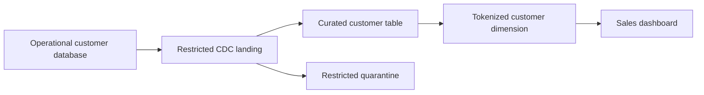

# Data Governance & Security: Data Engineer Interview Guide

Data governance defines who is accountable for data, what it means, how it may be used, and how those decisions are enforced. Data security protects its confidentiality, integrity, and availability. In an interview, connect policies to controls in ingestion, storage, transformation, serving, and deletion.

**Scope:** Platform-neutral concepts and engineering examples. Public sources were checked on October 25, 2026. Examples illustrate design decisions rather than a deployable security configuration. The GDPR discussion concerns EU GDPR; retention schedules and legal exceptions depend on the processing context and applicable law.

**Running example:** A multi-tenant online retailer processes customer profiles, orders, payments, and support tickets. Data moves from operational databases through CDC into restricted raw storage, curated warehouse tables, and analytics. Analysts need sales trends; support agents need selected customer details; neither should receive unrestricted production access.

## Contents

1. [Data Catalogs, Metadata Management, and Lineage](#1-data-catalogs-metadata-management-and-lineage)
2. [Data Ownership, Stewardship, and Classification](#2-data-ownership-stewardship-and-classification)
3. [Data Contracts and Schema Governance](#3-data-contracts-and-schema-governance)
4. [PII, Sensitive Data Discovery, Masking, and Tokenization](#4-pii-sensitive-data-discovery-masking-and-tokenization)
5. [RBAC, ABAC, and Row/Column-Level Security](#5-rbac-abac-and-rowcolumn-level-security)
6. [IAM, Least Privilege, Encryption, and KMS](#6-iam-least-privilege-encryption-and-kms)
7. [Data Retention, Deletion, and GDPR Compliance](#7-data-retention-deletion-and-gdpr-compliance)
8. [Audit Logs, Access Monitoring, and Policy Enforcement](#8-audit-logs-access-monitoring-and-policy-enforcement)
9. [Interview Practice](#9-interview-practice)
10. [Sources and Further Reading](#10-sources-and-further-reading)

## 1. Data Catalogs, Metadata Management, and Lineage

### What a data catalog does

A **data catalog** is a searchable inventory of data assets and the context needed to use them. Assets can include tables, files, topics, dashboards, features, and data products. A useful catalog answers: What is this? Who owns it? Can I use it? How fresh is it? Where did it come from?

Catalog entries usually combine automated extraction with human curation. Connectors can discover schemas and refresh timestamps; accountable teams must supply business definitions, intended uses, and ownership. A catalog containing thousands of undocumented tables makes discovery possible but does not establish trust.

For `curated.orders`, record its grain, keys, owner, business definition of an order, freshness expectation, classification, upstream sources, known limitations, and access request process. Distinguish certified assets from experimental ones using explicit publication criteria.

**A catalog is not automatically an enforcement system.** A sensitivity label changes access only if an integration translates it into a query, storage, or access policy. Some systems provide both functions; verify the actual enforcement path.

### Types of metadata

| Metadata type | Examples | Why a data engineer needs it |
| --- | --- | --- |
| Technical | Schema, types, keys, partitions, format, table location | Parse, join, discover, and optimize data |
| Business | Definitions, grain, owner, glossary terms, valid uses | Prevent incorrect interpretation |
| Operational | Run IDs, freshness, row counts, failures, source offsets | Diagnose incidents and establish reliability |
| Governance and security | Classification, access rules, retention, approved purposes | Apply handling requirements |
| Usage | Queries, consumers, dashboards, last access | Assess impact and identify unused assets |

**Metadata management** covers collecting, validating, versioning, updating, and retiring this information. Define stable asset identifiers, resolve duplicate entries, and record when a value was observed and which system supplied it. Renaming a table should not silently destroy its history or ownership.

A business glossary standardizes terms such as “active customer” across teams. It complements a technical schema: a column named `active` does not explain whether activity means a login, purchase, or paid subscription.

Metadata can itself be sensitive. Sample values, query text, table names, profiles, and lineage can reveal customers or confidential projects. Restrict catalog visibility and avoid collecting raw values when counts or classifications are sufficient.

### Lineage: dependencies and actual execution

**Data lineage** describes how data moves and changes from source to consumer. Follow it upstream to investigate a wrong number and downstream to assess the effect of a change.



| Level | What it captures | Example question |
| --- | --- | --- |
| Dataset/table | Relationships among datasets | Which dashboards use this table? |
| Column | Field dependencies and transformations | Does this output derive from email? |
| Run/partition | Inputs and outputs of an execution | Which batch introduced incorrect totals? |
| Business | Meaning across transformations and reports | How is reported net revenue calculated? |

**Design lineage** records intended dependencies from definitions or parsed code. **Runtime lineage** records observed execution. Both help: declared dependencies show planned changes, while runtime observations show what a particular run accessed. Dynamic SQL, stored procedures, notebooks, external APIs, and manual exports can create gaps.

For emitting and collecting execution metadata, see [OpenLineage and DataHub](data-quality.md#8-openlineage-and-datahub). Keep dataset identity and ownership consistent between the emitted events and the catalog.

Lineage supports impact analysis, root-cause analysis, sensitive-data tracing, and deletion discovery. It does not by itself reproduce an output: you also need retained input versions, transformation code, configuration, and relevant execution context. Nor does a lineage edge prove that deletion or a security policy propagated.

### Operating the metadata system

1. Register assets at creation and assign an accountable owner before publication.
2. Extract schemas and operational metadata automatically where possible.
3. Capture dependencies from both definitions and execution at useful granularity.
4. Reconcile catalog entries with storage and query inventories to detect drift.
5. Track coverage and freshness: unowned assets, stale metadata, missing critical lineage, and overdue reviews.

**Interview question: How would you evaluate a catalog?** Start with workflows: finding a trusted sales dataset, requesting access, tracing a broken dashboard, and locating sensitive copies. Evaluate integration coverage, metadata freshness, access controls, lineage gaps, and owner participation. The number of indexed tables alone is a weak success metric.

## 2. Data Ownership, Stewardship, and Classification

### Accountability and responsibilities

| Role | Main responsibility | Retail example |
| --- | --- | --- |
| Data owner | Accountable for business meaning, quality expectations, permitted use, and lifecycle decisions | Customer domain lead approves uses of customer data |
| Data steward | Maintains definitions, classifications, quality rules, and issue coordination | Resolves conflicting definitions of an active customer |
| Custodian/platform operator | Implements and operates storage, access, backup, and deletion controls | Platform team configures restricted storage |
| Producer | Supplies data and meets its agreed contract | Checkout service publishes order events |
| Consumer | Uses data within its contract and approved purpose | Analytics team builds sales reporting |
| Security/privacy specialists | Define or advise on security and privacy requirements and exceptions | Review a sensitive-data export |

Organizations may combine roles, but accountability must remain explicit. An owner needs decision authority and an escalation path. A shared mailbox without an accountable team does not resolve who approves a breaking change.

An internal **data owner** is an organizational role. GDPR **controller** and **processor** describe legal processing roles: a controller determines purposes and means; a processor processes personal data on its behalf. These labels are not interchangeable with a database owner or service account. [EDPB controller and processor guide](https://www.edpb.europa.eu/sme/learn-the-basics/data-controller-or-data-processor_en).

### Classification and handling rules

Classification groups data by sensitivity and handling requirements. The following scheme is illustrative; labels vary by organization.

| Class | Example | Typical handling |
| --- | --- | --- |
| Public | Published product descriptions | Approved for public distribution; preserve integrity |
| Internal | Routine operational metrics | Authenticated workforce access within business need |
| Confidential | Non-public revenue or customer identifiers | Explicit access, controlled sharing, monitored exports |
| Restricted | Authentication secrets, detailed health data, full payment credentials | Very narrow access and specialized controls |

One hierarchy rarely expresses every requirement. Use separate dimensions where needed: `contains_personal_data`, domain, tenant, residency constraints, retention category, and approved purposes. A confidential financial forecast and a customer health record may need different controls despite comparable sensitivity.

Classification must drive actions: access, masking, encryption requirements, sharing, retention, and incident handling. Classify columns as well as datasets. Protect a mixed dataset according to its contents, while allowing approved projections that exclude sensitive fields.

Derived data needs review. Copying `email` into a new table preserves its sensitivity; converting it to a stable identifier may still permit identification. Aggregation can reduce risk, but small groups or auxiliary data may enable re-identification.

### Governance operating models

- **Centralized:** one team sets standards and manages shared assets. Consistency is easier; approvals can become a bottleneck.
- **Federated:** domain teams own data products within shared standards. Decisions are closer to the business, but interoperability and enforcement require coordination.
- **Practical combination:** central identity, classification vocabulary, and baseline controls; domain ownership of definitions, quality, and access decisions within those controls.

For the retailer, the customer domain defines customer status and retention purpose; the platform supplies policy enforcement and deletion mechanisms. Domain ownership does not permit bypassing shared security requirements.

**Interview question: Who owns a dataset assembled from several domains?** Assign an accountable owner for the published product and document source-domain responsibilities. Define who resolves disputed definitions, manages consumer incidents, and approves changes. Upstream ownership does not remove responsibility for the derived output.

## 3. Data Contracts and Schema Governance

### Govern the contract

[Data contracts and schema management](data-contracts.md) owns contract structure, serialization formats, schema registries, compatibility directions, versioning, and contract tests. Governance establishes who approves changes, which uses are permitted, and how policy obligations follow the dataset.

An illustrative order contract could state:

```text
Asset: commerce.order_events, version 1
Owner: commerce data team
Grain: one event for a change to an order
Event identity: (tenant_id, event_id); retries preserve this identity
Order identity: (tenant_id, order_id)
Amount: integer minor units; currency is an explicit ISO currency code
Event time: UTC instant; distinct from ingestion time
Operation: created | updated | deleted
Delivery: duplicates and late arrivals are possible; consumers deduplicate
Quality: required identifiers are non-null; event identity is unique after deduplication
Privacy: customer_id is a personal-data link; free-text customer notes are excluded
Changes: compatibility checked before release; semantic breaks need consumer migration
```

This is a design example, not a standard contract format. Its purpose is to expose assumptions that a field list would miss.

### Schema compatibility

Use the [compatibility rules](data-contracts.md#4-backward-forward--full-compatibility) and [migration procedure](data-contracts.md#5-schema-evolution-breaking-changes--versioning) in the contracts guide. Governance must track supported consumers, retained schema versions, and approval of semantic breaks; registry acceptance alone is not that approval.

### Governing changes end to end

1. Propose a change with its meaning, affected fields, and migration plan.
2. Use lineage and consumer registration to identify affected systems.
3. Check schema compatibility and semantic expectations before deployment.
4. Publish a versioned contract and communicate notice and deprecation dates.
5. Roll out compatible readers/writers, or introduce a new field or dataset version for a break.
6. Validate output, monitor consumers, and retire old interfaces after migration.

For a currency-unit change, introduce an explicitly named replacement, migrate consumers, reconcile totals, and then deprecate the old field. Do not silently reinterpret history. Backfills must identify which contract and semantic version they apply.

### Where validation belongs

Use checks at producer development, ingestion, transformation, and publication. A registry can reject an incompatible schema registration; it does not necessarily prevent an ungoverned writer from placing arbitrary files in storage.

At ingestion, validate the actual payload and identity, not only the declared schema ID. For failures, choose a documented response: reject, stop publication, or quarantine and alert. Quarantine must inherit sensitive-data protections and retention limits. A rejected record may still contain a valid privacy deletion instruction that needs separate handling.

Some constraints need state: duplicate detection and referential integrity cannot always be established by validating one event. Separate per-record checks from windowed or dataset-level checks, and make their timing explicit.

**Interview question: Should every schema change stop a pipeline?** No. Apply the agreed compatibility and publication rules. A compatible addition can proceed; an incompatible or unexplained semantic change should not silently publish corrupted results. Preserve recoverable inputs in a controlled place and make any resulting freshness gap visible.

## 4. PII, Sensitive Data Discovery, Masking, and Tokenization

### PII and personal data

**Personally identifiable information (PII)** is a common security term; its definition varies across frameworks. GDPR uses **personal data**, including information about an identified or identifiable natural person. Do not limit discovery to obvious names and government identifiers.

| Category | Examples | Why it matters |
| --- | --- | --- |
| Direct identifiers | Name, email, national identifier | Can identify a person directly or through a lookup |
| Linkable identifiers | Customer ID, device ID, IP address | Can connect behavior to a person in context |
| Quasi-identifiers | Birth date, postcode, occupation | Combinations can identify someone |
| Sensitive personal information | Health information, biometrics used for identification | May require additional legal and security safeguards |
| Other sensitive data | Credentials, trade secrets, payment details | Needs protection even when not personal data |

GDPR special-category data and an organization's restricted classification are different concepts. Financial data can be highly sensitive without automatically being an Article 9 special category; criminal-conviction data has a separate Article 10 regime. [GDPR Articles 4, 9, and 10](https://eur-lex.europa.eu/eli/reg/2016/679/oj/eng/).

### Discovering sensitive data

Combine several signals:

- **Names and metadata:** suggest that `email`, `ssn`, or `support_message` deserves inspection.
- **Patterns and checksums:** recognize structured identifiers while reducing false positives.
- **Content inspection:** detect identifiers in free text, nested JSON, documents, and attachments.
- **Context and lineage:** recognize a generic field copied from a sensitive source.
- **Owner review:** confirm meaning, purpose, and the required handling.

Scan raw, curated, temporary, quarantine, export, and log locations. Sampling reduces scanning cost but can miss rare sensitive values. Track coverage and confidence, review uncertain results, and repeat discovery as schemas and sources change.

Do not log detected values in alerts. Record a field or object reference, classification, detector, and confidence instead. Give scanners only the access they need, and protect any retained samples.

### Comparing protection techniques

| Technique | What it does | Useful for | Main limitation |
| --- | --- | --- | --- |
| Redaction/suppression | Removes a value or field | Outputs that do not need the attribute | Loses utility; other fields may still identify a person |
| Static masking | Creates a persistently transformed copy | Development or controlled sharing | Produces another dataset to govern; realism and privacy must be assessed |
| Dynamic masking | Changes the value returned according to query policy | Different views for different users | Raw data remains; privileged or alternate paths may bypass it |
| Tokenization | Substitutes a token for a sensitive value | Restricted identity resolution and controlled joins | Mapping, detokenization, and linkability require protection |
| Encryption | Uses a key to protect plaintext | Storage, transport, or selected fields | Authorized decryption reveals the original |
| Hashing | Produces a deterministic digest | Integrity checks; carefully designed linking schemes | Low-entropy identifiers are guessable; hashing alone does not anonymize |

Masking `alice@example.com` as `a***@example.com` reduces direct exposure but still reveals the domain and some identity information. A dashboard showing only masked email may still expose addresses through a download endpoint or a joined raw table.

### Tokenization and pseudonymization

In a vault-based design, a restricted service maps the original identifier to a random token. Analysts receive the token; only approved workflows can request detokenization. Isolate and audit the mapping store because compromise can reconnect tokens to identities. Other tokenization designs exist and have different key and recovery requirements.

Stable tokens enable joins but reveal equality and create links across datasets. Scope tokens by domain or tenant when global linking is unnecessary. Specify how duplicate identities, collisions, rotation, merges, and deletion affect joins.

A keyed HMAC can support deterministic matching without storing a lookup table, but it still needs secure key handling, canonicalization, collision considerations, and a defined linking scope. A plain email hash is susceptible to candidate guessing. Random per-record salts reduce direct equality matching, which also makes joins harder.

**Pseudonymization is not anonymization.** Replacing names with tokens can reduce risk while leaving a route to identification. Whether information is anonymous requires assessing identifiability and reasonably available means of linking it back. [EDPB anonymization and pseudonymization](https://www.edpb.europa.eu/topics/ai-and-technology/anonymisation-pseudonymisation_en).

Generalization and aggregation can help, but a unique combination or very small group can still reveal someone. Concepts such as k-anonymity describe particular risks rather than guaranteeing protection against all auxiliary information. Differential privacy offers a different approach for controlled statistical release, with an explicit privacy budget and accuracy tradeoff.

### Choosing a technique

For sales trends, omit direct identifiers and use only the dimensions needed for the question. For support, permit narrowly scoped customer lookup. For development, prefer generated data when production-like identity is unnecessary. Use tokenized identifiers for approved analytical joins, with the mapping service isolated from ordinary analytical roles.

**Interview question: Can we anonymize customers by hashing email?** Usually that claim is unjustified. Email has a guessable input space, a stable digest links records, and other fields may identify the customer. Explain the threat model and required utility before selecting tokenization, keyed matching, aggregation, or removal.

## 5. RBAC, ABAC, and Row/Column-Level Security

### Authentication, authorization, and access scope

**Authentication** establishes an identity. **Authorization** decides what that identity may do. A valid login does not establish permission to read every dataset.

| Model/control | Decision basis | Example | Tradeoff |
| --- | --- | --- | --- |
| RBAC | Roles assigned to identities | A sales analyst role can read approved sales tables | Simple at stable job boundaries; too many combinations create role sprawl |
| ABAC | Subject, resource, action, and environment attributes | Finance staff with approved purpose may read finance-tagged data | Flexible; depends on trustworthy attributes and understandable policies |
| Row-level security | Predicates over visible or writable rows | A tenant principal accesses only its tenant's orders | Must cover reads, writes, and alternate paths |
| Column-level security | Permissions on attributes | Analysts cannot select full payment identifiers | Depends on projection, derived fields, and policy behavior |
| Dynamic masking | Conditional representation of values | Support sees a partial identifier | Complements authorization; does not eliminate inference or bypass risks |

RBAC and ABAC can work together: roles establish broad duties; attributes narrow access by domain, tenant, sensitivity, or purpose. Row and column controls describe enforcement granularity and can be driven by either model. NIST defines ABAC using attributes of subjects, objects, operations, and relevant environmental conditions. [NIST SP 800-162](https://csrc.nist.gov/pubs/sp/800/162/upd2/final).

### Trustworthy attributes

An ABAC policy might require a finance department attribute, an approved purpose, and a resource classification. The identity system must issue the subject attributes; an authorized metadata process must manage resource tags. A user must not gain access by editing their own department, claiming an arbitrary purpose, or removing a sensitivity tag.

Use default denial for absent, invalid, or unrecognized attributes. Decide who can change classifications and how changes are reviewed. Record policy and attribute versions so a later audit can explain a decision.

### Tenant isolation

For the retailer, a conceptual read policy is:

```text
ALLOW SELECT only when:
  authenticated identity has the approved reader permission
  AND row.tenant_id belongs to the identity's server-authorized tenant scope
  AND requested fields are permitted for that identity and purpose
Otherwise DENY
```

The tenant scope comes from a trusted identity or entitlement lookup. A client-supplied tenant parameter is a request, not proof of authorization. An application may check the request, but enforce equivalent boundaries wherever users can query data directly.

Include tenant identity in joins and keys when identifiers are only unique within a tenant. Filtering orders while joining an unrestricted customer table can disclose another tenant's data if customer IDs overlap.

For write access, enforce which rows may be modified and which tenant values may be inserted or assigned. A read filter alone may not prevent cross-tenant inserts or updates. Exact policy semantics depend on the database and must be tested.

### Bypass paths and inference

Check direct table grants, raw object storage, service accounts, administrative roles, security-definer routines, exports, caches, clones, and materialized outputs. A secure view protects only access that passes through that view; users with base-table access may bypass it.

Do not assume row policies, masks, or classifications automatically follow copied data. Create and verify the destination controls before granting consumers access. Shared caches must account for identity and policy context or restrict sharing to equivalent entitlements.

Even authorized queries may infer hidden values through filters, joins, counts, repeated queries, or small groups. Higher-risk statistical releases may need constrained queries, aggregation thresholds, or a formal privacy mechanism in addition to access control.

### What to test

- An authorized user receives the expected rows and fields.
- A different tenant receives none of the first tenant's rows, including through joins.
- Missing tenant context, null attributes, and unknown roles deny access.
- Base storage, export, and derived-table paths preserve the intended boundary.
- Inserts and updates cannot assign unauthorized tenant identities.
- Revoked access stops working after the documented propagation and session limits.

**Interview question: Why is a dashboard tenant filter insufficient?** It can be omitted or changed, and other interfaces may reach the same data. Tie tenant scope to trusted identity and enforce it at the data access boundary, then test every exposed path.

## 6. IAM, Least Privilege, Encryption, and KMS

### IAM across people and workloads

**Identity and access management (IAM)** governs identities, credentials, permissions, trust relationships, and their lifecycle. For data systems, follow the whole path: who can assume a workload identity, access storage, run a query, change a policy, or use a decryption key?

Prefer federated human identities with MFA and short-lived workload credentials over shared accounts and embedded long-lived secrets. Give ingestion, transformation, serving, and administration distinct identities when their duties differ. A consumer should not inherit the ingestion identity's broad raw-data access.

Resource access and identity trust are separate questions. A role with narrow storage permissions can still be exposed if an unintended principal can assume it. Scope both the trust relationship and the allowed actions and resources.

### Least privilege and separation of duties

**Least privilege** means the minimum permissions needed for a defined task and period. It includes actions, resources, rows, columns, environments, and time. Read-only access can still enable a complete data export.

| Identity | Needed access | Access to avoid |
| --- | --- | --- |
| CDC ingestion workload | Read approved source changes; write restricted landing | Broad analytical reads or policy administration |
| Transformation workload | Read approved inputs; write its outputs | Changing its own role or encryption policy |
| Analyst | Query approved curated datasets | Raw customer storage and token mappings |
| Support agent | Authorized customer lookup | Bulk customer exports |
| Security administrator | Manage defined security controls | Unnecessary routine access to customer payloads |

Separate duties where practical. Distinguishing key administration from key use helps only if the administrator cannot unilaterally change policy to grant themselves decryption. Consider the entire permission graph, approval controls, and audit trail.

Use time-limited access for exceptional tasks, with a reason, approval where required, expiry, and review. Emergency access needs a tested recovery path and prompt review. Periodically reconcile access with current duties and remove stale users, groups, service accounts, and grants.

### Encryption at rest, in transit, and during processing

- **At rest:** protects stored media and objects under the relevant key and service boundary. It does not stop a permitted query from returning plaintext.
- **In transit:** protects connections using authenticated TLS. Verify certificates and identities; do not disable verification to make a pipeline work.
- **Application/field level:** protects selected values before storage, narrowing plaintext exposure but complicating search, joins, recovery, and key distribution.
- **During processing:** plaintext may exist in memory, spill files, temporary tables, or results. Storage encryption does not remove those exposure paths.

Encryption, authorization, and minimization solve different problems. Encrypting an unnecessary copy still leaves a copy to govern. A compromised workload that legitimately decrypts data may expose plaintext.

### Envelope encryption and KMS

A **key management service (KMS)** manages cryptographic keys and controlled cryptographic operations. In envelope encryption:

1. A data encryption key (**DEK**) encrypts the data.
2. A key encryption key (**KEK**) wraps the DEK.
3. The ciphertext and wrapped DEK are stored; the plaintext DEK is not persisted alongside them.
4. An authorized workflow unwraps the DEK and decrypts the data when needed.

This separates bulk data encryption from centralized key protection. Managed storage services often perform these operations on the application's behalf. [Google Cloud envelope encryption explanation](https://docs.cloud.google.com/kms/docs/envelope-encryption).

Document which service identity uses the key and when it is checked. In a managed query service, a human query user may receive decrypted results through the service without having direct permission to call KMS. Access must be evaluated across the service boundary.

### Key lifecycle and operational risks

Distinguish generating a new key version, rewrapping existing DEKs, and re-encrypting existing data. Rotation does not universally rewrite old ciphertext; behavior depends on the storage integration. Preserve required old key versions until dependent data and recovery requirements are retired. [Google Cloud key-management deep dive](https://docs.cloud.google.com/docs/security/key-management-deep-dive).

Audit key use and policy changes, restrict destruction, and test restoration with the actual key dependencies. Key disabling, deletion, regional unavailability, quotas, or a failed permission change can interrupt pipelines. A backup that exists but cannot be decrypted is not a working recovery mechanism.

**Cryptographic erasure** makes recovery infeasible by sanitizing the keys needed to decrypt target data. It requires appropriate key isolation and removal of recoverable key copies; it does not erase plaintext exports. Destroying a shared key may also destroy unrelated data. [NIST cryptographic erase definition](https://csrc.nist.gov/glossary/term/cryptographic_erase), [NIST SP 800-88 Rev. 2](https://nvlpubs.nist.gov/nistpubs/SpecialPublications/NIST.SP.800-88r2.pdf).

**Interview question: Does customer-managed encryption replace access control?** No. It adds control over key use and lifecycle, but permitted workloads may still return plaintext. Explain who can query, who can use or administer keys, how the service decrypts, and what happens during key loss or revocation.

## 7. Data Retention, Deletion, and GDPR Compliance

### Retention as an engineered lifecycle

A retention policy states what data is kept, for which purpose, how long, from which starting event, and how disposal occurs. It must cover copies, not only the primary table. GDPR does not prescribe one universal retention period; choose periods based on purpose and applicable obligations. [Irish Data Protection Commission retention guidance](https://dataprotection.ie/en/faqs/responsibilities-data-controllers/how-long-should-personal-data-be-held-meet-obligations-imposed-gdpr).

For each data category, record the owner, purpose, retention trigger, duration, deletion mechanism, exceptions, and evidence. Triggers can differ: event time, account closure, contract expiry, or resolution of a support case. Specify how late arrivals and corrected timestamps affect expiry.

| Location | Why deletion is easy to miss | Engineering response |
| --- | --- | --- |
| Raw/CDC landing | Treated as permanently replayable | Bound retention and support subject deletion where required |
| Curated tables and SCD history | Current row deleted; historical versions remain | Find relevant identity links and historical records |
| Lakehouse snapshots and clones | Previous versions still reference old files | Apply supported expiry and cleanup with recovery constraints |
| Object versions | A delete marker leaves older versions | Address all required versions and replicas |
| Streaming systems | Tombstones, logs, and compaction have different lifecycles | Verify when records become inaccessible and physically expire |
| Backups | Selective removal may be technically constrained | Restrict access, define expiry, and sanitize restores |
| Exports, caches, search indexes | Outside the primary storage lifecycle | Register destinations and propagate removal |
| Logs and quarantine | Sensitive records copied for debugging | Minimize payloads and enforce their own retention |

Moving data to cheaper storage changes its cost, not its retention obligations. An archive that remains identifiable is still a copy.

### Logical deletion versus physical removal

A soft-delete flag changes application visibility; it does not remove stored data. A warehouse `DELETE` may remove rows from the current view while history, snapshots, or old files remain recoverable. File rewrite, snapshot expiry, garbage collection, and replica or backup lifecycles may be separate steps.

Record both the operational deletion state and any remaining controlled copies. Do not claim complete physical removal merely because a query returns zero rows. Coordinate cleanup with active readers, recovery windows, and legal holds to avoid unintended data loss.

A legal hold preserves specifically required information under a defined authority and scope. It should not become a blanket reason to retain all copies forever. Restrict held data to the permitted use and review the hold's lifecycle.

### GDPR principles translated into engineering

The core principles include lawfulness, fairness and transparency; purpose limitation; minimization; accuracy; storage limitation; integrity and confidentiality; and accountability. [European Commission GDPR principles](https://commission.europa.eu/law/law-topic/data-protection/information-business-and-organisations/principles-gdpr_en).

| Principle | Practical engineering implication |
| --- | --- |
| Lawfulness and transparency | Connect datasets to documented purposes and the approved processing basis |
| Purpose limitation | Do not treat broad technical access as permission for unrelated reuse |
| Data minimization | Exclude unnecessary identifiers and free-text fields at ingestion or publication |
| Accuracy | Support corrections and propagate them to consumers |
| Storage limitation | Execute and verify retention schedules |
| Integrity and confidentiality | Apply risk-appropriate access, encryption, recovery, and monitoring |
| Accountability | Retain evidence of decisions and control operation |

Consent is one possible lawful basis, not a universal requirement or blanket permission. [EDPB legal bases](https://www.edpb.europa.eu/topics/key-gdpr-concepts/legal-basis_en).

Privacy by design and default means building purpose and access restrictions into the normal flow. High-risk processing may require a data protection impact assessment. [GDPR Articles 25 and 35](https://eur-lex.europa.eu/eli/reg/2016/679/oj/eng/).

International transfers require appropriate assessment and safeguards; GDPR is not a universal requirement to store all personal data only in the EU. [European Commission international-transfer rules](https://commission.europa.eu/law/law-topic/data-protection/international-dimension-data-protection/rules-international-data-transfers_en).

For interviews, explain how the system supports rights such as access, rectification, and erasure. The owner and privacy function determine the applicable legal handling; the engineer implements traceable execution and evidence.

### Designing an erasure workflow

1. **Validate the request and authority.** Verify identity without collecting unnecessary additional information. Resolve the relevant tenant, subject, aliases, and identifiers.
2. **Determine scope and exceptions.** Identify data eligible for erasure and any information that must be retained for a specific obligation or legal claim.
3. **Discover copies.** Combine the inventory, lineage, destination registry, and identity mappings. Include processors and exports where relevant.
4. **Prevent resurrection.** Stop or constrain ingestion and replay that could recreate erased data. Maintain a narrowly scoped suppression mechanism only where justified and protected.
5. **Execute idempotently.** Remove or appropriately transform eligible records across current and historical stores; track each destination separately and retry failures.
6. **Handle recovery copies.** Apply the approved backup expiry and access procedure. Before a restore is exposed to users, reapply required deletions and suppressions.
7. **Verify and report.** Check completion in each system, record retained exceptions and pending expiry, and retain minimal evidence of the request's handling.

The right to erasure applies under specified grounds and has exceptions, including certain legal obligations and legal claims. Erasure obligations can extend to informing recipients. Requests generally require a response within one month; permitted extensions are subject to conditions and timely notice. Avoid interpreting this as a universal 30-day physical-wipe deadline for every copy. [GDPR Articles 12, 17, and 19](https://eur-lex.europa.eu/eli/reg/2016/679/oj/eng/), [European Commission request handling](https://commission.europa.eu/law/law-topic/data-protection/information-business-and-organisations/dealing-requests-individuals_en), [EDPB rights FAQ](https://www.edpb.europa.eu/sme/find-practical-info/faq_en).

The UK ICO describes backup data being put beyond use until it is overwritten according to an established schedule. This is UK-specific guidance, not an automatic EU GDPR exception for backups. For an EU implementation, define handling with the responsible privacy function and supervisory guidance. [ICO right-to-erasure guidance](https://ico.org.uk/for-organisations/uk-gdpr-guidance-and-resources/individual-rights/individual-rights/right-to-erasure/).

Deleting a token mapping alone may not erase the subject: direct identifiers, other mappings, or identifiable attributes may remain elsewhere. Conversely, deleting the identity map before locating downstream copies can make coordinated deletion harder. Plan the order and preserve only the minimum protected information required to complete the workflow.

**Interview question: How do you stop a backfill from restoring an erased customer?** Make erasure part of replay and restore semantics. Apply the current deletion/suppression state to retained input before publication, verify all outputs, and protect the minimum suppression identifiers under an explicit purpose and retention rule.

## 8. Audit Logs, Access Monitoring, and Policy Enforcement

### Auditability versus debugging

Debug logs help explain execution failures. **Audit logs** provide evidence of security-relevant activity and decisions. **Access monitoring** evaluates that activity for misuse, policy drift, or anomalous behavior. Having logs is not equivalent to reviewing them or enforcing a policy.

Capture events across identity, storage, query, pipeline, catalog, and key services. Control-plane logs record actions such as granting a role; data-plane logs record actions such as reading a table. Verify which event types are enabled, whether coverage is complete, and what delivery delays apply.

### What an audit event should establish

An event should support answering who did what, to which resource, when, through which identity or service, and with what outcome. Useful fields include:

- Timestamp, event ID, and request/correlation ID.
- Authenticated principal, assumed workload identity, and delegated user where available.
- Action, resource identifier, and policy decision or error category.
- Relevant source context, tenant scope, and policy version.
- Query/job reference, export destination, or privilege-change details as appropriate.

Avoid passwords, access tokens, encryption keys, and unnecessary personal payloads. Query text and error messages can contain personal literals; restrict, redact, or reference them according to the audit purpose. Sanitize untrusted event fields to prevent log injection. [OWASP logging guidance](https://cheatsheetseries.owasp.org/cheatsheets/Logging_Cheat_Sheet.html).

A shared service account can hide the initiating person. Preserve trustworthy delegation context where supported, and correlate the application request to the actual query or storage action. An application-supplied username alone is weak attribution if callers can forge it.

### Protecting the evidence

Send audit events to a restricted destination with administration separated from the workloads being audited. Use tamper-resistant or append-only storage where appropriate, synchronized clocks, retention controls, and monitoring for missing events. Alert on logging being disabled, delivery failures, and access-policy changes.

Logs can expose sensitive metadata and require their own access and retention policies. Integrity controls should make unexpected alteration detectable; they do not prove that all relevant events were captured in the first place.

### Useful access-monitoring signals

| Signal | Possible concern | Context needed |
| --- | --- | --- |
| Unusually large query or export | Bulk extraction | Approved reporting/backfill jobs and normal volumes |
| New raw-data access by an analyst | Bypassed curated boundary | Entitlements and incident-related exceptions |
| Repeated denied requests | Misconfiguration or attempted access | Deployment changes and principal history |
| New role, trust, or sensitivity-tag changes | Privilege escalation or policy weakening | Approved change record and actor authority |
| Unusual key use or detokenization | Identity exposure | Expected workloads and approved purpose |
| Missing expected audit events | Logging outage or tampering | Ingestion health and actual activity |
| Reads after access expiry | Stale sessions, caches, or grants | Revocation propagation and credential lifetime |

Tune alerts to workload context; a monthly close can legitimately produce a large export. Prioritize signals that combine unusual behavior with sensitive resources, new destinations, or privilege changes. Give each alert an owner and a response procedure.

### Policy decision and enforcement

A **policy decision point** evaluates identity, resource attributes, action, and context. A **policy enforcement point** applies the result at a query engine, API, or storage boundary. The components may be integrated, but identifying them exposes bypass paths.

For the retailer, the owner approves an analytical use, metadata records classification, the access system grants the appropriate entitlement, and the query engine enforces tenant and column restrictions. An audit event records the actual operation and outcome. A catalog approval without a corresponding enforced grant is incomplete.

**Policy as code** makes rules versioned and reviewable. It does not establish correctness by itself. Validate allowed and denied cases, missing attributes, cross-tenant joins, expired entitlements, and generated outputs. Reconcile deployed controls with intended policy to detect manual drift.

Distinguish preventive controls from detective controls: denying an unauthorized export prevents that action; an alert after a successful export detects it. Both matter, but detection alone cannot guarantee confidentiality.

For a policy-service outage, define fail-closed behavior and any explicitly approved cached-decision lifetime. Stale grants create a revocation window. Denial can interrupt production, so availability and emergency access need design and testing without silently permitting unknown requests.

**Interview question: What happens after suspected data exfiltration?** Contain the relevant sessions, identities, and destinations; preserve evidence; determine affected data and people; and involve the incident and privacy teams. Track recovery and correct the bypass or excessive grant. An audit trail supports that response but does not undo an export.

## 9. Interview Practice

### A structure for architecture answers

1. **Clarify use and sensitivity:** who needs what data, for which purpose, across which tenants and jurisdictions?
2. **Map the flow:** include sources, raw storage, transformations, serving, copies, and recovery paths.
3. **Assign accountability:** name owners, stewards, producers, consumers, and exception authorities.
4. **Define interfaces:** declare meaning, keys, contracts, quality, and compatibility expectations.
5. **Enforce boundaries:** explain trusted identity, least privilege, tenant isolation, masking, and key use.
6. **Manage the lifecycle:** retention, correction, deletion, replay, backup, and restoration.
7. **Prove operation:** lineage coverage, negative access tests, audits, alerts, and deletion evidence.
8. **State a tradeoff:** analytical utility versus linkability, centralized consistency versus domain autonomy, or immediate revocation versus cached-policy availability.

### Worked scenario: governed customer analytics

**Question:** Design an analytics platform for the retailer. Analysts need order trends by country, support needs customer lookup, tenants must remain isolated, and customer erasure requests must propagate.

**A strong answer:**

- Register customer and order assets with domain owners, classifications, grain, keys, and contracts. Define country carefully: shipping country at order time differs from a customer's current address.
- Capture CDC with stable event identity and explicit delete semantics. Restrict raw storage to necessary workloads; validate payloads and protect quarantine.
- Publish curated order facts with tokenized customer links where identity linking is needed. Exclude email and support free text from general analytics.
- Use separate analyst, support, and pipeline identities. Enforce tenant scope from trusted entitlements; check joins, direct storage, write paths, and exports.
- Put identity resolution behind a restricted service. Audit support lookups and detokenization; do not grant ordinary analysts the mapping store.
- Encrypt transport and storage, govern key use, and test recovery with the necessary keys and permissions.
- Track lineage through transformations and output destinations. Make the catalog describe enforced controls and known coverage gaps.
- Apply purpose-based retention and an idempotent erasure workflow across current tables, history, copies, and downstream systems. Make backfills and restored backups respect deletion state before publication.
- Monitor access and policy changes, with owners for alerts. Verify denied cases and deletion completion as well as normal query success.

**Tradeoffs to mention:** Tokenization preserves join utility but leaves linkability. Fine-grained policies reduce copies but increase policy and testing complexity. Shorter raw retention reduces exposure but limits replay. Central enforcement improves consistency but needs a defined outage behavior.

### Questions to rehearse

| Question | What a strong answer includes |
| --- | --- |
| Catalog versus metastore versus schema registry? | Discovery/business context; engine storage/schema metadata; versioned message/schema compatibility. Products can overlap |
| How do you trace a wrong dashboard number? | Upstream lineage, actual run/input versions, transformation semantics, reconciliation |
| Who approves access? | Accountable owner and applicable policy; platform enforces; decisions and expiry are recorded |
| What belongs in a data contract? | Structure, meaning, grain, keys, quality, delivery, ownership, changes, and handling rules |
| Can a schema-compatible change break consumers? | Semantic changes, positional assumptions, strict readers, and downstream business logic |
| How do you find PII in a data lake? | Inventory, metadata and content detectors, free text, lineage, owner review, and coverage gaps |
| Masking versus tokenization versus encryption? | Display transformation, substitution and controlled linking, keyed confidentiality; remaining exposure paths |
| RBAC versus ABAC? | Roles versus trusted attributes; operational complexity and how both can combine |
| How do you test tenant isolation? | Trusted tenant identity, joins and keys, negative read/write cases, bypass paths |
| Why isn't read-only access harmless? | Bulk extraction, personal-data disclosure, and inference remain possible |
| Does KMS rotation re-encrypt old data? | Depends on integration; separate new key versions, DEK rewrapping, and data rewriting |
| How do you prove deletion? | Destination-level status, verification, remaining recovery copies, controlled exceptions, and replay suppression |
| Are all personal-data uses consent-based? | No; processing needs an applicable lawful basis and purpose-specific handling |
| How do you audit a shared service identity? | Trusted delegation and request/query correlation; direct user attribution gaps |
| What if the policy service is unavailable? | Defined denial behavior, bounded cached decisions, revocation limits, and controlled emergency access |

### Common claims to challenge

- “A catalog tag enforces security.” Only if a real enforcement integration applies it.
- “Our lineage graph includes every copy.” Manual exports and unsupported execution paths may be invisible.
- “A schema registry guarantees data quality.” It cannot prove all business semantics or stateful constraints.
- “Hashed identifiers are anonymous.” Guessing, linking, and auxiliary information can preserve identifiability.
- “Masking prevents sensitive-data access.” Raw grants, inference, and alternate paths still matter.
- “An authenticated user can select any tenant.” Requested tenant scope must be authorized.
- “Encryption prevents analysts from reading PII.” Authorized queries can return plaintext.
- “Rotating a key erases the old data.” Old key versions and ciphertext may remain usable.
- “Deleting the current row removes every copy.” History, snapshots, backups, and exports have separate lifecycles.
- “GDPR requires deleting everything immediately on request.” Grounds, exceptions, response duties, and actual copy handling must be evaluated.
- “Immutable logs guarantee complete auditing.” They protect recorded evidence; coverage and delivery still need verification.
- “Policy as code means the policy is correct.” Review, negative tests, and deployed-state checks remain necessary.

## 10. Sources and Further Reading

These primary sources support the definitions and controls above. Examples and interview scenarios are engineering applications, not claims that a particular product implements every control automatically.

- [EU GDPR legal text](https://eur-lex.europa.eu/eli/reg/2016/679/oj/eng/) — definitions, lawful bases, rights, security, and transfer requirements.
- [European Commission GDPR principles](https://commission.europa.eu/law/law-topic/data-protection/information-business-and-organisations/principles-gdpr_en) — purposes, minimization, storage limitation, and accountability.
- [EDPB controller and processor guide](https://www.edpb.europa.eu/sme/learn-the-basics/data-controller-or-data-processor_en) — legal roles and responsibilities.
- [EDPB anonymization and pseudonymization](https://www.edpb.europa.eu/topics/ai-and-technology/anonymisation-pseudonymisation_en) — distinctions relevant to identifier protection.
- [NIST SP 800-162](https://csrc.nist.gov/pubs/sp/800/162/upd2/final) — ABAC concepts and considerations.
- [NIST SP 800-88 Rev. 2](https://nvlpubs.nist.gov/nistpubs/SpecialPublications/NIST.SP.800-88r2.pdf) — media sanitization and cryptographic erase considerations.
- [OWASP logging guidance](https://cheatsheetseries.owasp.org/cheatsheets/Logging_Cheat_Sheet.html) — event content, sensitive values, and log protection.
- [OpenLineage specification](https://openlineage.io/docs/spec/object-model/) — dataset, job, and execution metadata.
- [Confluent schema evolution](https://docs.confluent.io/platform/current/schema-registry/fundamentals/schema-evolution.html) — reader/writer compatibility and transitive checks.
- [Google Cloud envelope encryption](https://docs.cloud.google.com/kms/docs/envelope-encryption) — DEKs, KEKs, and wrapping.
