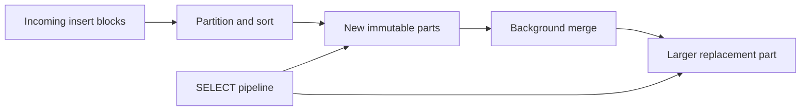

# ClickHouse: Data Engineer Interview Guide

Documentation reviewed: 2026-10-25. ClickHouse evolves quickly; optimizer behavior, feature maturity, defaults, and Cloud capabilities depend on the deployed version. Check `SELECT version()` and the documentation for that version before applying settings.

An events dashboard may examine billions of records but use only a timestamp, a tenant ID, and an event type. ClickHouse is built around that analytical workload: ingest many records, read selected columns, filter heavily, and aggregate quickly. Its speed becomes easier to explain when you connect column layout, vectorized execution, pruning, and parallelism to the actual query—and account for the correctness and operational trade-offs.

**A useful interview answer:** “ClickHouse stores analytical data in compressed columns and processes batches of values. MergeTree tables organize data into sorted, immutable parts, with sparse indexes that help skip irrelevant ranges. Background merges consolidate parts. Sharding divides a dataset, while replication maintains copies for availability.” [Columnar storage](https://clickhouse.com/resources/engineering/what-is-columnar-storage), [MergeTree](https://clickhouse.com/docs/engines/table-engines/mergetree-family/mergetree)

**Study order:** Architecture → MergeTree internals → key design → query optimization → ingestion and correctness → distributed processing → production operations.

Examples use ClickHouse SQL. Create the `analytics` database with `CREATE DATABASE IF NOT EXISTS analytics` before trying table examples. The `analytics.events` table introduced in section 3 supports later examples; other tables illustrate separate patterns. Cluster, Kafka, backup, and security examples require their own configuration and privileges. Use a disposable environment. SQL examples have not been executed against a ClickHouse server.

## Contents

1. [Architecture & Fundamentals](#1-architecture--fundamentals)
2. [Storage Engines & Internals](#2-storage-engines--internals)
3. [Data Modeling & Partitioning](#3-data-modeling--partitioning)
4. [Query Processing & Optimization](#4-query-processing--optimization)
5. [Ingestion & Data Modification](#5-ingestion--data-modification)
6. [Distributed Processing](#6-distributed-processing)
7. [Performance & Resource Management](#7-performance--resource-management)
8. [Production & Advanced Topics](#8-production--advanced-topics)

## 1. Architecture & Fundamentals

### OLAP architecture and column-oriented storage

Consider a dashboard that counts requests by hour. Even with billions of events, it may need only the timestamp, tenant, and event type. That combination—many records, relatively few columns—is characteristic of an OLAP workload and explains why column-oriented storage is a good starting point for understanding ClickHouse.

Columnar storage groups values of the same column together. This reduces bytes read for narrow analytical queries and improves compression because neighboring values have similar types and often similar distributions. Sorting further groups related values. A row-oriented database instead makes retrieving or changing a complete individual record convenient.

ClickHouse suits observability, product analytics, time-series analysis, and analytical serving. Frequent transactional changes across many entities require different trade-offs. A primary key in ClickHouse does not enforce uniqueness, and foreign-key enforcement should not be assumed. [How columnar storage works](https://clickhouse.com/resources/engineering/what-is-columnar-storage)

**Interview question: Why can ClickHouse count events faster than an OLTP database?**

Explain the combination: fewer columns read, compression, pruning, efficient batch execution, and parallel aggregation. Column orientation alone does not guarantee a fast query if it must read everything or build enormous intermediate state.

### Query execution engine and vectorized processing

The query engine parses and analyzes SQL, builds and optimizes a plan, then executes a pipeline of processors. These processors pass chunks containing columns of values rather than invoking a separate interpreted operation for every row.

Vectorized execution amortizes function-call overhead, improves CPU cache behavior, and allows SIMD instructions where implementations support them. SIMD is one technique within the execution engine; it does not mean every SQL expression becomes one CPU instruction.

Independent scan ranges and pipeline stages can execute concurrently. Some operations, such as combining a final result or sending it to the client, can limit parallelism. More threads help only while CPU, memory bandwidth, storage, and available work permit. [Query parallelism](https://clickhouse.com/docs/optimize/query-parallelism), [EXPLAIN](https://clickhouse.com/docs/sql-reference/statements/explain)

### MergeTree architecture and immutable data parts

For a typical MergeTree insert, ClickHouse parses incoming blocks, separates rows by partition, sorts them, and writes new parts with column data and supporting metadata. One INSERT can produce multiple parts; it is incorrect to equate every INSERT with exactly one part.

A committed part is immutable. A merge or traditional mutation produces replacement parts, then old parts become inactive and are eventually removed. Queries can continue reading parts they already reference. Background work therefore needs spare disk space as old and new data can coexist.



Sorting is per part, not a promise that the entire table is one globally sorted file. A query needs an explicit `ORDER BY` to guarantee result order. [Table parts](https://clickhouse.com/docs/parts)

### Sharding, replication, and Distributed tables

| Concept | Purpose | Example |
| --- | --- | --- |
| Shard | Holds a subset of the logical dataset | Tenant hashes route to one of four shards |
| Replica | Holds another copy of a shard's data | Two replicas per shard survive one replica failure |
| Local table | Stores data on an individual server | A `ReplicatedMergeTree` table |
| Distributed table | Routes queries and inserts across configured shards | A logical entry point over local tables |

Four shards with two replicas each means eight server-side copies of shard datasets, with approximately twice the logical dataset stored overall before compression and other overhead. It does not mean eight independent subsets.

Replication does not automatically create sharding. A Distributed table does not itself supply replication; its underlying tables determine that behavior. Classic Distributed tables store no independent table dataset, but background inserts can create local forwarding queues. [Replication and scaling example](https://clickhouse.com/docs/architecture/cluster-deployment), [Distributed engine](https://clickhouse.com/docs/reference/engines/table-engines/special/distributed)

This cluster model describes self-managed deployments. ClickHouse Cloud uses SharedMergeTree and shared object storage, with different mechanisms for replication and compute scaling. Do not assume that adding a Cloud replica means copying an entire local shard dataset to a new machine. [SharedMergeTree](https://clickhouse.com/docs/cloud/reference/shared-merge-tree)

### ClickHouse Keeper and cluster coordination

ClickHouse Keeper provides a ZooKeeper-compatible coordination service using Raft. Replicated tables use coordination metadata to track replicated operations and parts; distributed DDL also uses coordination. Actual table data moves between ClickHouse servers rather than through Keeper.

A typical production Keeper ensemble has three or five voting nodes across suitable failure domains. Raft requires a majority: three nodes tolerate one unavailable node; five tolerate two. Keeper has a consensus leader, but that does not make the database a single-leader write system.

Loss of Keeper quorum can prevent replicated writes and coordination even when data files remain intact. Reads of already available local data can continue in many cases. Monitor Keeper latency, storage, sessions, and quorum health independently of query latency. [ClickHouse Keeper](https://clickhouse.com/clickhouse/keeper)

## 2. Storage Engines & Internals

### MergeTree and ReplicatedMergeTree

The table engine determines how ClickHouse stores and maintains your rows. **`MergeTree`** is the general-purpose sorted storage engine; **`ReplicatedMergeTree`** adds copies of the table data within a shard. Replicas coordinate through a shared path and need distinct identities, so replication has its own configuration and failure behavior.

The replication prefix combines with specialized merge behavior: for example, `ReplicatedReplacingMergeTree` and `ReplicatedAggregatingMergeTree`. Replication and replacement/aggregation solve different problems.

Replication is table-level. Creating one replicated table does not automatically replicate unrelated tables, users, or all database metadata. Deployment must handle schema propagation explicitly, for example with distributed DDL or an appropriate replicated database setup. [Replicated table engines](https://clickhouse.com/docs/engines/table-engines/mergetree-family/replication)

### Choosing a MergeTree variant

| Engine | What merging does | Suitable use | Query-time responsibility |
| --- | --- | --- | --- |
| MergeTree | Combines sorted parts | Immutable event facts | Normal filtering and aggregation |
| ReplacingMergeTree | Keeps a winning row per sorting key | Versioned entity state, CDC | Resolve versions until physical deduplication occurs |
| SummingMergeTree | Sums configured numeric measures per sorting key | Additive rollups | Aggregate remaining rows across parts |
| AggregatingMergeTree | Combines aggregate states per sorting key | Distinct counts, averages, other rollups | Merge and finalize states correctly |
| CollapsingMergeTree | Cancels state/cancel rows using a sign | Explicit change streams | Use sign-aware calculations or appropriate finalization |
| VersionedCollapsingMergeTree | Cancels matching key/version pairs | Change streams arriving out of order | Preserve version/sign contracts |

Specialized merge behavior is asynchronous. Correctness must not depend on a merge having run before a SELECT. The following subsections explain each contract.

### ReplacingMergeTree: latest state through append-only writes

Rows are considered duplicates when their complete `ORDER BY` values match. With a version column, the highest version wins. The primary-key declaration alone does not define replacement identity.

```sql
CREATE TABLE analytics.customer_state
(
    tenant_id UInt32,
    customer_id UInt64,
    version UInt64,
    status String
)
ENGINE = ReplacingMergeTree(version)
ORDER BY (tenant_id, customer_id);

INSERT INTO analytics.customer_state VALUES
    (7, 101, 1, 'pending'),
    (7, 101, 2, 'active');

SELECT tenant_id, customer_id, status
FROM analytics.customer_state FINAL
WHERE tenant_id = 7;
```

The result contains customer `101` with status `active`. Without query-time reconciliation, both versions may be visible. Use a source-defined, strictly ordered version per entity; equal versions make business-level conflict resolution ambiguous. Keep mutable fields such as `status` out of the sorting key. [ReplacingMergeTree](https://clickhouse.com/docs/engines/table-engines/mergetree-family/replacingmergetree)

### SummingMergeTree: additive measures

`SummingMergeTree` replaces rows sharing a sorting key with rows containing summed numeric measures. Explicitly select measure columns when defining the engine so numeric identifiers are not accidentally treated as values to sum.

For daily counts sorted by `(tenant_id, day, event_type)`, multiple inserted count increments can merge into a smaller rollup. A correct read still uses `sum(hits)` with `GROUP BY tenant_id, day, event_type`, because matching keys can remain in separate parts.

An average is not additive: storing and summing daily averages gives the wrong overall average. Store sum and count, or use aggregate states. Non-key, non-summed values should not be treated as deterministically selected dimensions. [SummingMergeTree](https://clickhouse.com/docs/engines/table-engines/mergetree-family/summingmergetree)

### AggregatingMergeTree: mergeable aggregate states

This engine combines values stored as `AggregateFunction` states and supported `SimpleAggregateFunction` values. States preserve information needed to combine partial aggregates correctly.

`uniqCombined64State(user_id)` constructs a mergeable approximate distinct state; `uniqCombined64Merge(state_column)` combines and finalizes states. Similarly, an average state retains the information needed to compute a weighted result across batches.

```sql
CREATE TABLE analytics.daily_users
(
    tenant_id UInt32,
    day Date,
    users AggregateFunction(uniqCombined64, UInt64)
)
ENGINE = AggregatingMergeTree
ORDER BY (tenant_id, day);
```

Section 5 shows the materialized view that populates this table. Querying a state column directly does not return a normal finalized count. Use the matching `...Merge` function with the intended grouping. [AggregatingMergeTree](https://clickhouse.com/docs/engines/table-engines/mergetree-family/aggregatingmergetree)

### CollapsingMergeTree and VersionedCollapsingMergeTree

`CollapsingMergeTree(sign)` models a state row with `sign = 1` and a cancellation row with `sign = -1`. To replace a value of 10 with 15, publish the original `+10` state, its `-10` cancellation, and the new `+15` state. A sign-aware sum produces `10 - 10 + 15 = 15` even before merging.

Use a signed type for arithmetic, such as `sum(sign * toInt64(value))`. Count current entities with sign-aware logic rather than raw `count()`. The producer must emit matching cancellations and respect this engine's ordering contract. Duplicated or missing changes can corrupt the result. [CollapsingMergeTree](https://clickhouse.com/docs/engines/table-engines/mergetree-family/collapsingmergetree)

`VersionedCollapsingMergeTree(sign, version)` adds a version to cancellation matching, allowing opposite-sign rows with the same key and version to arrive in different orders. It still needs a valid state/cancellation protocol. It does not simply keep the highest version like ReplacingMergeTree, and it does not repair arbitrary duplicate deliveries. [VersionedCollapsingMergeTree](https://clickhouse.com/docs/engines/table-engines/mergetree-family/versionedcollapsingmergetree)

### Data parts, granules, marks, and background merges

| Term | Meaning |
| --- | --- |
| Part | Immutable unit of stored data, indexes, and metadata |
| Partition | Group of parts sharing a `PARTITION BY` value |
| Granule | Row range used by sparse indexing and read-range selection |
| Mark | Position information used to locate granules in column streams |
| Compressed block | Compression/I/O unit; boundaries need not match granules |
| Merge | Reads selected parts and writes a combined replacement part |

The common `index_granularity` default is 8,192 rows, but byte-based adaptive granularity and large rows can produce smaller granules. Avoid describing every granule as exactly 8,192 rows.

Wide parts store column streams separately; Compact parts pack column data into fewer files. Both remain logically column-oriented. Part layout and thresholds affect file overhead and mutation costs. [MergeTree storage](https://clickhouse.com/docs/engines/table-engines/mergetree-family/mergetree), [Part formats](https://clickhouse.com/docs/operations/system-tables/parts)

Background merges combine parts within the same partition. They consume CPU and I/O while reducing future scan and metadata overhead. Large parts may stop being selected for ordinary merges, so “eventually everything becomes one part” is not a correctness guarantee. [Part merges](https://clickhouse.com/docs/concepts/core-concepts/merges)

### Sparse primary index, compression, and codecs

Each part has its own sparse primary index, recording key values at granule boundaries rather than one entry per row. For `WHERE tenant_id = 7`, the index finds candidate ranges; ClickHouse then reads and filters rows in those ranges. A matching granule can contain many nonmatching rows.

This keeps index size manageable for analytical datasets, at the cost of less precise row lookup than a dense index. Mark files map selected ranges to physical stream positions. [Primary indexes](https://clickhouse.com/docs/concepts/core-concepts/primary-indexes)

Compression choices trade CPU for storage and I/O. LZ4 commonly favors speed; ZSTD can improve compression with additional CPU cost. Transform codecs such as Delta or DoubleDelta can help suitable numeric or time sequences before general compression.

```sql
CREATE TABLE analytics.codec_example
(
    occurred_at DateTime CODEC(Delta, ZSTD(1)),
    event_type LowCardinality(String),
    payload String CODEC(ZSTD(1))
)
ENGINE = MergeTree
ORDER BY occurred_at;
```

`LowCardinality` is a dictionary-encoded data type, not an engine or a promise that every string column will shrink. Measure compressed bytes and CPU on representative data; ordering can matter more than changing a codec. [Column compression codecs](https://clickhouse.com/docs/sql-reference/statements/create/table#column_compression_codec)

## 3. Data Modeling & Partitioning

### ORDER BY vs. PRIMARY KEY vs. PARTITION BY

In ClickHouse, a primary key does not enforce the uniqueness many SQL users expect. Sorting, sparse indexing, and lifecycle partitioning are separate choices. Start with the filters your queries use and the data you need to manage together, then assign each clause its job.

| Clause | Controls | Does not provide |
| --- | --- | --- |
| `ORDER BY` | Physical sorting within parts; identity for replacement/collapsing behavior | Guaranteed SELECT output order |
| `PRIMARY KEY` | Expressions stored in the sparse primary index | Uniqueness enforcement |
| `PARTITION BY` | Which rows belong to separate merge/lifecycle groups | Distribution across servers |

If `PRIMARY KEY` is omitted, the sorting key is used as the primary key. An explicitly different primary key must be a prefix of the sorting key. A shorter primary key can reduce index memory while keeping additional sorting columns. [MergeTree key definitions](https://clickhouse.com/docs/engines/table-engines/mergetree-family/mergetree)

```sql
CREATE DATABASE IF NOT EXISTS analytics;

CREATE TABLE analytics.events
(
    tenant_id UInt32,
    event_id UUID,
    user_id UInt64,
    event_type LowCardinality(String),
    occurred_at DateTime('UTC'),
    latency_ms UInt32,
    payload String
)
ENGINE = MergeTree
PARTITION BY toYYYYMM(occurred_at)
PRIMARY KEY (tenant_id, occurred_at)
ORDER BY (tenant_id, occurred_at, event_id);
```

This design favors tenant-scoped time ranges. Monthly partitions support lifecycle operations. The trailing event ID adds deterministic ordering but does not make a single event-ID lookup efficient without earlier key constraints. It also does not reject duplicate event IDs.

### Sorting key design and cardinality

Start with actual queries: common filters, time ranges, grouping, joins, and expected selectivity. For a multi-tenant event store, `(tenant_id, occurred_at, event_id)` helps queries that supply a tenant and time range. `(event_type, occurred_at)` favors a different workload.

Among useful filtering columns, putting lower-cardinality dimensions earlier often improves grouping and compression. This is a heuristic, not a rule to put a boolean before every other column. A frequently filtered high-cardinality tenant can be a better leading key than a rarely filtered low-cardinality status.

Lexicographic order matters. Filtering only the third key column often leaves many ranges to scan, although the optimizer may exploit later columns in some cases. Avoid putting an unfiltered random UUID first merely because it is unique. Validate candidate layouts with read rows, read bytes, and query latency. [Choosing a primary key](https://clickhouse.com/docs/best-practices/choosing-a-primary-key)

### Partition pruning and partition cardinality

Partition pruning eliminates whole partitions when the predicate can be related to their partition expression. A month filter can eliminate years of event data, then the primary index narrows ranges within the remaining parts.

Choose partitioning mainly for lifecycle and manageable storage organization. Excessive partition cardinality creates many small parts that cannot merge across partition boundaries. Partitioning by user ID is usually a poor event-table design; daily partitioning may also fragment a low-volume table unnecessarily.

An INSERT spanning many partition values can create many parts even when the overall batch is large. `PARTITION BY` does not assign data to cluster shards. [Choosing a partitioning key](https://clickhouse.com/docs/best-practices/choosing-a-partitioning-key)

### Data skipping indexes

Skipping indexes summarize blocks of granules and exclude blocks that cannot satisfy a predicate. They do not generally return exact row positions like an OLTP secondary index.

| Index | Good fit | Common failure |
| --- | --- | --- |
| `minmax` | Values clustered enough to have narrow local ranges | Every block spans the full value range |
| `set(N)` | Few distinct values within each indexed block | Local distinct count exceeds the set limit |
| `bloom_filter` | Equality or membership checks with sparse local matches | Values occur in almost every block |

Bloom filters can produce false positives, so surviving blocks still need filtering. They should not produce false negatives for supported predicates.

```sql
ALTER TABLE analytics.events
    ADD INDEX user_bloom user_id TYPE bloom_filter(0.01) GRANULARITY 4;

ALTER TABLE analytics.events MATERIALIZE INDEX user_bloom;
```

Adding an index definition covers new data; materialization builds it for existing parts and costs background work. Here `GRANULARITY 4` means an index block spans four primary-index granules. Measure actual skipped granules before keeping an index. [Data skipping indexes](https://clickhouse.com/docs/optimize/skipping-indexes)

### Projections and materialized views

A projection provides another physical representation associated with a table, such as an alternative sort order. The optimizer can select an eligible projection while users query the base table. Projections add storage and write/maintenance cost; newer lightweight projections can use `_part_offset` to reference base data.

An incremental materialized view explicitly transforms incoming data into a target table. Applications usually query that target. It can have a different engine, schema, and retention policy.

```sql
ALTER TABLE analytics.events ADD PROJECTION by_user
(
    SELECT tenant_id, user_id, occurred_at, event_type
    ORDER BY (tenant_id, user_id, occurred_at)
);

ALTER TABLE analytics.events MATERIALIZE PROJECTION by_user;
```

This projection supports a second access pattern. Confirm selection with EXPLAIN instead of assuming any similar query will use it. Projection compatibility with mutations, lightweight updates/deletes, and specialized engines depends on version and settings; verify it before combining those features. [Projections](https://clickhouse.com/docs/data-modeling/projections), [Materialized views versus projections](https://clickhouse.com/docs/managing-data/materialized-views-versus-projections)

### TTL policies and data lifecycle management

TTL can expire rows, reset expired column values, move data between configured storage tiers, recompress data, or roll up older data. Rules are evaluated through background processing rather than acting as a precise wall-clock deletion scheduler.

```sql
ALTER TABLE analytics.events
    MODIFY TTL occurred_at + INTERVAL 90 DAY DELETE;
```

This is a teaching retention policy: applying it to an existing table can schedule expensive work and remove historical data. Confirm the retention contract first.

Expired rows may remain physically stored until TTL processing completes. For whole-month retention, dropping an expired partition can be much cheaper than rewriting individual rows. Moving to a volume requires an existing storage policy. Deleting from the source table also does not automatically delete rows already copied into independent materialized-view targets or backups. [Manage data with TTL](https://clickhouse.com/docs/guides/developer/ttl)

## 4. Query Processing & Optimization

### Query pipeline and execution plans

If a query is slow, first ask whether it reads the expected ranges and columns. `EXPLAIN` shows the engine's intended plan; logs and measurements reveal the actual cost. The example below starts with the access path for a tenant's events in one day, giving you a concrete plan to compare with runtime evidence.

```sql
EXPLAIN indexes = 1
SELECT event_type, count()
FROM analytics.events
WHERE tenant_id = 7
  AND occurred_at >= toDateTime('2026-10-01 00:00:00', 'UTC')
  AND occurred_at < toDateTime('2026-10-02 00:00:00', 'UTC')
GROUP BY event_type;

EXPLAIN PIPELINE
SELECT event_type, count()
FROM analytics.events
WHERE tenant_id = 7
GROUP BY event_type;
```

`EXPLAIN indexes = 1` shows pruning information such as selected parts and granules. `EXPLAIN PIPELINE` shows processors and parallel streams. `EXPLAIN SYNTAX` helps inspect rewrites; `EXPLAIN PLAN` shows logical/physical plan steps. These are not substitutes for measuring elapsed time, peak memory, and actual reads. [EXPLAIN reference](https://clickhouse.com/docs/sql-reference/statements/explain)

### Index granule pruning and PREWHERE

Pruning reduces candidate data ranges using partition metadata, primary indexes, and skipping indexes. `PREWHERE` reduces column reads within the surviving ranges: read filtering columns first, evaluate them, then read other required columns for surviving rows.

```sql
SELECT occurred_at, payload
FROM analytics.events
PREWHERE tenant_id = 7 AND event_type = 'purchase'
WHERE occurred_at >= toDateTime('2026-10-01 00:00:00', 'UTC')
  AND occurred_at < toDateTime('2026-10-02 00:00:00', 'UTC');
```

Avoiding reads of a large `payload` column is valuable when early filters reject most rows. The optimizer can move eligible WHERE predicates into PREWHERE automatically; explicit PREWHERE is not mandatory tuning syntax.

PREWHERE does not create an index, guarantee fewer candidate granules, or eliminate the cost of reading its own filter columns. With `FINAL`, moving predicates on mutable, non-key fields before version reconciliation can affect correctness; respect the engine/version's safeguards. [PREWHERE optimization](https://clickhouse.com/docs/optimize/prewhere)

### Join algorithms and join ordering

| Algorithm | Basic approach | Main trade-off |
| --- | --- | --- |
| Hash / parallel hash | Build a hash structure and probe it | Fast when build-side state fits memory |
| Grace hash | Partition hash-join work, spilling buckets | Bounds memory using additional disk I/O |
| Full sorting merge | Sort inputs and merge matching keys | Can avoid sorting when physical order matches |
| Partial merge | Sort and process smaller ranges | Lower memory, often more work/latency |
| Direct | Probe a suitable key-value structure | Very fast lookups, restricted semantics and sources |

Algorithm support depends on join type, strictness, and conditions. `join_algorithm = 'auto'` can adapt under memory pressure, but it does not guarantee every join fits any memory limit. [Joining tables](https://clickhouse.com/docs/guides/joining-tables)

Reduce rows and columns before joining, and ensure join keys have compatible types. A small filtered build side helps hash joins. Current versions can reorder eligible joins; “ClickHouse never reorders joins” is outdated. Inspect the deployed optimizer's plan and available statistics.

`ANY JOIN` suppresses multiple matches from one side. Use it only when one matching row satisfies the requirement; it changes semantics compared with returning all matches. An existence test may be better expressed with `IN` or a semi join. Be aware that unmatched outer-join columns commonly use type defaults unless `join_use_nulls` requests NULL behavior. [JOIN optimization](https://clickhouse.com/docs/best-practices/minimize-optimize-joins)

**Interview question: Should every ClickHouse model be denormalized?**

No. Denormalization shifts repeated work to ingestion and can reduce latency, but changing dimensions, duplicated attributes, and many-to-many relationships complicate correctness. Compare denormalization, dictionaries, precomputed targets, and runtime joins for the actual workload.

### Aggregation strategies and approximate functions

Parallel workers build partial aggregate states, then combine them. High-cardinality grouping increases the number and size of states. Two-level aggregation organizes state into buckets to support scalable merging; aggregation in sorting-key order can reduce retained state for eligible queries.

The biggest win may be changing the input: prune earlier, avoid unused grouping keys, or query a rollup. Approximate distinct counts bound state growth compared with exact sets, while approximate quantiles trade exactness for resource savings.

```sql
SELECT
    event_type,
    count() AS events,
    uniqCombined64(user_id) AS approximate_users,
    quantileTDigest(0.95)(latency_ms) AS approximate_p95_ms
FROM analytics.events
WHERE tenant_id = 7
GROUP BY event_type;
```

Use `uniqExact` when exact distinct counts are required and memory permits. Do not add distinct counts across days to get a monthly distinct count, or average daily percentiles to obtain a monthly percentile. Combine compatible states or recompute from the required population. [Aggregation settings](https://clickhouse.com/docs/operations/settings/settings#optimize_aggregation_in_order), [uniqCombined64](https://clickhouse.com/docs/sql-reference/aggregate-functions/reference/uniqcombined64), [quantileTDigest](https://clickhouse.com/docs/sql-reference/aggregate-functions/reference/quantiletdigest)

### Parallelism, memory limits, and external spilling

`max_threads` limits query execution parallelism; increasing it can also increase memory use and reduce total throughput under concurrency. `max_memory_usage` limits a query's tracked memory on a server, not an automatically shared cluster-wide budget.

External aggregation and sorting can spill intermediate work to disk. Relevant settings include `max_bytes_before_external_group_by` and `max_bytes_before_external_sort`. Set thresholds with headroom below the overall memory limit because scans, joins, buffers, and final merges also need memory.

Spilling consumes temporary disk space and I/O and does not cover every operator or allocation. Use an appropriate spilling join algorithm separately. Temporary storage exhaustion can replace an out-of-memory failure with a disk failure. [Query complexity limits](https://clickhouse.com/docs/operations/settings/query-complexity), [GROUP BY implementation](https://clickhouse.com/docs/sql-reference/statements/select/group-by#implementation-details)

## 5. Ingestion & Data Modification

### Batch inserts and asynchronous inserts

A producer that sends one row at a time can create far more background work than its data volume suggests. Tiny synchronous inserts produce excessive parts, metadata, replication tasks, and merges. Batch by both rows and bytes within the pipeline's latency and memory budget. Thousands to tens of thousands of rows are a useful starting point; roughly 10,000–100,000 is often worth benchmarking, but no batch size is universally best.

Asynchronous inserts let the server combine small client inserts in memory and flush them in batches. Buffers are maintained per node and grouped by compatible insert shape/settings, so many different shapes can fragment batching.

```sql
INSERT INTO analytics.events
SETTINGS async_insert = 1, wait_for_async_insert = 1
VALUES
    (7, '00000000-0000-0000-0000-000000000001', 101,
     'purchase', '2026-10-01 10:00:00', 42, '{}');
```

With `wait_for_async_insert = 1`, acknowledgment waits for the buffered insert to flush successfully. With `0`, acknowledgment can precede durable storage and parsing failures may not reach the client. Server-side asynchronous batching, replication, and Distributed-table forwarding are separate asynchronous stages with separate acknowledgment semantics. [Selecting an insert strategy](https://clickhouse.com/docs/best-practices/selecting-an-insert-strategy), [Asynchronous inserts](https://clickhouse.com/docs/optimize/asynchronous-inserts)

### Kafka Engine and materialized-view ingestion

A Kafka Engine table consumes messages; it is not the durable analytical destination. A common path is Kafka topic → Kafka Engine table → incremental materialized view → MergeTree target.

```sql
CREATE TABLE analytics.events_kafka
(
    tenant_id UInt32,
    event_id UUID,
    user_id UInt64,
    event_type String,
    occurred_at DateTime('UTC'),
    latency_ms UInt32,
    payload String
)
ENGINE = Kafka
SETTINGS
    kafka_broker_list = 'broker:9092',
    kafka_topic_list = 'events',
    kafka_group_name = 'clickhouse-events',
    kafka_format = 'JSONEachRow',
    kafka_num_consumers = 1;

CREATE MATERIALIZED VIEW analytics.events_from_kafka
TO analytics.events
AS SELECT * FROM analytics.events_kafka;
```

Broker authentication/TLS is environment configuration. Consumers in the same group divide Kafka partitions; extra consumers beyond available partitions do not add useful parallelism.

Plan for replay and duplicates: a failure between writing data and committing offsets can cause redelivery. Kafka offset progress is not proof of globally atomic, exactly-once transformation. Monitor consumer lag, parser failures, target insert errors, and poison messages. Kafka retention must cover the recovery/replay window. [Kafka Engine](https://clickhouse.com/docs/engines/table-engines/integrations/kafka)

### Incremental vs. refreshable materialized views

| Property | Incremental MV | Refreshable MV |
| --- | --- | --- |
| Trigger | New inserted blocks in its source | Scheduled refresh |
| Work | Transform only incoming blocks | Re-execute the defined query over its inputs |
| Typical use | Real-time rollups and routing | Periodic full recomputation, joins, snapshots |
| Freshness | Insert-driven | Refresh interval plus runtime |
| Source corrections | Not automatically reflected by source mutations/merges | Reflected in a later successful recomputation |

An incremental MV acts like an insert trigger, not a continuously maintained query over the entire source. A join inside it does not automatically refresh old results when the other joined table changes. Refreshable views normally replace results; `APPEND` instead accumulates refresh outputs. [Use materialized views](https://clickhouse.com/docs/best-practices/use-materialized-views)

Using the `daily_users` target from section 2:

```sql
CREATE MATERIALIZED VIEW analytics.daily_users_mv
TO analytics.daily_users
AS
SELECT
    tenant_id,
    toDate(occurred_at) AS day,
    uniqCombined64State(user_id) AS users
FROM analytics.events
GROUP BY tenant_id, day;

SELECT tenant_id, day, uniqCombined64Merge(users) AS users
FROM analytics.daily_users
GROUP BY tenant_id, day;
```

The MV processes future inserts, not historical rows automatically. For backfill, establish a controlled boundary so historical and live processing neither overlap nor leave a gap. For example, pause writers while creating the view and backfilling, or use an ingestion sequence/watermark with disjoint ranges. Event time alone is unsafe when events arrive late. Avoid `POPULATE` under concurrent writes without a proven capture strategy. [Incremental materialized views](https://clickhouse.com/docs/materialized-view/incremental-materialized-view)

**Interview trap:** An incremental count view over a ReplacingMergeTree source counts inserted versions. Later replacement merges do not retract earlier counts from the target. Design CDC-aware transformations or recompute the result.

Source and dependent-view writes are not one all-or-nothing transaction. Concurrent readers can observe intermediate states, and failures require checking which writes succeeded. Blindly replaying into an additive target can double count without a verified deduplication strategy. [Materialized-view insert guarantees](https://clickhouse.com/docs/knowledgebase/are_materialized_views_inserted_asynchronously)

### Mutations: UPDATE, DELETE, and lightweight changes

| Operation | Mechanism | Main cost or caveat |
| --- | --- | --- |
| `ALTER TABLE ... UPDATE` | Mutation rewrites affected column data in parts | Expensive for sparse changes spread across many parts |
| `ALTER TABLE ... DELETE` | Mutation rewrites affected parts without matching rows | Expensive physical rewrite |
| `DELETE FROM ... WHERE ...` | Lightweight logical deletion; implementation can depend on settings | Logical invisibility and physical removal occur separately |
| `UPDATE ... SET ... WHERE ...` | Lightweight update using patch parts on supported versions/tables | Read-time patch work until materialization |
| New version into ReplacingMergeTree | Append and later reconcile versions | Queries need version-aware correctness |

```sql
ALTER TABLE analytics.events
    UPDATE payload = '{}' WHERE tenant_id = 7 AND user_id = 101;

ALTER TABLE analytics.events
    DELETE WHERE tenant_id = 7 AND user_id = 101;

DELETE FROM analytics.events
WHERE tenant_id = 7 AND user_id = 101;
```

These are alternative teaching operations, not a sequence to run on production data. Traditional mutations usually run asynchronously. Track progress and failures in `system.mutations`; `mutations_sync` controls waiting. Parts become visible as mutation work completes, so a table-wide mutation is not an atomic transactional update across every part. Key columns have update restrictions. [ALTER UPDATE](https://clickhouse.com/docs/sql-reference/statements/alter/update), [ALTER DELETE](https://clickhouse.com/docs/sql-reference/statements/alter/delete)

The traditional lightweight-delete path writes an `_row_exists` mask and filters deleted rows from reads. Wide parts can update the mask more cheaply than rewriting all columns; Compact parts can require more rewriting. Newer releases/settings can route lightweight deletes through patch-based machinery. In either case, a successful logical delete is not a guarantee that all physical copies and backups have been erased. [Lightweight DELETE](https://clickhouse.com/docs/sql-reference/statements/delete)

Newer ClickHouse versions also support standard `UPDATE` using patch parts. Verify supported engine variants, feature settings, required block-number/offset settings, and projection compatibility for the deployed release. Patches make changes visible without immediately rewriting all affected column files, at the cost of additional read and merge work. “ClickHouse cannot update rows” is outdated; “updates are free now” is equally misleading. [Lightweight UPDATE](https://clickhouse.com/docs/sql-reference/statements/update)

### Insert deduplication, ReplacingMergeTree, and FINAL

Insert deduplication detects repeated insert blocks or tokens within a bounded retention window. It is not a permanent unique constraint over a business key. Retrying with different row ordering, block boundaries, or data can change deduplication behavior.

Use stable retry payloads or an `insert_deduplication_token` representing one logical batch. Reuse the token only for retries of that batch. Verify engine settings, window size/time, async-insert deduplication, and dependent-MV behavior on the deployed release. Non-replicated and replicated engines have different deduplication configuration. [Deduplicating inserts on retries](https://clickhouse.com/docs/guides/developer/deduplicating-inserts-on-retries)

ReplacingMergeTree addresses entity versions by sorting key. `SELECT ... FINAL` applies engine merge semantics during reading; it does not wait for physical merges or rewrite stored parts. It costs extra query work and does not establish a global transaction across shards. `OPTIMIZE TABLE ... FINAL` is a separate physical merge operation with potentially large I/O costs. [ReplacingMergeTree and FINAL](https://clickhouse.com/docs/guides/replacing-merge-tree), [Avoid OPTIMIZE FINAL](https://clickhouse.com/docs/best-practices/avoid-optimize-final)

Keep every version of an entity on the same shard and in the same partition for reliable background reconciliation. If updates change partition or sharding placement, background merges cannot reconcile those separated versions. Do not apply per-partition FINAL optimizations unless entity versions are guaranteed to share a partition.

## 6. Distributed Processing

### Shards vs. replicas and the Distributed Engine

To expand capacity, separate distributing the dataset from keeping redundant copies of it. The following self-managed example gives each shard a local replicated table. It assumes `analytics` exists on every node, the cluster `interview_cluster` is configured, Keeper is available, and the `{shard}` and `{replica}` macros are correct.

```sql
CREATE TABLE analytics.events_local ON CLUSTER interview_cluster
(
    tenant_id UInt32,
    occurred_at DateTime('UTC'),
    event_type LowCardinality(String)
)
ENGINE = ReplicatedMergeTree(
    '/clickhouse/tables/{shard}/analytics/events_local',
    '{replica}'
)
PARTITION BY toYYYYMM(occurred_at)
ORDER BY (tenant_id, occurred_at);

CREATE TABLE analytics.events_all ON CLUSTER interview_cluster
AS analytics.events_local
ENGINE = Distributed(
    interview_cluster, analytics, events_local, cityHash64(tenant_id)
);
```

Replicas of one shard share the same Keeper table path and have distinct replica names; different shards need different paths. Configure `internal_replication = true` for the shard when Distributed writes should send to one replica and let ReplicatedMergeTree replicate the data. [Replication and scaling deployment](https://clickhouse.com/docs/architecture/cluster-deployment)

### Distributed query execution and data locality

A classic distributed SELECT sends work to shards, usually choosing one available replica per shard. Shards perform local pruning, filtering, and partial aggregation, then an initiator combines results. This makes data locality and balanced work important.

A tenant-based shard key keeps tenant-scoped processing local, but a very large tenant can create a hot shard. Random distribution can balance rows while increasing cross-shard work. Adding shards does not automatically redistribute historical data; plan resharding and stable routing for retries and entity versions.

Background Distributed inserts may acknowledge once data is queued on the initiator. `distributed_foreground_insert = 1` waits for forwarding to the destinations according to the configured replication behavior. This still does not make a multi-shard insert an atomic transaction: some shards can accept work before another fails. Monitor `system.distribution_queue`. [Distributed engine behavior](https://clickhouse.com/docs/reference/engines/table-engines/special/distributed)

### Distributed joins and GLOBAL JOIN

Local joins are efficient and correct when the required matching records are co-located, or when the dimension is completely replicated on every participating node. If two related records live on different shards, a shard-local join can miss matches.

`GLOBAL JOIN` computes its right-side input on the initiator and broadcasts that temporary data to remote servers. This can fix a missing-local-dimension problem, but its network and memory cost grows with the broadcast size and number of recipients.

```sql
SELECT e.tenant_id, count()
FROM analytics.events_all AS e
GLOBAL INNER JOIN
(
    SELECT DISTINCT tenant_id
    FROM analytics.events_all
    WHERE event_type = 'purchase'
) AS buyers USING (tenant_id)
GROUP BY e.tenant_id;
```

This counts all events for tenants that have at least one purchase. `DISTINCT` makes the broadcast set unique and prevents join fan-out in this example. If only membership is needed, `GLOBAL IN` can express that directly.

`GLOBAL` is a data-distribution choice, not a request for a global transaction or a guarantee that both sides fit memory. Inspect distributed-subquery settings and execution plans rather than assuming arbitrary distributed joins trigger a cheap, general shuffle. [Distributed JOIN](https://clickhouse.com/docs/sql-reference/statements/select/join#distributed-join), [Distributed IN](https://clickhouse.com/docs/sql-reference/operators/in#distributed-subqueries)

### Replication queues and consistency guarantees

ReplicatedMergeTree accepts writes on available replicas; other replicas fetch data asynchronously. The default write acknowledgment should not be interpreted as every replica being current. A read routed to a lagging replica can miss a recent acknowledged insert.

`insert_quorum` can require acknowledgments from a number of replicas. Quorum failure or a client timeout can leave an uncertain outcome, so retries still need an idempotency design. Read consistency settings such as `select_sequential_consistency` have prerequisites and interactions with quorum/parallel insert settings; validate the documented combination instead of treating a single flag as universal linearizability.

Reading from the same replica after a completed local write can provide useful read-your-writes behavior. Synchronizing another replica can help specific workflows but adds latency and availability dependencies. [Replication guarantees](https://clickhouse.com/docs/engines/table-engines/mergetree-family/replication), [Read consistency](https://clickhouse.com/docs/knowledgebase/read_consistency)

`system.replicas` summarizes replica health; `system.replication_queue` explains pending work and repeated exceptions. A large queue may indicate a disk, network, resource, or coordination problem rather than a need for more query replicas. [Replica status](https://clickhouse.com/docs/operations/system-tables/replicas), [Replication queue](https://clickhouse.com/docs/operations/system-tables/replication_queue)

### Distributed DDL, failover, and load balancing

`ON CLUSTER` submits DDL for execution on cluster hosts through a distributed task mechanism. Hosts can complete at different times. A timeout does not prove that no host applied the change; inspect `system.distributed_ddl_queue` and reconcile before retrying destructive operations.

Load balancing chooses among replicas according to settings, locality, and health. Failover improves availability when another usable replica exists, but it cannot compensate for a lost shard or guarantee zero lag. Skipping unavailable shards can return incomplete results; enable that only when partial answers are an explicit product requirement. [Distributed DDL](https://clickhouse.com/docs/sql-reference/distributed-ddl), [Load-balancing settings](https://clickhouse.com/docs/operations/settings/settings#load_balancing)

## 7. Performance & Resource Management

### Small parts, merge amplification, and insert batching

When ingestion falls behind, the bottleneck may be work created by earlier inserts. Too many small parts mean more indexes and metadata, file operations, replication, and scan ranges. Merges also read and rewrite data repeatedly, creating **write amplification**: one byte ingested can generate several bytes of background storage work.

Typical causes include per-row inserts, too many producers, high-cardinality partitions, and many materialized-view targets. A large batch crossing thousands of partitions can still be unhealthy.

Fix the production rate and layout first: batch writes, use async inserts where suitable, and reduce unnecessary partition fragmentation. Raising the “too many parts” thresholds can postpone a failure while increasing recovery work. Do not schedule frequent full-table OPTIMIZE FINAL as routine maintenance. [Selecting an insert strategy](https://clickhouse.com/docs/best-practices/selecting-an-insert-strategy), [Avoid OPTIMIZE FINAL](https://clickhouse.com/docs/best-practices/avoid-optimize-final)

### Background merge tuning

Compare part creation rate with merge completion rate, then identify the saturated resource. More background threads help only if CPU, memory, disk bandwidth, and free space permit them. Otherwise they can increase contention with serving queries.

Relevant controls include merge/mutation pool sizes, fetch pools, merge-selection size limits, and part-delay/rejection thresholds. Their names, defaults, and mutability depend on version; inspect server and MergeTree settings before changing them.

Keep capacity for merges, mutations, replication fetches, backups, and temporary query data. Forecast both steady-state storage and transient overlap between old/new parts. [Server settings](https://clickhouse.com/docs/operations/server-configuration-parameters/settings), [MergeTree settings](https://clickhouse.com/docs/operations/settings/merge-tree-settings)

### Query profiling, system tables, and query logs

| Source | What it helps answer |
| --- | --- |
| `system.query_log` | Which completed/failed queries are slow or expensive? |
| `system.processes` | What is running now? |
| `system.query_thread_log`, `system.trace_log` | Where did threads and sampled execution time go? |
| `system.parts`, `system.part_log` | How many parts exist, and how are they created/merged? |
| `system.merges`, `system.mutations` | Which background rewrites are active or stuck? |
| `system.replicas`, `system.replication_queue` | Are replicas healthy and catching up? |
| `system.metrics`, `system.events`, `system.asynchronous_metrics` | What pressure and activity does the server show? |

```sql
SELECT
    query_id,
    query_duration_ms,
    read_rows,
    read_bytes,
    memory_usage,
    ProfileEvents['SelectedMarks'] AS selected_marks
FROM system.query_log
WHERE event_date >= today() - 1
  AND type = 'QueryFinish'
  AND is_initial_query = 1
  AND query_kind = 'Select'
ORDER BY query_duration_ms DESC
LIMIT 10;
```

Query logs flush asynchronously and logging may be sampled or disabled. For distributed queries, distinguish initiator and remote entries using query IDs and `initial_query_id`; do not sum their metrics blindly and double count work. System tables are generally local, so collect from all relevant nodes, for example with `clusterAllReplicas` in a self-managed cluster. [system.query_log](https://clickhouse.com/docs/operations/system-tables/query_log), [Query monitoring](https://clickhouse.com/blog/monitoring-troubleshooting-select-queries-clickhouse)

### CPU, memory, disk I/O, and network bottlenecks

| Symptom | Evidence to seek | First change to evaluate |
| --- | --- | --- |
| High CPU with large scans | Read bytes, selected marks, CPU profile | Better pruning and fewer expressions/columns |
| Memory failures | Group count, join build size, concurrency | Reduce intermediate state; suitable spilling |
| Disk saturation | Read/write throughput, latency, merge backlog | Reduce reads and part churn; provision I/O capacity |
| Slow object-storage reads | Remote bytes, latency, cache hits | Pruning, locality, filesystem cache |
| Network saturation | Broadcast sizes, replication traffic, result size | Co-location and smaller remote intermediates |
| Fast isolated queries, slow peak traffic | Queueing, active queries, memory pressure | Bound concurrency and separate workloads |

A low result-row count says little about cost: producing ten rows can require scanning billions. Compare cold and warm cache behavior, realistic concurrency, representative data distribution, and tail latency. [Query optimization workflow](https://clickhouse.com/docs/optimize/query-optimization)

### Caching, concurrency, and workload isolation

Different caches avoid different work: OS page/filesystem caches avoid storage reads; mark caches avoid rereading stream positions; uncompressed caches can avoid decompression; query caches can avoid execution by reusing results. Availability and usefulness depend on deployment and settings.

The query result cache is explicitly enabled/configured and can serve stale results until expiry. It is not transactionally invalidated after every insert or mutation. Treat cache TTL as part of the freshness contract. Keep per-user result isolation unless shared results are safe for the access model. [Query cache](https://clickhouse.com/docs/operations/query-cache)

Bound concurrent queries and per-query parallelism together. Use separate users/settings profiles for ingestion, BI, and backfills; apply workload scheduling where available. Stronger resource isolation may require separate compute services or clusters. A query-level memory limit alone does not prevent many simultaneous queries from exhausting a server. [Workload scheduling](https://clickhouse.com/docs/operations/workload-scheduling)

## 8. Production & Advanced Topics

### Cluster deployment and replication recovery

A recovery plan starts with where the copies live. Spread replicas across independent failure domains, and place Keeper voters so a normal infrastructure failure leaves a quorum available. Cluster definitions, replica identities, paths, schema, and compatible versions must remain consistent. Before a rolling upgrade, test against the compatibility guidance for the deployed versions. [Deployment example](https://clickhouse.com/docs/architecture/cluster-deployment), [Upgrade guidance](https://clickhouse.com/docs/operations/update)

For a lagging replica, inspect Keeper connectivity, available disk, replication queue exceptions, missing parts, network connectivity, and fetch activity before changing metadata. A healthy replica can supply missing parts. Losing every copy of a shard requires backup restore or replay from a retained source.

Recovery commands such as `SYSTEM SYNC REPLICA`, `SYSTEM RESTART REPLICA`, and `SYSTEM RESTORE REPLICA` solve different conditions. Choose the documented procedure for the failure. Deleting coordination paths or reusing replica identities without understanding the state can make recovery worse. [SYSTEM replica commands](https://clickhouse.com/docs/sql-reference/statements/system#managing-replicatedmergetree-tables)

### Monitoring system.parts, system.merges, and system.query_log

Monitor part growth per partition, merge backlog, replica delay/queue exceptions, failed mutations, free disk, ingestion lag, rejected inserts, and query latency/error rates. Query logs provide workload context, while host metrics show resource saturation.

```sql
SELECT
    partition,
    count() AS active_parts,
    sum(rows) AS stored_rows,
    formatReadableSize(sum(bytes_on_disk)) AS disk_size
FROM system.parts
WHERE database = 'analytics' AND table = 'events' AND active
GROUP BY partition
ORDER BY active_parts DESC;

SELECT database, table, elapsed, progress, num_parts, is_mutation
FROM system.merges
WHERE database = 'analytics';

SELECT database, table, mutation_id, parts_to_do, latest_fail_reason
FROM system.mutations
WHERE database = 'analytics' AND NOT is_done;
```

Stored-row counts are physical observations: versions and logically deleted rows can make them differ from application-visible entity counts. `system.merges` shows active work, so an empty result does not prove there is no backlog. Gather time-series trends rather than alerting on one universal part-count number. [system.parts](https://clickhouse.com/docs/operations/system-tables/parts), [system.merges](https://clickhouse.com/docs/operations/system-tables/merges), [system.mutations](https://clickhouse.com/docs/operations/system-tables/mutations)

### Backup, restore, and disaster recovery

Replication handles loss of individual copies; it also propagates unwanted writes and deletions. Keep independent backups and validate restoration. Define recovery point objective (acceptable data loss) and recovery time objective (acceptable outage), then measure restore and source-replay times.

```sql
BACKUP TABLE analytics.events
TO Disk('backups', 'events_2026_10_25.zip');

RESTORE TABLE analytics.events AS analytics.events_restored
FROM Disk('backups', 'events_2026_10_25.zip');
```

This requires an allowed, configured backup disk. Production copies should survive loss of the database host. For incremental backups, preserve every required base. Inventory table definitions, access configuration, external integrations, and coordination recovery needs; do not assume backing up one table captures the whole platform.

Restore into an isolated target and verify schema, representative queries, counts/checksums where meaningful, and replay boundaries. Coordinate multi-table recovery if application consistency requires matching points in time. [Backup and restore](https://clickhouse.com/docs/operations/backup)

### RBAC, quotas, and resource limits

Use users and roles to grant only required operations. Keep readers, ingestion accounts, and schema administrators separate. For example, if `analyst_user` already exists:

```sql
CREATE ROLE analytics_reader;
GRANT SELECT ON analytics.* TO analytics_reader;
GRANT analytics_reader TO analyst_user;
```

Row policies can restrict visible records, while column privileges and views constrain exposed fields. Tenant filtering in application SQL is not an access-control boundary if users can run arbitrary SQL against unrestricted base tables. Control network access, authentication, and TLS as well as SQL privileges. [Access control](https://clickhouse.com/docs/operations/access-rights)

Settings profiles govern execution behavior, including memory, threads, and execution time; enforce constraints where users must not override them. Quotas limit cumulative usage over intervals, such as query counts or read volume. They complement per-query limits and concurrency controls rather than replacing them. [Settings profiles](https://clickhouse.com/docs/operations/settings/settings-profiles), [Quotas](https://clickhouse.com/docs/operations/quotas)

### Zero-downtime schema evolution

Use an expand-and-contract sequence: add compatible columns, deploy readers/writers that tolerate both schemas, backfill or materialize historical data when needed, verify, then remove obsolete fields after the rollback window.

```sql
ALTER TABLE analytics.events
    ADD COLUMN source LowCardinality(String) DEFAULT 'unknown';
```

Adding a column with a default can be primarily a metadata operation, with old parts supplying values through default evaluation until materialization. Type changes, materialization, index/projection builds, and incompatible key changes can require substantial data work. They are not all instant operations.

Use explicit insert column lists so added columns do not break positional writers. Review materialized views, targets, Distributed-table schemas, and downstream consumers. Cluster DDL can complete unevenly, so verify every host before relying on a new schema. Major sorting-key or partition redesigns commonly need a new table, controlled backfill, validated cutover, and an ingestion boundary. [ALTER COLUMN](https://clickhouse.com/docs/sql-reference/statements/alter/column)

### ClickHouse vs. Snowflake, Vertica, and DuckDB

| System | Architecture and common fit | Interview trade-off |
| --- | --- | --- |
| ClickHouse | Columnar analytical server; self-managed MergeTree clusters or Cloud shared-storage services | Strong fit for fresh analytical serving; key design, ingestion layout, and correctness contracts matter |
| Snowflake | Managed cloud platform with shared durable storage and independent virtual warehouses | Convenient workload separation and broad warehouse workflows; compare freshness and cost for the actual workload |
| Vertica | Distributed columnar analytics with projections; Enterprise local-storage and Eon shared-storage modes | Physical design and workload management matter; avoid assuming all deployments have identical storage architecture |
| DuckDB | In-process analytical database, commonly embedded in applications or local data workflows | Simple local/file analytics; core embedded use does not require a managed multi-node serving cluster |

All four support columnar analytical execution in relevant configurations. “ClickHouse is always faster” and “DuckDB only works on tiny datasets” are poor interview claims. Compare data volume, concurrency, latency/freshness targets, joins, update patterns, resilience, operational effort, and total cost using a representative benchmark. [Snowflake architecture](https://docs.snowflake.com/en/user-guide/intro-key-concepts), [Vertica architecture](https://docs.vertica.com/25.3.x/en/architecture/), [DuckDB connections and embedding](https://duckdb.org/docs/stable/connect/overview.html)

### Production troubleshooting: interview scenarios

| Scenario | Reasoning to explain |
| --- | --- |
| Dashboard slows as ingestion rises | Check part creation, merge pressure, query reads, and shared CPU/I/O; batch and prune before adding hardware |
| Duplicate entity versions appear | Check engine, full sorting key, versions, shard/partition placement, and query-time reconciliation |
| Rollup over CDC data is too high | An incremental MV saw every inserted version; source replacement did not retract prior target contributions |
| Acknowledged row is missing on a read | Trace async-buffer, Distributed-forwarding, replica selection, replication lag, and query-cache stages |
| Quorum insert times out | Outcome can be uncertain; inspect state and retry with stable idempotency identity |
| Distributed join misses rows | Verify co-location or full dimension replication; consider a bounded broadcast or another distribution strategy |
| Mutation never completes | Inspect mutation failure reason, parts remaining, replica health, disk capacity, and concurrent background work |
| Retention policy did not erase all copies immediately | TTL and lightweight deletion separate logical expiry from physical removal; independent targets/backups need their own lifecycle |

### Common interview traps

- A ClickHouse primary key is a sparse indexing key, not a uniqueness constraint.
- Partitioning, sorting, and sharding are separate design decisions.
- Background merges are maintenance, not a synchronization barrier for correct reads.
- ReplacingMergeTree identifies duplicates with the full sorting key.
- `FINAL` performs query-time reconciliation; `OPTIMIZE FINAL` forces physical merge work.
- Incremental materialized views process inserted blocks and do not automatically track source rewrites.
- A Kafka consumer, an insert retry window, and a replicated table do not by themselves provide end-to-end exactly-once processing.
- A Distributed table, a replicated local table, and ClickHouse Cloud solve distribution differently.
- More replicas improve availability and can improve read capacity; they do not automatically divide the dataset into new shards.
- More threads, indexes, and background workers help only when measurements justify their costs.
- A successful delete, a synchronized replica, and an independent tested backup provide different guarantees.
