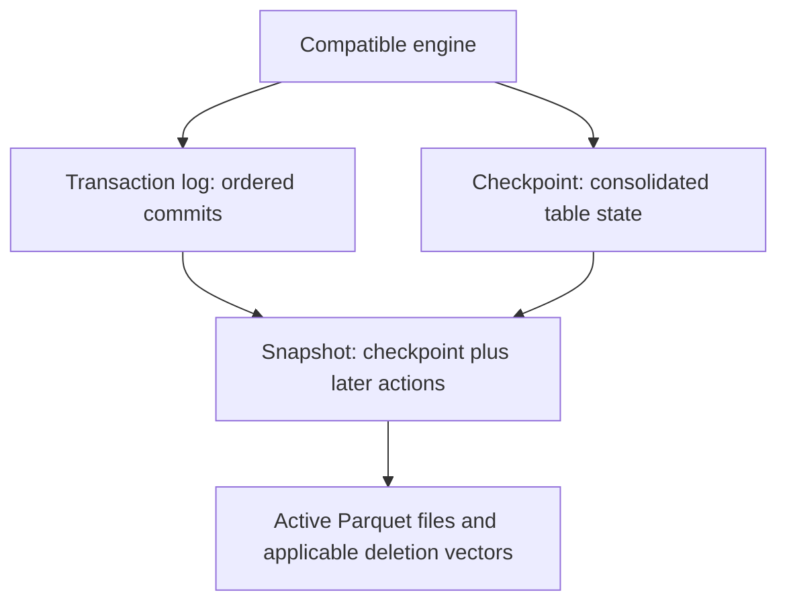

# Delta Lakehouse: Data Engineer Interview Guide

Documentation reviewed: 2026-11-09. Engine capabilities can change between releases.

Imagine an ingestion job writes Parquet files and fails before publishing its result. A second job retries while a dashboard is reading the table. Which files belong to the committed dataset? Delta Lake adds transactional table state to lake storage so compatible readers and writers can agree on an answer. A **lakehouse** is the broader architecture around those tables: compute, ingestion, governance, and serving are still required. [Delta Lake documentation](https://docs.delta.io/)

**A useful interview answer:** “Delta Lake is an open table format and implementation that combines Parquet data with a transaction log. A Delta lakehouse uses those tables for reliable batch and streaming pipelines, while engines execute queries and catalogs govern access.”

This guide focuses on **open-source Delta Lake**, not every capability of Databricks. A Delta library release, Spark release, table commit version, and reader/writer protocol version are different things. Check the deployed connector and enabled table features before assuming compatibility. [Feature compatibility](https://docs.delta.io/versioning/)

SQL examples assume **Spark SQL configured with Delta extensions and the Delta catalog integration**, plus an existing database named `interview`. They are independent teaching examples, not a script to run in order. Source views, table versions, and retention values are illustrative. Examples have not been executed against a cluster. Platform-specific capabilities are discussed in the [Databricks guide](../cloud-and-platforms/databricks.md). [Spark integration](https://docs.delta.io/delta-batch/#configure-sparksession)

## Contents

1. [Architecture & Metadata](#1-architecture--metadata)
2. [Partitioning & Data Layout](#2-partitioning--data-layout)
3. [Transactions & Concurrency](#3-transactions--concurrency)
4. [Read & Write Operations](#4-read--write-operations)
5. [History, Time Travel & Change Data Feed](#5-history-time-travel--change-data-feed)
6. [Maintenance & Optimization](#6-maintenance--optimization)
7. [Catalogs & Integrations](#7-catalogs--integrations)
8. [Production & Advanced Topics](#8-production--advanced-topics)

## 1. Architecture & Metadata

### Lakehouse architecture vs. table format

A table format solves table-state problems; it does not implement an entire data platform. Keep the layers separate when explaining a design:

| Layer | Responsibility | Example |
| --- | --- | --- |
| Storage | Persists objects | Object storage, supported filesystem |
| File format | Encodes columnar data | Parquet |
| Table format | Defines committed state and transaction rules | Delta Lake |
| Compute | Executes scans, joins, and writes | Spark or another compatible engine |
| Catalog and governance | Resolves names and controls supported access paths | Metastore or a governed catalog |
| Pipeline design | Defines business transformations and recovery | Raw ingestion, validated entities, serving aggregates |

Delta Lake is not a query engine, and using its format does not automatically create business keys, data-quality rules, or organization-wide access policies. [Delta Lake overview](https://docs.delta.io/)

### Transaction log, actions, and checkpoints

For a conventional filesystem-managed table, the state lives in `_delta_log` alongside its data:



Commits contain actions such as adding/removing logical files, changing metadata, and updating protocol requirements. Traditional commit files use zero-padded version numbers and JSON actions. Checkpoints consolidate state so readers need not replay from version zero; their representation depends on the checkpoint protocol. A checkpoint is **not a data backup**. [Delta protocol](https://github.com/delta-io/delta/blob/master/PROTOCOL.md)

### Snapshot reconstruction and query planning

A compatible reader reconstructs a selected version, determines its active files, and applies relevant deletion vectors. Removed files may remain physically present without belonging to the current snapshot. Reading every Parquet object directly bypasses these semantics. [Delta protocol](https://github.com/delta-io/delta/blob/master/PROTOCOL.md)

Once membership is known, partition values and file statistics can prune scans before Parquet readers apply finer-grained filtering. Metadata planning and data scanning are separate costs. [Data skipping](https://docs.delta.io/optimizations-oss/#data-skipping)

**Interview check:** Does the newest-looking Parquet file belong to the table? Not necessarily. Its presence is not proof of a successful commit.

## 2. Partitioning & Data Layout

### Partition columns and pruning

Traditional partitioning groups rows by explicit column values. A date partition can help bounded daily workloads; a customer-ID partition can produce many tiny directories. Choose a layout from table volume and actual filters, not from the assumption that every table needs partitions.

```sql
CREATE TABLE interview.orders (
  order_id BIGINT,
  customer_id BIGINT,
  order_date DATE,
  amount DECIMAL(18, 2),
  source_seq BIGINT
) USING DELTA
PARTITIONED BY (order_date);
```

Unlike Iceberg hidden transforms, this example stores an explicit `order_date` column. Existing-table appends must respect the table's partition definition. [Batch writes and partitioning](https://docs.delta.io/delta-batch/)

### File statistics, compaction, and Z-ordering

File-level statistics support data skipping when filters rule out a file's values. A layout that mixes every customer into every file gives a customer filter little to skip. Z-ordering colocates related values to improve skipping; it is neither a primary-key index nor a uniqueness constraint.

```sql
OPTIMIZE interview.orders ZORDER BY (customer_id);
```

Statistics must cover useful columns. Adding many Z-order columns can dilute the benefit and increase rewrite work. Compaction addresses small-file overhead; clustering addresses which values share files. These are related but different goals. [Delta optimizations](https://docs.delta.io/optimizations-oss/)

### Liquid clustering and layout evolution

Liquid clustering is a feature-dependent alternative to traditional partitioning and Z-ordering, available in Delta Lake 3.1 and later. It cannot be combined with either on the same table.

```sql
CREATE TABLE interview.clustered_orders (
  order_id BIGINT,
  customer_id BIGINT,
  order_date DATE,
  amount DECIMAL(18, 2)
) USING DELTA
CLUSTER BY (customer_id, order_date);

OPTIMIZE interview.clustered_orders;
```

Clustering columns can change without immediately rewriting existing data. The physical layout changes through subsequent clustering work; changing the declaration alone does not reorganize all old files. Check release-specific support for existing tables and full reclustering, and check writer compatibility before enabling it. [Liquid clustering](https://docs.delta.io/delta-clustering/)

### Schema enforcement and column mapping

Schema enforcement rejects incompatible writes; schema evolution deliberately changes the contract. Prefer scoped changes over globally accepting any incoming schema:

```sql
ALTER TABLE interview.orders ADD COLUMNS (currency STRING);
```

Write-level `mergeSchema` supports applicable additive changes, but is not a general conversion mechanism. Review downstream consumers before evolving the schema. [Schema validation and evolution](https://docs.delta.io/delta-batch/)

Column mapping separates logical column names from physical Parquet names, enabling supported metadata-only renames and drops. It introduces protocol requirements and version-specific streaming/CDF limitations. Dropping a column logically does not erase its old bytes from retained files. [Column mapping](https://docs.delta.io/delta-column-mapping/)

**Interview check:** Why can an unpartitioned table outperform a partitioned one? Avoiding tiny partitions can improve file sizing and parallelism, while statistics and clustering still provide selective reads.

## 3. Transactions & Concurrency

### ACID and optimistic concurrency control

Readers use a consistent snapshot. Writers stage changes, then validate them against intervening commits before publishing a new version. A conflicting operation fails rather than silently replacing another writer's work. Atomic publication does not mean every pair of writers can succeed concurrently. [Concurrency control](https://docs.delta.io/concurrency-control/)

The ordinary guarantee discussed here is a **single-table transaction**. Do not assume several writes to separate tables become atomic merely because one Spark job issued them. Any catalog-specific multi-table facility needs its own contract. [Delta protocol](https://github.com/delta-io/delta/blob/master/PROTOCOL.md)

### Conflict scope and isolation

Two merges affecting different keys can still conflict because both read or modify the same files. Metadata and protocol changes can also conflict with active writers. Row-level concurrency in a particular platform must not be assumed for every open-source Delta deployment. [Write conflicts](https://docs.delta.io/concurrency-control/)

Reduce unnecessary overlap through selective predicates and work ownership, but preserve matching semantics. Adding a date restriction that hides an existing order can turn an intended update into a duplicate insert.

### Storage coordination and retries

Correct commits require a supported storage integration, not merely strongly consistent object reads. For example, the documented default S3 integration has single-cluster writing constraints; multi-cluster writing needs the appropriate coordination setup. Every writer must use a compatible configuration. [Storage configuration](https://docs.delta.io/delta-storage/)

For failures, distinguish a confirmed conflict from an unknown commit outcome. Replan a conflicting operation; reconcile whether an ambiguous write committed before replaying it. Make the source and replay behavior deterministic rather than blindly increasing retries.

**Interview check:** Does ACID prevent duplicate business events? No. Transaction correctness and business-level idempotency are separate requirements.

## 4. Read & Write Operations

### Append, overwrite, DELETE, and UPDATE

An append adds rows; an overwrite replaces its defined scope. A poorly bounded overwrite can publish a valid transaction containing the wrong dataset. For selective replacements, use supported predicate-overwrite facilities such as `replaceWhere` and retain their validation. [Batch writes](https://docs.delta.io/delta-batch/)

```sql
UPDATE interview.orders
SET amount = CAST(0 AS DECIMAL(18, 2))
WHERE order_id = 101;

DELETE FROM interview.orders
WHERE order_date < DATE '2020-01-01';
```

These statements change logical table state; they do not promise immediate physical erasure of old data. Predicate selectivity affects scanning and rewrite work. [Updates and deletes](https://docs.delta.io/delta-update/)

### MERGE and source determinism

Assume `incoming_orders` contains **at most one non-null key per order**, matching types, and a non-null, strictly ordered source sequence. This example retains only the current state:

```sql
MERGE INTO interview.orders AS t
USING incoming_orders AS s
ON t.order_id = s.order_id
WHEN MATCHED AND s.source_seq > t.source_seq THEN
  UPDATE SET
    customer_id = s.customer_id,
    order_date = s.order_date,
    amount = s.amount,
    source_seq = s.source_seq
WHEN NOT MATCHED THEN
  INSERT (order_id, customer_id, order_date, amount, source_seq)
  VALUES (s.order_id, s.customer_id, s.order_date, s.amount, s.source_seq);
```

Multiple source rows matching a target update can make a merge ambiguous. Deduplicate or deterministically reduce the source first. A merge is not a primary-key constraint, and duplicate unmatched source keys must not be expected to deduplicate themselves. [Merge semantics](https://docs.delta.io/delta-update/)

For CDC deletes, the sequence comparison above cannot protect a key after its target row disappears. As a pipeline design rule, retain a tombstone or durable per-key high-water mark when an old event could resurrect a deleted entity. Intermediate events must also be preserved when downstream semantics require more than final state.

### File rewrites vs. deletion vectors

Without deletion vectors, changing a small number of rows can require rewriting their Parquet files. With supported deletion-vector operations, removed row positions can be recorded without immediately rewriting those files. Updates still need to represent their new row values.

```sql
ALTER TABLE interview.orders SET TBLPROPERTIES (
  'delta.enableDeletionVectors' = 'true'
);
```

Enabling the feature changes compatibility requirements. Operation support varies by release; readers must apply the vectors. Reduced write amplification trades against read/maintenance work, and logical deletion is not physical purging. [Deletion vectors](https://docs.delta.io/delta-deletion-vectors/)

### Constraints are not business-key enforcement

Delta supports `NOT NULL` and `CHECK` constraints, and constraint violations reject writes:

```sql
ALTER TABLE interview.orders ADD CONSTRAINT nonnegative_amount
CHECK (amount >= 0);
```

Existing rows must satisfy a newly added check. A nullable amount still needs a separate nullability rule if nulls are forbidden. Do not infer enforced primary-key or foreign-key uniqueness from these constraints or from informational catalog declarations. [Constraints](https://docs.delta.io/delta-constraints/)

## 5. History, Time Travel & Change Data Feed

### Versions, historical reads, and restore

Table versions are ordered commit numbers, not global transaction IDs shared across tables. Inspect history before selecting a recovery point:

```sql
DESCRIBE HISTORY interview.orders;

SELECT * FROM interview.orders VERSION AS OF 12;

RESTORE TABLE interview.orders TO VERSION AS OF 12;
```

Time travel reads an older state; restore commits a new current state based on an older one. Restore requires retained files and can be observed as data changes by downstream streaming consumers, potentially reprocessing rows. It cannot recover bytes already removed by vacuum. [History and restore](https://docs.delta.io/delta-utility/)

### Retention is a recovery contract

Historical reads require both reconstructible log history and the referenced data. Defaults documented for log retention and deleted-file retention are 30 days and 7 days respectively; neither promises every old version remains readable. Log cleanup and data-file cleanup are different mechanisms. [Time-travel retention](https://docs.delta.io/delta-batch/#data-retention), [table utilities](https://docs.delta.io/delta-utility/)

Choose retention from the longest reader/writer duration, consumer lag, replay window, and recovery objective. A configured number is not evidence of a tested recovery path.

### Change Data Feed vs. ordinary incremental reads

CDF must be enabled explicitly and records subsequent changes, not a retroactive history:

```sql
ALTER TABLE interview.orders SET TBLPROPERTIES (
  'delta.enableChangeDataFeed' = 'true'
);

SELECT order_id, _change_type, _commit_version, _commit_timestamp
FROM table_changes('interview.orders', 20, 25);
```

The version bounds are inclusive and must fall in retained, CDF-enabled history. Change types include `insert`, `delete`, `update_preimage`, and `update_postimage`. Decide how consumers handle both update images. CDF can derive some events from the log without dedicated change files, and its retained data is subject to cleanup. It is not a permanent audit archive; persist it separately if that is required. Column mapping and schema changes introduce additional version-specific restrictions. [Change Data Feed](https://docs.delta.io/delta-change-data-feed/)

**Interview check:** Is reading newly appended files equivalent to CDC? No. It does not, by itself, express updates and deletes to previously published rows.

## 6. Maintenance & Optimization

### Compact small files without confusing cleanup

```sql
OPTIMIZE interview.orders;
```

Compaction rewrites file layout without changing logical rows. It reduces scheduling and file-opening overhead but does not remove historical objects from storage. Tune ingestion batch sizes and writer parallelism too; otherwise maintenance continually repairs the same problem. Measure planning time separately from scan time. [Compaction](https://docs.delta.io/optimizations-oss/)

### Vacuum and physical deletion

Start with inspection rather than deletion:

```sql
VACUUM interview.orders DRY RUN;
```

`VACUUM` removes eligible files outside the retention window; it does not compact files. Never disable retention safety checks merely to save storage. Concurrent writers, long readers, and lagging streams can still depend on old or not-yet-committed files. [Vacuum safety](https://docs.delta.io/delta-utility/)

Deletion-vector cleanup has an additional step. Where supported, `REORG TABLE ... APPLY (PURGE)` rewrites files carrying soft-deleted rows; old files then remain until eligible for vacuum. Ordinary `OPTIMIZE` does not guarantee every such file is rewritten. Physical-erasure procedures must also account for backups, replicas, and object-store retention policies. [Purging deletion vectors](https://docs.delta.io/delta-deletion-vectors/)

### Checkpoints and metadata growth

Checkpoints shorten log replay; they do not solve a huge active-file set. Diagnose whether latency comes from reconstructing metadata, planning many files, scanning too many bytes, or shuffling rows. Each calls for different work. Do not manually remove transaction-log files to reduce planning time. [Checkpoint protocol](https://github.com/delta-io/delta/blob/master/PROTOCOL.md)

**Interview check:** Why did storage usage rise after compaction? New files were written while old files remained available for retained history. Logical size and retained physical size differ.

## 7. Catalogs & Integrations

### Named tables, paths, and governance

Filesystem-managed Delta tables can be registered under catalog names or accessed by path. Names simplify discovery, but permissions must cover every allowed storage access path. A user with direct object-store access may bypass policies enforced only through a query service. [Table locations](https://docs.delta.io/delta-batch/)

Catalog-managed variants have additional protocol and catalog requirements. Do not assume that copying `_delta_log` or pointing an arbitrary path reader at such a table reproduces its supported commit/access contract. [Catalog-managed tables](https://docs.delta.io/delta-catalog-managed-tables/)

### Spark and other engines

“Supports Delta” is not a sufficient compatibility statement. Build a matrix for the actual deployment:

| Question | What to verify |
| --- | --- |
| Can it read the table? | Reader protocol, column mapping, deletion vectors, data types |
| Can it write safely? | Writer features, storage coordination, catalog requirements |
| Can it apply changes? | Supported MERGE/DELETE operations and semantics |
| Can it consume history? | Time travel, CDF, schema evolution, retention |
| Can it maintain the table? | Compaction, clustering, vacuum and purge support |

Delta Kernel provides connector-building APIs so engines can reuse Delta table logic; it is not itself a distributed SQL engine. Connector/runtime support still matters. [Delta Kernel](https://docs.delta.io/delta-kernel/), [feature compatibility](https://docs.delta.io/versioning/)

### UniForm and interoperability

UniForm can generate metadata that lets compatible Iceberg clients read shared Parquet data without a second data copy. Metadata generation is asynchronous, so a Delta commit and the latest exposed Iceberg state need not be visible simultaneously.

This is not permission for arbitrary Delta and Iceberg writers to mutate the same files independently. Check the configured catalog, compatibility features, connector limits, and metadata freshness. [UniForm](https://docs.delta.io/delta-uniform/)

## 8. Production & Advanced Topics

### Bronze, silver, and gold are responsibilities

A common lakehouse design separates replayable ingestion, validated business entities, and serving models. The names do not enforce correctness. For a hypothetical orders pipeline:

| Layer | Responsibility | Recovery question |
| --- | --- | --- |
| Bronze | Preserve source payload and source position | Can the input be replayed without losing ordering information? |
| Silver | Validate, deduplicate, and apply business changes | Can an older event overwrite or resurrect an entity? |
| Gold | Publish aggregates or dimensional models | Can corrections be propagated without double counting? |

Define ownership, freshness, quarantine rules, and retention per layer. Do not add three physical copies when the workload needs only one validated table and a view. See [warehouse modeling](dwh.md) for grain and historical modeling.

### Streaming guarantees and checkpoint identity

The native Delta Structured Streaming sink uses transaction tracking with durable checkpoints to support exactly-once writes under its recovery contract. This does not deduplicate arbitrary business events or make external side effects transactional.

`foreachBatch` may replay a batch. Make merges or writes replay-safe; applicable Delta writes can use `txnAppId` and `txnVersion`. Resetting a checkpoint requires careful transaction-identity handling, not blindly reusing IDs with restarted batch numbers. Never run two active queries against the same checkpoint.

An ordinary Delta streaming source expects append-oriented changes. Options that skip change commits do not propagate their deletes or updates; use CDF when those changes matter. Monitor lag against retention. [Streaming reads and writes](https://docs.delta.io/delta-streaming/)

### Feature upgrades are deployment changes

Before enabling column mapping, deletion vectors, clustering, or another protocol feature:

1. Inventory every reader, writer, maintenance job, and recovery tool.
2. Check their exact versions against the required feature set.
3. Test reads, writes, streaming restarts, and recovery on a disposable table.
4. Roll out compatible clients before changing production tables.

Turning a feature property off does not generally undo its protocol requirements or physical effects. Some features have supported drop procedures, with specific cleanup and history consequences; do not manually lower protocol numbers. [Feature compatibility](https://docs.delta.io/versioning/), [dropping table features](https://docs.delta.io/delta-drop-feature/)

### Observability and incident response

```sql
DESCRIBE DETAIL interview.orders;
DESCRIBE HISTORY interview.orders LIMIT 10;
SHOW TBLPROPERTIES interview.orders;
```

Use these to inspect layout, properties, and recent operations. Available history metrics depend on the operation and runtime. [Table inspection](https://docs.delta.io/delta-utility/)

For a production incident, capture the table version, engine version, feature set, checkpoint identity, and concurrent operations. Then classify it before changing anything:

| Symptom | First investigation |
| --- | --- |
| Concurrent modification | Overlapping file/predicate reads, metadata changes, commit coordination |
| Duplicate entities | Source duplicates, replay identity, merge matching and ordering |
| Slow selective reads | Scanned files/bytes, statistics coverage, layout, deletion overhead |
| Historical read failure | Missing data files, pruned log history, unsupported features |
| Storage growth | Small files, retained replaced files, CDF, maintenance backlog |

Stop a faulty writer before restoring a prior state. Preserve evidence and reconcile downstream consumers; restoring a table does not reverse an email, API call, or separately committed aggregate.

### Delta Lake vs. Iceberg

Both formats separate committed table state from raw object listings. Compare actual engine and operational support rather than treating the metadata layout as a universal performance ranking.

| Dimension | Delta Lake | Iceberg |
| --- | --- | --- |
| Table state | Ordered transaction log and checkpoints; catalog-managed variants exist | Catalog-coordinated metadata, snapshots, and manifests |
| Layout | Explicit partition columns, Z-ordering, feature-dependent liquid clustering | Hidden partition transforms, partition evolution, sort orders |
| Row changes | Rewrites or supported deletion vectors | Rewrites, v2 delete files, v3 deletion vectors, depending on engine |
| Change consumption | Explicit CDF feature with retention limits | Engine-specific incremental/changelog APIs and version-dependent lineage |
| Compatibility | Reader/writer protocols and enabled features | Format version plus engine/catalog feature support |

Use the [Iceberg guide](iceberg.md) for that format's mechanics. Delta's protocol and features must likewise be checked against the selected clients. [Delta protocol](https://github.com/delta-io/delta/blob/master/PROTOCOL.md), [Delta compatibility](https://docs.delta.io/versioning/)

**Interview check:** Which would you choose? Start with required engines, governance, update patterns, streaming recovery, and maintenance ownership. Benchmark representative workloads only after the compatibility requirements are satisfied.
