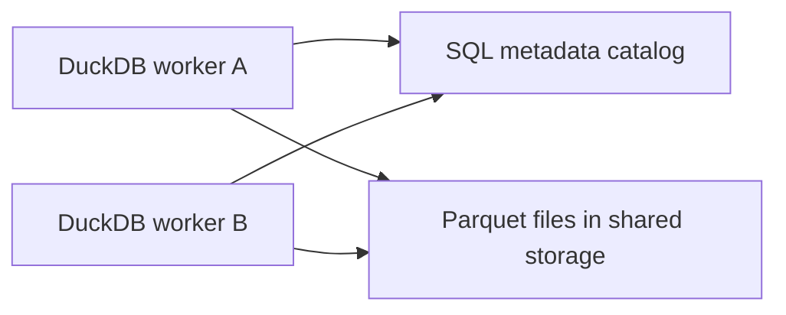

# DuckDB: Data Engineer Interview Guide

Documentation reviewed: 2026-10-27, using the DuckDB 2.0 documentation. Check `SELECT version()` in the interview or deployment environment: Python APIs, storage compatibility, Iceberg support, and Quack maturity differ across releases.

Suppose a daily pipeline reads Parquet from object storage, joins it to a small customer table, and produces a report. Running a distributed cluster may cost more time and money than the transformation itself. DuckDB lets the application run analytical SQL directly against those files, using the CPU cores, memory, and temporary disk of one machine. Understanding that boundary explains both its performance and its operational limits.

**A useful interview answer:** “DuckDB is an embedded analytical database with columnar storage and vectorized execution. It runs inside the calling process, parallelizes work across local cores, and can query Parquet without importing it. Its optimizer reduces data movement through pruning, pushdown, and join ordering. It can spill supported intermediate state to local disk, but it does not turn a query into distributed MPP execution.” [DuckDB internals](https://duckdb.org/docs/2.0/internals/overview), [Memory management](https://duckdb.org/2024/07/09/memory-management)

**Priority:** Explain vectorized execution, storage internals, query optimization, Parquet scans, Python/Arrow integration, and memory limits before memorizing extension options. For shared concepts, review [database internals](../foundations/database.md), [SQL](../foundations/sql.md), and [Python](../foundations/python.md).

The local SQL examples build on the small `events` fixture below unless they define their own input. File examples use paths created earlier or explicitly describe a required external dataset. Python examples are independent. Local examples were checked with DuckDB 2.0.0 and PyArrow 26.0.0. Remote storage, catalogs, extensions, and service connections require their own setup and were not executed; illustrative remote paths are placeholders.

## Contents

1. [Architecture & Fundamentals](#1-architecture--fundamentals)
2. [Storage Engine & Internals](#2-storage-engine--internals)
3. [Query Processing & Optimization](#3-query-processing--optimization)
4. [SQL & Analytical Capabilities](#4-sql--analytical-capabilities)
5. [Data Formats & External Storage](#5-data-formats--external-storage)
6. [Python & Arrow Integration](#6-python--arrow-integration)
7. [Lakehouse & Extensions](#7-lakehouse--extensions)
8. [Performance & Resource Management](#8-performance--resource-management)
9. [Production & Advanced Topics](#9-production--advanced-topics)

## 1. Architecture & Fundamentals

### Embedded OLAP and in-process execution

An embedded database is a library loaded by an application. A Python program can create a DuckDB connection and execute SQL without starting a separate database server. In this deployment, calls cross a function boundary rather than a network connection, and the engine shares the application's process and failure domain.

OLAP queries usually scan many rows, select a subset of columns, join datasets, and aggregate. DuckDB targets that shape of work. Embedding makes notebooks, command-line tools, batch workers, and application analytics convenient, but the application must still control memory, concurrency, credentials, and lifecycle. “Serverless” here does not imply a managed cloud service.

```python
import duckdb

memory = duckdb.connect(":memory:")
persistent = duckdb.connect("analytics.duckdb")
print(persistent.execute("SELECT version()").fetchone()[0])
memory.close()
persistent.close()
```

The first connection has no durable database file; the second opens or creates one. In-memory mode can still read files and use temporary disk for supported spilling. Persistence describes the database's lifetime, not whether query processing uses RAM. [Python connection API](https://duckdb.org/docs/2.0/clients/python/dbapi), [Files created by DuckDB](https://duckdb.org/docs/2.0/operations_manual/footprint_of_duckdb/files_created_by_duckdb)

### Columnar storage and vectorized execution solve different problems

Columnar storage places values from the same column together, reducing reads for narrow projections and exposing patterns for compression. Vectorized execution describes how operators process data after reading it: batches of column values flow through compiled engine code.

DuckDB's standard vector capacity is **2,048 values**. A `DataChunk` contains vectors for several columns with a shared row count. Flat vectors store values directly; constant vectors store one repeated value; dictionary vectors use a child vector and selection indices; sequence vectors represent an offset and increment. These representations can avoid copying or expanding values unnecessarily.

Batch processing amortizes dispatch overhead and improves cache locality. Some operations also use SIMD instructions, but vectorized SQL execution and CPU SIMD are different concepts. A vector may be partially filled, and 2,048 is neither a storage row-group size nor a Python result-batch requirement. [Execution format](https://duckdb.org/docs/2.0/internals/vector)

### Single-node processing versus distributed MPP

DuckDB can use many local cores. Scan tasks, joins, sorts, and aggregations may run in parallel, sharing the machine's resources. Distributed MPP engines instead coordinate workers across machines and exchange data over a network, often through repartitioning or shuffle stages.

This makes DuckDB attractive when one well-sized machine can finish within the required time. It avoids cluster scheduling and network shuffle overhead, but cannot add another machine's RAM or CPU to a normal embedded query. Reading a petabyte-scale lake does not mean a particular query processes a petabyte: selective partition and row-group pruning may reduce it dramatically. Conversely, a much smaller many-to-many join can create intermediates too large for the available disk and memory.

In an interview, size the **selected input, intermediate state, output, concurrency, and completion time**. Dataset size alone is a poor engine-selection rule. Quack changes remote access; DuckLake changes shared table storage. Neither automatically distributes one DuckDB query across a cluster. [Concurrency models](https://duckdb.org/docs/2.0/connect/concurrency), [Quack FAQ](https://duckdb.org/quack/faq)

### DuckDB versus adjacent systems

| System | Typical role | Decision to explain |
| --- | --- | --- |
| DuckDB | Embedded batch analytics and SQL over files | Few deployment components; each ordinary query uses one machine |
| SQLite | Embedded application state and transactional lookups | Similar embedding model; row-oriented access serves a different workload |
| PostgreSQL | Shared transactional database with rich server features | Prefer it for application transactions and many independent clients; offload suitable analytics when scans burden the service |
| ClickHouse | Analytical serving and high-volume ingestion | Server operations and distributed deployment support a different concurrency and availability requirement |
| Spark | Distributed ETL and large-scale processing | Cluster compute, shuffle, scheduling, and recovery can justify their overhead when one machine is insufficient |

These are workload choices, not universal speed rankings. Compare the actual SQL, storage layout, hardware, cold and warm reads, correctness requirements, and concurrent load. Continue with the [ClickHouse](clickhouse.md) and [Spark](../processing/spark.md) guides for their execution and operational models.

## 2. Storage Engine & Internals

### Row groups, column segments, and blocks

Keep three units separate when explaining native DuckDB storage:

| Unit | Purpose | Relevant default |
| --- | --- | --- |
| Execution vector | Batch of values processed by operators | 2,048 values |
| Row group | Horizontal range of table rows, with separate column storage | 122,880 rows |
| Storage block | Physical allocation unit in the database file | 256 KiB; configurable for new files |

A row group contains the same row range across columns. Each column is represented through segments and associated metadata; blocks provide the physical space. A row group is not one block: row width, compression, and variable-length data affect its footprint. Row groups also provide scan work that can be assigned to local threads. [Storage format](https://duckdb.org/docs/2.0/internals/storage), [ATTACH storage options](https://duckdb.org/docs/2.0/sql/statements/attach)

The native format is columnar but is **not a Parquet container**. A `.duckdb` file also stores database metadata and database-specific structures. Reading an external Parquet file uses its own metadata and encoding; importing it creates native table storage.

### Compression and encoding

DuckDB chooses compression suited to the column's values. Constant encoding helps when a segment repeats one value. Run-length encoding represents repeated runs; dictionary encoding replaces repeated values with references. Bit packing reduces the bits used for small integer ranges, and frame-of-reference encoding represents values relative to a base. String and floating-point codecs address their own data patterns.

Compression saves I/O, and lightweight decoding keeps the CPU cost manageable. Sorting by a useful column can improve both compression and pruning, although the sort itself costs time and temporary space. Native persistent storage is compressed by default; in-memory compression requires an explicit compressed attachment. The available codecs depend on storage version. [Lightweight compression](https://duckdb.org/2022/10/28/lightweight-compression), [Storage compression](https://duckdb.org/docs/2.0/internals/storage)

### Zone maps: proving that data cannot match

Zone maps hold summaries such as minimum and maximum values. If one row group has `event_time` between January 1 and January 3, a predicate requesting January 10 cannot match it. DuckDB can skip that group without checking every row. If the range overlaps, the engine still evaluates the predicate on candidate data; min/max metadata does not prove that a value exists.

Ordered timestamps usually produce narrower, more useful ranges than timestamps randomly mixed throughout the table. This explains why the same selective predicate can perform differently on two copies of the same logical dataset. DuckDB creates zone maps automatically. ART indexes serve another purpose, such as selective lookups and constraint enforcement; adding an index to every analytical column is rarely a sensible first optimization. [Indexing and ordering](https://duckdb.org/docs/2.0/guides/performance/indexing)

### MVCC, transactions, WAL, and checkpoints

Multi-version concurrency control lets a transaction read a consistent snapshot while other transactions make changes. Uncommitted changes remain isolated. DuckDB guarantees **snapshot isolation**, described as repeatable reads in its transaction documentation; do not claim that all possible serializable schedules or cross-row business invariants are enforced automatically. [Transaction management](https://duckdb.org/docs/2.0/sql/statements/transactions)

For persistent databases, the write-ahead log records recoverable changes. A checkpoint incorporates logged state into the database file. After a crash, opening the database with its WAL allows recovery by replay. A checkpoint does not create an independent backup, and deleting a WAL after a crash can discard committed data needed for recovery. [CHECKPOINT](https://duckdb.org/docs/2.0/sql/statements/checkpoint), [Crash recovery](https://duckdb.org/docs/2.0/guides/troubleshooting/crashes)

```sql
CREATE TABLE events (
    event_id BIGINT PRIMARY KEY,
    customer_id BIGINT,
    country VARCHAR,
    event_time TIMESTAMP,
    amount DECIMAL(12, 2)
);

INSERT INTO events VALUES
    (1, 101, 'US', '2026-01-01 09:00:00', 10.00),
    (2, 101, 'US', '2026-01-02 10:00:00', 25.00),
    (3, 102, 'GB', '2026-01-02 11:00:00', 15.00),
    (4, 103, 'US', '2026-01-03 08:00:00', 40.00),
    (5, 102, 'GB', '2026-01-03 12:00:00', 20.00),
    (6, 101, 'US', '2026-01-03 13:00:00', 5.00);

BEGIN TRANSACTION;
UPDATE events SET amount = 99.00 WHERE event_id = 1;
ROLLBACK;

SELECT amount FROM events WHERE event_id = 1;
```

The result remains `10.00`. Use explicit transactions when several statements must succeed together. The guarantees of a native transaction do not automatically cover a remote database plus output files plus orchestration metadata.

### Concurrency inside the embedding process

One read-write process can run concurrent transactions through separate connections. DuckDB uses optimistic conflict detection: writers that update or delete the same rows can conflict. Appends do not conflict at the row-update level, although constraints such as a duplicate primary key can still reject them. Schema changes can also conflict with concurrent work.

Retry a failed transaction as a unit, with a bounded policy, after considering whether its inputs and external effects can safely repeat. Different Python threads should use their own connection/cursor handles rather than concurrently executing on one shared handle. Multiple application processes opening the same native file for writes are a separate problem, covered in section 9. [Concurrency](https://duckdb.org/docs/2.0/connect/concurrency), [Multiple Python threads](https://duckdb.org/docs/2.0/guides/python/multiple_threads)

### Buffer management and temporary state

The buffer manager keeps useful database pages in memory and evicts them when other work needs space. Clean cached pages already exist in the database file, so eviction need not write another copy. Query intermediates are different: supported joins, sorts, and aggregations may need temporary files so that their state can be reloaded later.

This distinction explains why scanning data larger than RAM can be cheap while grouping it into almost as many distinct groups as input rows can be expensive. The scan streams chunks; the aggregation must retain substantial state. `memory_limit` governs buffer-managed memory, not the entire host process. Section 8 connects that limit to Python objects, result materialization, and out-of-memory failures. [Memory management](https://duckdb.org/2024/07/09/memory-management)

## 3. Query Processing & Optimization

### From SQL to logical and physical plans

The parser recognizes SQL structure. The binder resolves tables, columns, functions, and types. A logical plan describes operations such as filtering, joining, and grouping. Optimization rewrites that plan; the physical plan selects concrete operators that execute it.

For example, “join orders to customers” is a logical requirement. Building a hash table on filtered customers and probing it with orders is one physical strategy. The final plan can differ from the order in which the SQL is written, while preserving SQL semantics. [Internals overview](https://duckdb.org/docs/2.0/internals/overview)

### Vectorized pipelines and blocking operators

A pipeline passes chunks from a source through operators to a sink. A scan, filter, and projection can process a chunk and move it onward without materializing the whole dataset. Independent pieces of scan work, often called morsels, let multiple threads do useful local work.

A hash join's build phase must prepare state before probing. Grouping and sorting also introduce boundaries where state must accumulate or be finalized before the next stage can consume results. These are reasons why a query that returns ten rows may still need substantial memory. A `LIMIT` after a large aggregation does not necessarily avoid building the aggregation state. [Execution model](https://duckdb.org/docs/2.0/internals/overview), [Pipeline dependencies in the implementation](https://github.com/duckdb/duckdb/blob/main/src/include/duckdb/parallel/meta_pipeline.hpp)

### Cost-based optimization and cardinality estimation

The optimizer uses statistics to estimate how many rows operators produce and what alternative join orders may cost. Filtering a dimension first can shrink downstream joins; building a hash table on a smaller input can reduce memory. Estimates can still be wrong when columns are correlated, distributions are skewed, or statistics are missing or stale.

Run `ANALYZE events;` when refreshing native table statistics is relevant, especially after significant data changes. It does not create a detailed multi-column model of every distribution or rewrite external files. Check estimated and actual cardinalities at the first operator where they diverge. Do not disable join ordering as a general tuning step. [Join optimization](https://duckdb.org/docs/2.0/guides/performance/join_operations), [ANALYZE](https://duckdb.org/docs/2.0/sql/statements/analyze)

### Predicate pushdown and projection pruning

Predicate pushdown moves filters toward scans so fewer rows enter expensive work. Projection pruning removes columns that no later operator needs, including wide payloads that would otherwise enlarge join state. Columns used in predicates and joins remain necessary even when absent from the final output.

For Parquet, these optimizations reach the reader: required column chunks can be selected, and statistics can eliminate row groups. Pushdown and pruning are related but different: a pushed filter may still match every row group's min/max range. An opaque Python UDF or an expression the reader cannot translate can limit scan-level filtering.

```sql
EXPLAIN
SELECT customer_id, sum(amount) AS revenue
FROM events
WHERE event_time >= TIMESTAMP '2026-01-02 00:00:00'
GROUP BY customer_id;
```

Look for the timestamp filter near the scan and the necessary projected columns. Exact plan labels depend on the version and data. Filter propagation across equality joins and Top-N optimization can further reduce work. [Optimizer examples](https://duckdb.org/2024/11/14/optimizers)

### Join algorithms, join order, and aggregation

Hash joins commonly handle equality predicates: build hash state from one input, then probe it with the other. The build footprint depends on retained columns, key representation, and row count, not just source-file bytes. For larger-than-memory hash joins, partitioning permits subsets to be processed while others remain on disk. [External hash join design](https://vldb.org/pvldb/vol18/p2748-kuiper.pdf)

Other conditions need other strategies. Range predicates can use merge-oriented or specialized inequality joins; tiny inputs may favor nested loops. ASOF joins express nearest-match semantics directly. The SQL predicate and input cardinalities determine eligible algorithms; inspect the plan instead of assuming every join is a hash join. [ASOF join implementation](https://duckdb.org/2023/09/15/asof-joins-fuzzy-temporal-lookups), [Range joins](https://duckdb.org/2022/05/27/iejoin)

Parallel grouped aggregation uses local pre-aggregation and partitioned combination. Grouping by country has little state; grouping by a nearly unique identifier can be much larger. Exact distinct counts and large list aggregates can also dominate memory. Pre-aggregate before a join only when the business grain and required columns make the rewrite equivalent. For example, averaging per-partition averages is wrong unless weighted by the corresponding counts. [External aggregation](https://duckdb.org/2024/03/29/external-aggregation)

### EXPLAIN, EXPLAIN ANALYZE, and profiling

`EXPLAIN` shows a plan and estimates without running the query. `EXPLAIN ANALYZE` runs it and reports observed rows and operator timings. On a data-changing statement, analyzing it can change data; use a safe environment. Parallel operator timings can overlap, so adding them does not reliably reproduce end-to-end latency. [Query profiling](https://duckdb.org/docs/2.0/sql/statements/profiling)

```sql
EXPLAIN ANALYZE
SELECT country, sum(amount) AS revenue
FROM events
WHERE event_time >= TIMESTAMP '2026-01-02 00:00:00'
GROUP BY country;
```

For deeper inspection, enable a JSON profile around the target query:

```sql
SET enable_profiling = 'json';
SET profiling_output = 'duckdb-profile.json';

SELECT country, sum(amount) AS revenue
FROM events
GROUP BY country;

PRAGMA disable_profiling;
```

Read scan volume, intermediate cardinalities, operator time, and the memory/temp-storage metrics exposed by that version. Profile the same input snapshot and consume the full result when comparing runs. Separate cold remote reads from warm cached runs. [Profiling guide](https://duckdb.org/docs/2.0/dev/profiling)

**Interview question: A query became slower after the data doubled. What do you check?**

First establish whether bytes scanned, join output, or group count grew. Then compare plans and estimates, inspect pruning, and check whether intermediate state crossed the memory threshold and began spilling. Doubling source data need not double runtime when the plan or memory regime changes.

## 4. SQL & Analytical Capabilities

### Windows, aggregations, CTEs, and QUALIFY

An aggregation changes the row grain; a window function computes over related rows while retaining them. Specify the window frame and a deterministic order when the distinction matters. The following running sum uses a row frame and breaks timestamp ties with `event_id`:

```sql
SELECT event_id, customer_id, amount,
       sum(amount) OVER (
           PARTITION BY customer_id
           ORDER BY event_time, event_id
           ROWS BETWEEN UNBOUNDED PRECEDING AND CURRENT ROW
       ) AS running_amount
FROM events
ORDER BY customer_id, event_time, event_id;
```

Customer 101's running amounts are `10.00`, `35.00`, and `40.00`. `QUALIFY` filters after window evaluation, allowing a latest-record query without another nesting level:

```sql
SELECT *
FROM events
QUALIFY row_number() OVER (
    PARTITION BY customer_id
    ORDER BY event_time DESC, event_id DESC
) = 1
ORDER BY customer_id;
```

`WHERE` filters input rows, `HAVING` filters groups, and `QUALIFY` filters window results. They cannot be interchanged freely. [Window functions](https://duckdb.org/docs/2.0/sql/functions/window_functions), [QUALIFY](https://duckdb.org/docs/2.0/sql/query_syntax/qualify)

CTEs name intermediate logic, including recursive queries. DuckDB generally materializes CTEs but can inline eligible ones. `AS MATERIALIZED` and `AS NOT MATERIALIZED` influence this choice; neither is a universal optimization. Reusing an expensive result can justify materialization, while materializing a large result can add work or constrain rewrites. Inspect the resulting plan. [WITH and materialization](https://duckdb.org/docs/2.0/sql/query_syntax/with)

### ASOF JOIN, POSITIONAL JOIN, and LATERAL JOIN

ASOF answers “which known value applied at this time?” With `>=`, each trade matches the latest eligible earlier or equal price for its symbol. A left ASOF join preserves trades without an eligible price:

```sql
WITH trades(symbol, trade_time) AS (
    VALUES ('ABC', TIMESTAMP '2026-01-01 10:05:00'),
           ('XYZ', TIMESTAMP '2026-01-01 10:05:00')
), prices(symbol, price_time, price) AS (
    VALUES ('ABC', TIMESTAMP '2026-01-01 10:00:00', 100),
           ('ABC', TIMESTAMP '2026-01-01 10:04:00', 105)
)
SELECT t.symbol, t.trade_time, p.price
FROM trades t
ASOF LEFT JOIN prices p
  ON t.symbol = p.symbol AND t.trade_time >= p.price_time
ORDER BY t.symbol;
```

The prices are `105` and `NULL`. ASOF returns at most one right-side match per left row. If the reference data has duplicate symbol/timestamp keys, establish the business tie-breaking rule before joining.

A `POSITIONAL JOIN` pairs the first row with the first row, then the second with the second. It is full outer: unmatched trailing rows receive `NULL`. Use it only when position is a real input contract, such as aligned arrays. Equal row counts do not prove alignment, and a filter or reorder can silently invalidate the relationship.

```sql
SELECT *
FROM (VALUES (10), (20), (30)) AS a(x)
POSITIONAL JOIN (VALUES ('a'), ('b')) AS b(label);
```

`LATERAL` lets a right-side subquery refer to preceding input rows and emit zero, one, or many rows for each. DuckDB can detect many lateral uses automatically. The syntax expresses correlation; the optimizer may transform execution rather than literally run an interpreter loop. [Join syntax and semantics](https://duckdb.org/docs/2.0/sql/query_syntax/from)

```sql
SELECT e.event_id, u.adjusted_amount
FROM events e,
LATERAL (
    SELECT e.amount * multiplier AS adjusted_amount
    FROM range(1, 3) t(multiplier)
) u
WHERE e.event_id = 1
ORDER BY u.adjusted_amount;
```

### PIVOT and UNPIVOT

`PIVOT` turns category values into columns and aggregates within the chosen row grain:

```sql
PIVOT events
ON country IN ('GB', 'US')
USING sum(amount)
GROUP BY customer_id
ORDER BY customer_id;
```

Customer 101 has `US = 40.00`; customer 102 has `GB = 35.00`. Explicit categories stabilize the output schema. Dynamic pivots can add columns when new categories arrive, which matters to downstream contracts. [PIVOT](https://duckdb.org/docs/2.0/sql/statements/pivot)

`UNPIVOT` turns columns into name/value rows:

```sql
WITH monthly(customer_id, jan, feb) AS (
    VALUES (101, 10, 20), (102, 30, 40)
)
UNPIVOT monthly
ON jan, feb
INTO NAME month VALUE amount;
```

It reshapes a wide dataset for analysis. It cannot reconstruct individual source rows lost through a pivot's aggregation. Check null handling and compatible value types when reshaping production data. [UNPIVOT](https://duckdb.org/docs/2.0/sql/statements/unpivot)

### LIST, STRUCT, MAP, and UNNEST

Nested types preserve structure without converting every operation to text parsing. A `LIST` contains ordered elements of one type, a `STRUCT` has a fixed set of named typed fields, and a `MAP` holds key/value entries with unique keys and consistent key/value types. These distinctions matter when choosing a schema for semi-structured input. [Nested types](https://duckdb.org/docs/2.0/sql/data_types/overview)

```sql
SELECT [10, 20, 30][1] AS first_value,
       {'city': 'Kyiv', 'active': true}.city AS city,
       map(['source'], ['web'])['source'] AS source;

SELECT customer_id, unnest(tags) AS tag
FROM (VALUES (101, ['new', 'paid']), (102, []::VARCHAR[]))
     AS t(customer_id, tags);
```

The first query returns `10`, `Kyiv`, and `web`. The second emits two rows for customer 101 and none for customer 102. Empty and null lists unnest to zero rows. Multiple list unnests in the same `SELECT` align side by side and pad shorter lists with nulls; they do not create a Cartesian product. A struct unnest expands fields into columns. Losing parent rows with empty lists is a common correctness trap. [UNNEST](https://duckdb.org/docs/2.0/sql/query_syntax/unnest)

### JSON functions and SQL macros

DuckDB can read JSON documents into typed columns or operate on the `JSON` type. Use extraction functions for individual fields and `from_json`/`json_transform` when a known nested schema should be decoded in bulk. JSON arrays use zero-based indexing, while SQL lists and arrays use one-based indexing. [JSON overview](https://duckdb.org/docs/2.0/data/json/overview), [JSON functions](https://duckdb.org/docs/2.0/data/json/json_functions)

```sql
SELECT json_extract_string('{"customer":{"id":"101"}}', '$.customer.id')
       AS customer_id;

CREATE MACRO cents_to_amount(cents) AS
    CAST(cents AS DECIMAL(18, 2)) / 100;

SELECT cents_to_amount(1250) AS amount;
```

A SQL macro expands reusable SQL into the calling query, keeping the expression available to the optimizer. It is not a Python callback invoked for each row. For financial work, explicitly choose the final decimal type and rounding policy; division can change expression types, and a convenient conversion example is not a complete currency model. [CREATE MACRO](https://duckdb.org/docs/2.0/sql/statements/create_macro)

## 5. Data Formats & External Storage

### Direct file queries: Parquet, CSV, JSON, and Arrow

External file queries need no `CREATE TABLE` import step. A view over files stores a query definition, not a durable copy of their contents. Materializing a native table can pay off for repeated joins and reuse, but duplicates data and creates another refresh responsibility.

| Format/interface | Main advantage | Cost or correctness issue |
| --- | --- | --- |
| Parquet | Typed columnar storage with row-group metadata | Layout, statistics, compression, and file count affect scans |
| CSV | Broad compatibility | Text parsing, weak type information, and schema inference |
| JSON | Flexible nested interchange | Parsing cost and changes in inferred structure/types |
| Arrow | Typed columnar interchange in memory | Producer lifetime, conversion rules, and result materialization |

```sql
COPY (
    SELECT * FROM events ORDER BY event_time, event_id
) TO 'events.parquet' (
    FORMAT PARQUET, COMPRESSION ZSTD, ROW_GROUP_SIZE 122880
);

SELECT customer_id, sum(amount) AS revenue
FROM read_parquet('events.parquet')
GROUP BY customer_id;
```

The small fixture produces only a tiny file; the configured row-group size becomes relevant with more rows. DuckDB also supports glob patterns, explicit lists of files, and schema combination through `union_by_name = true`. Missing columns then become nulls; that convenience does not validate a schema contract. [Parquet reader/writer](https://duckdb.org/docs/2.0/data/parquet/overview), [Combining file schemas](https://duckdb.org/docs/2.0/data/multiple_files/combining_schemas)

For production CSV and JSON feeds, specify expected types and parsing rules rather than trusting a sample to represent every file. A late string in an inferred numeric column can fail a pipeline or change its schema. Validate malformed records and required fields explicitly. [CSV auto-detection](https://duckdb.org/docs/2.0/data/csv/auto_detection), [Loading JSON](https://duckdb.org/docs/2.0/data/json/loading_json)

### How a selective Parquet scan avoids work

Consider this query against an external dataset with Hive-style date folders:

```sql
SELECT customer_id, sum(amount) AS revenue
FROM read_parquet('lake/event_date=*/*.parquet', hive_partitioning = true)
WHERE event_date = DATE '2026-01-03'
  AND event_time >= TIMESTAMP '2026-01-03 12:00:00'
GROUP BY customer_id;
```

The stages eliminate different costs:

1. **Partition pruning** uses `event_date=2026-01-03` in the path to exclude unrelated files.
2. **Projection pruning** selects columns required by the filter and aggregation.
3. **Row-group pruning** uses Parquet statistics to skip groups whose timestamp range cannot match.
4. **Row filtering** tests candidate values that remain, before later operators process them.

Metadata and file-discovery requests may still be necessary. Missing or broad statistics reduce pruning, and one giant row group limits scan parallelism. Filtering on a partition column explicitly is often clearer than relying on the optimizer to derive a partition predicate from another timestamp expression. [Hive partitioning](https://duckdb.org/docs/2.0/data/partitioning/hive_partitioning), [Parquet partial reads](https://duckdb.org/docs/2.0/data/parquet/overview)

Inspect the actual layout rather than guessing:

```sql
SELECT row_group_id, row_group_num_rows, path_in_schema,
       stats_min_value, stats_max_value, compression
FROM parquet_metadata('events.parquet');
```

For a larger dataset, compare the same filter on sorted and shuffled data. Sorting can tighten ranges; selecting only a few rows does not by itself prove that the reader skipped bytes. [Parquet metadata](https://duckdb.org/docs/2.0/data/parquet/metadata)

### Hive partitioning and partitioned writes

Hive partitioning encodes values in folders such as `event_date=2026-01-03/`. DuckDB can expose those values as columns and use them during file selection. Write a local example with:

```sql
COPY (
    SELECT *, CAST(event_time AS DATE) AS event_date
    FROM events
) TO 'events_partitioned' (FORMAT PARQUET, PARTITION_BY (event_date));
```

Choose a partition column that queries filter and that produces reasonably sized partitions. Partitioning by a nearly unique identifier creates excessive folders and small files. Adding a partition level also does not guarantee good ordering inside each file. Repeated writes need a deliberate overwrite/append/publication policy; do not assume a directory write is an atomic table update. [Partitioned writes](https://duckdb.org/docs/2.0/data/partitioning/partitioned_writes)

### S3, GCS, Azure Blob, and authentication

`httpfs` provides HTTP and S3-compatible access. S3 authentication can use the `aws` extension's credential chain, letting a workload use its configured role or short-lived credentials without embedding keys in SQL. The following is illustrative setup for an already authorized S3 environment; it does not provision access:

```sql
INSTALL httpfs;
LOAD httpfs;
INSTALL aws;
LOAD aws;

CREATE SECRET lake_read (
    TYPE s3,
    PROVIDER credential_chain,
    REGION 'eu-west-1',
    SCOPE 's3://example-bucket/interview/'
);

SELECT count(*)
FROM read_parquet('s3://example-bucket/interview/*.parquet');
```

Secret scope chooses which credential configuration applies to a path. It does not grant or restrict IAM permissions by itself; the underlying identity must have appropriate storage permissions. [S3 authentication](https://duckdb.org/docs/2.0/core_extensions/httpfs/s3api), [AWS extension](https://duckdb.org/docs/2.0/core_extensions/aws)

GCS can be queried through `httpfs` using its interoperability/HMAC credentials and `gs://` paths; do not assume an arbitrary Google OAuth token is interchangeable with an HMAC secret. Azure Blob/ADLS uses the `azure` extension and supports providers such as credential-chain authentication, including managed identity configurations. Use each provider's documented path scheme and authentication flow. [GCS import](https://duckdb.org/docs/2.0/guides/network_cloud_storage/gcs_import), [Azure extension](https://duckdb.org/docs/2.0/core_extensions/azure)

### Remote I/O, range requests, and caching

For remote Parquet, DuckDB can fetch metadata and issue HTTP range requests for needed file regions. This can avoid downloading entire files, provided the endpoint supports the necessary access. CSV generally requires much more sequential reading because it lacks Parquet's typed column chunks and row-group statistics. [HTTP partial reads](https://duckdb.org/docs/2.0/core_extensions/httpfs/https)

DuckDB 2.0 adds asynchronous I/O for supported scans, including Parquet and native storage. Worker threads process available data while I/O requests run through a separate pool. `threads` and `async_threads` control different pools. More in-flight work can hide latency but increases request pressure and buffering needs; it cannot repair poor pruning or a bandwidth limit. [I/O model](https://duckdb.org/docs/2.0/data/io)

Caching includes several different resources: OS pages, native database buffers, remote file data, HTTP metadata, and reusable connections. Current DuckDB enables an external file cache; cache behavior and available settings are version-dependent. A fast repeated query may be measuring cache reuse rather than object-storage throughput. Compare cold and warm runs and record request counts and transferred bytes. [Cache configuration](https://duckdb.org/docs/2.0/configuration/overview)

## 6. Python & Arrow Integration

### Keep computation in the engine and choose the output boundary

DuckDB can scan pandas DataFrames and Arrow objects through Python integration. Explicit registration gives a SQL name to an object without importing it into a persistent table. Python replacement scans can also resolve an in-scope variable by name, which is convenient interactively but creates a less visible dependency than registration.

The relational API builds query expressions lazily; fetching, exporting, or writing a result triggers execution. Keep filters, joins, and aggregation in SQL when they can reduce data before it crosses into Python. Fetching a large input into Python only to discard most of it adds allocations and work. [SQL on pandas](https://duckdb.org/docs/2.0/guides/python/sql_on_pandas), [Relational API](https://duckdb.org/docs/2.0/clients/python/relational_api)

### Arrow input and bounded output batches

Arrow provides typed columnar buffers and an interchange interface that can avoid row-by-row Python object conversion. DuckDB can scan supported Arrow inputs with little copying, but **zero-copy end to end is not a general guarantee**. Type conversion, expression evaluation, joins, and output construction may allocate new buffers. Arrow is an in-memory representation; Parquet is a storage format. [SQL on Arrow](https://duckdb.org/docs/2.0/guides/python/sql_on_arrow), [Python conversions](https://duckdb.org/docs/2.0/clients/python/conversion)

This independent example requires `duckdb` and `pyarrow`:

```python
import duckdb
import pyarrow as pa

source = pa.table({
    "customer_id": [101, 101, 102],
    "amount_cents": [100, 250, 80],
})

with duckdb.connect() as con:
    con.register("arrow_events", source)
    reader = con.sql(
        """
        SELECT customer_id, sum(amount_cents) AS revenue_cents
        FROM arrow_events
        WHERE amount_cents >= ?
        GROUP BY customer_id
        ORDER BY customer_id
        """,
        params=[100],
    ).to_arrow_reader(1024)

    rows = []
    for batch in reader:
        rows.extend(batch.to_pylist())

    assert rows == [{"customer_id": 101, "revenue_cents": 350}]
```

The tiny example collects rows only to assert the answer. A large pipeline should send each batch to its consumer rather than retain them all. Keep the connection and registered input alive until the reader is consumed, and consume or close the reader before reusing its connection for another operation. Batch iteration bounds the output handed to Python; it does not remove an upstream sort or aggregation's state requirements. [Arrow export](https://duckdb.org/docs/2.0/guides/python/export_arrow), [Python API reference](https://duckdb.org/docs/2.0/clients/python/reference)

### Materialization, types, UDFs, and threads

`fetchall()` creates Python row objects. `.df()`/`.to_df()` materializes a pandas DataFrame, and `.to_arrow_table()` materializes an Arrow table. A batch reader can avoid retaining the complete output, while `COPY ... TO` can avoid bringing output into Python at all. Choose the interface according to the consumer, not just convenience. [Python conversion methods](https://duckdb.org/docs/2.0/clients/python/conversion)

Check nullability, decimal precision, timestamp units, timezone meaning, and nested type mappings across the boundary. A Python integer, pandas nullable integer, and SQL `BIGINT` have different constraints. A conversion that works on a small sample may fail on an out-of-range value. [Python type conversion](https://duckdb.org/docs/2.0/clients/python/conversion)

Prefer built-in SQL expressions when available. A scalar Python UDF can reintroduce per-value interpreter overhead; an Arrow UDF can work in batches but still needs correct null and exception behavior. DuckDB's native query execution can use local threads, but this does not make Python callbacks automatically parallel or remove Python runtime constraints. Use separate connection handles for concurrent queries and budget engine threads across the host process. [Python UDFs](https://duckdb.org/docs/2.0/clients/python/function), [Threading](https://duckdb.org/docs/2.0/guides/python/multiple_threads)

**Interview question: The SQL finishes, then the notebook dies. Why?**

The result may fit inside engine-managed memory while conversion creates a much larger Python object graph or DataFrame. Inspect the fetch step, output cardinality, types, process RSS, and retained notebook variables. Reduce output in SQL or consume batches; increasing `memory_limit` can make less headroom available to Python.

## 7. Lakehouse & Extensions

### File formats, table formats, and catalogs

Parquet describes files. A lakehouse table format additionally describes which files constitute a table snapshot, how changes become visible, and how schema and deletion metadata are interpreted. A catalog helps discover tables and coordinate metadata access. Querying a glob of Parquet files does not supply those table-level guarantees.

DuckDB can act as a lakehouse query and transformation engine: read a snapshot, join and transform its rows, then write through the supported table integration. The catalog and object store remain separate dependencies with their own permissions and failure modes. See the [Iceberg guide](iceberg.md) for format fundamentals. [DuckDB lakehouse formats](https://duckdb.org/docs/2.0/lakehouse_formats)

### Apache Iceberg and REST catalogs

The `iceberg` extension supports direct reads from table metadata and catalog-managed access. A direct `iceberg_scan(...)` does not provide the same write path as attaching a REST catalog. Current documentation supports writes through an attached REST catalog, while direct storage scans are read-only. Avoid the outdated blanket statement that DuckDB's Iceberg support is always read-only. [Iceberg overview](https://duckdb.org/docs/2.0/core_extensions/iceberg/overview)

Conceptually, the integration must resolve a snapshot, read metadata and manifests, select data files, and apply the table's deletion and schema rules. Scanning the data directory as ordinary Parquet bypasses those rules and may return obsolete or deleted rows. Supported writes require publishing updated metadata through the catalog's commit protocol. [Writing to Iceberg](https://duckdb.org/docs/2.0/core_extensions/iceberg/writing_to_iceberg)

Catalog authentication and data-file authentication are distinct. An OAuth token for a REST catalog does not necessarily authorize object storage; some catalogs vend scoped credentials for the files. Match the extension version, catalog implementation, storage backend, Iceberg format version, and required operations before promising compatibility. The extension repository still marks the integration experimental. [Iceberg catalogs](https://duckdb.org/docs/2.0/core_extensions/iceberg/catalogs), [Iceberg extension status](https://github.com/duckdb/duckdb-iceberg)

### DuckLake architecture and metadata management

DuckLake is a separate lakehouse format: bulk data lives in Parquet, while an ACID SQL database stores table metadata. DuckDB accesses it through the `ducklake` extension. A server catalog such as PostgreSQL allows separate DuckDB processes to coordinate access through shared transactional metadata; they are not all opening one native `.duckdb` file for writes. [DuckLake architecture](https://ducklake.select/), [DuckLake documentation](https://ducklake.select/docs)



Snapshots identify visible table state. Schema evolution, partition information, data-file references, and deletion information are tracked through the format. Small inserts can be inlined into the metadata database instead of creating tiny Parquet files immediately. Data inlining means that a complete backup may need actual row data from the catalog as well as files from storage. [DuckLake introduction](https://ducklake.select/docs/stable/duckdb/introduction), [Data inlining](https://ducklake.select/docs/stable/duckdb/advanced_features/data_inlining)

A local learning example uses a DuckDB file as the metadata catalog:

```sql
INSTALL ducklake;
LOAD ducklake;

ATTACH 'ducklake:interview.ducklake' AS lake (
    DATA_PATH 'interview_lake_files'
);

CREATE TABLE lake.main.daily_revenue AS
SELECT CAST(event_time AS DATE) AS event_date,
       sum(amount) AS revenue
FROM events
GROUP BY event_date;
```

This demonstrates the format, not a multi-process server catalog. Native metadata-file concurrency limits still apply to this local setup. For shared writers, choose a catalog backend with the required concurrency behavior and compatible client versions. DuckLake 1.1 requires DuckDB 2.0 or later. [Connecting to DuckLake](https://ducklake.select/docs/stable/duckdb/usage/connecting), [Client requirements](https://ducklake.select/docs/stable/duckdb/introduction)

Maintenance remains necessary: compact small files when useful, reconcile delete overhead, expire snapshots according to retention, and clean unreferenced files through supported procedures. Never delete old-looking Parquet files blindly; retained snapshots or active readers may still reference them. [DuckLake maintenance](https://ducklake.select/docs/stable/duckdb/maintenance/recommended_maintenance)

### httpfs, postgres, spatial, and extension lifecycle

| Extension | What it adds | Operational implication |
| --- | --- | --- |
| `httpfs` | HTTP/S3-compatible file access | Credentials, request costs, network behavior, and endpoint support |
| `postgres` | Read/write access to PostgreSQL through DuckDB | Source load, network transfer, connection limits, and remote transaction behavior |
| `spatial` | Geospatial functions and data access | Coordinate reference systems, geometry semantics, and explicit loading |
| `iceberg` | Iceberg scans and catalog integration | Format and catalog compatibility |
| `ducklake` | DuckLake table access | Shared metadata service plus data-file lifecycle |

`INSTALL` obtains an extension artifact; `LOAD` activates it in the process. Some known extensions autoinstall/autoload, while `spatial` requires explicit loading. Pin compatible engine and extension artifacts when reproducibility matters. Extensions run native code inside the application, so repository trust is part of the deployment boundary. [Extension installation](https://duckdb.org/docs/2.0/extensions/installing_extensions), [Spatial extension](https://duckdb.org/docs/2.0/core_extensions/spatial/overview)

For PostgreSQL, use a read-only attachment when analytics should not modify the source. Projection and available filter pushdown can reduce transfer, but do not assume an arbitrary join is fully delegated to PostgreSQL. Inspect the plan and source load; a direct analytical scan can compete with application traffic. Store credentials through secrets rather than password-bearing connection strings. [PostgreSQL extension](https://duckdb.org/docs/2.0/core_extensions/postgres/overview)

## 8. Performance & Resource Management

### Configure a budget for the whole application

The following values illustrate a budget; they are not universal production defaults. Run them before the workload, with enough free space for the chosen temporary directory:

```sql
SET threads = 4;
SET memory_limit = '2GB';
SET temp_directory = 'duckdb_tmp';
SET max_temp_directory_size = '10GB';

SELECT name, value
FROM duckdb_settings()
WHERE name IN ('threads', 'memory_limit', 'temp_directory',
               'max_temp_directory_size');
```

More threads can improve throughput when enough scan tasks and CPU work exist. They can also add intermediate state, compete for memory bandwidth, and worsen performance under concurrent load. Several orchestrated workers each using all cores can oversubscribe the host. In 2.0, budget the asynchronous I/O pool too; lowering query-worker threads alone does not describe every thread in the process. [Workload tuning](https://duckdb.org/docs/2.0/guides/performance/how_to_tune_workloads), [Asynchronous I/O](https://duckdb.org/docs/2.0/data/io)

The default memory budget is based on roughly 80% of system RAM, but it is not a hard process-RSS cap. Python objects, result buffers, some engine allocations, and other libraries need headroom. Container limits and multiple database instances also matter. Lowering the engine limit can help the process survive by reserving space for allocations outside the buffer manager. [Memory-limit scope](https://duckdb.org/docs/2.0/configuration/pragmas), [OOM guidance](https://duckdb.org/docs/2.0/guides/performance/oom)

### Out-of-core execution: what spilling does and cannot do

Supported operators partition or write intermediate state to temporary storage and reload manageable pieces. This trades additional I/O for lower resident memory requirements. A large streaming scan with a small aggregate may need little state; a high-cardinality group-by, sort, distinct, or join can spill heavily.

Spilling is not a promise that every query will complete. Some complex aggregate states, including large `list()` and `string_agg()` states, have spilling limitations. Multiple blocking operators can compete for memory, and `PIVOT` can inherit list-aggregation limits. A full or unwritable temporary disk is another failure mode. [Larger-than-memory limits](https://duckdb.org/docs/2.0/guides/performance/how_to_tune_workloads)

Use a fast local temporary disk with sufficient capacity, observe its usage, and reduce unnecessary state before increasing limits. Reducing threads can reduce simultaneous allocations. Disabling insertion-order preservation can help eligible bulk operations if the pipeline does not require that ordering; correctness must use explicit `ORDER BY` where order matters. [OOM troubleshooting](https://duckdb.org/docs/2.0/guides/performance/oom)

```sql
SELECT tag, memory_usage_bytes, temporary_storage_bytes
FROM duckdb_memory()
ORDER BY memory_usage_bytes DESC;

SELECT * FROM duckdb_temporary_files();
```

These functions show engine-managed allocations and current spill files, not every allocation in the application. A snapshot after completion may miss a query's peak; combine it with profiling and operating-system metrics. [Memory inspection](https://duckdb.org/2024/07/09/memory-management)

### Optimize joins and aggregation by reducing state

Start with correctness: verify join-key uniqueness, null behavior, required grain, and expected output cardinality. A duplicate dimension key can multiply a fact table and inflate both runtime and revenue. No memory setting repairs that logical mistake.

Then remove unused payloads, filter early, and check build-side size. Pre-aggregate only when equivalent to the required result. Consider approximate aggregates only when their error properties satisfy the requirement. For repeated join-heavy analysis over the same files, compare loading native tables against repeated file scans rather than assuming either is always faster. [Join tuning](https://duckdb.org/docs/2.0/guides/performance/join_operations), [Native storage versus Parquet](https://duckdb.org/docs/2.0/guides/performance/file_formats)

### Parquet row groups, file sizes, and scan optimization

Row-group sizing balances several pressures. Larger groups amortize metadata and can improve compression. Smaller groups offer finer pruning and more independent tasks, but create more metadata overhead. Very small groups waste work; a single huge group can leave cores idle.

The performance guide suggests roughly **100,000 to 1,000,000 rows per row group** as a starting range, not a guarantee. Row width, selectivity, ordering, storage latency, and compression change the result. Provide enough total row groups across scanned files to occupy the query workers. Consolidate tiny files when discovery and request overhead dominate, while retaining useful partition granularity. [Parquet sizing guidance](https://duckdb.org/docs/2.0/guides/performance/file_formats), [Parquet writing tips](https://duckdb.org/docs/2.0/data/parquet/tips)

For the fixture export, `ROW_GROUP_SIZE 122880` is an explicit starting choice. A production benchmark should vary one layout factor at a time and measure bytes read, elapsed time, CPU, peak memory, and request counts against representative filters. “Bigger Parquet files are faster” is too broad: file size and row-group size control different units of work.

### Diagnose CPU, memory, disk, and remote-I/O bottlenecks

| Observation | Likely explanation to investigate | Useful next step |
| --- | --- | --- |
| High CPU and little I/O | Decoding, expressions, hashing, or sorting | Inspect expensive operators and projected types/columns |
| Low CPU, many remote requests | Latency, small files, metadata discovery | Measure requests and pruning; inspect I/O concurrency |
| High local disk traffic and temp growth | Spilling intermediates | Reduce retained state and check join/group cardinality |
| One busy core | Too few scan tasks or a serial stage | Inspect row groups and pipeline boundaries |
| Process dies without a DuckDB OOM | OS/container kill or host-side allocations | Check RSS, runtime limits, fetch conversion, and competing processes |
| Large warm-run improvement | Reused metadata or cached data | Compare cold/warm runs with the same snapshot |

Treat these as hypotheses to test, not diagnoses from one metric. First validate results, then inspect a profile, identify the limiting resource, change one variable, and rerun representative work. Include result consumption and publication in an end-to-end pipeline measurement.

## 9. Production & Advanced Topics

### Embedded deployment and multi-process access

Native embedded access has two common modes: one process opens a database read-write, or multiple processes open it read-only with no writer. Multiple threads and connections inside the writer process are supported; independent processes directly writing the same file are not the ordinary native-file model. A shared filesystem does not change this contract and may introduce locking hazards. [Native concurrency](https://duckdb.org/docs/2.0/connect/concurrency)

| Requirement | Suitable approach to evaluate |
| --- | --- |
| One scheduled batch worker | Embedded connection, optionally with a durable local database |
| Several immutable-file readers | Independent workers querying published Parquet or read-only databases |
| Several clients sharing one native database | A service that owns the database, including evaluation of Quack |
| Independent workers sharing lakehouse tables | DuckLake with a concurrent server catalog, or a supported Iceberg catalog |
| One query needs several machines | A distributed engine such as Spark; remote DuckDB access alone is insufficient |

For embedded deployments, close connections, bound concurrent queries, provide writable temporary storage, and pin versions. A native extension crash or an OS OOM kill affects the hosting process, so a separate batch worker can provide a useful failure boundary.

### Quack protocol versus DuckLake

Quack is DuckDB's remote protocol: clients send work to a DuckDB server instead of independently opening the same native file for writing. The server owns the database and coordinates client operations. It supports remote execution, **not distributed query processing across a cluster**.

As of the review date, Quack was introduced in 1.5.3 and improved in 2.0, but the official FAQ still labels it beta and warns of protocol and API changes. Do not present it as a fully stable production service. Evaluate authentication, authorization, transport security, upgrade compatibility, resource isolation, and recovery against the actual deployment requirements. [Quack FAQ](https://duckdb.org/quack/faq)

DuckLake solves a different problem: several engines coordinate table state through a SQL metadata catalog and access shared data files. Their query execution remains local unless a separate distributed execution layer is involved. Quack is a client/server access protocol; DuckLake is a table and catalog format. One does not substitute for the other.

### Persistence, backup, and recovery

For a physical backup of a native database, quiesce writers, finish transactions, checkpoint and close the database cleanly, then copy the stable file. Do not assume copying a live `.duckdb` file alone creates a consistent backup. Preserve the file and WAL together after a crash and let DuckDB attempt recovery; a missing WAL can prevent complete recovery. [Database files and WAL](https://duckdb.org/docs/2.0/operations_manual/footprint_of_duckdb/files_created_by_duckdb), [Recovery](https://duckdb.org/docs/2.0/guides/troubleshooting/crashes)

A logical export writes schema/load SQL and table data. These commands are separate source and restore sessions:

```sql
EXPORT DATABASE 'duckdb_backup' (FORMAT PARQUET);
```

```sql
IMPORT DATABASE 'duckdb_backup';
```

Import into a fresh database and test representative queries and counts. An export is not a backup of every external dependency or secret. DuckDB 2.0.0 also omits triggers from exports, so databases that use them need explicit restoration steps. [EXPORT and IMPORT](https://duckdb.org/docs/2.0/sql/statements/export)

Storage compatibility is separate from SQL compatibility. A database created with the default 2.0 storage format cannot be opened by pre-2.0 engines. Validate rollback plans before upgrading files. For DuckLake, coordinate metadata backup, inlined data, object retention, and recovery to the same recoverable table state; copying only the catalog or only the Parquet files is incomplete. [Storage versions](https://duckdb.org/docs/2.0/internals/storage), [DuckLake data inlining](https://ducklake.select/docs/stable/duckdb/advanced_features/data_inlining)

### Orchestration, idempotency, and testing

DuckDB is an execution component; Airflow, Dagster, another scheduler, or a simple job runner can own retries and dependencies. Give each task an explicit input snapshot or immutable file list, logical processing interval, output destination, and resource budget.

For a daily report, a reliable publication sequence is:

1. Read the intended input version, validate its schema, and transform the day's data.
2. Write to a unique staging/run location and validate output counts, keys, and business totals.
3. Publish through a transactional table commit or an explicitly designed manifest/pointer mechanism.
4. Record successful publication and clean abandoned staging data according to retention.

A retry must not blindly append another copy of the same output. A native `BEGIN`/`COMMIT` does not make arbitrary object-store file writes atomic with the local database. If publication succeeds but the scheduler loses the acknowledgement, the next attempt must recognize that success or safely reproduce the same visible result. Cross-system publication is a pipeline design responsibility.

Test nulls, duplicate keys, empty inputs, timestamp ties, decimal behavior, schema changes, and late data. Re-run a partition to check idempotency and test failure between output creation and publication. For performance tests, generate enough rows and distinct groups to exercise pruning, parallelism, and spilling; the six-row fixture only checks SQL semantics. Review the [pipeline testing](../quality-and-governance/testing.md) and [orchestration](../pipelines/airflow.md) guides for the shared patterns.

### Object-storage reliability, credentials, and secrets

Use immutable or versioned input objects when a query needs a reproducible snapshot. A plain glob over a changing folder has no table-level snapshot contract. Retrying a failed request should read the intended object version; retrying a whole transformation should not publish duplicate data. Distinguish a successful upload of one object from successful publication of a multi-file dataset. [S3 access and object-version pinning](https://duckdb.org/docs/2.0/core_extensions/httpfs/s3api)

Prefer scoped, short-lived credentials delivered through supported providers. Catalog and file access may require different identities. Persistent DuckDB secrets are stored in unencrypted form protected by filesystem permissions; persistence is not encryption. Keep credentials out of SQL committed to Git, logs, and password-bearing connection strings. [Secrets manager](https://duckdb.org/docs/2.0/configuration/secrets_manager), [PostgreSQL credential handling](https://duckdb.org/docs/2.0/core_extensions/postgres/overview)

An embedded SQL connection inherits powerful access from its process: file readers, exports, extensions, and configured secrets can reach external resources. Parameterize untrusted values, and do not treat arbitrary user-supplied SQL as a safe sandbox. Enforce the intended file/network/extension boundaries in the embedding application and deployment. [Securing DuckDB](https://duckdb.org/docs/2.0/operations_manual/securing_duckdb/overview)

### DuckDB versus Spark for ETL workloads

Choose DuckDB when a local worker can meet the workload's runtime and concurrency requirements, particularly for SQL over Parquet, Python integration, and transformations with manageable intermediate state. Include the time to discover files, read remote bytes, spill, consume results, and publish output in that decision.

Choose Spark when distributing work and recovery across machines addresses a demonstrated capacity or reliability requirement, or when an existing Spark platform supplies needed integrations and operations. Its scheduling, serialization, and shuffle overhead may be justified by the workload. Avoid fixed claims such as “DuckDB below 100 GB, Spark above 100 GB”: pruning, group cardinality, join expansion, hardware, skew, and SLA make that boundary unreliable.

A useful hybrid is Spark for broad distributed processing and DuckDB for development samples, quality checks, and selective downstream analysis. Validate SQL semantics, decimals, timestamps, null ordering, and supported table features before treating results from two engines as interchangeable. See the [Spark guide](../processing/spark.md).

### Interview scenarios and common traps

| Interview prompt | Strong answer should connect |
| --- | --- |
| “Why is DuckDB fast?” | Selected columns, compression, pruning, optimized plans, vectorized execution, and local parallelism |
| “Why is this selective Parquet query slow?” | File discovery, missing/broad statistics, row-group layout, required columns, remote requests, and actual bytes scanned |
| “Why did a small query run out of memory?” | Intermediate cardinality and state, blocking operators, output conversion, process headroom, and spill limits |
| “Can two Airflow tasks write the same database?” | Processes versus connections; ownership of the native file; shared catalog or service alternatives |
| “Does Arrow mean zero-copy?” | Efficient columnar interchange, supported types, buffer ownership, and allocations introduced by computation/conversion |
| “Can DuckDB replace Spark?” | Selected workload and SLA, one-machine limits, concurrency, failure recovery, and measured cost |
| “What changes with DuckLake or Quack?” | Shared lakehouse metadata versus remote server access; neither inherently adds distributed execution |
| “Is a Parquet folder a transactional table?” | File format versus snapshots, commit coordination, deletes, schema evolution, and publication |

Avoid claiming that columnar storage implies vectorization, that in-memory mode forbids disk use, that a pushed filter guarantees row-group skipping, or that a memory limit caps the whole Python process. These mistakes conflate different layers. In a strong answer, trace one query from file discovery through pruning, execution, intermediate state, result conversion, and publication, then explain where correctness or resource limits can fail.
