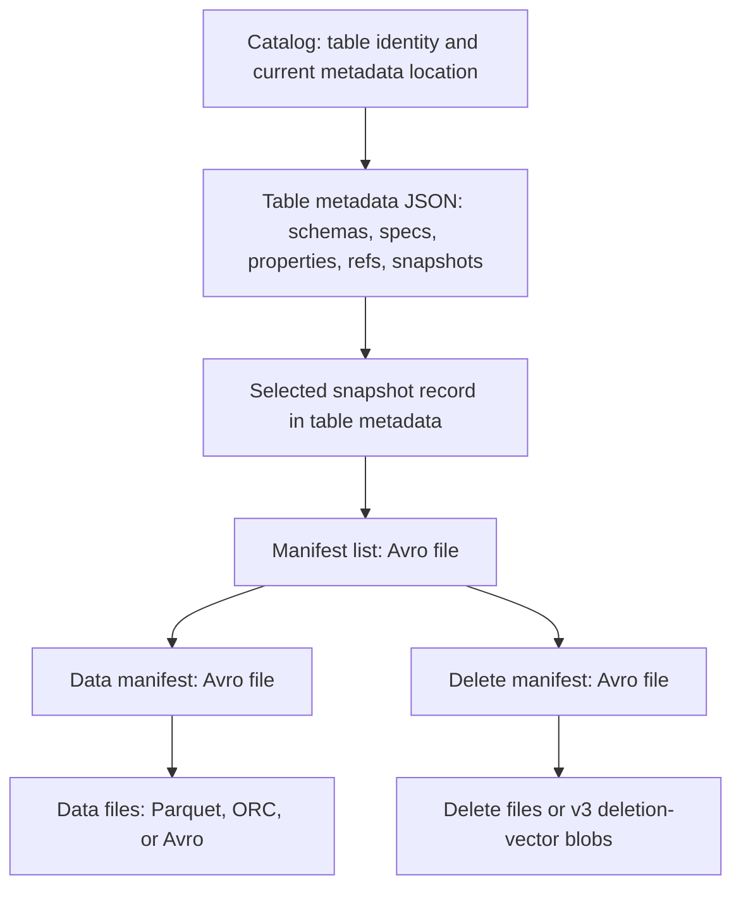

# Apache Iceberg: Data Engineer Interview Guide

Documentation reviewed: 2026-10-21. Engine capabilities can change between releases.

Imagine a job writes new Parquet files, then fails before publishing its result. Which files should a reader treat as part of the table? Iceberg answers that question by adding a transactional table structure to lake files: it defines membership, helps readers find the right files, and lets writers publish a consistent new state. Spark, Flink, Trino, and other engines still execute the work. [Iceberg introduction](https://iceberg.apache.org/docs/latest/)

**A useful interview answer:** “Parquet describes a file; Iceberg describes a table made from files. Iceberg combines versioned metadata, snapshots, and atomic commits to support reliable writes, schema and partition evolution, and efficient reads.”

This guide covers table format versions **v1, v2, and v3**. A table's format version is different from an Iceberg library version, Spark version, or Athena engine version. Engine support must be checked separately.

SQL examples use **Spark SQL with Iceberg SQL extensions and a configured catalog named `lake`**. The namespace is `interview`. Examples are independent teaching examples, not a script to run in order. Replace example snapshot IDs and retention cutoffs with values appropriate to your table. The examples have not been executed against a cluster. [Spark configuration](https://iceberg.apache.org/docs/latest/spark-configuration/)

## Contents

1. [Architecture & Metadata](#1-architecture--metadata)
2. [Partitioning & Data Layout](#2-partitioning--data-layout)
3. [Transactions & Concurrency](#3-transactions--concurrency)
4. [Read & Write Operations](#4-read--write-operations)
5. [Snapshots & Time Travel](#5-snapshots--time-travel)
6. [Maintenance & Optimization](#6-maintenance--optimization)
7. [Catalogs & Integrations](#7-catalogs--integrations)
8. [Production & Advanced Topics](#8-production--advanced-topics)

## 1. Architecture & Metadata

### Table format vs. file format

A Parquet file can tell a reader how its columns are encoded. It cannot, by itself, tell the reader whether a failed job committed that file or whether a newer job replaced it. Understanding Iceberg starts with separating file contents from table state, then identifying who stores, publishes, and executes that state.

| Layer | Responsibility | Example |
| --- | --- | --- |
| File format | Encodes rows, columns, compression, and file-level structures | Parquet, ORC, Avro |
| Table format | Defines table membership, evolution, snapshots, and commit rules | Iceberg |
| Catalog | Resolves table identities and coordinates publication of table metadata | REST catalog, Glue, Hive Metastore |
| Compute engine | Plans and executes SQL, scans, shuffles, and writes | Spark, Flink, Trino |
| Storage | Persists data and metadata objects | Object storage or a filesystem |

A directory of Parquet files alone does not say whether a failed job's files are committed, whether another job replaced them, or which files represented yesterday's table. Iceberg supplies that table state. It still relies on an engine for execution and a suitable catalog/storage implementation for commit correctness. [Iceberg introduction](https://iceberg.apache.org/docs/latest/)

### Catalog, metadata files, manifest lists, manifests, data files

For the v1–v3 layout, follow the metadata references downward:



| Object | What it contains |
| --- | --- |
| Catalog entry | The table's authoritative metadata location, with catalog-specific commit coordination |
| Table metadata JSON | Table UUID, schemas, partition specs, sort orders, properties, snapshots, and named snapshot references |
| Snapshot record | Snapshot ID, parent ID, timestamp, operation summary, and manifest-list location |
| Manifest list | Manifest locations, partition summaries, and manifest-level counts |
| Manifest | File paths, partition tuples, record counts, column metrics, and file tracking information |
| Data file | Stored table rows |
| Delete information | Row removals that readers apply to relevant data files |

A snapshot is a logical table state described by metadata; it is not a complete physical copy. Unchanged files and manifests can be shared by many snapshots. A snapshot record is held in table metadata, rather than requiring a separate “snapshot JSON” file. [Iceberg terminology](https://iceberg.apache.org/terms/)

### Snapshots, snapshot references, metadata versioning

Keep three ideas separate:

- **Metadata version:** a newly committed table metadata state. A schema or property change can create one without creating a data snapshot.
- **Snapshot:** a particular set of table data and applicable deletes. Snapshot IDs are opaque identifiers, not sortable version counters.
- **Snapshot reference:** a name pointing to a snapshot. A branch tracks a writable lineage; a tag names a retained point in history.

For example, adding a column changes metadata while the current data snapshot may stay the same. Appending records publishes a new snapshot. Rolling back changes the current reference to an existing snapshot; it does not copy its rows into new files. [Table specification](https://iceberg.apache.org/spec/), [branching and tagging](https://iceberg.apache.org/docs/latest/branching/)

### Metadata tree and query planning

For a query filtering `event_ts` and `customer_id`, planning proceeds approximately as follows:

1. Resolve the table through its catalog and select a snapshot.
2. Project the row predicate onto the applicable partition transforms.
3. Use manifest-list partition summaries to eliminate irrelevant manifests.
4. Read surviving manifests and use partition values and column metrics to eliminate files.
5. Plan scan tasks and attach applicable delete information.
6. Read selected columns and apply remaining predicates and deletes.

This avoids discovering table membership through directory listings. The metadata tree enables pruning before data files are opened; the file reader may then skip Parquet row groups or pages. A poorly organized table can still have expensive planning. [Scan planning and filtering](https://iceberg.apache.org/docs/latest/performance/)

**Interview check:** Why does Iceberg help a table with millions of files? It makes file membership explicit and uses hierarchical metadata to avoid examining every object for every query. Small files and fragmented metadata still need maintenance.

## 2. Partitioning & Data Layout

### Hidden partitioning and partition transforms

A user filtering orders by `event_ts` should not have to remember an extra partition-date condition just to make the query efficient. **Hidden partitioning** derives partition values from ordinary columns and lets users filter those original columns. Iceberg uses the declared transform to derive a safe partition filter. The table below uses a day transform over the event timestamp. [Partitioning](https://iceberg.apache.org/docs/latest/partitioning/)

```sql
CREATE TABLE lake.interview.orders (
    order_id BIGINT,
    customer_id BIGINT,
    event_ts TIMESTAMP,
    amount DECIMAL(18, 2),
    status STRING,
    source_seq BIGINT
)
USING iceberg
PARTITIONED BY (days(event_ts))
TBLPROPERTIES ('format-version' = '2');

SELECT order_id, amount
FROM lake.interview.orders
WHERE event_ts >= TIMESTAMP '2026-10-01 00:00:00'
  AND event_ts < TIMESTAMP '2026-10-02 00:00:00';
```

The query can prune daily partitions through `event_ts`. There is no user-maintained `event_date` column to keep synchronized. Partition metadata is authoritative; directory naming is not the table's partition definition.

| Transform | Purpose | Tradeoff |
| --- | --- | --- |
| Identity | Keep the source value | High-cardinality values can create too many partitions |
| Year/month/day/hour | Group temporal values | Finer granularity increases partition and file counts |
| `bucket(N, column)` | Map values to a bounded number of hash buckets | Useful for equality predicates; generally weak for ranges |
| `truncate(W, column)` | Group numeric ranges or string prefixes | Coarser groups reduce selectivity |

Spark accepts temporal expressions such as `days(event_ts)`; other engines may use different SQL spellings. A bucket partition is not a general-purpose row index and does not guarantee that a join avoids shuffling. [Spark partition DDL](https://iceberg.apache.org/docs/latest/spark-ddl/)

### Partition evolution

Suppose daily partitions become too large:

```sql
ALTER TABLE lake.interview.orders
REPLACE PARTITION FIELD days(event_ts) WITH hours(event_ts);
```

New writes use the new spec. Historical files keep their original layout, and planning handles both specs. Evolution changes metadata without eagerly rewriting history. Rewriting old data is a separate optimization. [Partition evolution](https://iceberg.apache.org/docs/latest/evolution/)

**Practical consequence:** dynamic partition overwrite is defined by partition boundaries. Changing those boundaries can change which records a later overwrite replaces. For stable business semantics, express the intended row predicate and use a supported operation that validates it.

### Schema evolution and field IDs

Iceberg identifies fields by stable IDs, including nested fields. Renaming or reordering a column preserves its identity. Dropping `status` and later adding another column named `status` creates a new identity; old values must not silently reappear. [Schema evolution](https://iceberg.apache.org/docs/latest/evolution/)

```sql
ALTER TABLE lake.interview.orders
RENAME COLUMN amount TO total_amount;

ALTER TABLE lake.interview.orders
ADD COLUMN currency STRING;
```

Supported type promotions preserve values, such as `int` to `long`, `float` to `double`, or increasing decimal precision while keeping its scale. Arbitrary narrowing or incompatible conversions require a different migration strategy. Added optional columns normally read as null in old files unless an applicable default is defined. A dropped column's bytes can remain in historical files until retention and cleanup remove them. [Schemas and type compatibility](https://iceberg.apache.org/docs/latest/schemas/)

### Sort orders, clustering, and file sizing

Partitioning chooses groups. Sorting or clustering places related values near each other within the physical layout, improving the usefulness of file bounds.

```sql
ALTER TABLE lake.interview.orders
WRITE ORDERED BY customer_id, event_ts;
```

This establishes a write sort order; it does not immediately sort historical files. Apply the desired layout through subsequent writes or a supported rewrite. A table sort order also does not replace `ORDER BY` in a query. [Sort-order DDL](https://iceberg.apache.org/docs/latest/spark-ddl/)

For example, if every file contains customers across the full customer-ID range, `customer_id = 42` may skip little data. Files clustered into narrower ranges can make the same predicate selective without creating one partition per customer.

File size balances object-open overhead, parallelism, memory, and rewrite cost. `write.target-file-size-bytes` is a target, not a guarantee: a Spark task cannot combine data from other tasks into its output file, and files cannot cross partition boundaries. Compression and sparse partitions also produce smaller files. [Spark file sizing](https://iceberg.apache.org/docs/latest/spark-writes/#controlling-file-sizes)

### Partition pruning and metadata-based data skipping

Partition pruning excludes incompatible partition values. File-level data skipping uses metrics such as lower/upper bounds and null counts. A file whose `customer_id` bounds are `[100, 200]` cannot satisfy `customer_id = 42`.

These are conservative exclusions. Overlapping bounds mean “possibly matches,” not “definitely contains a matching row.” Missing or truncated statistics can reduce pruning effectiveness without changing query correctness. [Data filtering](https://iceberg.apache.org/docs/latest/performance/#data-filtering)

**Interview check:** Why not partition by every commonly filtered column? The combinations can create many sparse partitions and small files. Choose partition granularity from data volume and access patterns; use clustering and statistics for additional selectivity.

## 3. Transactions & Concurrency

### ACID transactions and atomic commits

A writer may produce several data and metadata files before it can publish an update. Readers need a coherent table state throughout that work, and competing writers need a safe way to publish their changes. Iceberg's transaction guarantees describe that table boundary; the catalog and storage implementation are part of making it work.

| Property | Meaning for an Iceberg table |
| --- | --- |
| Atomicity | A committed state exposes all changes in the operation together |
| Consistency | Validated metadata and file references describe a coherent table state |
| Isolation | Readers use a stable snapshot; write validation controls concurrent-operation guarantees |
| Durability | Committed metadata and referenced objects persist through the storage system |

Writers first produce new immutable files and metadata, then publish the new metadata state through an atomic catalog operation. Files written before publication are not automatically part of the table. Failed writes can leave orphan files. Readers already using an older snapshot continue to use its files. [Reliability](https://iceberg.apache.org/docs/latest/reliability/)

The normal guarantee is scoped to one table. Multi-table atomicity requires explicit catalog and engine support; it does not follow from making two separate Iceberg commits. REST defines an optional multi-table transaction endpoint, but server support and client use must both be verified. [REST catalog protocol](https://iceberg.apache.org/docs/latest/rest-protocol/)

### Optimistic concurrency control

Iceberg generally lets writers prepare changes concurrently, then validates them at commit:

```text
Writer A loads metadata M0 and prepares append A.
Writer B loads metadata M0 and prepares append B.
A publishes M1 using M0 as its expected base.
B's attempt using M0 fails because the base changed.
B refreshes, validates its operation, and can publish M2 containing A and B.
```

A compatible append can often reuse its data files during a retry. A rewrite cannot safely remove files that another operation already replaced. This is why a pointer conflict and a conflicting data operation require different responses. [Concurrent writes and retry validation](https://iceberg.apache.org/docs/latest/reliability/#concurrent-write-operations)

### Snapshot isolation and serializable isolation

Do not confuse **a reader's consistent snapshot** with **the isolation level used to validate a modifying operation**.

- Under **snapshot isolation**, a modifying operation works from its starting snapshot and validates required files and conflicting changes. It can allow concurrent additions that would match its predicate.
- Under **serializable isolation**, stronger predicate validation can reject those additions, preventing a result that cannot be explained by a serial ordering of the supported operations.

Consider a merge that inserts key `42` when absent. Two writers may both see that key as absent. Under a weaker validation policy, both can potentially insert it. Serializable validation can reject overlapping additions, depending on the engine and operation. Neither Iceberg identifier fields nor an unenforced primary-key declaration provide a universal uniqueness constraint.

Iceberg Spark properties include `write.delete.isolation-level`, `write.update.isolation-level`, and `write.merge.isolation-level`; the documented defaults are `serializable`. Other engines can impose different behavior. [Isolation configuration](https://iceberg.apache.org/docs/latest/configuration/)

### Concurrent writes, conflict detection, and commit retries

| Situation | Typical handling |
| --- | --- |
| Two compatible appends | Refresh and retry metadata publication |
| Rewrite of disjoint files | May succeed after validation |
| Two operations replace the same file | Validation can fail; recompute from a fresh state |
| Concurrent addition overlaps a serializable operation's predicate | Reject if it violates the operation's assumptions |
| Schema changes invalidate a writer's assumptions | Refresh and rebuild or fail, depending on compatibility |
| Commit response is lost | Determine whether publication succeeded before replaying |

Retry limits and backoff help transient catalog contention. They do not make a stale merge plan valid. On a data validation failure, rerun the logical operation using fresh metadata and a reproducible source batch. On an unknown commit outcome, blindly appending the batch again can duplicate records.

**Interview check:** Does optimistic concurrency mean there are no locks anywhere? No. It describes how writers prepare and validate work. The catalog may use database transactions, conditional updates, or short critical sections to implement atomic publication.

## 4. Read & Write Operations

### Append, overwrite, DELETE, UPDATE, and MERGE

Adding new orders and rebuilding yesterday's orders sound similar until the input is empty or contains duplicate keys. Each write operation defines a different scope of change. Choose it by the intended table effect, then verify the engine's overwrite, matching, and concurrency behavior.

| Operation | Logical effect | Important detail |
| --- | --- | --- |
| Append | Add rows | Does not automatically deduplicate business keys |
| Overwrite | Replace a defined set of existing data | Static, dynamic-partition, and predicate overwrite have different scopes |
| `DELETE` | Remove matching rows | Can remove whole files through metadata when all rows qualify |
| `UPDATE` | Replace values in matching rows | Implemented through replacement data and/or delete information |
| `MERGE` | Apply conditional inserts, updates, and deletes | Match semantics and source uniqueness matter |

In Spark, a **static partition overwrite** replaces the scope selected by its partition clause; without a restricting clause, that can mean the whole table. A **dynamic partition overwrite** replaces only partitions represented in the incoming rows. A **predicate overwrite** replaces data selected by an explicit condition through a supported API. Dynamic overwrite is therefore not “replace this business-day range”: missing output for a partition can leave its previous contents intact. Verify both the intended scope and how empty output is handled. [Overwrite behavior](https://iceberg.apache.org/docs/latest/spark-writes/#overwrite-behavior)

```sql
INSERT INTO lake.interview.orders
VALUES (1, 42, TIMESTAMP '2026-10-01 09:00:00', 100.00, 'NEW', 1);

UPDATE lake.interview.orders
SET status = 'PAID'
WHERE order_id = 1;

DELETE FROM lake.interview.orders
WHERE order_id = 1;
```

For a merge, assume `orders_changes` is a prepared source relation containing the table columns plus `op`, with one applicable record per `order_id`:

```sql
MERGE INTO lake.interview.orders t
USING orders_changes s
ON t.order_id = s.order_id
WHEN MATCHED AND s.op = 'D' THEN DELETE
WHEN MATCHED AND s.op <> 'D' THEN
  UPDATE SET
    customer_id = s.customer_id,
    event_ts = s.event_ts,
    amount = s.amount,
    status = s.status,
    source_seq = s.source_seq
WHEN NOT MATCHED AND s.op <> 'D' THEN
  INSERT (order_id, customer_id, event_ts, amount, status, source_seq)
  VALUES (s.order_id, s.customer_id, s.event_ts, s.amount, s.status, s.source_seq);
```

This demonstrates operation semantics, not a complete out-of-order CDC policy. Multiple source records that modify the same target row can make a merge fail; resolve source ordering first. A broad overwrite can remove more data than intended, so verify its replacement scope explicitly. [Spark writes](https://iceberg.apache.org/docs/latest/spark-writes/)

### Copy-on-Write vs. Merge-on-Read

| Dimension | Copy-on-Write (COW) | Merge-on-Read (MOR) |
| --- | --- | --- |
| Modification | Rewrite affected data files with their surviving/updated rows | Write delete information and any replacement rows |
| Immediate write cost | Can be high for sparse changes | Often lower when few rows change |
| Read cost | Less outstanding delete application | Readers merge base data with applicable deletes |
| Maintenance need | File sizing and layout still matter | Delete accumulation adds maintenance pressure |
| Good fit | Read-heavy workloads with less frequent changes | Frequent changes where readers support the delete representation |

If ten rows change across ten large files, COW may rewrite all ten files. MOR can avoid that immediate rewrite, but subsequent readers must apply deletes, and later compaction can pay the rewrite cost.

Spark exposes separate `write.delete.mode`, `write.update.mode`, and `write.merge.mode` properties. Setting them does not force every engine to use the same strategy. [Write-mode properties](https://iceberg.apache.org/docs/latest/configuration/)

### Position deletes, equality deletes, and deletion vectors

| Representation | How it identifies a removed row | Main consequence |
| --- | --- | --- |
| Position delete, v2 | Data-file path plus zero-based row position | Writer must identify physical rows |
| Equality delete, v2/v3 | Matching values for specified field IDs | Can delete by key without first locating row positions |
| Deletion vector, v3 | Bitmap of deleted positions for one referenced data file | Compact positional representation stored in Puffin |

Deletes are scoped by partition/file applicability and sequence rules; an equality delete is not an eternal prohibition on inserting that key. In v2, equality deletes apply to eligible older data sequence numbers; position deletes can also apply at the same data sequence number.

V3 writers use deletion vectors instead of adding new position-delete files. A snapshot has at most one vector per data file, with existing positional removals merged when updating that vector. Existing v2 position deletes remain readable after upgrade and must be incorporated when a vector is created for the affected file. Equality deletes remain valid in v3. [Delete formats and sequence rules](https://iceberg.apache.org/spec/#delete-formats)

### Write distribution modes and write amplification

Spark's `write.distribution-mode` influences how rows reach write tasks:

- **`none`:** the writer requests no automatic distribution; input must meet its ordering requirements, or use a supported fanout writer.
- **`hash`:** distribute by partition values, commonly reducing scattered writes.
- **`range`:** distribute ranges using partition/sort columns, paying more shuffle work for ordered output.

Distribution does not guarantee a precise file count or target size. Fanout can avoid sorting in some streaming writes while keeping more writers and file handles open. [Write distribution](https://iceberg.apache.org/docs/latest/spark-writes/#writing-distribution-modes)

**Write amplification** is physical data written relative to logical data changed. COW can amplify sparse updates; MOR shifts some work into reads and maintenance. Measure ingestion, rewrites, metadata, and storage together rather than comparing only the initial write duration.

**Interview check:** Does an update edit a Parquet row in place? No. A new committed table state references replacement files and/or delete information. Existing files remain available to snapshots that still need them.

## 5. Snapshots & Time Travel

### Snapshot lifecycle and lineage

To ask what a table looked like before the latest correction, you need an identity for its earlier state. A data-changing commit normally creates a **snapshot** with a parent. Branches can form separate lineages, while rollback changes the current snapshot. Snapshot IDs identify states; the sequence numbers in v2 and v3 order table changes and help determine which deletes apply.

```text
S1 --> S2 --> S3        main
        \--> S4         staging
```

Both branches may reuse files from S2. Removing one snapshot does not imply that all its files can be removed: another retained snapshot may still reference them. [Snapshot references and retention](https://iceberg.apache.org/docs/latest/branching/)

### Time travel, rollback, branching, and tagging

| Operation | Purpose | Does it change current data visibility? |
| --- | --- | --- |
| Time-travel query | Read a historical state | No |
| Rollback | Move a branch/current reference back to an existing ancestor | Yes, for that reference |
| Branch | Maintain an independent writable snapshot lineage | Only when that branch is changed or published |
| Tag | Name a historical snapshot for retention and lookup | No |

```sql
SELECT * FROM lake.interview.orders
VERSION AS OF 123456789;

SELECT * FROM lake.interview.orders
TIMESTAMP AS OF '2026-10-01 12:00:00';
```

A timestamp query resolves to a suitable historical snapshot; it does not reconstruct row-by-row state between commits. Schema selection differs between snapshot-ID/time-travel reads and branch reads, so specify it when reproducibility matters. [Time-travel queries](https://iceberg.apache.org/docs/latest/spark-queries/#time-travel-queries-with-sql)

```sql
CALL lake.system.rollback_to_snapshot(
    table => 'interview.orders',
    snapshot_id => 123456789
);

ALTER TABLE lake.interview.orders
CREATE BRANCH staging;

ALTER TABLE lake.interview.orders
CREATE TAG month_end AS OF VERSION 123456789;
```

Use an existing ancestor ID for `rollback_to_snapshot`. These examples change references, not individual rows. A write-audit-publish workflow can write to a branch, validate it, and publish through an appropriate procedure. A fast-forward requires ancestry; it is not an arbitrary row-level merge. Table branches share table-level schema rather than owning independent schemas. [Snapshot procedures](https://iceberg.apache.org/docs/latest/spark-procedures/), [branch and tag DDL](https://iceberg.apache.org/docs/latest/spark-ddl/)

### Snapshot expiration and retention policies

Retention should cover recovery objectives, audits, long-running readers, and the maximum lag of incremental consumers. References can protect snapshots; branches also define history-retention settings. Policies take effect when expiration runs, rather than physically deleting files at a wall-clock deadline. [Branch retention](https://iceberg.apache.org/docs/latest/branching/)

Expiration removes eligible snapshots and can delete files no retained snapshot needs. A tag can therefore retain substantial storage. An active query does not universally register a retention lease, so an aggressive cleanup can break a long-running reader. [Snapshot maintenance](https://iceberg.apache.org/docs/latest/maintenance/)

### Incremental reads and change data capture

An incremental **append scan** reads added data over a snapshot range, commonly with an exclusive start and inclusive end:

```python
added_rows = (
    spark.read.format("iceberg")
    .option("start-snapshot-id", "123456789")
    .option("end-snapshot-id", "987654321")
    .load("lake.interview.orders")
)
```

This is not a complete stream of inserts, updates, and deletes. The documented Spark incremental interface is append-oriented and does not support all snapshot operations. Snapshot IDs must describe a valid retained range on the intended lineage. [Incremental reads](https://iceberg.apache.org/docs/latest/spark-queries/#incremental-read)

For CDC, distinguish the database's source change log from changes reconstructed from an Iceberg table. Spark's `create_changelog_view` can expose row changes, remove unchanged carry-over rows from COW rewrites, and infer update pairs using identifier columns. Supported delete representations and runtime versions still constrain what can be reconstructed. Row lineage alone does not supply every before-image. [Changelog views](https://iceberg.apache.org/docs/latest/spark-procedures/#create_changelog_view)

**Interview check:** Why isn't comparing added and removed files sufficient for business CDC? A rewrite can move unchanged rows into different files. File changes describe physical work; business CDC needs logical row changes.

## 6. Maintenance & Optimization

### Data-file compaction and manifest rewriting

A table can remain correct while becoming expensive to plan or read. Many small data files, fragmented metadata, accumulated delete information, and retained history are different sources of overhead. Maintenance is most useful when it targets the one you have measured; the operations below are not interchangeable cleanup commands.

| Maintenance | Changes | Intended benefit |
| --- | --- | --- |
| Data-file rewrite/compaction | Replaces selected data files | Fewer small files, better layout, application of relevant deletes |
| Manifest rewrite | Reorganizes file metadata | Less metadata overhead and better planning locality |
| Position-delete rewrite | Consolidates eligible delete files and removes dangling entries | Less delete-processing overhead |
| Snapshot expiration | Removes eligible historical states | Controls history and releases unreachable files |
| Orphan-file removal | Finds sufficiently old unreferenced objects | Cleans failed/staged write leftovers |

Data compaction creates replacement files; manifest rewriting reorganizes metadata. They solve different bottlenecks. Position-delete cleanup is also distinct from applying deletes to data files. [Maintenance operations](https://iceberg.apache.org/docs/latest/maintenance/)

```sql
CALL lake.system.rewrite_data_files(
    table => 'interview.orders'
);

CALL lake.system.rewrite_manifests(
    table => 'interview.orders'
);
```

These operations consume compute and can contend with modifying writes. A rewrite creates a new committed state; historical files can remain physically present until retention permits cleanup. [Rewrite procedures](https://iceberg.apache.org/docs/latest/spark-procedures/)

### Snapshot expiration and orphan-file removal

Do not delete storage objects simply because their filenames look old. They may support retained snapshots, tags, or a write in progress.

```sql
CALL lake.system.expire_snapshots(
    table => 'interview.orders',
    older_than => TIMESTAMP '2026-10-01 00:00:00',
    retain_last => 10
);

CALL lake.system.remove_orphan_files(
    table => 'interview.orders',
    dry_run => true
);
```

The expiration cutoff above is illustrative and destructive if applied. Set it from the actual recovery and consumer requirements. Orphan removal has a dry-run mode; inspect candidates before enabling deletion. Its age threshold must exceed the longest possible in-flight write, including retries and recovery. Use a table-owned location and account for equivalent URI schemes/authorities to avoid misclassifying referenced files. [Cleanup procedures](https://iceberg.apache.org/docs/latest/spark-procedures/)

### Metadata growth and planning overhead

Frequent micro-batches produce snapshots, manifests, and metadata versions even when they add little data. More retained history increases metadata and storage pressure; many tiny manifests can increase planning overhead.

Tune commit frequency together with freshness, compact files based on observed size distribution, and rewrite manifests when planning metrics justify it. Snapshot retention and old metadata-JSON retention are separate controls. Properties such as `write.metadata.delete-after-commit.enabled` and `write.metadata.previous-versions-max` manage previous metadata files, not a replacement for snapshot expiration. [Streaming maintenance](https://iceberg.apache.org/docs/latest/spark-structured-streaming/#maintenance-for-streaming-tables), [metadata retention](https://iceberg.apache.org/docs/latest/maintenance/#remove-old-metadata-files)

### Read/write performance and delete-file accumulation

Diagnose the phase before choosing maintenance:

| Observation | Investigate | Possible response |
| --- | --- | --- |
| Long delay before scan tasks start | Planning duration, manifests scanned, catalog latency | Improve metadata layout or resolve catalog bottleneck |
| Many short scan tasks and object opens | File count and size distribution | Compact small files |
| Many bytes read for selective predicates | Partition filters, bounds, sort layout | Improve clustering or partition strategy |
| MOR scans get slower over time | Applicable delete files/entries and deleted-row density | Consolidate deletes or rewrite affected data |
| Writes spend most time shuffling | Distribution, skew, partition cardinality | Adjust write layout and task sizing |

Compare these measurements on the same query and data scope. Compaction will not fix a missing filter; changing partition metadata alone will not reorganize historical files. [Scan and commit metrics](https://iceberg.apache.org/docs/latest/metrics-reporting/)

**Interview check:** Why is deleting every “unused” file immediately unsafe? A file may still be needed by history, an active reader, or an unfinished writer. Snapshot reachability and a conservative age threshold address different parts of that problem.

## 7. Catalogs & Integrations

### REST, Hive, Glue, JDBC, and Nessie catalogs

Two writers can safely publish to the same table only if they agree on how publication is coordinated. That makes the **catalog** part of the table's correctness path, beyond its role in resolving names. When choosing a catalog, inspect its commit mechanism and the requirements every writer must satisfy.

| Catalog | What it provides | Operational consideration |
| --- | --- | --- |
| REST | A common HTTP catalog protocol backed by a server implementation | Authentication, capabilities, credentials, and server guarantees vary |
| Hive | Table registration and metadata pointers in Hive Metastore | Requires a compatible metastore and commit coordination |
| Glue | AWS catalog integration and version-based optimistic locking | All writers need compatible Glue coordination and permissions |
| JDBC | Catalog state in a relational database | Requires suitable atomic database transactions |
| Nessie | Versioned catalog state with Git-like branches and tags | Catalog-wide references differ from table snapshot references |

REST describes an API, not a particular storage backend. JDBC stores catalog records; it does not move table rows into that database. Using HiveCatalog does not turn Iceberg partition tracking into Hive directory discovery. [REST protocol](https://iceberg.apache.org/docs/latest/rest-protocol/), [Hive catalog integration](https://iceberg.apache.org/docs/latest/hive/), [JDBC catalog](https://iceberg.apache.org/docs/latest/jdbc/)

Glue commits use a table version to prevent stale writers from overwriting a newer metadata pointer. Nessie can coordinate catalog-level changes across tables when the integration uses its transaction model; two independent engine statements are not automatically one transaction. [Glue locking](https://iceberg.apache.org/docs/latest/aws/#optimistic-locking), [Nessie integration](https://iceberg.apache.org/docs/latest/nessie/)

### Spark, Flink, Trino, and Athena integration

| Engine | Typical role | What to verify |
| --- | --- | --- |
| Spark | Batch transforms, row-level operations, maintenance | Matching runtime artifact, catalog, SQL extensions, and write modes |
| Flink | Continuous ingestion and upserts | Checkpointing/recovery, sink version, equality fields, and partition constraints |
| Trino | Interactive SQL and supported modifications | Connector version, catalog type, format/delete support, and procedure syntax |
| Athena | Managed SQL over cataloged Iceberg data | AWS-documented format support, Glue locking, and supported DML semantics |

The Flink sink documents exactly-once behavior with checkpoint/recovery integration. For partitioned upserts, equality fields must include the partition source columns; that can affect how you model keys and partition changes. [Flink writes](https://iceberg.apache.org/docs/latest/flink-writes/)

Trino exposes its own connector configuration and SQL procedures. Spark's `CALL lake.system...` examples are not portable Trino syntax. [Trino Iceberg connector](https://trino.io/docs/current/connector/iceberg.html)

Athena documents support for v2 tables and Glue optimistic locking. Its row-level updates/deletes use MOR with position deletes and snapshot isolation; Spark's COW and isolation properties do not override that engine behavior. Check its current limitations before sharing a table with v3 writers. [Athena Iceberg support](https://docs.aws.amazon.com/athena/latest/ug/querying-iceberg.html), [Athena updates](https://docs.aws.amazon.com/athena/latest/ug/querying-iceberg-updating-iceberg-table-data.html)

### Object storage, consistency, and commit coordination

Object storage holds immutable data and metadata objects. The catalog coordinates publication of the new authoritative table state. Strong object read/list consistency does not by itself provide a conditional transaction over the table's current metadata pointer.

A failure before publication leaves invisible objects; a failure after successful publication may leave the client uncertain whether its commit succeeded. Recovery must distinguish these cases. Do not assume that filesystem rename-based coordination works on every object store. [Commit reliability](https://iceberg.apache.org/docs/latest/reliability/)

### Catalog interoperability and engine compatibility

Two engines can safely share a table only when they agree on the same authoritative table registration, commit coordination, object access, and supported table features. Registering identical files independently in two mutable catalogs creates separate authorities that can diverge.

Before enabling a feature, check every required reader and writer for its format version, data types, delete representation, schema/partition evolution, and catalog authentication support. A generic “supports Iceberg” claim is insufficient. [Spark catalog integration](https://iceberg.apache.org/docs/latest/spark-configuration/), [Trino compatibility](https://trino.io/docs/current/connector/iceberg.html)

**Interview check:** Can Spark read the table but still be an unsafe writer? Yes. Reading metadata does not prove that its catalog configuration and commit mechanism coordinate correctly with other writers.

## 8. Production & Advanced Topics

### Streaming ingestion, CDC, and idempotent writes

An append can be atomic and still add the same business event twice after a retry. To design reliable CDC into Iceberg, separate three requirements: delivery guarantees, business-key uniqueness, and applying events in source order. The table commit addresses a publication boundary; the pipeline must still define how replayed and out-of-order changes become the intended rows.

A practical CDC design should define:

1. A stable business key and source ordering token, such as a log sequence plus a deterministic tie-breaker.
2. How to reduce multiple events for one key while preserving the required business semantics.
3. A rule that prevents an older event from overwriting a newer applied state.
4. Durable checkpoint/batch identity and recovery behavior for an unknown commit outcome.
5. Delete handling, including protection against an old insert resurrecting a physically deleted key.

For the last case, retain tombstones or a separate durable high-water mark where necessary. A simple merge condition like `s.source_seq > t.source_seq` protects an existing row but cannot compare against a target row that has already been deleted. This is a design implication, not a uniqueness guarantee supplied by Iceberg.

Spark `foreachBatch` pipelines need their own replay-safe logic. Native streaming sinks and Flink checkpoint integration have specific recovery contracts; resetting checkpoint identity can change their guarantees. Spark's append-oriented streaming source does not turn skipped overwrite/delete snapshots into CDC events. [Spark streaming](https://iceberg.apache.org/docs/latest/spark-structured-streaming/), [Flink sink guarantees](https://iceberg.apache.org/docs/1.10.1/flink-writes/)

### Concurrent MERGE operations and conflict troubleshooting

Two merges on different keys can still touch the same data file. Large COW files and broad predicates can enlarge the conflict domain. MOR changes the physical work but does not remove all validation conflicts.

Use this diagnostic sequence:

1. Capture the engine/connector versions, catalog, starting snapshot, operation mode, and isolation level.
2. Classify the failure: stale catalog commit, data validation conflict, or unknown commit outcome.
3. Identify overlapping files/predicates and concurrent maintenance or writers.
4. Check source determinism and uniqueness before replaying the operation.
5. Retry publication for a compatible metadata conflict; replan the operation for a data conflict.

To reduce repeated conflicts, assign non-overlapping work, make predicates selective without changing merge correctness, or serialize hot-key workloads. Do not add a partition predicate that hides an existing matching key merely to improve pruning: it can cause an unintended insert.

**Example:** jobs for different customers may conflict because both rewrite one mixed-customer file. Better clustering can reduce overlap; a blind increase in commit retries cannot restore a file already replaced by another job.

### Metadata tables, observability, and recovery

Metadata tables expose the table's internal state through the engine:

```sql
SELECT committed_at, snapshot_id, parent_id, operation
FROM lake.interview.orders.snapshots
ORDER BY committed_at DESC;

SELECT * FROM lake.interview.orders.history;
SELECT * FROM lake.interview.orders.refs;
SELECT * FROM lake.interview.orders.metadata_log_entries;

SELECT content, COUNT(*) AS file_count,
       SUM(file_size_in_bytes) AS total_bytes
FROM lake.interview.orders.files
GROUP BY content;

SELECT * FROM lake.interview.orders.manifests;
SELECT * FROM lake.interview.orders.partitions;
```

`snapshots` lists retained states; `history` shows when snapshots became current. `refs` shows named references, and `metadata_log_entries` helps inspect metadata versions. `files` describes current file entries, including deletes; `all_*` tables span retained snapshots and can repeat references to a shared file. Physical file record counts do not necessarily equal live row counts after deletes. [Metadata queries](https://iceberg.apache.org/docs/latest/spark-queries/#inspecting-tables)

Monitor planning time separately from scan time, selected/skipped manifests and files, delete overhead, commit attempts, and ingestion freshness. File-size percentiles and bytes retained by historical references often explain storage growth better than the current table's logical size. [Metrics reporting](https://iceberg.apache.org/docs/latest/metrics-reporting/)

For a bad committed write, stop the faulty writer, inspect history, protect the recovery snapshot, and use a supported reference-changing procedure. Rollback cannot restore objects already physically deleted. If a catalog entry is lost, recovery requires identifying a verified committed metadata state and registering it through supported tooling; the newest-looking JSON filename is not proof that a commit succeeded. Avoid hand-editing metadata. [Recovery procedures](https://iceberg.apache.org/docs/latest/spark-procedures/)

### Iceberg v1/v2/v3 differences and row lineage

| Format version | Key capabilities | Interview implication |
| --- | --- | --- |
| v1 | Snapshot-based tables, evolution, atomic file-set changes | Row changes can be achieved through file replacement; no v2 row-level delete files |
| v2 | Position/equality delete files and sequence-based delete applicability | Supports MOR row-level changes in compatible engines |
| v3 | Deletion vectors, row lineage, column defaults, and types such as variant and nanosecond timestamps | Requires compatible readers and writers; upgrade does not rewrite all historical data |

Library releases and table format versions evolve independently. Upgrading a runtime does not mean all tables changed format, and upgrading the table can make it unreadable to an older engine. Treat format upgrades as compatibility changes; do not assume that setting a lower property reverses them. [V3 capabilities in Iceberg Go](https://iceberg.apache.org/blog/apache-iceberg-go-0.6.0-release/), [AWS format upgrade considerations](https://docs.aws.amazon.com/glue/latest/dg/aws-glue-programming-etl-format-iceberg.html)

V3 row lineage tracks `_row_id` and `_last_updated_sequence_number`. Compatible writers preserve identity across rewrites and use sequence metadata to identify changes. These are system tracking fields, not enforced business primary keys. Historical rows after an upgrade may have null lineage values until assigned through the specified mechanisms. Equality-delete upserts generally represent a removal plus a newly identified row rather than preserving the previous row's identity. [Row lineage](https://iceberg.apache.org/spec/#row-lineage)

This helps engines reason about changes but does not independently provide a portable, indefinitely retained CDC feed with before-images. That still depends on the engine's API, operation semantics, and retained history.

### Iceberg vs. Delta Lake

Both are open table formats supporting transactional updates and historical reads. Neither is a query engine or a substitute for physical layout and maintenance.

| Dimension | Iceberg | Delta Lake |
| --- | --- | --- |
| Authoritative table state | Catalog-coordinated metadata with snapshots and manifests | Delta transaction-log protocol, commonly `_delta_log`, with checkpoints; catalog-managed variants also exist |
| Data layout | Hidden partition transforms, partition evolution, sort orders | Partitioned tables and feature-dependent clustering, including liquid clustering |
| Row changes | COW, v2 deletes, v3 deletion vectors, depending on engine | Rewrites and deletion vectors where supported/enabled |
| Change capture | Engine-specific changelog/incremental APIs and v3 lineage | Explicit Change Data Feed feature with retention and compatibility constraints |
| Version compatibility | Table format version plus engine/catalog feature support | Reader/writer protocol requirements and enabled table features |
| Ecosystem decision | Evaluate the required engines and catalog integration | Evaluate the required engines, platform integration, and enabled features |

The log-versus-manifest distinction describes metadata organization; it does not prove that one format is universally faster. Both use optimistic concurrency techniques and need compatible commit coordination. [Delta protocol](https://github.com/delta-io/delta/blob/master/PROTOCOL.md), [Delta concurrency](https://docs.delta.io/concurrency-control/)

Delta CDF is an explicit feature and does not retain every change forever. Liquid clustering is also a specific feature with its own protocol requirements. Avoid claims that “Delta cannot evolve layout” or “only Iceberg works outside one platform.” Compare actual reader/writer support and workload measurements. [Delta CDF](https://docs.delta.io/delta-change-data-feed/), [liquid clustering](https://docs.delta.io/delta-clustering/), [Delta feature compatibility](https://docs.delta.io/versioning/)

**Interview check:** Which format would you choose? Start with the required engines, catalog/governance environment, update and streaming behavior, operational tooling, and compatibility constraints. Then compare representative read/write/maintenance workloads. The format name alone does not answer the question.
