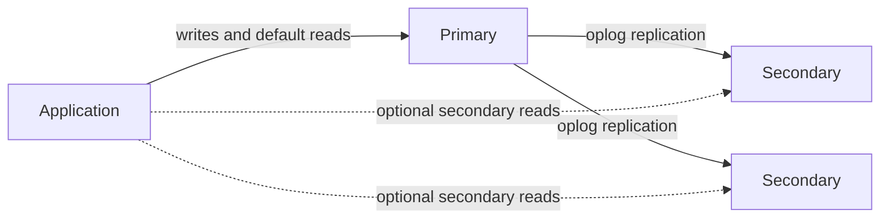
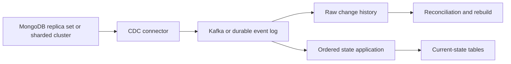

# MongoDB: Data Engineer Interview Guide

Documentation reviewed: 2026-10-25. This guide focuses on MongoDB 8.x concepts for standard replica sets and sharded clusters using WiredTiger. Examples do not target Atlas Infinite, whose storage architecture differs. Check `db.version()`, feature compatibility version, driver compatibility, and the matching server documentation before applying version-sensitive advice.

An application may store an order with nested line items, optional delivery details, and evolving event payloads. MongoDB's document model can suit that shape, but flexibility does not remove the need for deliberate access patterns and data contracts. For a data engineer, the challenge extends beyond querying documents: you need to extract changes without losing data or overwhelming the source, and explain which consistency guarantees a consumer receives.

**A useful interview answer:** “MongoDB stores typed BSON documents. I model documents around access patterns, index the queries that matter, and use replica sets for availability. Sharding distributes data and workload according to a shard key. Consistency depends on read concern, write concern, read preference, and sessions. For analytics ingestion, I combine a coordinated initial load with resumable Change Streams and idempotent downstream processing.” [Data modeling](https://www.mongodb.com/docs/manual/data-modeling/), [Replication](https://www.mongodb.com/docs/manual/replication/)

**Study order:** Document boundaries → indexes → query plans and pipelines → replication and consistency → sharding → transactions → CDC → production troubleshooting.

Most examples use `mongosh` and the disposable `interview_mongodb` database. The transaction example uses PyMongo; the CDC checkpoint example is pseudocode. Replica sets or sharded clusters are required for transactions and Change Streams. Administrative commands require appropriate privileges. Examples are independent where stated and have not been executed against a MongoDB server.

## Contents

1. [Document Model & Schema Design](#1-document-model--schema-design)
2. [Indexes](#2-indexes)
3. [Query Planner, Aggregation & Explain](#3-query-planner-aggregation--explain)
4. [Replica Sets, Elections & Concerns](#4-replica-sets-elections--concerns)
5. [Sharding, Shard Keys & Distribution](#5-sharding-shard-keys--distribution)
6. [Transactions, Consistency & Concurrency](#6-transactions-consistency--concurrency)
7. [Change Streams & CDC Integration](#7-change-streams--cdc-integration)
8. [Performance Tuning & Operational Recovery](#8-performance-tuning--operational-recovery)

## 1. Document Model & Schema Design

### Documents, collections, and BSON

Start with the information the application reads together. MongoDB stores **documents** in collections, and collections in a database. Each document contains named fields with scalar values, nested documents, or arrays. Collections have a flexible schema by default, so documents can differ in fields and types. That puts schema decisions into application and data-platform contracts; the decisions still have to be made.

BSON is a binary, typed representation of documents, with types beyond JSON:

| Type | Typical purpose | Data Engineering concern |
| --- | --- | --- |
| `ObjectId` | Common generated `_id` value | Preserve its identity when exporting; it is not an ordinary string |
| String | Names, codes, external identifiers | Distinguish `"42"` from numeric `42` |
| Int32 / Int64 | Counts and integer identifiers | Avoid precision loss in systems that convert everything to floating point |
| Double | Approximate numeric measurements | Binary floating point is unsuitable for exact decimal accounting |
| Decimal128 | Exact decimal values within its precision | Preserve decimal precision and scale through serialization |
| Date | Application timestamps | UTC milliseconds since the Unix epoch; not a timezone name |
| Timestamp | Internal logical timestamps, including oplog positions | Not interchangeable with application Date values |
| Binary | Bytes and UUID representations | Agree on encoding and UUID representation across clients |
| Document / Array | Nested structures and repeated values | Define how these map to downstream tables |

An `ObjectId` contains a timestamp component but is not a reliable global event-order or CDC checkpoint. Client generation and timestamp resolution matter. Use an explicit business/event timestamp and the CDC mechanism's own position. BSON-aware tools or Extended JSON preserve types that plain JSON cannot represent directly. [BSON types](https://www.mongodb.com/docs/manual/reference/bson-types/)

### A running order example

Run this setup once in a disposable database. It creates the collection used in later query examples.

```javascript
db = db.getSiblingDB("interview_mongodb");

db.createCollection("orders", {
  validator: {
    $jsonSchema: {
      bsonType: "object",
      required: ["tenantId", "status", "createdAt", "items"],
      properties: {
        tenantId: { bsonType: "string" },
        status: { enum: ["pending", "paid", "cancelled"] },
        createdAt: { bsonType: "date" },
        items: { bsonType: "array", minItems: 1 }
      }
    }
  },
  validationLevel: "strict",
  validationAction: "error"
});

db.orders.insertOne({
  _id: "order-1001",
  tenantId: "tenant-7",
  customerId: "customer-42",
  status: "paid",
  createdAt: ISODate("2026-10-24T10:00:00Z"),
  shippingAddress: { city: "Kyiv", country: "UA" },
  items: [
    { sku: "sku-42", quantity: NumberInt(2), unitPrice: Decimal128("19.95") },
    { sku: "sku-99", quantity: NumberInt(1), unitPrice: Decimal128("5.00") }
  ],
  schemaVersion: NumberInt(1)
});
```

This validator illustrates top-level shape checks; it does not validate every nested item or business invariant. A production contract should also validate item fields, numeric bounds, and relevant identifiers. Validation rules can be introduced gradually, but changing rules does not automatically clean up existing invalid data. [Schema validation](https://www.mongodb.com/docs/manual/core/schema-validation/)

### Embedded versus referenced data

Choose the document boundary by asking what is read together, updated together, and allowed to grow together.

| Decision | Embed when | Reference when |
| --- | --- | --- |
| Read pattern | Related values are usually fetched together | Entities are often queried independently |
| Relationship size | Children are bounded and reasonably small | Children can grow indefinitely |
| Lifecycle | Values belong to the parent's lifecycle | Entities have independent lifecycles |
| Updates | One atomic document update fits the operation | Shared data changes frequently across many parents |
| Relationship | Ownership or bounded one-to-few | Large one-to-many or many-to-many |

Order line items and the shipping address captured at purchase often belong inside the order. Reading the order retrieves its purchase-time details, and a single-document update can change several embedded fields atomically. A later customer address change should not necessarily rewrite an old order's historical address. [Embedding](https://www.mongodb.com/docs/manual/data-modeling/embedding/)

The customer itself can live in `customers`, with `customerId` on each order. References avoid copying a changing customer profile into every order. Resolve them in application queries or with `$lookup`; MongoDB does not automatically enforce foreign keys or cascading deletes. Define how dangling references and concurrent lifecycle changes are handled. [Referencing](https://www.mongodb.com/docs/manual/data-modeling/referencing/)

### Document growth and schema evolution

MongoDB's maximum BSON document size is **16 MiB**. A collection can contain far more data; the limit applies to each individual document. Large binary objects can use GridFS when appropriate, or external object storage with references. [Limits](https://www.mongodb.com/docs/manual/reference/limits/)

Avoid a customer document containing an ever-growing array of all orders, or a device document containing its entire telemetry history. Besides eventual size failure, large arrays increase update work and index entries. Store separate records, bounded buckets, or a bounded recent subset plus references to the full history. [Unbounded arrays](https://www.mongodb.com/docs/manual/data-modeling/design-antipatterns/unbounded-arrays/)

For schema evolution, an application-level `schemaVersion` can identify document shapes. Deploy readers that understand old and new shapes, update writers, backfill in bounded batches, and tighten validation after verifying the migration. A downstream contract must distinguish a missing field, explicit `null`, and a value of the wrong type. This rollout sequence is a design pattern, not automatic database behavior.

**Interview question: Why not normalize everything as in a relational database?**

Normalization reduces duplication but can increase lookups and cross-document coordination. Start with read/write patterns, ownership, and bounded growth. Embed a small order aggregate; reference an independently changing customer. Explain the cost of keeping duplicated values correct and whether they represent current state or an intentional historical snapshot.

## 2. Indexes

### How indexes help and what they cost

If an application looks up one order, examining every document is unnecessary work when a suitable index exists. Most ordinary MongoDB indexes use a B-tree structure to store ordered keys and document references. The read benefit has a cost: indexes occupy disk and cache, and inserts, deletes, and indexed-field updates must maintain them. More indexes can therefore improve reads while slowing writes. A normal unsharded collection has a unique default `_id` index. [Indexes](https://www.mongodb.com/docs/manual/indexes/)

Design indexes from actual filters, sorts, projections, and frequency. The fact that a field exists does not justify indexing it. An index on a low-selectivity field can still help a particular sort or partial workload, so “never index booleans” is also too simplistic.

### Compound indexes and the ESR guideline

```javascript
db.orders.createIndex(
  { tenantId: 1, status: 1, createdAt: -1, _id: -1 },
  { name: "tenant_status_recent" }
);

db.orders.find({
  tenantId: "tenant-7",
  status: "paid",
  createdAt: { $gte: ISODate("2026-10-01T00:00:00Z") }
}).sort({ createdAt: -1, _id: -1 }).limit(100);
```

The index orders by tenant, then status, then descending timestamp and identifier. With equality on tenant and status, it supports the requested ordering within that slice. Compound indexes support leading prefixes; skipping an intermediate field can make later bounds or sorting less effective. Matching all sort directions in reverse can also support a reverse scan. Arbitrarily reversing only one sort field generally cannot. [Compound indexes](https://www.mongodb.com/docs/manual/core/indexes/index-types/index-compound/)

**ESR** means Equality → Sort → Range. Equality fields normally lead; sort fields follow when avoiding a blocking sort is important. For a highly selective range, Equality → Range → Sort can examine fewer keys at the cost of sorting. Field ordering among equality predicates need not follow a universal “most selective first” rule. Compare representative plans and workloads. [ESR guideline](https://www.mongodb.com/docs/manual/tutorial/equality-sort-range-guideline/)

### Multikey indexes and array semantics

An index on an array field automatically becomes multikey. For example:

```javascript
db.orders.createIndex({ tenantId: 1, "items.sku": 1 });

db.orders.find({ tenantId: "tenant-7", "items.sku": "sku-42" });
```

One document can produce multiple index entries, so array growth affects index size and write cost. A compound multikey index cannot index two independent array-valued fields in the same document; for example, separate `tags` and `categories` arrays. A unique multikey index constrains keys across documents, not repeated values inside one document. [Multikey indexes](https://www.mongodb.com/docs/manual/core/indexes/index-types/index-multikey/)

When several conditions must match **the same array element**, use `$elemMatch`:

```javascript
db.orders.find({
  tenantId: "tenant-7",
  items: { $elemMatch: { sku: "sku-42", quantity: { $gte: 2 } } }
});
```

Separate predicates on `"items.sku"` and `"items.quantity"` can match different items. `$elemMatch` expresses the relationship correctly and can allow tighter multikey bounds when the index and path structure support it. [Array element matching](https://www.mongodb.com/docs/manual/reference/operator/query/elemmatch/)

### Partial indexes

A partial index includes only documents satisfying `partialFilterExpression`:

```javascript
db.orders.createIndex(
  { tenantId: 1, createdAt: -1 },
  {
    name: "pending_orders_recent",
    partialFilterExpression: { status: "pending" }
  }
);

db.orders.find({ tenantId: "tenant-7", status: "pending" })
  .sort({ createdAt: -1 });
```

This is useful when a small active subset receives frequent queries. MongoDB can use it only when the query implies the partial filter, so using it does not omit valid results. A query for every order in a tenant cannot rely on this index alone. A unique partial index enforces uniqueness only among matching documents. Partial and sparse are different: sparse primarily concerns field presence; partial expresses an explicit predicate. [Partial indexes](https://www.mongodb.com/docs/manual/core/index-partial/)

### TTL indexes

TTL indexes remove expired documents in the background. Use a separate example collection:

```javascript
db.sessions.createIndex({ expiresAt: 1 }, { expireAfterSeconds: 0 });

db.sessions.insertOne({
  _id: "session-1",
  expiresAt: ISODate("2026-10-26T00:00:00Z")
});
```

For ordinary collections, TTL is a **single-field index on a BSON Date field**, or an array of dates. `expireAfterSeconds: 0` means the field contains the expiration time; a positive value expresses an age relative to the indexed date. Compound indexes do not provide TTL behavior, and `_id` cannot be the TTL field.

Expiration is asynchronous. The background monitor runs periodically, and deletion can lag further under load. Missing or unsuitable date values do not expire as intended. Authorization must check whether a session has expired rather than waiting for physical deletion. Creating or shortening TTL over old data can trigger substantial delete traffic. [TTL indexes](https://www.mongodb.com/docs/manual/core/index-ttl/)

### Covered queries and index lifecycle

A covered query obtains its filter and output fields from the index without fetching collection documents. Explicitly exclude `_id` if it is neither needed nor in the index. Coverage also depends on multikey rules and, in sharded execution, shard-key requirements. In `explain`, look for no document-fetch stage and `totalDocsExamined: 0` for a query that actually returns results. [Query optimization and coverage](https://www.mongodb.com/docs/manual/core/query-optimization/)

Inspect `getIndexes()` and `$indexStats`, considering observation duration, restarts, all relevant nodes, and infrequent jobs. A hidden index can test query-planner behavior without dropping the index; it remains maintained and still costs writes. Hidden unique indexes still enforce uniqueness. Do not remove an index merely because one node reports no recent reads. [Hidden indexes](https://www.mongodb.com/docs/manual/core/index-hidden/)

**Interview question: Why did writes slow down after adding indexes?**

Every affected index adds maintenance, journal/storage work, and cache pressure. Check multikey expansion, document growth, and index-build activity. Keep indexes that support measured workloads or required constraints, and verify query regressions before removing overlapping indexes.

## 3. Query Planner, Aggregation & Explain

### Query planning and plan caching

A query that was fast for one tenant may behave differently for another with far more documents. To understand the access path, inspect how MongoDB chooses from eligible plans. Classic multi-planning compares candidate work during a trial; newer versions also have cost-based ranking paths for eligible queries. Plan selection is version- and query-dependent, so avoid assuming one mechanism explains every deployment.

Plans can be cached by query shape, which includes features such as filter, sort, and projection. Parameter skew matters: a shape that is efficient for a tiny tenant may behave differently for a huge tenant. Index changes can invalidate related cache entries. The plan cache stores plans, not result documents. [Query plans](https://www.mongodb.com/docs/manual/core/query-plans/)

### Reading explain output

```javascript
db.orders.find({ tenantId: "tenant-7", status: "paid" })
  .sort({ createdAt: -1, _id: -1 })
  .limit(100)
  .explain("executionStats");
```

| Field or stage | Meaning | What to investigate |
| --- | --- | --- |
| `queryPlanner.winningPlan` | Selected plan | Does it use an appropriate access path? |
| `IXSCAN` | Index scan | Are bounds selective, or is most of the index scanned? |
| `COLLSCAN` | Collection scan | Appropriate for a tiny/full scan, expensive for a selective large query |
| `FETCH` | Reads documents after index access | Expected if output or residual filtering needs document fields |
| `SORT` | Explicit sorting work | Can an index supply the order? Is sorting spilling? |
| `nReturned` | Result count | Interpret together with limits and aggregation stages |
| `totalKeysExamined` | Index keys visited | High values can reveal weak bounds or multikey expansion |
| `totalDocsExamined` | Documents inspected | Compare with useful results and expected selectivity |
| `executionTimeMillis` | Measured server execution time | Compare under similar load/cache conditions |

Read these metrics together; an index scan can still examine most of a collection's keys. [Interpreting explain plans](https://www.mongodb.com/docs/manual/tutorial/analyze-query-plan/)

Stage names and nesting differ between classic execution, slot-based execution, and distributed plans. `queryPlanner` explains planning without the full execution statistics; `executionStats` executes the winning plan; `allPlansExecution` adds trial statistics for candidate plans, not complete execution of every candidate. Explain bypasses the plan cache and does not populate it. It therefore cannot alone prove which cached plan a live request used. [Explain results](https://www.mongodb.com/docs/manual/reference/explain-results/)

As an interpretation exercise, returning 100 orders after examining 100 documents is usually preferable to examining one million documents for the same result. It is not a universal ratio target: an aggregation may correctly read millions of records to return one total. These figures are hypothetical, not benchmark results.

### Aggregation pipeline fundamentals

A pipeline passes documents through ordered stages:

| Stage | Purpose | Common issue |
| --- | --- | --- |
| `$match` | Filter documents | Filtering after expansion does unnecessary work |
| `$project` / `$set` | Shape or derive fields | Type conversion and missing-value semantics |
| `$unwind` | Emit an output per array element | Changes the grain and multiplies rows |
| `$group` | Aggregate by a key | Large intermediate state; output order is unspecified |
| `$sort` / `$limit` | Order and bound results | Blocking sort without a suitable index |
| `$lookup` | Join another collection | Large join fan-out and missing foreign indexes |
| `$setWindowFields` | Window calculations | Partition/sort work and state size |
| `$merge` / `$out` | Write results | Destination permissions, constraints, and rerun semantics |

Each stage has its own semantics and restrictions. [Aggregation stages](https://www.mongodb.com/docs/manual/reference/mql/aggregation-stages/)

For example, compute paid revenue by SKU for one tenant and month:

```javascript
db.orders.aggregate([
  {
    $match: {
      tenantId: "tenant-7",
      status: "paid",
      createdAt: {
        $gte: ISODate("2026-10-01T00:00:00Z"),
        $lt: ISODate("2026-11-01T00:00:00Z")
      }
    }
  },
  { $unwind: "$items" },
  {
    $group: {
      _id: "$items.sku",
      units: { $sum: "$items.quantity" },
      revenue: { $sum: { $multiply: ["$items.quantity", "$items.unitPrice"] } }
    }
  },
  { $sort: { revenue: -1, _id: 1 } },
  { $limit: 10 }
], { allowDiskUse: true });
```

The initial `$match` can use the compound index from section 2. `$unwind` changes the grain from order to line item. With only the sample order, `sku-42` has 2 units and revenue `39.90`; `sku-99` has 1 unit and revenue `5.00`. Summing an order-level total after unwinding would count it once per item and overstate revenue. [Aggregation pipeline](https://www.mongodb.com/docs/manual/core/aggregation-pipeline/)

### Optimization, joins, and memory

Push selective filters before expensive stages when semantics allow. MongoDB can move independent `$match` predicates and coalesce stages, but it cannot move a predicate that depends on a computed value before the computation. Early `$project` solely to reduce field count is often unnecessary because the optimizer already tracks required fields. Index-backed sorting usually needs to occur before stages such as `$group` or `$unwind` change the input. [Pipeline optimization](https://www.mongodb.com/docs/manual/core/aggregation-pipeline-optimization/)

An equality `$lookup` benefits from an index on its foreign join field. Validate join cardinality, missing matches, and whether tenant scoping is required on both sides. A join using only a customer identifier that is unique within a tenant can mix tenants unless the query also includes tenant identity. Sharding does not make a large join free. [Lookup](https://www.mongodb.com/docs/manual/reference/operator/aggregation/lookup/)

Blocking stages such as `$sort` and `$group` may require substantial memory. In MongoDB 8.x, spillable stages that exceed the documented 100 MB threshold may write temporary files according to `allowDiskUseByDefault` and the operation option. `allowDiskUse` does not make every stage spillable or remove every memory limit. Result documents must still respect the 16 MiB BSON limit. [Pipeline limits](https://www.mongodb.com/docs/manual/core/aggregation-pipeline-limits/)

Inspect the actual aggregation plan:

```javascript
db.orders.explain("executionStats").aggregate([
  { $match: { tenantId: "tenant-7", status: "paid" } },
  { $group: { _id: "$customerId", orders: { $sum: 1 } } }
]);
```

**Interview question: A query uses an index but is still slow. Why?**

It may scan too many keys, fetch large documents, perform an unsupported sort, join many rows, scatter across shards, or wait for I/O. Compare examined work, spills, and per-shard behavior. “Uses an index” describes an access path, not sufficient evidence of efficiency.

## 4. Replica Sets, Elections & Concerns

### Replica set architecture

To follow a write through a standard replica set, begin at the **primary**, where clients send writes. Secondary members copy and asynchronously apply oplog entries, maintaining copies of the dataset; they can also serve reads when read preference allows it. A common topology has three data-bearing voting members across suitable failure domains. The read and write concerns determine what the application can conclude about those copies. [Replica set architecture](https://www.mongodb.com/docs/manual/core/replica-set-members/)



An arbiter votes but holds no dataset and cannot acknowledge a replicated data write. A primary-secondary-arbiter topology is not equivalent to three data-bearing nodes: losing the secondary prevents majority write acknowledgment in that topology, even if the primary and arbiter can maintain election quorum. Prefer data-bearing redundancy when it meets the availability requirement. [Arbiters](https://www.mongodb.com/docs/manual/core/replica-set-arbiter/)

### Elections and failover

Members use heartbeats to detect failures. An eligible secondary must receive a majority of configured votes to become primary. Election eligibility also depends on member configuration and replication state; the highest-priority member is not guaranteed to win immediately.

In a three-voter set, two reachable voters can elect a primary; one cannot. A primary isolated from a voting majority steps down. During failover, writes pause, and clients can receive topology or network errors. Drivers discover the new topology, but requests still need timeouts and suitable retry behavior. Election detection and recovery time are configuration- and environment-dependent, not zero. [Elections](https://www.mongodb.com/docs/manual/core/replica-set-elections/)

### Oplog, replication lag, and rollback

The oplog is a rolling operations log in `local.oplog.rs`. It supports secondary replication and underlies Change Streams. It is not a permanent event archive. The journal serves local crash durability; the oplog serves replication history. They solve different problems.

The **oplog window** is the time between its oldest and newest retained entries. The same configured capacity gives a shorter history during heavy writes. The oplog can exceed its configured size to protect the majority commit point, and minimum retention settings can also affect space use. A secondary that falls behind all available replication history needs resynchronization rather than ordinary catch-up. [Replica set oplog](https://www.mongodb.com/docs/manual/core/replica-set-oplog/)

An old primary can contain writes that the new primary never received. Those divergent writes may roll back when it rejoins. `w: 1` acknowledgment alone does not protect a write from that scenario. Rollback handling should include preserving relevant evidence and reconciling external effects; clients must not assume that an observed but insufficiently replicated write is permanent. [Rollback](https://www.mongodb.com/docs/manual/core/replica-set-rollbacks/)

### Write concern: what must acknowledge the write?

| Setting | Requested acknowledgment | Trade-off |
| --- | --- | --- |
| `{ w: 0 }` | No server write acknowledgment | Cannot use the response to establish success |
| `{ w: 1 }` | Primary acknowledgment | Lower replication wait; write may roll back after failover |
| `{ w: "majority" }` | Calculated voting data-bearing majority | Stronger failover durability; depends on replica availability |
| `{ j: true }` | Journal persistence on acknowledging members | Crash durability requirement; alone does not guarantee replication |
| `wtimeout` | Bound the write-concern wait | Timeout leaves an uncertain outcome; does not undo the write |

For the usual three-data-bearing-voter topology, majority is two. Starting in MongoDB 8.0, majority acknowledgment waits for the required members to durably write the oplog entry; applying changes to secondary collections can follow asynchronously. An immediate secondary read can therefore lag a successful majority write. Journaling guarantees depend on configuration, including `writeConcernMajorityJournalDefault`. [Write concern](https://www.mongodb.com/docs/manual/reference/write-concern/)

Specify the required concern explicitly for critical writes. The implicit default is majority in most deployments, but some arbiter topologies default to `w: 1`; configured cluster or client defaults also matter. [Default concerns](https://www.mongodb.com/docs/manual/reference/mongodb-defaults/)

### Read preference versus read concern

**Read preference chooses where to read.** `primary` is the default; `primaryPreferred`, `secondary`, `secondaryPreferred`, and `nearest` allow different routing choices. `nearest` selects among eligible members within a latency window, not the freshest member. Secondary reads can be stale; `maxStalenessSeconds` is a routing filter, not a promise of zero lag. Transactions that read must use primary read preference. [Read preference](https://www.mongodb.com/docs/manual/core/read-preference/)

**Read concern chooses the visibility guarantee.**

| Read concern | Main guarantee | Important limit |
| --- | --- | --- |
| `local` | Returns locally available data | May include data that later rolls back |
| `available` | Prioritizes availability of locally available reads | Can return orphaned documents in sharded collections |
| `majority` | Reads majority-committed data | Does not guarantee the newest value or a cross-shard snapshot |
| `snapshot` | Reads a consistent point-in-time view | Availability and history constraints apply |
| `linearizable` | Single-document reads reflect prior successful majority writes in real-time order | Requires primary, a uniquely identifying filter, and stronger coordination |

Do not equate primary routing with linearizability, or majority reads with reading from several nodes and voting on a result. A member can serve majority-committed data from its own committed view. Use a bounded `maxTimeMS` for linearizable reads because availability depends on majority communication. [Read concern](https://www.mongodb.com/docs/manual/reference/read-concern/)

### Causal sessions and read-your-writes

For durable causal guarantees, combine a causally consistent session with majority write concern and majority read concern. The session carries ordering information so a later read waits until it can observe the required preceding operation, including when routed to a secondary. The full guarantees include read-your-writes, monotonic reads, monotonic writes, and writes following reads. These guarantees are scoped to ordered session operations; they do not establish a universal serial order across unrelated clients. [Causal consistency](https://www.mongodb.com/docs/manual/core/causal-consistency-read-write-concerns/)

**Interview scenario: The API saved an order, but the next request cannot find it.**

Check write acknowledgment, read routing, session propagation, and whether the operation actually succeeded. A secondary may not have applied the write. A write-concern timeout may leave an uncertain outcome. Choose a durable causal session when the workflow needs read-your-writes; investigate failover and rollback if the original write used weak acknowledgment.

## 5. Sharding, Shard Keys & Distribution

### Sharded cluster components

Replication keeps copies, but copies alone do not divide an oversized dataset. **Sharding** partitions a collection across machines to expand storage and throughput capacity. Each shard holds a subset, and a normal production shard is itself a replica set. The remaining components locate those subsets and route requests to them.

| Component | Responsibility |
| --- | --- |
| Shards | Store subsets of collection data and execute local operations |
| `mongos` routers | Route requests using cluster metadata and combine distributed results |
| Config server replica set | Stores cluster metadata, including range placement |
| Balancer | Moves ranges to improve data distribution within configured constraints |

Applications normally connect through `mongos`, allowing it to perform routing and sharding-related checks. Modern configurations can use a config shard that also holds application data; the conceptual distinction between metadata and data responsibilities still matters. Sharding adds routing, coordination, and operational cost. [Sharding](https://www.mongodb.com/docs/manual/sharding/)

### Choosing a shard key

A shard key maps documents into ranges of key values, or ranges of hashed values. The key must have a supporting index. Evaluate:

1. **Cardinality:** enough distinct full key values to partition usefully.
2. **Frequency:** avoid one key value holding a disproportionate amount of data.
3. **Monotonicity:** an increasing range key can concentrate new writes at one end.
4. **Query targeting:** common filters should restrict the shards that must participate.
5. **Write distribution:** representative traffic should spread, not merely historical bytes.

`status` is usually a poor standalone key because it has few values. A range-sharded `createdAt` can concentrate new inserts on the newest range. `tenantId` targets tenant queries, but one enormous or busy tenant can dominate a shard. High cardinality alone does not solve frequency or traffic skew. `analyzeShardKey`, available from MongoDB 7.0, can use sampled queries and key metrics to support the decision. [Choosing a shard key](https://www.mongodb.com/docs/manual/core/sharding-choose-a-shard-key/)

### Range versus hashed sharding

| Strategy | Benefit | Cost |
| --- | --- | --- |
| Range sharding | Keeps nearby key values together; supports range targeting | Monotonic keys and skew can create hotspots |
| Hashed sharding | Spreads distinct values, including monotonically generated identifiers | Range queries on the original value lose useful locality |
| Compound key | Combines query locality with another distribution dimension | Leading fields and traffic skew still determine behavior |

Hashing distributes **distinct values**, not repeated instances of one value. Hashing `tenantId` does not split a single huge tenant because every copy of the same tenant identifier hashes identically. A compound key can add a partitioning dimension, but tenant-wide queries may then touch multiple shards. [Hashed sharding](https://www.mongodb.com/docs/manual/core/hashed-sharding/)

For illustration, shard an independent, empty telemetry collection from a `mongos` connection:

```javascript
db = db.getSiblingDB("interview_mongodb");
db.telemetry.createIndex({ deviceId: "hashed" });
sh.shardCollection("interview_mongodb.telemetry", { deviceId: "hashed" });
```

Equality on `deviceId` can target the relevant hashed range. A time-only search across all devices usually reaches many shards. This key suits some device-centric workloads; it is not a universal telemetry design.

### Chunk distribution, balancing, and hotspots

A chunk is a contiguous range of shard-key space, not a fixed number of documents or a separate physical file. The balancer monitors data distribution and migrates ranges while respecting constraints such as zones. Balancing is asynchronous and consumes network, disk, and replication resources.

Equal chunk counts do not imply equal bytes or equal workload. A shard can be hot because its documents are accessed more frequently, even if bytes are balanced. Oversized ranges with repeated identical full shard-key values cannot be usefully subdivided by that key. Zones can constrain placement for locality or policy, but do not automatically provide complete compliance. [Balancer](https://www.mongodb.com/docs/manual/core/sharding-balancer-administration/)

Avoid the outdated explanation that MongoDB always splits a chunk immediately when it reaches a fixed size. Automatic chunk splitting was removed starting in 6.0.3 as balancing policy changed; splitting, migration, and merging behavior depends on the deployed release. [Sharding reference](https://www.mongodb.com/docs/manual/reference/sharding/)

### Routing, uniqueness, and changing the key

Filters containing useful shard-key values can target fewer shards. Other queries often scatter to multiple shards, and `mongos` merges their results. A local index can speed each shard's work without eliminating cluster-wide fan-out. Distributed sorting, grouping, and joins add merge and network costs. [Query routing](https://www.mongodb.com/docs/manual/core/sharded-cluster-query-router/)

A sharded collection's ordinary unique compound index generally needs the shard key as a prefix. If `_id` is not the shard key, the default `_id` index enforces uniqueness only within each shard; the application must ensure global identifier uniqueness. Hashed indexes cannot themselves be unique. Do not promise arbitrary globally unique business fields without checking the sharding constraints. [Shard keys and indexes](https://www.mongodb.com/docs/manual/core/sharding-shard-key/)

Refining a shard key adds suffix fields; resharding changes the key and redistributes data. These are operational changes that need capacity planning, compatibility checks, and observation under load. Refinement does not automatically redistribute existing data into an ideal layout. [Refining a shard key](https://www.mongodb.com/docs/manual/core/sharding-refine-a-shard-key/), [Resharding](https://www.mongodb.com/docs/manual/core/sharding-reshard-a-collection/)

**Interview scenario: We doubled the shards, but throughput barely changed.**

Check whether the workload still targets one key/range, whether migrations have redistributed data, whether queries broadcast to every shard, and whether a router, shared resource, or downstream service is the bottleneck. Capacity cannot overcome a key that funnels the important work to one place.

## 6. Transactions, Consistency & Concurrency

### Single-document atomicity first

Suppose an inventory document holds both available stock and reservation state. MongoDB can update those fields atomically because a write to one document is atomic, including its embedded values. That boundary does not automatically extend to a bulk write or `updateMany`: other operations can interleave between the individual document changes.

Use a conditional update to reserve stock without an application read-then-write race. This example uses a separate inventory collection; seed it once:

```javascript
db.inventory.insertOne({ _id: "sku-42", available: NumberInt(5) });

const result = db.inventory.updateOne(
  { _id: "sku-42", available: { $gte: 2 } },
  { $inc: { available: -2 } }
);

if (result.matchedCount !== 1) {
  throw new Error("Missing product or insufficient stock");
}
```

The predicate is checked as part of the write. Competing successful reservations cannot each consume stock based on the same stale application read. For general optimistic concurrency, filter on `_id` plus an expected version, then increment that version atomically. Check the match count and handle conflicts. [Atomicity](https://www.mongodb.com/docs/manual/core/write-operations-atomicity/)

### When multi-document transactions are needed

Use a transaction when several documents must change together, such as inventory and a reservation record. MongoDB supports transactions across collections and databases on replica sets, and across shards on sharded clusters. Standalone servers do not support multi-document transactions. Every operation must use the same session, and transaction options belong at transaction scope. [Transactions](https://www.mongodb.com/docs/manual/core/transactions/)

The following PyMongo example requires the inventory record above, an installed compatible driver, and `MONGODB_URI` configured for a test replica set or sharded cluster. `reservation-1001` must be a new business operation identifier.

```python
import os

from pymongo import MongoClient, ReadPreference
from pymongo.read_concern import ReadConcern
from pymongo.write_concern import WriteConcern


def reserve(session):
    database = session.client["interview_mongodb"]
    result = database.inventory.update_one(
        {"_id": "sku-42", "available": {"$gte": 2}},
        {"$inc": {"available": -2}},
        session=session,
    )
    if result.matched_count != 1:
        raise ValueError("Missing product or insufficient stock")
    database.reservations.insert_one(
        {"_id": "reservation-1001", "sku": "sku-42", "quantity": 2},
        session=session,
    )


with MongoClient(os.environ["MONGODB_URI"]) as client:
    with client.start_session() as session:
        session.with_transaction(
            reserve,
            read_concern=ReadConcern("snapshot"),
            write_concern=WriteConcern("majority"),
            read_preference=ReadPreference.PRIMARY,
        )
```

If inserting the reservation fails, the stock decrement is aborted with the transaction. The identifier helps detect a repeated business request, but this example does not implement a complete request-idempotency API: a repeated identifier raises a duplicate-key error rather than returning the original result. [PyMongo transactions](https://www.mongodb.com/docs/languages/python/pymongo-driver/current/crud/transactions/)

### Retry semantics and external effects

The driver callback API includes retry handling for labeled transaction errors:

- `TransientTransactionError`: retry the entire transaction when the error is retryable.
- `UnknownTransactionCommitResult`: retry the commit because the outcome may already be committed.

The callback can run more than once. Keep email, HTTP side effects, and message publication out of it. For reliable publication, write an outbox record in the same transaction and publish it separately with deduplication. A MongoDB transaction cannot atomically commit an unrelated Kafka or warehouse transaction. Some errors are not retryable, and driver/server retry behavior is version-dependent. [Transactions in applications](https://www.mongodb.com/docs/manual/core/transactions-in-applications/)

### Isolation and concurrent updates

WiredTiger combines multiversion concurrency control with optimistic document-level concurrency; MongoDB also uses locks at higher levels. Concurrent readers do not imply that every operation is lock-free. Contention on the same document can produce write conflicts and retries, so one global counter can become a bottleneck. [Concurrency](https://www.mongodb.com/docs/manual/faq/concurrency/)

Snapshot read concern provides a consistent point-in-time view, including across shards. For transactions, its majority-committed guarantees require committing with majority write concern. Snapshot isolation is not serializable isolation: two transactions can read the same condition and update different documents, producing write skew unless the invariant is enforced through appropriate constraints or shared contention. [Snapshot read concern](https://www.mongodb.com/docs/manual/reference/read-concern-snapshot/)

For example, two on-call workers can each observe that another worker remains available and independently mark themselves unavailable. If they update different documents, no same-document write conflict necessarily prevents both commits. Model the invariant so competing changes conflict on a shared record, or use a suitable unique/conditional constraint rather than assuming a transaction alone enforces it.

### Transaction cost and operational limits

Keep transactions short and bounded. Long-lived transactions retain snapshot history, increase cache pressure, and can conflict with writes, DDL, or chunk migrations. The default transaction lifetime limit in standard deployments is under one minute, governed by `transactionLifetimeLimitSeconds`; deployment policy can differ. Large transactions can fail from cache/resource limits. There is no blanket 16 MiB total transaction limit, though individual BSON documents and oplog entries remain subject to their limits. [Transaction production considerations](https://www.mongodb.com/docs/manual/core/transactions-production-consideration/)

**Interview question: Does MongoDB provide strong consistency?**

State the required guarantee first. Atomic updates, durable majority writes, causal sessions, snapshot transactions, and single-document linearizable reads solve different requirements. Routing a read to a secondary without causal ordering does not provide the same freshness as an ordered read-your-writes workflow.

## 7. Change Streams & CDC Integration

### What Change Streams expose

After copying existing documents, a pipeline needs a way to observe later changes and resume after interruption. **Change Streams** expose changes on replica sets and sharded clusters, with collection, database, or deployment scope subject to permissions and namespace restrictions. They are unavailable on standalone servers. Events become visible after the changes are majority committed, so the stream does not report every uncommitted attempt. [Change Streams](https://www.mongodb.com/docs/manual/changestreams/)

Typical event fields include:

| Field | Meaning |
| --- | --- |
| `_id` | Opaque resume token identifying the stream position |
| `operationType` | Such as `insert`, `update`, `replace`, or `delete` |
| `ns` | Database and collection namespace |
| `documentKey` | Document identifier and relevant shard-key fields |
| `clusterTime` | Logical operation time; not a unique event identifier by itself |
| `fullDocument` | Document content when available under the selected mode |
| `updateDescription` | Updated/removed fields and array-change information for updates |

A resume token is different from the changed document's `_id`. Preserve its BSON representation; do not parse it as an application sequence number. Preserve stream order where needed, and remember that repartitioning events into Kafka topics or processing them concurrently can change downstream ordering. Transactions can generate several events; identical logical times do not imply duplicate events. [Change event fields](https://www.mongodb.com/docs/manual/reference/change-events/)

### Update deltas versus document images

An update event normally describes changes rather than carrying a complete document image. `fullDocument: "updateLookup"` requests a lookup of the current majority-committed document. Subsequent updates can occur before that lookup, so it can return a later state, and deletion can leave no document to return. It is not an exact event-time post-image. [Full-document lookup](https://www.mongodb.com/docs/manual/reference/method/db.collection.watch/)

When event-time state is required, enable collection pre/post images and request the appropriate image mode. `"whenAvailable"` tolerates unavailable images; `"required"` fails if the requested image cannot be provided. Images add processing and storage, cannot recover changes from before enablement, and depend on retention. Removing the corresponding oplog history also removes associated images, regardless of a longer image-retention setting. [Update events and images](https://www.mongodb.com/docs/manual/reference/change-events/update/)

Illustrative `mongosh` inspection, in a replica set or sharded cluster:

```javascript
const changes = db.orders.watch([], { fullDocument: "updateLookup" });
const event = changes.tryNext();
if (event !== null) {
  printjson(event);
}
changes.close();
```

This opens from the current position, does not load existing orders, and performs one poll. It is not a production CDC loop.

### Resume tokens, checkpoints, and delivery guarantees

Resume a stream using its opaque token and the same pipeline/options that produced it. `resumeAfter` continues after a processed position; `startAfter` can start after an invalidating event such as a collection drop. A rename or recreation still needs explicit semantic handling: resuming an API cursor does not preserve a dropped collection's data contract.

The required oplog history must still exist. Tokens are not permanent recovery points. The server can also provide a post-batch token reflecting progress through a batch, including an empty batch. Advance that checkpoint only after all preceding emitted events have been durably handled. [Change Stream specification](https://github.com/mongodb/specifications/blob/master/source/change-streams/change-streams.md)

For a simple consumer, the safe sequence is:

```text
for each event in stream:
    apply event idempotently to the sink
    wait for durable sink success
    persist the event's resume token
```

This sequence is an architectural rule, not executable code. A crash after sink success but before checkpoint persistence replays an event; the sink must tolerate that replay. Saving the token before the sink commits can lose a change. Atomic sink-and-checkpoint commits can close this gap only when the chosen system supports the required atomicity.

Do not claim end-to-end exactly-once behavior merely because a source is resumable or Kafka has idempotent producers. Specify the failure boundary, offset storage, sink commit behavior, and deduplication strategy. An upsert keyed by namespace plus document identity can converge to current state when ordered correctly; append-only event history needs an event identity and replay handling.

### Initial snapshot plus streaming changes

A change stream does not emit every pre-existing document when opened. A reliable initial load needs a coordinated boundary between the snapshot and the stream:

1. Establish a resumable change boundary and retain or buffer changes from that point.
2. Read existing documents using the connector's supported snapshot protocol.
3. Reconcile changes that overlap the scan using that protocol's ordering/watermarks.
4. Switch to streaming and persist durable progress.
5. Ensure available history covers scanning, outage, and catch-up time.

“Export everything, then open a stream” loses writes made during the export. “Open a stream, scan, then blindly replay” can also corrupt results if a scan sees a newer value and an older overlapping change is applied afterward. Snapshot coordination, deletes, and order preservation are part of correctness. Prefer an established connector protocol over inventing a snapshot algorithm.

The MongoDB Kafka source connector reads Change Streams and emits to Kafka Connect. Its startup/snapshot options, offsets, and output format require configuration. Debezium is another integration option with its own snapshot and event semantics; the two connectors' configuration properties are not interchangeable. [MongoDB Kafka source connector](https://www.mongodb.com/docs/kafka-connector/current/source-connector/), [Debezium MongoDB connector](https://debezium.io/documentation/reference/stable/connectors/mongodb.html)

### Mapping CDC into analytical storage



This is an example architecture. Define the sink behavior explicitly:

- **Identity:** include namespace and tenant/shard identity where necessary; document `_id` alone may be insufficient across collections or shards.
- **Deletes:** remove current-state rows or apply tombstones; ordinary delete events do not contain the full previous document.
- **Nested changes:** account for removed fields, arrays, replacements, and the sink's representation of missing versus null.
- **Types:** preserve Decimal128, Int64, Date, and binary values through the serialization contract.
- **Ordering:** keep per-document changes in order; timestamps alone are insufficient as unique version identifiers.
- **History:** keep raw events if audit or rebuild requirements exceed MongoDB's retained history.
- **Reconciliation:** compare counts and partition-level checks or samples at compatible boundaries; arrival time alone does not establish consistency.

**Interview scenario: The connector was down longer than the oplog window.**

Confirm whether the required history exists on every relevant shard and whether the token can resume. If history is lost, do not restart at “now” and call the sink complete. Run a supported resnapshot/reconciliation procedure, rebuild affected state, and correct retention, alerting, or recovery capacity. Preserving the old sink until verification avoids turning a recoverable gap into destructive replacement.

## 8. Performance Tuning & Operational Recovery

### Diagnose from a representative workload

When an application slows down, first separate time spent waiting for a connection from database execution and network time. Then identify the affected query shape, data volume, tenant skew, throughput, and latency percentiles. Comparing the slow period with a stable baseline is more useful than a warm-cache toy query, which cannot establish production capacity.

| Symptom | Investigate first | Possible response after evidence |
| --- | --- | --- |
| Many examined documents for a selective lookup | Bounds, predicate types, index choice | Change the query or create an appropriate index |
| High disk reads and cache eviction | Active working set and index footprint | Reduce unnecessary indexes/data access or add suitable memory/storage |
| High CPU during aggregation | Fan-out, expressions, joins, grouping | Reduce input, precompute selected results, or move heavy analytics |
| Slow writes | Index maintenance, hot documents, durability waits | Reduce avoidable write work or remove contention |
| Secondary lag | Apply throughput, I/O, network, heavy reads | Remove the bottleneck and preserve enough oplog history |
| One shard hot | Key/range workload and targeting | Revisit distribution or the shard key |
| Slow app with short server execution | Pool saturation, network, result size | Reuse bounded pools and reduce round trips/payloads |
| Large sort/group spills | Stage order and intermediate size | Improve filtering/indexing or allocate justified resources |

Change one cause at a time, then remeasure latency and throughput under representative concurrency. Sharding, larger pools, and extra indexes are interventions with costs, not default fixes. [Performance analysis](https://www.mongodb.com/docs/manual/administration/analyzing-mongodb-performance/)

### Working set, WiredTiger, and ingestion

WiredTiger uses an internal cache plus the operating system's filesystem cache. Its internal cache does not equal total process memory: queries, connections, and other structures also need RAM. Cached collection data has a different, uncompressed representation from compressed disk blocks. Keep headroom and account for container limits instead of assigning nearly all RAM to the storage cache. Checkpoints and the journal support local recovery; they do not replace an independent backup. [WiredTiger](https://www.mongodb.com/docs/manual/core/wiredtiger/)

For bulk ingestion, use bounded batches and a reused client. Ordered bulk operations stop at the first error; unordered operations can continue and report partial success. Neither mode makes the batch atomic. Size batches by payload and latency as well as count, handle per-operation failures, and use stable identifiers when retries can repeat writes. [Bulk writes](https://www.mongodb.com/docs/manual/core/bulk-write-operations/)

Read-heavy reporting on secondaries still consumes CPU, disk, cache, and apply capacity. It can increase lag and reduce failover readiness. Large analytical scans often belong in an analytical system fed through CDC when they compete with operational traffic; this is a workload-design choice, not a requirement that every MongoDB aggregation be externalized.

### Pagination and bounded reads

Large `skip()` offsets require walking past skipped results. Prefer keyset pagination for deep traversal. Use a stable total sort with a unique tie-breaker within the query's scope:

```javascript
db.orders.createIndex({ tenantId: 1, createdAt: -1, _id: -1 });

const lastCreatedAt = ISODate("2026-10-24T10:00:00Z");
const lastId = "order-1001";

db.orders.find({
  tenantId: "tenant-7",
  $or: [
    { createdAt: { $lt: lastCreatedAt } },
    { createdAt: lastCreatedAt, _id: { $lt: lastId } }
  ]
}).sort({ createdAt: -1, _id: -1 }).limit(100);
```

The cursor contains the last record's timestamp and identifier; do not hard-code the sample values in an application. Keyset pagination avoids deep offsets but is not a frozen snapshot: concurrent inserts or changes to sort fields can affect traversal. Use an appropriate snapshot protocol for a consistent export. Return only needed fields and bound result sizes. [Skip and range pagination](https://www.mongodb.com/docs/manual/reference/method/cursor.skip/)

### Observability and safe diagnostics

Useful read-only inspection commands include:

```javascript
db.orders.getIndexes();
db.orders.aggregate([{ $indexStats: {} }]);
db.getProfilingStatus();
rs.status();
rs.printReplicationInfo();
sh.status();
```

These commands have different topology and privilege requirements: `rs.*` methods apply to replica sets and `sh.status()` to sharded clusters. Atlas exposes many metrics through its monitoring interfaces. Observe replication lag, oplog window, connection/pool pressure, CPU, disk latency/free space, cache eviction, transaction aborts, and shard skew together.

Profiling is useful but has overhead and can record sensitive query values. Prefer existing slow-query logs or managed query diagnostics first; if profiling is needed, bound its duration, sampling, access, and retention. The profiler writes to `system.profile` on `mongod`; `mongos` has different diagnostic capabilities. [Database profiler](https://www.mongodb.com/docs/manual/tutorial/manage-the-database-profiler/)

### Backups, restore, RPO, and RTO

Replication protects availability, but an accidental delete or bad application update replicates too. A backup strategy needs independently retained restore points and tested recovery.

- **RPO:** the maximum acceptable data loss measured in time.
- **RTO:** the maximum acceptable time to restore the required service.
- **Point-in-time recovery:** an appropriate base backup plus continuous retained recovery history to reach a supported target time.

Use managed continuous backup or a supported coordinated snapshot strategy according to the deployment. A sharded restore needs consistent shard data and config metadata; independent snapshots at unrelated times do not establish cluster consistency. Encrypt backups, restrict restore access, and test the procedure against the actual version and topology. [Backup methods](https://www.mongodb.com/docs/manual/core/backups/)

`mongodump` creates logical BSON backups with metadata and index definitions. Under concurrent writes, an ordinary dump does not represent one consistent instant. For a supported **full dump of an unsharded replica set**, `mongodump --oplog` captures writes during the dump; restore with `mongorestore --oplogReplay`. It cannot be combined with database/collection-limited dumping and is not a coordinated sharded-cluster backup. Concurrent DDL and administrative operations have additional restrictions. `mongoexport` is an interchange tool, not a substitute for a full-fidelity database backup. [Mongodump](https://www.mongodb.com/docs/database-tools/mongodump/)

### Operational recovery scenarios

**A primary fails.** Check quorum, eligible secondaries, topology discovery, and write/read concerns. Allow normal election and recovery where possible. Reconcile requests with ambiguous outcomes using stable business identifiers; do not blindly replay non-idempotent operations.

**A secondary is too stale to catch up.** Verify available replication history and the remaining healthy replicas. Resynchronize or replace the stale member using the supported process, preserving enough healthy redundancy and capacity during initial sync. Avoid rebuilding several members at once. [Replica synchronization](https://www.mongodb.com/docs/manual/core/replica-set-sync/)

**A collection was accidentally deleted.** Stop the offending writer and preserve evidence. Restore to an isolated deployment at a point before the error, validate the recovered collection, then plan reconciliation with later legitimate writes. Do not overwrite the live database simply to recover one collection.

**Disk space is almost exhausted.** Identify growth in collections, indexes, oplog, snapshots, and temporary files. Restore headroom through supported capacity or retention actions. Never delete live WiredTiger, journal, or oplog files manually. Resyncs, index builds, and migrations can require extra working space, so starting more background work can worsen the incident.

**Someone suggests `mongod --repair`.** Treat repair as a last resort for specified corruption cases, not routine failover or a general recovery strategy. It can discard corrupt data. Prefer restoring or resynchronizing from an intact source, and follow the exact version's documented procedure after preserving a copy of the damaged files. [Recovering from unexpected shutdown](https://www.mongodb.com/docs/manual/tutorial/recover-data-following-unexpected-shutdown/)

For a restore drill, validate collections and required indexes, sample business invariants, exercise reads and writes, verify permissions, and measure end-to-end recovery time. Re-establish CDC from a compatible boundary and reconcile downstream state; a token from before restore is not automatically valid for a reconstructed deployment. These are recovery design checks rather than guarantees supplied by a successful restore command.

### Interview practice: connect mechanisms to outcomes

| Question | What a strong answer should demonstrate |
| --- | --- |
| Embed order items or reference them? | Bounded growth, shared lifecycle, atomicity, and query patterns |
| Which index serves tenant-specific recent paid orders? | Compound prefixes, equality predicates, and sort order |
| How do two predicates on an item array differ from `$elemMatch`? | Different-element matches versus one-element semantics |
| Why can a majority write be absent on a secondary? | Durability, asynchronous apply, and causal ordering are separate |
| Why does an arbiter not replace a data-bearing replica? | Election votes do not store or acknowledge replicated data |
| Will hashing a tenant key fix one huge tenant? | Repeated key values remain colocated |
| Does a transaction prevent every business race? | Snapshot isolation, write skew, constraints, and conflict design |
| Does `updateLookup` reconstruct the exact update-time state? | Lookup timing versus retained event images |
| When is a CDC checkpoint safe to advance? | Durable sink success and replay-safe recovery |
| How do you recover an accidental delete? | Independent backups, isolated restore, reconciliation, and CDC restart |

Practice answering each question with the mechanism, its guarantee, a concrete failure case, and the operational trade-off. Explain what evidence you would inspect before changing indexes, concerns, shard keys, or retention.
