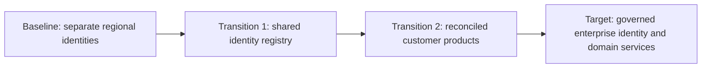

# Data / Enterprise Architect: Data Engineer Interview Guide

Three acquired businesses each have a customer database, a warehouse, and a different definition of revenue. Leadership wants one view of the business without disrupting billing or exposing customer data across legal boundaries. Choosing a database is only one part of that problem. An architect must decide what the enterprise should share, what domains should control, how systems will coexist during change, and whether the benefits justify the cost.

This guide prepares a data engineer for interviews that extend into data and enterprise architecture. It assumes familiarity with pipelines, warehouse modeling, and distributed systems. The examples are hypothetical; costs, targets, and matching thresholds illustrate reasoning rather than industry benchmarks. Selected primary sources were checked on October 27, 2026. The framework descriptions support practical interviews, rather than a particular certification syllabus.

**Highest priority:** Sections 1–4 and 7: frameworks, enterprise modeling and MDM, domain-driven architecture, design evaluation, and technology strategy. Sections 5–6 and 8–10 connect those decisions to integration, migration, economics, and business outcomes.

**Related guides:** [Data platform system design](data-platform-system-design.md), [data warehousing](../storage-and-modeling/dwh.md), [semantic layer and metrics](../storage-and-modeling/semantic-layer.md), [data contracts](../quality-and-governance/data-contracts.md), [governance and security](../quality-and-governance/governance.md), [replication and CDC](../ingestion/replication.md), and [cost engineering and FinOps](finops.md).

## Contents

1. [Enterprise Architecture Frameworks](#1-enterprise-architecture-frameworks)
2. [Enterprise Data Modeling](#2-enterprise-data-modeling)
3. [Domain-Driven Data Architecture](#3-domain-driven-data-architecture)
4. [Architecture Design and Evaluation](#4-architecture-design-and-evaluation)
5. [Enterprise Integration Architecture](#5-enterprise-integration-architecture)
6. [Architecture Modernization and Evolution](#6-architecture-modernization-and-evolution)
7. [Technology Strategy and Standardization](#7-technology-strategy-and-standardization)
8. [Enterprise Architecture Economics](#8-enterprise-architecture-economics)
9. [Enterprise Data Strategy](#9-enterprise-data-strategy)
10. [Enterprise Architecture Case Studies](#10-enterprise-architecture-case-studies)
11. [Interview Practice](#11-interview-practice)

## 1. Enterprise Architecture Frameworks

### Connect enterprise decisions to delivery

Enterprise architecture connects business strategy, capabilities, information, applications, and technology across an organization. Data architecture focuses on how information is defined, owned, integrated, stored, protected, and used within that wider system. Solution architecture applies those constraints to a particular initiative. Responsibilities overlap, but the decision scope differs.

For the acquired businesses, an enterprise architect might decide that identity and financial reporting require common policies while regional operations remain autonomous. A data architect defines customer identity, authoritative attributes, integration contracts, and historical semantics. A solution architect designs the first customer reconciliation service. A data engineer implements its ingestion, matching inputs, quality checks, and publishing pipeline. In a small organization, one person may do all four jobs.

A framework helps organize these decisions and expose omissions. It does not supply the business priorities or prove that a design works.

### TOGAF, ArchiMate, Zachman, and DAMA-DMBOK

These approaches answer different questions and can be used together:

| Approach | Main purpose | Practical use in the acquisition example |
| --- | --- | --- |
| TOGAF | Organize architecture development, governance, and change through the Architecture Development Method, or ADM | Establish the business vision, compare baseline and target architectures, and sequence migration |
| ArchiMate | Model relationships across enterprise architecture using a defined language | Show how a customer-management capability depends on application services and supporting technology |
| Zachman Framework | Classify enterprise descriptions by perspective and question | Check whether the design addresses ownership, meaning, location, timing, and motivation as well as structure |
| DAMA-DMBOK | Organize data management disciplines and responsibilities | Check that modeling, metadata, master data, quality, security, and operations have owners |

TOGAF is a method and supporting framework; ArchiMate is a modeling language. Zachman classifies descriptions rather than prescribing a delivery sequence. DAMA-DMBOK covers data management more broadly than an architecture method. These distinctions follow the [Open Group's ADM overview](https://www.opengroup.org/soa/source-book/togaf/p4.htm), [ArchiMate introduction](https://archimate-community.pages.opengroup.org/workgroups/archimate-101/), [Zachman's explanation](https://zachman-feac.com/zachman/about-the-zachman-framework), and [DAMA-DMBOK knowledge areas](https://www.damadmbok.org/copy-of-about-dama-dmbok).

Zachman's matrix crosses six questions—**what, how, where, who, when, and why**—with six perspectives ranging from executive scope to the functioning enterprise. Its value is coverage: a data model answers part of “what,” but leaves questions about responsibility and motivation open. Filling every cell is not automatically necessary for a particular decision. The [framework's own description](https://zachman-feac.com/zachman/about-the-zachman-framework) explains its classification structure.

DAMA-DMBOK's eleven core knowledge areas are governance; architecture; modeling and design; storage and operations; security; integration and interoperability; document and content management; reference and master data; warehousing and business intelligence; metadata; and quality. Use that breadth to identify missing responsibilities, such as an MDM project with no stewardship process or metadata owner. The [DAMA-DMBOK framework overview](https://www.damadmbok.org/copy-of-about-dama-dmbok) describes these disciplines.

### Enterprise data architecture principles

A principle should guide an actual decision. Useful starting principles include accountable ownership, explicit authoritative definitions, reuse through governed interfaces, security and privacy by design, interoperable contracts, traceable provenance, and lifecycle-aware retention and recovery. Describe each principle's rationale, implications, scope, and exception authority.

For example, “share data appropriately” implies discoverable products with approved access, rather than unrestricted copying. “Define authoritative sources” implies an owner for conflicting claims and documented rules for history. Principles can compete: minimizing copies may conflict with isolation and recovery. Resolve that conflict against the use case and record the decision.

### Explain the TOGAF ADM through its outputs

The ADM includes a Preliminary phase, phases A–H, and continuous Requirements Management. A useful interview explanation connects each part to an output:

| Phase | Question and useful output |
| --- | --- |
| Preliminary | How will architecture work here? Establish principles, scope, responsibilities, and governance |
| A: Architecture Vision | Why change? Agree on outcomes, stakeholders, scope, and constraints |
| B: Business Architecture | Which capabilities and processes must change? Describe baseline, target, and gaps |
| C: Information Systems Architectures | What data and applications support them? Describe data and application architectures |
| D: Technology Architecture | Which infrastructure and platform capabilities support the target? |
| E: Opportunities and Solutions | Which work packages and transition architectures could close the gaps? |
| F: Migration Planning | In what order should investments and migrations happen? Produce a prioritized roadmap |
| G: Implementation Governance | Does delivery conform to agreed architecture? Review changes and exceptions |
| H: Architecture Change Management | What has changed enough to revise the architecture or begin another cycle? |

Requirements Management connects requirements and changes across the cycle. The method is iterative; adapt scope and depth to the decision. The Open Group describes the [phases and their relationship to enterprise change](https://www.opengroup.org/soa/source-book/togaf/p4.htm).

In practice, use the method to ask whether regional customer identifiers, privacy constraints, and business ownership have been resolved before approving the migration. Producing every possible artifact before learning from a pilot would delay the evidence needed to improve the design.

### Business capability mapping and architecture domains

A **capability** describes what the business can do, such as customer onboarding, credit assessment, or financial close. A process describes how work happens; an organization chart describes who currently performs it. Capabilities provide a useful investment view because processes, reporting lines, and products can change while the underlying business need remains.

Map each important capability to business outcomes, owners, information, applications, technology, and current weaknesses:

| Capability | Business outcome | Important data | Current weakness | Architecture response |
| --- | --- | --- | --- | --- |
| Customer onboarding | Open valid accounts quickly | Party identity, verification evidence | Duplicate customer records | Shared identity resolution with regional verification rules |
| Financial close | Publish reconciled group accounts | Invoices, payments, exchange rates | Incompatible revenue definitions | Finance-owned definitions and reconciled reporting products |
| Customer support | Resolve issues across brands | Accounts, contacts, service history | Agents cannot connect identities | Authorized cross-brand identity lookup |

TOGAF commonly distinguishes **business, data, application, and technology** architectures. Security, operations, and governance cut across those domains. Do not confuse these with ArchiMate's core **Business, Application, and Technology** layers; its language also covers motivation, strategy, implementation, and migration. The [ArchiMate introduction](https://archimate-community.pages.opengroup.org/workgroups/archimate-101/) explains that organization.

The useful output is traceability: a technology investment should support an application or data capability that addresses a business need. A capability map alone cannot reveal every integration dependency, so connect it to application and data-flow inventories.

### Current-state, target-state, and transition architectures

The **current state**, or baseline, describes the relevant reality: deployed systems, ownership, interfaces, data flows, constraints, and operational problems. Record evidence and unknowns. An application inventory that omits spreadsheet exports and overnight transfers can make a migration look much easier than it is.

The **target state** describes the architecture needed for a defined planning horizon. Include operating responsibilities and measurable outcomes alongside systems. “Unified customer analytics with regional access controls and daily identity reconciliation” gives a clearer target than “move everything to a lakehouse.”

A **transition architecture** is a deliberately designed intermediate state that can operate safely. For example, all regional sources remain authoritative while a customer identity registry supplies shared identifiers; later, a consolidated customer product serves analytics; operational master-data authoring moves only where justified. Each transition needs an owner, funding, entry and exit criteria, and explicit consistency and support arrangements.



The diagram shows a migration sequence, not a requirement to centralize every customer attribute. Some regional systems may remain in the target architecture.

### Maturity assessment and gap analysis

Maturity measures how reliably an organization performs architecture and data management work. Capability gaps describe what is missing between baseline and target. They are related: buying an MDM tool may close a technology gap while leaving stewardship and change-management gaps unresolved.

For an interview, propose a simple evidence-based scale: **ad hoc → repeatable → defined → measured → continuously improved**. State that this is an illustrative rubric, not an official scoring scheme. Assess dimensions separately: ownership, modeling, metadata, quality controls, security, delivery automation, and operational support. A single average can hide a critical weakness.

A gap register should identify the current evidence, target outcome, business consequence, dependencies, accountable owner, action, and completion measure. For example: “No enterprise identity mapping; analysts use email joins; establish a versioned crosswalk owned by customer operations; validate matching errors and consumer adoption before retiring manual joins.” Prioritize by business impact, risk, dependency, and effort. Some gaps require policy or staffing changes; some require deletion of redundant systems.

**Interview checkpoint:** Explain why you chose a framework, what decision it improved, and which artifacts you would actually produce. Naming frameworks without showing their effect on delivery is a weak answer.

## 2. Enterprise Data Modeling

### Model shared meaning before storage

An enterprise conceptual model captures major business concepts and relationships across domains. A logical model adds identifiers, attributes, cardinalities, constraints, and temporal meaning without committing to a particular database. A physical model implements those decisions in tables, documents, events, indexes, or files. Warehouse facts and dimensions are consumption-oriented physical or logical structures; they do not replace the enterprise view.

For the acquisition, start by separating **Party**, **Person**, **Organization**, **CustomerAccount**, **Agreement**, and **ContactPoint**. A person can have several accounts; an organization can have several authorized contacts; one person can act in several roles. Treating all of these as one `customer` row creates accidental assumptions about uniqueness, ownership, and history.

A model must explain its relationships. Is an address associated with a party, an account, a contract, or a delivery? Can several parties share it? When was that relationship valid? These answers affect matching and analytics more than the choice of a surrogate-key type.

### Enterprise canonical models without a universal schema

A **canonical model** provides an agreed representation at a sharing boundary. For example, a shared `PartyIdentity` contract can define identifier namespaces and identity assertions while billing retains its own account and invoice model. Map local concepts explicitly instead of forcing every domain to store identical tables.

Keep the shared core small: identifiers, definitions, relationships, controlled vocabularies, and the attributes consumers actually need. A universal customer schema with hundreds of optional fields couples unrelated releases and becomes difficult to own. A canonical integration representation, an enterprise conceptual model, and a warehouse dimensional model serve different purposes even when they use similar names.

Distinguish these identifiers in the model:

| Identifier | Example | Meaning |
| --- | --- | --- |
| Source record key | `(crm_eu, customer, 42)` | Identifies a record in a named source and entity type |
| Enterprise party ID | `party-9001` | Identifies a resolved enterprise entity under a governed identity policy |
| Business identifier | Tax identifier plus issuing jurisdiction | Carries business meaning, but may be missing, corrected, or restricted |
| Account ID | `(billing_uk, account, 42)` | Identifies an account, which need not have a one-to-one relationship with a person |

Maintain a **crosswalk** from source keys to enterprise identities with provenance, effective dates, and mapping history. A warehouse surrogate key may identify a historical dimension row; it should not silently become the enterprise identity contract.

### MDM and the golden record

Master Data Management coordinates the definitions, ownership, quality, identity, and distribution of core entities such as parties, products, suppliers, and locations. A **golden record** is the governed representation selected for a particular purpose. It may combine attributes from several sources and should retain their provenance. It does not mean every original record disappears or that one value is correct for every legal entity and time period.

Choose the implementation style according to who may author data and how changes propagate:

| Style | Where authoring happens | What is shared | Main consequence |
| --- | --- | --- | --- |
| Registry | Existing source systems | Identity links and references; views can be assembled from sources | Limited source disruption, but source availability and quality still matter |
| Consolidation | Existing source systems | A consolidated representation for downstream use | Useful for analytics; source systems may continue to disagree |
| Coexistence | Sources and a central hub | Reconciled master data synchronized between them | Requires conflict rules, loop prevention, and clear field authority |
| Centralized | Central master-data service for the governed scope | Authoritative master records consumed downstream | Stronger write control, but authoring workflows and applications must change |

These four styles are described in [SAP's MDM overview](https://www.sap.com/canada/products/data-cloud/master-data-governance/what-is-mdm.html). Product terminology varies; explain authoring authority, persistence, and propagation rather than relying on a style name alone.

For the acquired businesses, consolidation may solve group reporting without changing operational billing. Centralized authoring might later suit a shared product catalog. Different entity types can justify different styles.

### Entity resolution and identity matching

Entity resolution determines which records refer to the same real-world entity. It is separate from choosing the surviving attributes after records have been linked. A safe design makes both decisions explainable and reversible.

A practical matching flow is:

1. **Validate and normalize:** standardize permitted representations, preserve originals, and record source provenance. Normalization must respect locale and business meaning.
2. **Generate candidates:** use blocking or search keys to avoid comparing every record to every other record. Multiple blocking passes can reduce missed candidates.
3. **Compare evidence:** evaluate identifiers, names, dates, addresses, and other permitted signals. Exact rules can coexist with probabilistic or learned scores.
4. **Decide:** link high-confidence candidates, send ambiguous cases to stewardship, and keep low-confidence records separate.
5. **Evaluate and monitor:** measure errors on representative labeled examples, inspect review outcomes, and monitor changes in source quality.

An illustrative score threshold might auto-link above 0.98 and send scores from 0.85 to 0.98 for review. Those numbers have no meaning without calibration, source-specific evidence, and the cost of errors. A similarity score is not automatically a probability. Blocking also affects recall: an excellent scorer cannot match a pair it never sees.

A **false positive** merges different entities; a **false negative** leaves duplicates separate. False positives can expose one person's information to another and are often especially costly in identity-sensitive workflows. Shared household email addresses, recycled phone numbers, and reused local IDs make simplistic rules unsafe. Do not remove meaningful punctuation or leading zeros from identifiers without a documented rule.

Evaluate pairwise precision and recall, but also inspect resulting entity clusters. If A resembles B and B resembles C, it does not follow that all three are the same person. Constraints, contradictory evidence, and cluster-level review may be needed. Preserve merge decisions, rule versions, and split history so a mistaken merge can be corrected and downstream products repaired.

### Survivorship, authority, and history

**Survivorship** selects the preferred attribute values after identity has been resolved. Use explicit rules for source authority, verification, recency, completeness, and permitted use. “Latest non-null value wins” can replace a verified legal name with an unverified marketing form submission.

An authority matrix makes this concrete:

| Attribute or relationship | Accountable authority | Conflict rule |
| --- | --- | --- |
| Verified legal name | Verification process in the relevant jurisdiction | Retain verified evidence; investigate contradictory verified claims |
| Preferred contact channel | Customer preference service | Respect effective preference and permitted purpose |
| Credit status | Credit domain | Publish the domain's assessment with its evaluation time |
| Customer-to-account relationship | Account-owning domain | Preserve role and valid dates; allow multiple relationships |

Store the chosen value alongside origin, verification status, valid time, processing time where needed, and rule version. Business validity answers “when was this true?” Processing history answers “what did we know when we produced that report?” A corrected identity must not silently rewrite a previously issued financial or regulatory result. Define which consumers receive current corrections and which require historical reproducibility.

MDM identity resolution is also separate from authentication and authorization. Knowing that two records describe one person does not grant every consumer access to both. Enforce access and purpose restrictions when linking, publishing, and querying identities.

### Reference data and cross-domain semantic consistency

Reference data consists of controlled classifications such as country codes, currency codes, product categories, and status vocabularies. Give each set an owner, version, effective dates, publication process, and compatibility policy. Local extensions may be necessary, but their mappings must be explicit. Reference data changes can alter historical interpretation even when no column type changes.

An acquisition may have one system where `ACTIVE` means “open account” and another where it means “purchased in the last 90 days.” Renaming both to `active_customer` does not align them. Preserve distinct concepts or define an explicit transformation with an owner and effective date. Document units, currency, time zone, calendar, population, and grain as part of shared meaning.

Cross-domain consistency usually requires a small shared vocabulary and governed mappings. It need not require identical internal models. The [semantic-layer guide](../storage-and-modeling/semantic-layer.md) explains how those choices reach metrics and safe analytical joins.

### Ontologies, knowledge graphs, and semantic interoperability

An **ontology** formalizes concepts, relationships, and rules of meaning. A **knowledge graph** represents entities and relationships as connected data, often using an ontology or other schema. A taxonomy classifies concepts; it generally expresses less than an ontology with rich relationships and constraints.

RDF represents statements as subject–predicate–object triples and uses identifiers to connect resources. SKOS supports concept schemes, labels, hierarchies, and mappings between vocabularies. These are foundations for some semantic integration approaches, rather than requirements for every graph implementation. See the [W3C RDF primer](https://www.w3.org/TR/rdf11-primer/) and [SKOS primer](https://www.w3.org/TR/skos-primer/).

In the example, a graph could connect parties, accounts, legal entities, contracts, and ownership relationships to answer “which organizations are exposed to this supplier?” That becomes useful when relationships span many domains and change often. A relational model with governed keys may be simpler for routine reporting. A graph does not resolve identity errors, establish access rights, or make two definitions equivalent by itself.

**Interview checkpoint:** Be able to separate identity matching, attribute survivorship, reference-data mapping, and historical modeling. Explain who can correct a golden record and how that correction reaches consumers safely.

## 3. Domain-Driven Data Architecture

### DDD and bounded contexts

Domain-Driven Design builds models around business knowledge and a shared language between domain experts and engineers. A **bounded context** is the boundary within which a particular model and vocabulary are consistent. A **context map** describes relationships and translations between those boundaries. The same word can legitimately have different meanings in different contexts; this is central to [bounded-context modeling](https://martinfowler.com/bliki/BoundedContext.html).

Sales may model a customer as a prospect or buyer. Billing models an account holder with payment obligations. Support models a requester and their entitlements. A shared party identifier can connect them without erasing those distinctions. A bounded context is not automatically a department, a database, or a microservice; choose the boundary around meaning, business rules, and the ability to change coherently.

DDD also uses entities, value objects, and aggregates. An entity has continuity of identity; a value object is defined by its values; an aggregate groups related changes under business invariants. For a data architect, the key consequence is that an operational consistency boundary should be explicit. Publishing an event from one aggregate does not create an atomic transaction across every downstream data product.

### Domain ownership boundaries

Give each published concept an accountable owner with the authority and capacity to maintain it. A domain should own the meaning, quality expectations, evolution, and support of its products. A platform team can operate the infrastructure while the domain remains responsible for whether the data correctly represents the business.

Choose boundaries using semantic cohesion, change patterns, decision rights, and dependencies. If changing one business rule requires coordinated releases across six teams every week, inspect whether the boundary or contract is wrong. Equally, forcing all customer-related data into one team can create a permanent bottleneck.

Shared identity, reference data, and enterprise metrics require named authorities. They can be managed as shared capabilities with domain participation. “Everyone owns customer” leaves consumers without a clear decision maker when definitions conflict.

### Data Mesh and federated governance

Data Mesh combines four principles: **domain-oriented ownership, data as a product, a self-service data platform, and federated computational governance**. It addresses the organizational problem of serving trustworthy analytical data across many domains. These principles are set out in the [original Data Mesh description](https://martinfowler.com/articles/data-mesh-principles.html).

Domain teams publish useful data products. A platform provides repeatable capabilities such as provisioning, access enforcement, metadata publication, delivery, and monitoring. Federated governance combines enterprise requirements with domain expertise and automates enforceable rules where possible. Decentralized ownership can run on shared physical infrastructure.

Use this approach when domains can sustain product ownership and a shared platform can reduce their operating burden. A small organization may achieve the same business outcome with a central data team and clear domain stewardship. Naming every table a product does not solve support, quality, or funding.

### Data product architecture and interoperability

A data product is a maintained interface to data for a defined set of consumers and decisions. It includes the data, its meaning, its delivery interfaces, and the responsibilities needed to keep it usable. A table can be an interface to a product; a table without ownership and service expectations is an incomplete product definition.

For a `CustomerIdentity` product, specify:

| Concern | Example decision |
| --- | --- |
| Purpose and consumers | Resolve approved cross-brand identities for support and group analytics |
| Meaning and grain | One mapping per source identity and validity interval; separate identity from account status |
| Interfaces | Versioned analytical table for joins and a lookup API for authorized support workflows |
| Service objectives | Daily reconciled analytical publication; separately defined API latency and availability |
| Ownership | Customer identity team owns semantics, matching policy, incident response, and change communication |
| Controls | Purpose-aware access, provenance, quality gates, lineage, and correction workflow |
| Lifecycle | Supported versions, consumer inventory, deprecation window, and retirement criteria |

Interoperability has several layers. Technical compatibility means systems can exchange data. Structural compatibility means schemas line up. Semantic compatibility means identifiers, units, grain, history, and definitions agree. Operational compatibility means consumers can rely on publication and support. Organizational compatibility means someone can decide and fund changes.

Two products can both expose Parquet and still be impossible to join correctly. Specify whether a party-to-account mapping is one-to-many, which date makes the join valid, and which consumers may use it. Enterprise standards should concentrate on these shared boundaries while allowing domains to evolve their internals.

### Cross-domain integration and shared semantics

Use a context map to identify upstream authorities and downstream translations. An upstream domain may publish a stable public model; a downstream domain may adapt it through an anti-corruption layer. A deliberately small shared kernel can work where teams accept joint ownership, but it introduces coordination costs and should not expand casually.

For a `RevenueByCustomer` product, Finance owns recognition policy, Sales owns order facts, and Identity owns party mappings. The product owner must agree with each upstream team on timing, corrections, and meaning. Reusing products reduces duplicated extraction, but every dependency adds an availability and change dependency. Materialize stable inputs when consumers need isolation from upstream outages.

MDM and Data Mesh can coexist: MDM establishes governed identity and selected shared attributes, while domains own their business-specific relationships and products. An identity service should not become the owner of every fact associated with a person.

### Data contracts at enterprise scale

A contract describes the promises at a producer–consumer boundary: schema, identifiers, semantics, quality, freshness, access conditions, correction behavior, and supported evolution. A schema registry handles only part of that agreement. The [data-contracts guide](../quality-and-governance/data-contracts.md) covers formats and compatibility mechanics.

At enterprise scale, make contracts discoverable and connect them to producer versions, lineage, known consumers, and incident ownership. Validate structural compatibility in delivery pipelines, exercise important consumer expectations, and monitor production objectives. A field remaining a string does not make a change from account ID to party ID compatible.

For a breaking change, publish a new interface, provide migration examples, observe consumer adoption, and retire the old version after agreed acceptance criteria. Critical consumers may require explicit confirmation. Emergency exceptions need an owner, compensating control, and expiry; otherwise a temporary bypass becomes the effective standard.

**Interview checkpoint:** Explain what the enterprise standardizes, what domains decide, what the platform automates, and who resolves a conflict. Include the staffing and funding required to make ownership real.

## 4. Architecture Design and Evaluation

### ADRs and RFCs

An **RFC**, or Request for Comments, proposes a change and gathers input before a decision. An **ADR**, or Architecture Decision Record, preserves a significant decision and its context, status, and consequences. An organization may use other names, but the distinction between exploring options and recording an accepted decision is useful. Michael Nygard's [ADR description](https://cognitect.com/blog/2011/11/15/documenting-architecture-decisions) explains why decision context should remain accessible over time.

A useful RFC states the business problem, constraints, alternatives, expected effects, migration approach, unresolved questions, and responsible reviewers. Timebox review and identify who decides. Record significant dissent and the reason for the final choice.

An ADR should be short enough for a future maintainer to read:

```text
Title: Use an identity registry before changing operational customer authoring
Status: Accepted
Context: Three CRMs must support group reporting; billing changes are out of scope.
Decision: Publish versioned source-to-party mappings with governed matching.
Alternatives: Centralized authoring now; independent report-specific matching.
Consequences: Faster analytical adoption; source duplicates remain unresolved.
Validation: Matching review, privacy review, and reconciliation for pilot consumers.
Revisit when: Operational duplicate costs justify changes to authoring workflows.
Owner: Customer identity architecture lead
```

The extra validation, revisit, and owner fields are practical additions, not a universal ADR format. When the decision changes, preserve its history and link a superseding record.

### C4, ArchiMate, and architecture viewpoints

The C4 model provides four levels: **system context, container, component, and code**. A container is a runnable application or data store, not necessarily a Docker container. Use only the levels that clarify the decision. The [C4 model documentation](https://c4model.com/diagrams.html) also describes landscape, dynamic, and deployment diagrams.

ArchiMate is useful for enterprise relationships among strategy, capabilities, business behavior, applications, and technology. C4 is useful for explaining software-system structure. Neither a static C4 diagram nor an enterprise capability model fully describes event timing, trust boundaries, or cutover behavior; add the relevant views.

A **viewpoint** specifies the concerns, conventions, and audience for a kind of view. A **view** is the actual representation. Choose them from stakeholder questions:

| Stakeholder concern | Useful view |
| --- | --- |
| Executive: what business outcome does this fund? | Capability and investment roadmap |
| Data owner: what does customer mean here? | Conceptual model, ownership map, and authority matrix |
| Engineer: what calls what? | C4 context/container and dynamic interaction views |
| Security: where can sensitive data cross boundaries? | Data-flow and trust-boundary view |
| Operations: how does recovery work? | Deployment, dependencies, and recovery sequence |
| Migration lead: which systems coexist at cutover? | Transition architecture and reconciliation gates |

Label boundaries, ownership, direction, interface meaning, and important timing assumptions. A box named “governance” is insufficient unless the design explains how a particular policy is enforced.

### ATAM and quality-attribute scenarios

The Architecture Tradeoff Analysis Method evaluates architecture against competing quality goals with stakeholders. Its process connects business drivers, architectural approaches, a prioritized utility tree, and concrete scenarios. The outputs include risks, non-risks, sensitivity points, and trade-off points; it is not a universal architecture score. See the [SEI ATAM collection](https://www.sei.cmu.edu/library/architecture-tradeoff-analysis-method-collection/).

Express a scenario with a **source, stimulus, environment, affected artifact, response, and response measure**. For example: “During normal operation, a domain publishes an incompatible customer schema. The publication pipeline detects the violation, rejects that version, preserves the last valid product, and notifies its owner within five minutes.”

A sensitivity point is a decision or parameter that materially affects a quality attribute. A trade-off point affects multiple attributes in competing ways. Longer identity-cache retention may improve availability and latency while increasing the period before a correction takes effect. Evaluate the effect against prioritized scenarios, then assign owners to unresolved risks.

In an interview, use an abbreviated scenario discussion and identify it as such. A full ATAM evaluation involves broader stakeholder participation and structured analysis.

### Architecture fitness functions

A fitness function checks whether an important architecture characteristic remains within an acceptable range as the system changes. It can be a static check, a runtime measure, or a periodically exercised procedure. The concept supports [guided incremental architecture evolution](https://evolutionaryarchitecture.com/precis.html).

| Intended characteristic | Example check | Limitation to acknowledge |
| --- | --- | --- |
| Domain independence | Detect direct access to another domain's private schema | Approved public interfaces must be distinguishable |
| Contract compatibility | Compare producer changes and run consumer expectations | Structural checks cannot prove unchanged meaning |
| Sensitive-data protection | Test access policies and inspect published classifications | Scanners can miss sensitive data and misclassify fields |
| Recoverability | Restore an isolated environment and reconcile outputs against RPO/RTO targets | Backup existence alone does not establish recovery |
| Portability | Export a representative product and run it on a second engine | A small sample may hide scale and semantic differences |
| Cost efficiency | Track cost per agreed unit under representative load | Changes in workload mix can distort comparisons |

Set thresholds, owners, evaluation frequency, and a response to failure. Measure runtime drift as well as proposed configuration. If a metric is easy to game, pair it with outcome checks; a rising count of registered products can conceal poor usability.

### Reference architectures, standards, and automated compliance

A **reference architecture** describes a reusable arrangement of responsibilities and interactions for a class of problems. A **technical standard** makes a particular requirement mandatory within a defined scope. A **reference implementation** demonstrates a working way to satisfy the architecture and standards.

For example, a reference ingestion architecture might specify capture, durable storage, validation, and publication boundaries. A standard might require encrypted transport, an owner, an approved identity mechanism, and replayable ingestion for a defined risk class. A reference implementation shows those controls working together with deployment and recovery instructions.

Turn enforceable requirements into checks during provisioning, build, deployment, and operation. Examples include preventing public exposure of restricted data, rejecting missing ownership metadata, and detecting an expired contract exception. Evaluate the actual effective permissions and deployed state; a configuration file alone is incomplete evidence.

Automation cannot decide whether a revenue definition is appropriate or a cross-border use is permitted in a specific business situation. Assign those decisions to qualified owners and retain their evidence. Use review effort where judgment is needed, and provide fast automated paths for routine conforming changes.

**Interview checkpoint:** Start with one important quality scenario, show the trade-off it reveals, record the decision, and explain the ongoing check that protects it.

## 5. Enterprise Integration Architecture

### Canonical integration versus point-to-point integration

Point-to-point integration maps one system directly to another. It can be the simplest choice for a small, stable relationship. Across many systems, separate mappings can duplicate semantic decisions and create inconsistent interpretations. A fully connected directed network of `n` systems has up to `n × (n − 1)` directed connections, but real integration networks are rarely fully connected.

A canonical integration model allows each participant to translate between its local model and an agreed shared representation. This can reduce repeated mappings when many systems exchange the same concepts. It introduces shared-model governance and adapter work, and an oversized canonical model can become a release bottleneck. The [Canonical Data Model pattern](https://www.enterpriseintegrationpatterns.com/patterns/messaging/CanonicalDataModel.html) describes that translation approach.

For the acquisition, standardize the meaning of an identity-link event across participating CRMs. Do not route unrelated inventory and billing internals through one enormous enterprise message. Canonical semantics do not require one central message broker or one deployment boundary.

### Anti-corruption layers and legacy integration

An anti-corruption layer translates an external or legacy model into the receiving domain's language. It prevents assumptions such as overloaded status codes or source-specific identifiers from spreading through the new domain. It can be an adapter in an existing service; it does not have to be another independently deployed platform.

For a legacy billing database, translate `CUST_NO` into a namespaced account identifier and resolve party identity separately. Preserve unknown statuses as explicit unknowns or quarantine them; silently converting an unrecognized status to “active” changes business meaning. Keep provenance and reconciliation so translation defects can be found and corrected.

### Enterprise event taxonomies and schemas

An event taxonomy organizes business facts by domain, meaning, ownership, and lifecycle. Prefer names that describe what occurred, such as `billing.invoice-issued`, with a defined occurrence time and business entity. A command asks another component to act; an event records a fact. CDC records expose storage changes and require interpretation before consumers can treat them as domain events.

Define envelope conventions for event ID, event type, schema version, source, occurrence time, subject identity, and correlation where needed. Define payload semantics separately: grain, units, sensitive fields, correction behavior, and compatibility. Reprocessing a historical event must not accidentally trigger a second payment or notification.

Taxonomy and schema governance should identify who can add or change an event type and how consumers discover it. Avoid sensitive personal information in topic names, identifiers visible to broad audiences, or routing metadata. Retention, deletion, and replay permissions also belong in the architecture.

### Cross-domain consistency and coordination

First state the invariant and its boundary. Updating an invoice and ledger atomically within one system is different from making all analytical products observe the update at once. Across domains, use explicit asynchronous states, reconciliation, and versioned publication when a global transaction is unavailable or inappropriate.

A transactional outbox can commit a local business change with a record to publish; the relay may still publish duplicates, so consumers need idempotency. A saga coordinates local transactions and compensations for a business workflow. Compensation is a new business action and may not reverse every effect. Analytical products often need completeness markers and corrected publications rather than distributed transactional coordination. See [core engineering](../foundations/core.md) for the underlying guarantees.

For group revenue, publish a reconciled daily version after all required regional inputs reach their agreed cutoffs. Keep provisional operational dashboards separate in meaning. A low event-processing delay does not establish that financial data is complete.

### Data virtualization and federation

Data virtualization presents a logical access layer over multiple underlying sources. Query federation executes a query across sources and combines results. Implementations can overlap, and either may use caching or materialization; inspect the actual behavior.

Federation is useful for discovery, low-volume access, and some transition periods because it can avoid moving every dataset first. Its limits include source load, network transfer, uneven pushdown, inconsistent snapshots, partial outages, and differing access semantics. Joining live customer data to yesterday's invoices does not produce a single consistent business snapshot automatically.

Materialize governed products when repeated joins, predictable latency, reproducible snapshots, or isolation from source failures justify the copy. Copying adds lifecycle and protection obligations; virtualization still needs authorization at every relevant boundary.

### Select integration patterns by the requirement

| Requirement | Likely starting pattern | Main trade-off |
| --- | --- | --- |
| Immediate business validation | Synchronous API | Clear response, but runtime availability and latency coupling |
| Propagate business facts to independent consumers | Events | Temporal decoupling, but duplicates, ordering, and evolution need design |
| Capture legacy database changes | CDC plus interpretation | Low application intrusion, but source schemas and transaction behavior leak into integration |
| Reconciled bulk analytical delivery | Batch file or table publication | Efficient and repeatable, with explicit publication delay |
| Temporary access across platforms | Federation | Less initial movement, with source and query coupling |
| Multi-step business workflow | Orchestrated or choreographed saga | Local autonomy, with visible intermediate states and recovery complexity |

Select the simplest pattern that meets semantics, freshness, recovery, and ownership requirements. The same enterprise will usually need several patterns.

## 6. Architecture Modernization and Evolution

### Choose a strategy for each part of the estate

Legacy systems often encode valid business rules and difficult operational knowledge. Begin with criticality, supportability, dependencies, data quality, and business value. Rehost when infrastructure movement is sufficient; replatform when a limited platform change addresses the constraint; refactor or rearchitect when the existing structure prevents necessary outcomes. Replace with a product when its workflows fit. Retain or retire systems where the evidence supports those choices.

The **Strangler Fig** approach replaces capabilities incrementally behind boundaries that let old and new implementations coexist. Martin Fowler describes the [pattern's gradual replacement approach](https://martinfowler.com/bliki/StranglerFigApplication.html). In data architecture, move one product or consumer group at a time, validate equivalent behavior, redirect use, and then remove the old path when its dependencies are gone.

Do not mistake copying tables for migrating a capability. Schedules, access, reference mappings, reports, operational procedures, and historical correction rules also have to move or be deliberately replaced.

### Transition states and migration sequencing

Build a dependency map from producers through transformations and shared dimensions to consumers. Sequence migrations so prerequisites are available first, but use a representative vertical slice early to test end-to-end assumptions. Starting only with the easiest isolated tables can postpone the risks that determine feasibility.

A migration wave should specify its source of truth, backfill and change-capture approach, validation, read/write routing, fallback, and retirement gate. A useful sequence is **inventory → contract → backfill → capture ongoing changes → reconcile → shadow consumers → cut over → retire**. The [replication guide](../ingestion/replication.md) explains snapshot and change-stream handoff.

Rollback is straightforward only while the old path remains sufficiently current and compatible. After the new system accepts writes or changes business meaning, returning to the old system can require reverse replication and conflict resolution. Name the point after which recovery becomes a forward repair rather than a simple traffic switch.

Validate more than row counts: compare keys, aggregates, business invariants, access behavior, historical corrections, and representative reports. Explain acceptable differences, such as intentionally corrected legacy defects, with business approval and retained evidence.

### Technology lifecycle and enterprise technical debt

Track products, deployed versions, owners, support deadlines, dependencies, replacement options, and upgrade lead time. An end-of-support date is useful only if the organization knows which workloads depend on that version. Review dependency chains; upgrading a platform can be blocked by an old connector or client.

Assess technical debt by its recurring burden, incident exposure, delivery delay, and cost to remove. Record concrete items such as “manual reconciliation after each schema change” or “unsupported connector blocks security updates.” Distinguish deliberate debt with a repayment condition from an unknown risk or ordinary planned work.

Prioritize debt that blocks strategic changes or creates material operational risk. A large codebase is not automatically debt, and replacing a stable system can introduce more uncertainty than maintaining it.

### Consolidation, coexistence, and compatibility

Consolidation can reduce duplicated skills, contracts, controls, and infrastructure. It can also enlarge the failure domain, create migration work, and weaken support for specialized workloads. Coexistence may be justified by residency, workload differences, acquisitions, or contractual timing. Make its interfaces, responsibilities, cost, and review date explicit.

Separate logical unification from physical consolidation. Common identity, metrics, catalog discovery, and access policy can create enterprise consistency while several engines remain. Conversely, putting all tables in one engine does not resolve conflicting definitions.

Protect long-term compatibility through stable identifiers, versioned contracts, retained metadata, tested export/import, and explicit history semantics. Open file formats help, but catalogs, table features, authorization, SQL behavior, and operational procedures also affect migration feasibility.

## 7. Technology Strategy and Standardization

### Technology radar and lifecycle management

A technology radar communicates where the organization stands on technologies and techniques. A useful structure is **Assess** for investigation, **Trial** for a bounded real-world evaluation, **Adopt** for proven use in an appropriate context, and **Caution** for careful evaluation before use. Older Thoughtworks material uses **Hold** for the outer ring; the [current radar tool documents its rename to Caution](https://radar.thoughtworks.com/).

Define your organization's own entry and exit criteria. A trial needs a workload, owner, budget, success conditions, and decision date. Adoption needs operating evidence, support ownership, and known limitations. Add explicit internal states such as deprecated and retiring if needed; a radar position alone does not schedule removal or imply a security verdict.

Review the radar alongside the deployed-version inventory and architecture roadmap. An attractive new query engine does not justify adoption if its main effect is a third operating model with no funded team.

### Build, buy, or use a managed service

Begin with the capability and constraints. Building may suit a differentiating capability or a requirement existing products cannot meet. Buying can provide established functionality but introduces product fit, licensing, customization, and vendor-roadmap constraints. Managed services reduce some infrastructure responsibilities while leaving responsibility for data correctness, access configuration, integration, and business continuity with the customer.

| Option | Strong reason to choose it | Costs and risks to investigate |
| --- | --- | --- |
| Build | The capability differentiates the business or has unusual hard requirements | Product ownership, engineering, testing, on-call, upgrades, security, and staff continuity |
| Buy and operate | A product fits but infrastructure control or deployment location matters | Licenses, operational team, upgrades, customization, integration, and support quality |
| Managed service | A supported capability meets requirements and operational capacity is constrained | Usage pricing, quotas, outages, regional availability, service changes, data movement, and exit work |

Estimate the entire lifecycle, including the work displaced onto domain teams and consumers. A free license with several dedicated operators may cost more than a managed offering. A managed product may still be unsuitable if it cannot meet a hard control or recovery requirement.

### Evaluation frameworks and decision matrices

Evaluate **hard gates before weighted preferences**. Examples include required deployment regions, access controls, acceptable recovery behavior, contractual conditions, and supported workload semantics. A high performance score cannot compensate for failing a mandatory condition.

For options that pass the gates, agree on criteria, weights, and evidence before the trial. The following hypothetical scores use 1–5, with higher being better:

| Criterion | Weight | Managed warehouse | Operated open stack | Specialized service |
| --- | --- | --- | --- | --- |
| Workload fit | 30% | 4 | 4 | 5 |
| Operational fit | 25% | 4 | 2 | 3 |
| Five-year cost | 20% | 3 | 4 | 2 |
| Delivery speed | 15% | 4 | 2 | 3 |
| Exit feasibility | 10% | 3 | 4 | 2 |
| Weighted score | 100% | **3.70** | **3.20** | **3.30** |

The matrix makes preferences visible; it does not establish objective truth. “Operational fit: 4” needs evidence such as available skills, recovery exercises, and support responsibilities. Show uncertainty and test whether reasonable changes in weights or scores change the ranking. A small score difference with weak evidence calls for a targeted experiment.

Benchmark representative distributions, concurrency, security controls, updates, recovery, and cost. Include skew, historical corrections, and realistic data volume. Agree on acceptance criteria before seeing results, retain configurations, and distinguish measured behavior from vendor promises.

### Vendor lock-in and exit architecture

Lock-in includes more than proprietary storage. It can arise from SQL dialects, catalogs, access models, orchestration APIs, governance metadata, identity integration, operational skills, and commercial commitments. Some dependence is a reasonable price for useful capabilities. Evaluate its concentration and exit cost explicitly.

An **exit architecture** describes how the business could leave a platform within an agreed time and cost. Identify what must move: data, history, transformations, schemas, lineage, permissions, keys or encryption arrangements, schedules, and consumer interfaces. Confirm what contracts allow and what APIs actually export.

Exercise a representative export and restore with another engine. Validate results, security behavior, runtime, transfer rate, and costs. A theoretical export button is weak evidence for moving petabytes while production continues. Include both a planned migration and a constrained exit, such as a contract dispute or a service retirement with limited notice.

Protect the most expensive boundaries first. Stable domain contracts and independently retained critical data can offer useful options without wrapping every vendor API in a custom abstraction.

### Multi-cloud portability versus platform specialization

Distinguish **portability** from simultaneous operation in multiple clouds. Portability means a credible ability to move; active multi-cloud adds synchronization, operations, security, network, and consistency responsibilities. Disaster recovery is another requirement with its own RPO and RTO; possessing an export does not make failover possible within minutes.

Specialized managed capabilities can improve delivery and operating efficiency. A common subset across platforms may reduce migration effort but exclude valuable features and create extra implementation work. Choose where portability earns its cost: durable data, contracts, and transformation logic may deserve it more than every internal scheduling call.

For the acquisition, one primary analytical platform plus tested exports and regional exceptions may satisfy the business. A genuine requirement to operate in several jurisdictions or recover from provider-wide failure could justify a different design. Name the requirement and measure the extra cost instead of treating cloud count as a quality metric.

### Enterprise standards and reference implementations

Standardize what enables safe collaboration: identity conventions, semantic definitions, contract evolution, access boundaries, observability, recovery, and supported delivery interfaces. Standardize a tool when shared operating skills, controls, or economics justify it. Allow approved variation where the standard cannot meet a legitimate need.

A standard needs its scope, rationale, owner, validation mechanism, and exception process. A reference implementation should show a small working path that teams can adopt, including deployment, monitoring, and failure recovery. If compliance requires extensive custom work in every team, improve the shared implementation before adding more review meetings.

**Interview checkpoint:** Defend a technology choice with hard constraints, representative evidence, lifecycle cost, and a tested exit path. Explain the circumstances that would change your decision.

## 8. Enterprise Architecture Economics

### Architecture-level TCO and multi-year modeling

Total Cost of Ownership includes acquisition, implementation, integration, operation, governance, change, and retirement. At architecture level, include shared services and costs distributed across teams: engineering time, support, security, training, data transfer, duplicate storage, commitments, and transition overlap. Compare options delivering the same business scope and service levels.

Model demand rather than extrapolating one invoice. Separate retained data, ingestion, transformations, query concurrency, backfills, environments, and disaster recovery. Account for growth, retention expiry, tiered prices, committed capacity, staffing steps, and currency or price uncertainty. Label assumptions and show low, base, and high scenarios. The [FinOps guide](finops.md) covers workload-level cost drivers.

For costs occurring at the end of each year, a simple present-value model is:

```text
PV(cost) = initial_cost + sum(year_cost[t] / (1 + discount_rate)^t)
NPV(investment) = PV(incremental benefits) - PV(incremental costs)
```

Use a consistent baseline, planning horizon, currency basis, and discount-rate convention. Agree on the rate with Finance. Show benefits and costs separately so an uncertain revenue claim cannot hide a known infrastructure increase. Lower nominal TCO and positive NPV are different statements.

### Technical debt and migration economics

The economic burden of debt includes repeated manual work, slower delivery, incident exposure, and capabilities the business cannot safely deliver. Estimate the effort to remove it and the recurring burden avoided. These are uncertain forecasts; do not turn every old component into an invented financial liability.

Compare migration with a realistic “maintain and improve” baseline. Staying may still require upgrades, staffing, compliance changes, and capacity growth. Migration adds discovery, remediation, conversion, validation, parallel operation, consumer changes, and retirement. License savings begin only when the old commitment or workload can actually be removed.

Avoid double-counting benefits. Hours saved may create delivery capacity without reducing payroll. Incident-cost reduction may already include the support effort counted elsewhere. Keep cash savings, released capacity, risk reduction, and business upside distinct.

### Optionality, reversibility, and risk

Architectural optionality is the value of keeping useful future choices available. Stable public contracts, staged migration, and independently recoverable data can reduce the cost of changing direction. They also cost money today, so compare that cost with plausible future decisions and their consequences.

Some choices are easy to reverse, such as a replaceable transformation tool behind stable outputs. Others are difficult: changing enterprise identifiers, distributing sensitive data, or moving all authoring into a proprietary workflow. Run cheaper experiments before committing to the difficult choices.

Use sensitivity analysis for growth, migration duration, contract renewal, staffing, and exit costs. Expected incident loss can help compare scenarios, but rare severe events and mandatory controls cannot be reduced to a misleading average. Present the cost–risk–flexibility trade-off and who accepts residual risk. Section 10 includes a worked five-year comparison.

## 9. Enterprise Data Strategy

### Assess capabilities against business outcomes

Start with decisions the business needs to improve, such as reducing onboarding delays, closing accounts faster, or measuring cross-brand sales. Assess the required capabilities and their current evidence. An inventory of tools does not show whether the organization can produce a trusted customer view.

Connect each capability to people, process, data, technology, and measures. For identity resolution, assess source coverage, matching error, stewardship capacity, correction turnaround, downstream propagation, and permitted use. Record the baseline and the owner who can change it.

### Target operating architecture

The target operating architecture connects technical responsibilities to the way people fund, build, run, and govern data services. Specify decision rights: who defines semantics, funds shared capabilities, approves risk, changes contracts, operates infrastructure, handles incidents, and retires products.

One possible arrangement gives domains responsibility for product meaning and service objectives, a platform team responsibility for common infrastructure and automation, and a federated governance group responsibility for enterprise policies and cross-domain disputes. Adapt the arrangement to organizational capacity. Ownership without budget, staffing, or authority is a label rather than an operating model.

### Data product portfolio architecture

View products as a portfolio of reusable capabilities and dependencies. Source-aligned products expose reliable domain facts; shared products provide capabilities such as identity or reference mappings; consumer-oriented products combine inputs for defined decisions. These categories are useful design choices, not mandatory Data Mesh layers.

Record consumers, value, dependency criticality, support cost, and overlap. A rarely queried reference product can still be critical if many pipelines depend on it. Consolidate products with truly equivalent purpose and semantics; keep distinct products where legal boundaries or business meaning require separation. Avoid mandatory chains of products that add latency without useful responsibility or reuse.

### Data asset lifecycle and strategic classification

Classify assets along several dimensions: business criticality, sensitivity, permitted purpose, reproducibility, retention, residency, and recovery needs. Do not collapse these into one “gold/silver/bronze” label. A temporary extract may contain highly sensitive information; a public reference dataset may be operationally critical.

Design the lifecycle from creation and onboarding through active use, change, archival, and deletion. Identify how policies reach copies, derived products, caches, and backups, including documented exceptions and retention constraints. Legal holds and deletion obligations require decisions from the appropriate owners; architecture must make those decisions enforceable and auditable.

### Roadmaps and measures of technical value

Build roadmaps around capability outcomes and dependency gates. “Enable reconciled group customer reporting” can include identity mapping, regional policy agreement, contract publication, and consumer migration. Each work package needs a measurable outcome, owner, funding, dependencies, and criteria for stopping or revising it.

| Intended outcome | Useful measure | Guard against |
| --- | --- | --- |
| Faster safe delivery | Time from approved data request to usable product | Counting delivery before quality or access acceptance |
| Better identity quality | Reviewed false-merge and missed-match rates | Reporting only duplicate reduction |
| Reliable interoperability | Consumer incidents and migration effort per interface change | Counting schemas without measuring correct use |
| Lower operating burden | Comparable unit cost and manual support hours | Ignoring workload growth or transition overlap |
| Real modernization | Workloads retired, commitments removed, and recovery demonstrated | Counting copied tables as completed migration |
| Business value | Financial-close duration or onboarding outcome | Claiming architecture caused every business improvement |

Use baseline trends, consumer feedback, and attributed examples together. Architecture effectiveness appears in safer change, lower friction, and better outcomes; the number of diagrams or standards produced is only activity.

## 10. Enterprise Architecture Case Studies

These hypothetical cases build on the acquired-business example. In an interview, state assumptions, propose a decision, explore its failure modes, and identify the evidence required before wider adoption.

### Case 1: Consolidate multiple warehouses and data platforms

**Situation:** Three businesses operate separate warehouses. Leadership wants consistent group reporting and lower support costs. Regional data restrictions remain, and one platform has a contract commitment for another year.

**Design:** Inventory consumers, models, pipelines, access policies, commitments, and operating costs. Agree on shared identity and finance definitions before choosing a target physical arrangement. Use one primary analytical platform where permitted, with regional products and governed interfaces where consolidation is unsuitable. A unified catalog and semantic layer provide discovery and agreed meaning across the remaining boundaries.

**Sequence:** Migrate one representative reporting slice, including identity joins and corrections. Run old and new reports in parallel, explain differences, move consumers, and observe adoption. Retire each old workload only after lineage checks, business acceptance, recovery evidence, and contract timing permit removal. Keep transition costs and deadlines visible.

**Failure to explore:** Data movement succeeds, but a country has a different recognition rule and totals diverge. Preserve local finance meaning, define the group transformation explicitly, and reconcile both views. Success means accepted reports and lower operating burden, with real retirement of redundant workloads.

### Case 2: Design enterprise MDM across heterogeneous systems

**Situation:** Regional CRMs, billing, and support all hold customer-like records. Local keys collide; some contacts share email addresses; several sources cannot accept master-data writes.

**Design:** Separate parties from accounts and roles. Start with a registry or analytical consolidation, use namespaced source keys, and publish a crosswalk with history. Assign authority per attribute and jurisdiction. Calibrate matching against reviewed examples, route ambiguous cases to stewards, and preserve enough evidence to undo false merges.

**Sequence:** Pilot one region and consumer, measure matching errors, validate access boundaries, and then add sources. Publish corrections with a versioned propagation process. Introduce coexistence or centralized authoring only for entities whose operating workflows and benefits justify it.

**Failure to explore:** A false merge exposes support records across people. Identity linkage must not bypass authorization; suspend the incorrect link, split the entity, identify affected consumers, and repair derived outputs under the incident process. Success measures include false merges, unresolved cases, correction latency, and consumer reconciliation.

### Case 3: Establish cross-domain data product interoperability

**Situation:** Sales, Billing, and Support publish products independently. They all have a string `customer_id`, but it refers to a prospect, billing account, and support contact respectively.

**Design:** Preserve domain models and publish explicit identifier types and mappings. Define product grain, valid-time joins, correction policy, quality expectations, and permitted use. Finance owns a combined revenue product and its recognition semantics. The platform supplies catalog registration, contract validation, access controls, and lineage.

**Sequence:** Implement one consumer journey across the three products, including an identity correction and an incompatible-change test. Agree on who supports a failure at each boundary and how enterprise exceptions are decided.

**Failure to explore:** A party has several accounts and a naive join duplicates revenue. Aggregate at the declared grain or use the correct dated relationship before combining facts. Success is a correct reusable integration with predictable support and evolution, rather than three matching column names.

### Case 4: Migrate through multiple transition architectures

**Situation:** A legacy warehouse runs monthly financial reporting and cannot be replaced in one release. Historical corrections are common, and the new platform initially serves read-only analytics.

**Design:** Transition 1 captures legacy outputs with provenance while the old warehouse remains authoritative. Transition 2 computes one reporting product independently and reconciles it against the old result. Transition 3 redirects accepted consumers while keeping a tested fallback. The target retires legacy processing after required history, late corrections, and operational responsibilities have moved.

**Sequence:** Establish reproducible inputs, then migrate by report dependencies. Gate each step on reconciled business invariants, approved differences, access checks, recovery, and ownership. After any new write authority is introduced, revisit fallback feasibility and reverse synchronization.

**Failure to explore:** A late invoice correction arrives after the initial comparison window. Test corrections spanning several periods before cutover and preserve the ability to republish affected versions. Success includes closing the legacy path, not permanent parallel processing.

### Case 5: Define enterprise-wide architecture standards

**Situation:** Domains use different tools and release procedures. Consumers cannot identify product owners, access reviews are manual, and incompatible changes repeatedly break shared reporting.

**Design:** Establish a small mandatory baseline for ownership, identity, access, contract evolution, observability, and recovery, scoped by product criticality. Deliver a working reference implementation and automated checks through the shared platform. Let domains choose implementation details within those boundaries.

**Sequence:** Test the baseline with two domains, measure adoption effort, improve the implementation, and then extend it. Give exceptions a named decision maker, reason, compensating control, and expiry. Review runtime evidence as well as delivery-time checks.

**Failure to explore:** Teams bypass a standard because the approved path cannot support their workload. Investigate the constraint and either improve the shared path or approve a bounded alternative. Measure reduced incidents and delivery friction; adoption counts alone do not show effectiveness.

### Case 6: Evaluate a five-year data platform strategy

**Situation:** Compare maintaining the current estate with staged consolidation onto a managed platform. Both options must satisfy the same control and recovery requirements. All figures below are hypothetical USD millions. Costs occur at year-end except the initial investment; use an illustrative 8% annual discount rate.

| Cost period | Maintain and improve | Staged consolidation |
| --- | --- | --- |
| Initial investment, year 0 | 0.0 | 2.4 |
| Year 1 | 2.0 | 2.4 |
| Year 2 | 2.2 | 1.4 |
| Year 3 | 2.4 | 1.3 |
| Year 4 | 2.6 | 1.4 |
| Year 5 | 2.8 | 1.5 |
| Undiscounted total | **12.0** | **10.4** |
| Present value at 8% | **9.46** | **8.90** |

Assume both forecasts include growth, operating staff, upgrades, support, governance, and recovery. The consolidation forecast also includes discovery, conversion, validation, training, parallel operation, and retirement. A zero initial cost for the baseline means its improvements are included in annual costs; it does not mean doing nothing is free.

Discounting the annual costs and adding the initial investment gives a present-value cost advantage of approximately **0.56 million** for consolidation. A 50% increase in its initial investment adds 1.2 million at year 0, raising its present-value cost to **10.10 million**. Maintaining the estate then costs approximately **0.64 million less** in present-value terms. If a year of overlap remains, include its full incremental cost and delayed savings too.

The base case favors consolidation on modeled cost, but its advantage is sensitive to execution. Treat unquantified improvements in delivery and risk as separate evidence to investigate; do not add arbitrary benefits to make the preferred option win.

**Decision:** Advance only after hard requirements pass and a representative pilot validates workload behavior, migration effort, and operating responsibilities. Use staged funding with acceptance gates. If savings depend on deleting workloads that cannot be retired, revise the forecast before committing. Technical feasibility, economic attractiveness, and organizational ability to migrate are separate conditions.

## 11. Interview Practice

### A structure for architecture answers

Start with the business outcome and relevant scope. State constraints, current evidence, and unknowns. Define ownership and semantic boundaries before drawing products and platforms. Compare a few viable alternatives, identify the decisive trade-offs, and describe transition states. Finish with economics, failure handling, validation, and the measure that would tell you the architecture is working.

For a hypothetical 45-minute discussion, spend roughly five minutes on outcomes and constraints, ten on baseline and boundaries, ten on the target and alternatives, ten on migration and failure scenarios, and ten on evaluation and economics. Adjust to the interviewer's questions; the sequence matters more than the clock.

### Questions and the reasoning a strong answer should include

| Question | What to explain |
| --- | --- |
| How do TOGAF, ArchiMate, Zachman, and DMBOK differ? | Method, modeling language, classification, and data management knowledge; an example of their combined use |
| How would you assess architecture maturity? | Evidence by capability, a declared rubric, critical gaps, accountable actions, and measurable improvement |
| Does the enterprise need one canonical customer model? | Shared identity and semantics at boundaries, local bounded contexts, and the cost of a universal schema |
| How would you choose an MDM style? | Authoring authority, operational disruption, consistency, stewardship, and propagation requirements |
| How do you handle a false entity merge? | Detection, access protection, reversible linkage, history, affected-consumer discovery, and correction |
| Can MDM coexist with Data Mesh? | Shared identity authority alongside domain ownership, with platform automation and federated policy |
| How do you evaluate an architecture? | Prioritized quality scenarios, competing approaches, risks, measurements, and decision records |
| How do you keep standards useful? | Narrow scope, working implementations, automated checks, ownership, and evidence-based exceptions |
| When is federation preferable to migration? | Temporary or suitable access needs, source limitations, consistency, repeated cost, and later materialization |
| How do you choose between managed and operated platforms? | Hard gates, workload evidence, team capacity, lifecycle cost, risk, and exit feasibility |
| How do you justify consolidation? | Business capabilities, full costs, transition overlap, actual retirement, and specialized exceptions |
| How do you know the strategy worked? | Baseline outcomes, consumer adoption, quality, delivery friction, unit cost, and reduced operational risk |

### Claims to challenge

- **“One platform creates one source of truth.”** Shared storage still needs authorities, definitions, history, and reconciliation.
- **“The golden record is always correct.”** Matching and survivorship can be wrong; preserve evidence and correction paths.
- **“Data Mesh means each team chooses everything.”** Interoperability and enterprise controls require shared decisions and enforcement.
- **“Schema compatibility proves semantic compatibility.”** An unchanged string field can acquire an incompatible meaning.
- **“Open formats eliminate lock-in.”** Catalogs, features, permissions, SQL, operations, and contracts also affect exit cost.
- **“Parallel runs make rollback safe.”** The old path must remain current and compatible, especially after write authority moves.
- **“The highest matrix score wins.”** Hard constraints, evidence quality, uncertainty, and sensitivity still determine the decision.
- **“Architecture success is compliance with the diagram.”** The useful test is whether the implemented system delivers the required outcomes safely and economically.

Rehearse one project story around a difficult boundary, one around a migration, and one around a technology decision. For each, explain the alternatives, evidence, consequences, and what you would change with what you know now.
