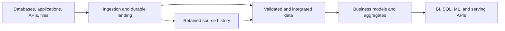

# Data Platform System Design: Data Engineer Interview Guide

Finance wants a reconciled revenue report every morning. Operations wants changes visible within a minute. Both depend on the same orders, yet they need different freshness and publication guarantees. Designing a data platform means connecting operational sources to trustworthy products for analytics, machine learning, and applications while making those requirements explicit. This guide follows the decisions that turn a diagram into a system you can defend.

**Scope:** Platform-neutral architecture and interview reasoning. Technologies are examples, not a required stack. Product-specific guarantees depend on the deployed version, connectors, configuration, and transaction boundaries. Selected primary documentation was checked on October 25, 2026.

**Running example:** Design a multi-tenant commerce analytics platform that ingests order changes, payment events, and application events. Operational dashboards need fresh data within one minute; finance needs reconciled daily results. Historical data must support corrections and replay.

**Related guides:** [Core engineering concepts](../foundations/core.md), [data warehousing](../storage-and-modeling/dwh.md), [replication](../ingestion/replication.md), [Kafka](../ingestion/kafka.md), [Spark](../processing/spark.md), and [Iceberg](../storage-and-modeling/iceberg.md).

## Contents

1. [How to Approach a System Design Interview](#1-how-to-approach-a-system-design-interview)
2. [Batch, Streaming, Lambda, and Kappa](#2-batch-streaming-lambda-and-kappa)
3. [Data Lake, Lakehouse, DWH, and Medallion](#3-data-lake-lakehouse-dwh-and-medallion)
4. [Ingestion, Processing, Storage, and Serving](#4-ingestion-processing-storage-and-serving)
5. [Partitioning, Scalability, and Capacity Planning](#5-partitioning-scalability-and-capacity-planning)
6. [Consistency, Fault Tolerance, Recovery, and Idempotency](#6-consistency-fault-tolerance-recovery-and-idempotency)
7. [Multi-tenancy, Workload Isolation, and Resource Management](#7-multi-tenancy-workload-isolation-and-resource-management)
8. [Data Contracts, Governance, and Observability](#8-data-contracts-governance-and-observability)
9. [Technology Selection and Performance/Cost Trade-offs](#9-technology-selection-and-performancecost-trade-offs)
10. [Worked Design: Commerce Analytics Platform](#10-worked-design-commerce-analytics-platform)
11. [Interview Practice](#11-interview-practice)

## 1. How to Approach a System Design Interview

### Start with the consumers and requirements

Begin with the person waiting for the data. What decision will they make, how fresh must the result be, and what would a wrong or missing answer cost them? Those questions establish what the platform must deliver and how it should behave during failure. Product choices become easier to justify once those requirements are clear.

| Area | Questions to ask | Design consequence |
| --- | --- | --- |
| Consumers | BI dashboards, ad hoc SQL, ML training, online APIs? | Different serving engines, layouts, and latency targets |
| Freshness | Seconds, minutes, hourly, or next morning? | Streaming, micro-batch, or scheduled batch |
| Correctness | Are approximate counts acceptable? Can results change later? | Provisional results, reconciliation, and publication rules |
| Sources | Databases, events, APIs, files? Do they expose changes and deletes? | CDC, event ingestion, snapshots, or incremental extraction |
| Scale | Average and peak events/s, bytes/event, growth, tenant distribution? | Partition count, compute, retention, and headroom |
| Queries | Filters, joins, result size, concurrency, p95/p99 latency? | Partitioning, clustering, indexing, and precomputation |
| History | How far back can data arrive or be corrected? | Retained inputs, state size, and backfill capacity |
| Reliability | Allowed data loss and recovery time? | Replication, checkpoints, backups, and disaster recovery |
| Security | Sensitive fields, tenant separation, residency requirements? | Access boundaries, masking, encryption, and placement |
| Operations | Team skills, budget, on-call capacity, existing systems? | Managed services, reuse, and operational complexity |

Separate **functional requirements** such as ingesting CDC and publishing daily revenue from **nonfunctional requirements** such as freshness, availability, isolation, and cost.

Distinguish related service objectives:

- **Freshness:** How far the usable output trails the source or business event.
- **Query latency:** How long a query takes after submission.
- **Availability:** Whether users can access the service and its promised functions.
- **Completeness:** Whether the expected records have arrived and been included.
- **RPO, recovery point objective:** How much data loss is acceptable after a disaster.
- **RTO, recovery time objective:** How long restoring the agreed service level may take.

A dashboard can return in 100 ms while showing yesterday's data. A pipeline can process recent events while missing an older source partition. Neither query speed nor the newest timestamp alone proves freshness and completeness.

### A practical interview sequence

For a 45-minute interview, a useful allocation is:

1. **5 minutes:** Clarify consumers, requirements, assumptions, and exclusions.
2. **5 minutes:** Estimate throughput, storage, state, and recovery needs.
3. **10 minutes:** Draw sources, durable boundaries, processing, and serving.
4. **15 minutes:** Explore correctness, partitioning, failure recovery, and isolation.
5. **5 minutes:** Discuss security, observability, and operating cost.
6. **5 minutes:** Address follow-ups and explain the main trade-offs.

State assumptions explicitly and revise them when the interviewer adds information. Spend detail on the hardest requirement instead of giving every component equal attention.

## 2. Batch, Streaming, Lambda, and Kappa

### Batch processing

If finance needs yesterday's reconciled orders by morning, a bounded computation may be enough. **Batch processing** works on a finite dataset, such as a daily export, a partition, or a fixed range of source changes. A scheduler or data-availability signal starts the job; the boundary gives it a defined scope to validate and publish.

**Typical flow:** Extract files or changes → durable landing → transform a bounded range → validate → publish.

Batch suits daily financial reporting, historical rebuilds, large joins, and workloads where minutes or hours of delay are acceptable. It can use compute only while work runs and makes it easier to validate a complete input range before publication.

The cost is delayed results and potentially large reruns. A daily job that takes six hours leaves little room for recovery before an early-morning deadline. Incremental batches reduce work but require reliable change detection and correct handling of updates and deletes.

**Interview point:** Batch does not mean full refresh. A five-minute job that processes only newly committed changes is incremental batch processing.

### Streaming and micro-batch processing

Streaming continuously processes a potentially unbounded input. Stateful computations retain information across events, such as aggregates, deduplication keys, or join state.

**Typical flow:** Events or CDC → durable log → stateful processing → incremental serving updates.

Streaming suits operational dashboards, anomaly detection, and applications where the value of data falls quickly with delay. It introduces persistent state, out-of-order records, backpressure, checkpoints, and correction policies.

Micro-batch handles a stream as a sequence of small bounded batches. A processing engine may offer a streaming interface while executing work in micro-batches. The business requirement determines whether the resulting latency is sufficient.

| Property | Scheduled batch | Micro-batch | Continuous streaming |
| --- | --- | --- | --- |
| Input execution unit | Bounded dataset or range | Small bounded range | Records flowing through operators |
| Typical freshness goal | Minutes to days | Seconds to minutes | Milliseconds to seconds, workload-dependent |
| State | Often persisted between jobs | State across batches when needed | State across records when needed |
| Recovery | Retry a batch or affected range | Replay a batch with consistent progress | Restore state and replay input |
| Common operating challenge | Missed deadline or expensive rerun | Scheduling/commit overhead and batch duration | State growth, backpressure, and checkpoint health |

These are patterns, not hard latency guarantees. A slow source, a long window, or an overloaded sink can dominate end-to-end delay regardless of execution model.

### Event time, watermarks, and late data

**Event time** is when a business event occurred; **processing time** is when an operator handles it. Replaying yesterday's events today should usually update yesterday's business results.

A watermark expresses estimated event-time progress and lets operators decide when to emit window results or release state. It does not prove that all older events have arrived. Parallel inputs can advance at different speeds; idle inputs need an explicit policy. See [Apache Flink's time model](https://nightlies.apache.org/flink/flink-docs-stable/docs/concepts/time/) and [watermark guidance](https://nightlies.apache.org/flink/flink-docs-stable/docs/dev/datastream/event-time/generating_watermarks/).

Define what happens after a result is first emitted:

- Accept late records within a specified horizon and publish corrected aggregates.
- Route records beyond that horizon to a repair path.
- Mark operational results provisional until reconciliation completes.

For example, an hourly sales chart can update after a late payment arrives. A closed accounting report may require a separately tracked adjustment. The business decides the policy; the processor implements it.

### Lambda architecture

Lambda maintains separate paths for low-latency results and historical correctness:

```text
                         +--> batch over retained history --> batch views --+
Source --> durable input |                                                  +--> serving
                         +--> speed processing ------------> recent views -+
```

The serving layer combines a historical view with recent results until the batch path incorporates them.

**Benefit:** The platform can deliver quick results while recomputing complete historical views with batch processing.

**Cost:** Two paths must agree on business logic, event identity, corrections, and the boundary between historical and recent data. Combining views without a precise cutover can double count or omit records.

Choose Lambda when both paths solve a concrete requirement that a simpler design cannot meet. A platform containing both batch and streaming jobs is not automatically Lambda; the defining concern is the two complementary result paths.

### Kappa architecture

Kappa uses one main stream-processing path. To change logic or repair history, replay retained events through a new processing version, rebuild its outputs, validate them, and switch consumers.

```text
Retained event history --> versioned stream processing --> materialized views
                                  ^
                                  +-- replay for rebuilds
```

**Benefit:** One main computation model reduces divergence between live and replay logic.

**Cost:** Replay depends on retained history, reproducible transformations, recoverable state, and sufficient catch-up capacity. A compacted current-state topic cannot reconstruct every historical transition. Historical reference data may also be needed to reproduce past joins.

Kappa does not require keeping every event forever in a broker. An archive can retain history, but replaying that archive must preserve the semantics required by the processing path. Large historical joins may still be more practical as bounded computations.

### Choosing the simplest suitable pattern

- Start with scheduled incremental batch when its freshness meets the requirement.
- Use micro-batch when shorter intervals meet the requirement without needing record-level processing.
- Use continuous streaming when latency or continuously maintained state justifies its operating cost.
- Consider Kappa when durable replay and a common processing model fit the workload.
- Consider Lambda when separate historical and low-latency paths provide enough value to justify reconciliation complexity.

**Example:** Daily finance reports alone do not justify continuous streaming. Adding a one-minute operational dashboard may justify a streaming serving path while finance still reads reconciled historical data.

## 3. Data Lake, Lakehouse, DWH, and Medallion

### Data lake vs. lakehouse vs. warehouse

A design discussion can get stuck on whether the platform is a lake, lakehouse, or warehouse before anyone explains how its tables become reliable. Use the categories to describe capabilities and responsibilities, then check which ones the workload actually needs. File storage, table transactions, and governed analytical serving solve different parts of the problem.

| Architecture | Main idea | Strengths | Responsibilities and limitations |
| --- | --- | --- | --- |
| Data lake | Store diverse data in scalable file/object storage | Flexible formats, economical history, broad processing options | Files alone do not provide table transactions, quality, or discoverability |
| Lakehouse | Add managed table semantics and analytical capabilities over lake storage | Transactional tables, snapshots, schema management, multiple workloads | Requires compatible engines, catalogs, maintenance, and access enforcement |
| Data warehouse, DWH | Provide an integrated analytical database and curated business data | SQL analytics, workload management, BI integration, governed models | Loading, modeling, concurrency, portability, and cost still need design |

These categories overlap. A modern warehouse may separate storage and compute and query external lake data. A lakehouse can serve warehouse-style dimensional models. Compare actual capabilities and guarantees rather than treating product categories as exclusive.

### File format, table format, catalog, and engine

Keep four responsibilities separate:

- **File format:** Parquet or ORC organizes values within files; Avro is another common serialization format.
- **Table format:** Iceberg, Delta Lake, or Hudi tracks table state, files, metadata, and changes according to its protocol.
- **Catalog:** Locates tables and metadata and may coordinate commits and governance integration.
- **Execution engine:** Reads and transforms data, plans queries, and performs supported writes.

Parquet files in a directory do not by themselves make a transactional table. An open table format does not guarantee that every engine supports every feature or that several tables can be committed atomically together.

Catalog permissions also do not protect data if a user can bypass the catalog and read the underlying files directly. Align storage permissions and query access with the intended trust boundary.

### Medallion architecture

Medallion organizes data by progressive refinement. It is a data-design pattern, independent of whether transformations run in batch or streaming. The common names are bronze, silver, and gold. See [Databricks' medallion overview](https://docs.databricks.com/aws/en/lakehouse/medallion).

| Layer | Purpose | Commerce example |
| --- | --- | --- |
| Bronze | Retain source records with provenance for audit and replay | Original order changes with source position and ingestion time |
| Silver | Produce validated, deduplicated, consistently typed data | Order versions with normalized timestamps and explicit delete handling |
| Gold | Publish consumer-oriented models and metrics | Daily net revenue by tenant, currency, and business date |

Bronze is minimally transformed, but ingestion still enforces authorization, safe payload limits, and controlled handling of invalid or sensitive data. Raw data needs retention and access controls too.

Silver should establish reusable correctness rules such as identity and update ordering. Gold should define business semantics such as whether revenue means authorized, captured, settled, or refunded amounts.

Three named layers do not automatically provide quality or transactions. Add physical copies only where replay, ownership, performance, or a publication boundary justifies them. Small platforms may need fewer layers; complex domains may need more.

### Medallion vs. platform layers

Medallion describes the quality and purpose of datasets. Ingestion, processing, storage, and serving describe system responsibilities.

An ingestion service can write bronze tables; a processing job can produce silver and gold tables; storage holds all three; a serving engine can query gold. They are different views of the same platform.

## 4. Ingestion, Processing, Storage, and Serving

### A reference flow

Follow an order from the operational source to a dashboard. Along the way, it crosses ingestion, validation, integration, and business modeling boundaries. Each boundary should explain what is durable, what is trusted, and where replay begins. The reference flow below provides a structure for those decisions.



Processing transforms data between durable storage boundaries. Catalogs, orchestration, access controls, contracts, and observability apply across the flow.

### Ingestion: capture changes without gaps

| Source pattern | Useful when | Main correctness questions |
| --- | --- | --- |
| Full snapshot | Small datasets or initial load | Is it a consistent snapshot? How are deletions detected? |
| Incremental query | Reliable modification marker exists | Can timestamps collide or change late? How are deletes captured? |
| Log-based CDC | Database changes and delete history matter | How do snapshot and log positions align? What if logs expire? |
| Application events | Business intent is emitted explicitly | Can the database commit succeed while event publication fails? |
| API polling | Source exposes only an API | Pagination consistency, rate limits, cursor expiry, and retries |
| File delivery | Partners or systems export datasets | Complete-file detection, manifest, checksum, identity, and replacement policy |

For CDC bootstrap, coordinate the initial snapshot with a source-log position so changes during the snapshot are neither missed nor incorrectly duplicated. Monitor source-log retention while the connector is unavailable.

For application events, the **transactional outbox** records the business change and an event record in the same database transaction. A relay publishes outbox records with retry. This closes the database/event dual-write gap, but consumers still need duplicate handling.

For timestamp-based extraction, a lookback interval plus deduplication can handle some late updates. It cannot recover arbitrary source changes or deletes that the extraction mechanism never exposes.

### Record identity and provenance

Retain enough metadata to explain and replay a record:

| Field | Purpose |
| --- | --- |
| Tenant identity | Ownership and access boundary |
| Entity key | Which order, customer, or payment changed |
| Event/change identity | Detect the same logical change on retry |
| Source position or entity version | Apply changes in a defined order |
| Operation type | Insert, update, delete, or domain event |
| Event time | Business-time calculations |
| Ingestion time | Pipeline delay and incident analysis |
| Schema version | Decode and validate the payload |
| Source and processing version | Trace provenance and reproduce transformations |

An entity key is not an event identity: one order can have many legitimate changes. A broker offset identifies a position within a partition, not a universal business version across sources.

### Processing: establish business meaning

Separate common responsibilities:

1. Validate structure and required metadata; quarantine invalid records with actionable reasons.
2. Deduplicate repeated changes using stable identity and an explicit retention horizon.
3. Apply entity updates and deletes using the source's ordering semantics.
4. Enrich records using the appropriate reference-data version.
5. Build business models at a declared grain.
6. Validate and publish outputs with a defined visibility boundary.

**ETL** transforms before loading into the target analytical store. **ELT** loads first and transforms using the target's compute. The distinction depends on the target boundary: transforming bronze into silver is ELT relative to bronze landing, even if another downstream warehouse receives already transformed data.

An orchestrator manages dependencies, retries, schedules, and backfills. It does not make writes atomic or business results correct. Streaming jobs additionally need supervision for long-running state, checkpoints, and upgrades.

### Storage: design for both reads and recovery

Choose storage around retained history, update patterns, query access, and restore requirements:

- A durable log decouples producers and consumers and supports replay within its retention.
- Object storage retains large historical datasets and versioned analytical files.
- Analytical tables provide managed metadata and supported transaction semantics.
- Serving stores organize data for predictable read paths and concurrency.

Keep raw inputs, processing checkpoints, table metadata, schemas, and necessary reference history recoverable. Retaining data files while losing the catalog, permissions, or encryption-key access may still prevent recovery.

Define retention separately for source history, deduplication state, checkpoints, table snapshots, aggregates, and backups. Their horizons must support the promised correction and recovery procedures.

### Serving: select for the access pattern

| Consumer | Suitable pattern | Important requirement |
| --- | --- | --- |
| BI and governed reporting | Warehouse/lakehouse SQL with curated models | Consistent definitions, concurrency, and predictable freshness |
| Exploratory analysis | SQL engine over detailed historical tables | Scan efficiency, quotas, and discoverability |
| Operational dashboard | Indexed OLAP store or incremental aggregates | Frequent updates and low-latency concurrent reads |
| Application point lookup | Key-value or relational serving store | Key-based access and predictable tail latency |
| ML training | Versioned datasets and reproducible feature computation | Point-in-time correctness and lineage |
| Online inference | Online feature/lookup store when required | Freshness and consistency with training definitions |

Do not require an analytical lake scan for every interactive point lookup. Equally, do not add a dedicated serving database if an existing engine already meets the measured latency and concurrency requirement.

When several outputs form one report, publishing tables independently can expose mixed versions. Use an engine-supported transaction, versioned datasets with a release manifest, or another explicit mechanism that pins readers to a coherent release.

## 5. Partitioning, Scalability, and Capacity Planning

### Different kinds of partitioning

The key that keeps one order's events in sequence may be a poor choice for pruning a year's analytical history. Partitioning has a different job at each layer. Identify the boundary—broker, processor, storage layout, or database distribution—before choosing a key or estimating useful parallelism.

| Type | What it controls | Example |
| --- | --- | --- |
| Broker partition | Ordering and source-consumer parallelism | Route order changes by a hash of tenant and order ID |
| Processing partition | Which worker handles a key or shuffle range | Group payments by tenant and account |
| Storage partition | Which files can be skipped for a filter | Organize events by event date |
| Database shard/distribution | Placement across database nodes | Distribute entities by a stable hash |

One key rarely optimizes every layer. Broker ordering needs may favor an entity key while analytical queries benefit from time-based pruning.

### Partition-key selection and skew

A useful partitioning strategy balances data volume, preserves required ordering, and matches access patterns.

- **Hash partitioning** spreads keys, but a single very hot key remains hot.
- **Range partitioning** supports locality and range access, but uneven ranges can overload one partition.
- **Time partitioning** helps historical pruning and retention, but recent writes concentrate in active ranges.
- **Composite strategies** combine time with bucketing or clustering when the workload justifies it.

For the commerce example, hashing `(tenant_id, order_id)` can distribute order changes while keeping one order together under stable routing. Hashing only `tenant_id` may overload one partition for the largest merchant. A composite key does not guarantee tenant-wide ordering.

Salting splits a hot aggregation key into subkeys and merges partial results afterward. It works for mergeable aggregates such as sums; it cannot preserve an arbitrary strict sequence for one entity. Sometimes the requirement must change or that entity must remain serial.

Changing partition counts can change key routing. If ordering matters, plan the transition using version checks, coordinated producer cutover, or another compatible migration strategy.

### Storage layout, pruning, and small files

Choose storage partitions from frequent filters and expected volume per partition. Avoid one directory per customer when millions of mostly empty partitions would create metadata and file-management overhead.

Partition pruning skips groups of files; clustering/sorting and file statistics can skip more data within a partition. File size is a workload choice: excessively small files increase listing, planning, and scheduling overhead; excessively large files can reduce useful parallelism and increase rewrite cost.

Compaction trades extra writes and compute for fewer, better-sized files. Schedule it so it does not compete with critical ingestion or queries.

Some table formats support partition evolution. For example, Iceberg can retain old and new partition specifications together; changing the specification does not automatically rewrite historical files. See [Iceberg partition evolution](https://iceberg.apache.org/docs/latest/evolution/#partition-evolution).

### Estimate input rate and storage

Assume the following **illustrative workload**, using decimal units:

- 100 million events/day.
- 1 KB per serialized event before compression.
- Peak rate is 10 times the daily average.
- Seven days of broker retention with three replicas.
- One year of raw history; assume measured compression is 3:1.

```text
Average events/s = 100,000,000 / 86,400                 ≈ 1,157
Peak events/s    = 1,157 × 10                          ≈ 11,574
Raw bytes/day   = 100,000,000 × 1,000                   = 100 GB
Peak input rate = 11,574 × 1,000                        ≈ 11.6 MB/s
Broker storage  = 100 GB/day × 7 days × 3 replicas      = 2.1 TB
Raw archive     = 100 GB/day × 365 days / 3 compression ≈ 12.2 TB
```

Broker storage is an uncompressed baseline. Add measured compression effects, indexes, protocol overhead, growth, disk headroom, and replication/recovery traffic. The archive estimate excludes silver/gold copies, snapshots, checkpoints, temporary data, and any additional replication billed separately by the storage service.

Do not assume that raw input size equals query scan size or shuffle volume. A wide join can create much more intermediate data than ingestion produces.

### Estimate processing parallelism and state

For a stage with measured sustainable per-worker throughput:

```text
Workers >= ceiling(required throughput / (worker throughput × target utilization))
```

If a tested worker handles 2,000 events/s and the design targets 60% utilization, the example peak needs `ceil(11,574 / 1,200) = 10` workers for that stage. This is a sizing hypothesis, not a product benchmark. CPU cost per event, serialization, state, network, skew, and sink limits determine the real result.

In a conventional Kafka consumer group, a partition is assigned to one consumer at a time. More active source consumers require enough partitions; downstream operators can have different parallelism. More partitions also add metadata, connections, and recovery overhead. See [Kafka's design documentation](https://kafka.apache.org/41/design/design/).

State can dominate capacity:

```text
State size ≈ active keys × bytes/key × retained versions/windows + overhead
```

Ten million active keys at 200 bytes each already imply 2 GB of logical state before indexes, serialization, allocator overhead, and checkpoints. A state TTL must follow the correction and replay semantics; shrinking it solely to save memory may admit duplicates or lose valid joins.

### Recovery capacity and backlog

Let arrival rate be `λ`, available processing rate be `μ`, and outage duration be `T`:

```text
Backlog after outage ≈ λ × T
Catch-up time        ≈ backlog / (μ - λ), provided μ > λ
```

At 1,157 events/s, a four-hour outage creates about 16.7 million events. At 10,000 events/s processing capacity with the average arrival rate continuing, catch-up takes about 31.4 minutes. This excludes failure detection, provisioning, state restore, validation, and publication. Peak arrivals would exceed that processing capacity, so the same design would not catch up during a sustained peak.

Retention must cover the outage, restore, catch-up, and safety margin. Retaining a day of events while promising recovery from a two-day outage creates a gap unless an archive or source can restore the missing input.

### Query concurrency and scaling limits

Measure query arrival rate, service time, scanned bytes, memory per query, and queue time. Under stable conditions, Little's Law gives `average requests in system = arrival rate × average time in system`; it does not predict tail latency during overload.

Scaling helps only when the bottleneck can use the new capacity. A hot key, serialized commit, source API quota, metadata service, or saturated sink may cap throughput regardless of worker count. Autoscaling also needs time for provisioning and state redistribution.

## 6. Consistency, Fault Tolerance, Recovery, and Idempotency

### Name the consistency boundary

A dashboard may see a coherent version of one table while combining it with an older version of another. Calling the whole platform 'consistent' hides that distinction. Ask which reader sees which state, across which boundary, and under which failures; then give the guarantee a precise scope.

| Boundary | Relevant guarantee |
| --- | --- |
| One entity's changes | Defined ordering and prevention of stale overwrites |
| One table commit | Readers see an atomic supported table version |
| Several related tables | A coherent release or supported multi-table transaction |
| Source vs. analytical copy | Defined lag and reconciliation, not instant equality by default |
| Several serving stores | Coordinated publication or explicitly eventual convergence |

An ACID table commit does not make the whole pipeline transactional. A consistent snapshot can still contain yesterday's data. Independent CDC streams can expose different parts of one source transaction at different times unless the ingestion and publication design preserves that boundary.

CAP concerns behavior during a network partition: a distributed system cannot always provide both linearizable consistency and availability for every request. It does not mean choosing two arbitrary properties once for an entire platform. Define the critical operation: for example, reject an uncertain ledger publication while continuing to serve the last validated dashboard version.

### Delivery semantics and exactly-once effects

- **At most once:** A failure can lose work because progress may advance before the effect is durable.
- **At least once:** Work can repeat because an effect may commit before progress is recorded.
- **Exactly-once effects:** Recovery produces the intended single committed effect within a stated boundary, even if processing executes more than once.

For example, Kafka transactions can coordinate Kafka output records and consumed offsets; they do not automatically include a separate database or an HTTP side effect. The external sink needs compatible transaction coordination or idempotent application. See [Kafka's delivery semantics](https://kafka.apache.org/41/design/design/#message-delivery-semantics).

**Interview test:** Ask what happens if a worker commits the sink write and crashes before saving progress. If the answer is “the record replays,” the next question is why replay does not duplicate the effect.

### Idempotency: make retries safe

An operation is idempotent when repeating the same logical operation has the same effect as applying it once.

| Write pattern | Why replay can be safe | Important condition |
| --- | --- | --- |
| Insert event by stable identity | Duplicate insert cannot create another logical event | Identity uniqueness is enforced atomically |
| Upsert latest entity state | Replay writes the same or an older version | Conditional version comparison prevents stale overwrites |
| Replace a bounded output range | Retry publishes the same complete range | Atomic replacement and protection from concurrent writers |
| Store aggregate by key and revision | Retry replaces the same aggregate version | Deterministic calculation and ordered revisions |
| Apply increment with operation ledger | Previously applied operation is recognized | Recording identity and increment are atomic |

`balance = balance + amount` is not idempotent by itself. `MERGE` is not automatically safe either: source rows can contain duplicate keys, old versions can arrive late, and concurrent writers can race.

For current-state tables, use a comparable source version within each entity's history. Apply a newer version, ignore an identical replay, and investigate conflicting payloads for the same version. A delete should retain enough version/tombstone information to prevent an older replay from resurrecting the entity.

Deduplication history must cover the promised replay horizon, or older replays must rebuild a separate output version. Generating a new random event ID on every retry defeats deduplication.

### Fault tolerance and checkpoints

Replication keeps a service available through some component failures. Checkpoints support consistent processing recovery. Backups provide independent recovery points for corruption, accidental deletion, or disaster. They solve different problems.

Place replicas across the failure domains the design must survive, such as hosts or availability zones. Match write acknowledgments, replication health, and failover rules to the durability promise; three replicas alone do not prove that an acknowledged write survives a failure.

A stateful stream checkpoint must align operator state with source positions. Recovery restores that state and replays input from corresponding positions. Exactly-once state recovery alone does not establish exactly-once external effects; sources must be replayable and sinks need compatible transactional or idempotent behavior. See [Flink fault tolerance](https://nightlies.apache.org/flink/flink-docs-stable/docs/learn-flink/fault_tolerance/).

Monitor checkpoint completion, age, duration, failures, and restore time. A running processor with failing checkpoints can appear healthy until a restart forces a much larger replay than expected.

### Retry, quarantine, and backpressure

Retry transient failures with bounded exponential backoff and jitter. Preserve the same operation identity. Unbounded immediate retries can overload a dependency and prevent recovery.

Malformed records or incompatible schemas need a quarantine path with source identity, error reason, and controlled access. Assign ownership, alert on volume and age, and support repair/replay. A dead-letter queue that nobody inspects silently loses business coverage.

Skipping one invalid event may break per-entity ordering or financial correctness. For critical streams, pause the affected partition/entity or withhold publication until the gap is resolved.

Backpressure occurs when downstream capacity cannot keep up. Buffering absorbs temporary bursts; it does not fix a permanent rate mismatch. Bound buffers, monitor lag, protect source systems, and define admission or load-shedding rules only for workloads where dropping data is acceptable.

### Backfills and disaster recovery

A safe historical correction is a controlled data release:

1. Identify the affected source range, transformation version, and downstream dependencies.
2. Verify that retained input and historical reference data can reproduce the required result.
3. Rebuild in an isolated output version with limited resources.
4. Reconcile counts, keys, amounts, deletes, and relevant business invariants.
5. Catch up with live input or establish a precise cutover boundary.
6. Switch readers atomically where supported and retain the previous version for rollback.
7. Repair dependent caches, aggregates, exports, and features as required.

An event-time range may depend on earlier state or later corrections. A monthly revenue rebuild may need refund events outside the month and historical exchange rates. Do not assume that reading the target dates alone is sufficient.

For disaster recovery, test restoring data, metadata, credentials/access, processing state, and serving configuration. Measure recovery through the agreed usable service level, including catch-up and validation. Replication is not an independent backup when it propagates a bad delete or corrupt write.

## 7. Multi-tenancy, Workload Isolation, and Resource Management

### Separate security isolation from performance isolation

Two tenants can be unable to read each other's records and still interfere badly when one consumes all the workers. **Multi-tenancy** means customers, teams, or domains share some resources; isolation must therefore cover more than data access. Separate these dimensions when deciding what each tenant can affect:

- **Data:** A tenant cannot read or modify another tenant's records.
- **Compute:** One workload cannot exhaust all CPU, memory, or execution slots.
- **Storage and I/O:** One tenant cannot consume all capacity or bandwidth.
- **Failure:** An incident has a bounded impact on other tenants.
- **Operations:** Ownership, costs, quotas, and service levels are attributable.

A namespace can organize resources without enforcing any of these boundaries. Separate compute pools may improve performance isolation while still sharing a catalog, broker, storage system, or network bottleneck.

### Isolation models

| Model | Benefits | Costs and risks |
| --- | --- | --- |
| Shared tables with tenant keys | Efficient storage and common maintenance | Requires enforced row-level access; shared compute and accidental cross-tenant join risks |
| Separate schemas/databases | Clearer ownership and lifecycle | Isolation strength depends on permissions and shared infrastructure |
| Dedicated compute on shared storage | More predictable workload capacity | Shared metadata, storage, and access paths still need protection |
| Dedicated deployment/account/project | Stronger operational and security boundaries | More provisioning, upgrades, monitoring, and baseline cost |

A hybrid model can pool small tenants and dedicate resources to large or regulated tenants. Choose it because of measured workload or contractual requirements, not because every tenant needs a unique cluster.

### Tenant-aware correctness and access

Include tenant identity in entity keys, deduplication keys, joins, state keys, and caches where IDs are only unique within a tenant. Joining two tables on `order_id` alone can mix tenants even if the final query filters by tenant.

At external API and ingestion boundaries, validate identity and derive authorized tenant scope from a trusted principal or mapping. Do not trust an arbitrary request field to grant access to that tenant.

Use database/storage-enforced access controls where possible. Application filters alone are easy to omit in one query or export path. Apply the same boundaries to raw files, checkpoints, quarantine records, cached results, logs, and backups.

### Workload isolation and admission control

Separate interactive queries, scheduled reporting, ingestion, and historical backfills when they have competing service objectives.

Useful controls include:

- Resource pools or queues with minimum reservations and maximum limits.
- Per-tenant concurrency, memory, request-rate, and scanned-byte limits.
- Weighted fair scheduling and protection against starvation.
- Query timeouts, cancellation, and workload admission before resources are exhausted.
- Lower-priority backfill pools with explicit I/O and sink-write budgets.
- Autoscaling limits and budget controls tied to service objectives.

Priority alone is insufficient if low-priority work already occupies non-preemptible capacity. Reserve enough capacity for critical work or support effective preemption.

### Noisy neighbors and resource management

When one tenant causes latency spikes, inspect CPU, memory, spilling, queue time, disk/network throughput, metadata requests, and hot keys. Scaling a shared pool may hide the issue while increasing costs for everyone.

Track consumption by tenant and workload, using showback or chargeback where useful. Include shared services and maintenance in the model; query compute alone understates platform cost.

Autoscale on signals that reflect the bottleneck: lag and input rate for ingestion, queue time for interactive queries, or state/memory pressure for stateful processing. Set limits and retain recovery headroom. CPU utilization alone can miss an I/O-bound or sink-bound workload.

## 8. Data Contracts, Governance, and Observability

### Data contracts: make producer/consumer expectations explicit

A source box on a diagram should carry enough information to explain what downstream consumers may rely on: dataset grain, tenant-scoped keys, change identity, ordering, deletes, replay horizon, freshness, ownership, and permitted uses. Those are concrete design assumptions. [Data contracts and schema management](../quality-and-governance/data-contracts.md) covers the full contract structure and compatibility rules behind them.

Do not label the source “exactly once” without explaining the boundary. Similarly, “daily delivery” needs a timezone, deadline, completeness signal, and late-delivery policy.

### Schema and semantic evolution

Apply the [schema migration procedure](../quality-and-governance/data-contracts.md#5-schema-evolution-breaking-changes--versioning) to the complete path, including historical replay. In the design, identify which consumers move first, where both versions coexist, and how you verify that meanings and units remain consistent.

Enforce contracts at both development and runtime boundaries:

1. Check proposed schema and semantic changes against supported consumers.
2. Validate incoming records and monitor contract violations.
3. Roll out additive changes before making consumers depend on them.
4. For breaking changes, support a migration period with versioned datasets or another explicit compatibility strategy.
5. Verify both live processing and historical replay before retiring old readers or schemas.

### Governance and access

Governance makes data discoverable, understandable, controlled, and accountable:

- A catalog records datasets, owners, definitions, classifications, and locations.
- Lineage connects source changes, transformation versions, and published outputs.
- Least-privilege access applies to storage, engines, service identities, and exports.
- Row/column policies, masking, or tokenization reduce unnecessary exposure.
- Encryption protects data in transit and at rest; key access and lifecycle remain part of the design.
- Audit logs record access and administrative changes without unnecessarily copying sensitive payloads.

Separate discovery permission from read permission. A user may be allowed to find a dataset's description without reading its sensitive columns.

Retention and deletion must reach derived tables, serving stores, caches, exports, and backups according to the applicable policy. Append-only raw storage does not remove deletion obligations. Plan how historical replay avoids reintroducing data that should remain deleted.

Data mesh is an ownership and operating model: domains own data products while shared standards and infrastructure provide interoperability. It is not a storage engine or a synonym for distributing files across buckets. Centralized storage and domain ownership can coexist.

### Observability: infrastructure health and data health

| Dimension | Signals | What they reveal |
| --- | --- | --- |
| Ingestion | Source progress, oldest unprocessed event, lag, source-log headroom | Falling behind or approaching unrecoverable input loss |
| Processing | Throughput, errors, restarts, skew, backpressure, state growth | Bottlenecks and unstable computation |
| Recovery | Checkpoint age/duration, restore tests, replay rate | Ability to survive the next failure |
| Storage | File count/size, commit failures, metadata latency, capacity | Maintenance debt and storage bottlenecks |
| Serving | p95/p99 latency, queue time, concurrency, cache behavior | User-facing performance and overload |
| Data | Missing intervals, duplicates, nulls, freshness, reconciliation | Semantically incorrect or incomplete output |
| Tenants and cost | Resource consumption, quota breaches, unit cost | Noisy neighbors and budget changes |

Logs explain individual failures; metrics expose trends and alert conditions; traces or correlation IDs help follow operations through components. For batched data, source ranges, run IDs, table snapshots, and release IDs often provide more useful lineage than tracing every record.

### SLOs, reconciliation, and alerting

Write service objectives in consumer terms. For example:

- At least 99% of eligible operational events become queryable within 60 seconds of source commit over a defined measurement window.
- The daily finance dataset is reconciled and published by 07:00 in the agreed business timezone.
- Interactive dashboard queries meet a p95 latency target at a stated concurrency and tenant mix.

Define eligibility and start/end timestamps so measurements cannot hide source-side delay or exclude difficult events silently. Measure lateness from event time separately if client timestamps are unreliable.

Reconcile source and target at comparable boundaries: source position, business date, currency, and tenant. Track counts and amounts, missing keys, duplicates, and deletes. A total row count can match while the wrong records are present; aggregate amounts can match while currencies or tenants are mixed.

Alert on user impact, expected missing deliveries, rapidly consuming freshness budgets, and threats to recoverability. Track quarantine age and unresolved reconciliation differences. Successful job status alone proves neither data correctness nor consumer readiness.

## 9. Technology Selection and Performance/Cost Trade-offs

### Choose capabilities before product names

Once the required behavior is clear, choose the component that can provide it. A retained stream, a batch engine, and a transactional table format belong in a design for different reasons. The examples below connect capabilities to candidates, while leaving room to reuse an existing component that already meets the requirement.

| Requirement | Capability to evaluate | Illustrative options |
| --- | --- | --- |
| Durable ordered change stream | Retention, replay, partitioning, producer/consumer guarantees | Kafka or a managed event-stream service |
| Large bounded transformations | Distributed joins, shuffle handling, incremental processing | Spark, warehouse SQL, or another batch engine |
| Low-latency stateful computation | Event time, state management, checkpoints, compatible sinks | Flink or another stream processor |
| Historical analytical storage | Columnar scans, table transactions, catalog integration | Object storage with supported Iceberg/Delta/Hudi tables |
| Governed SQL and BI | Concurrency, modeling, access controls, workload management | A managed warehouse or lakehouse SQL engine |
| Interactive operational analytics | Fast filtering/aggregation with frequent ingest | ClickHouse, Pinot, Druid, or an existing engine that meets the SLO |
| Dependency management | Scheduling, retries, data-aware dependencies, backfills | Existing orchestrator or platform-native workflow service |
| Transformation modeling | Versioned SQL models, tests, lineage, deployment | dbt or existing transformation tooling |

These tools can overlap in capability. An orchestrator does not replace a processing engine; dbt does not replace a database; a table format does not execute queries. Prefer an existing component when it meets the requirement.

### Evaluate the complete operating model

Compare candidates on:

1. Required semantics: ordering, transactions, deletes, corrections, and replay.
2. Measured throughput and tail latency under realistic data and concurrency.
3. Failure behavior, restore time, and compatibility during upgrades.
4. Security, tenancy, catalog, and connector integration.
5. Team expertise and ongoing on-call/maintenance burden.
6. Total cost, including idle resources, storage, scans, network, and operations.
7. Portability of data, metadata, and transformations if migration becomes necessary.

Open file/table formats can reduce some migration costs, but engine-specific SQL, permissions, catalogs, extensions, and operational procedures can still create coupling.

### Common performance and cost trade-offs

| Choice | What improves | What becomes more expensive or difficult |
| --- | --- | --- |
| Continuous low-latency processing | Freshness | Always-on compute, state, and operational work |
| Larger batches | Amortized scheduling and commit cost | Freshness and amount of work retried |
| More partitions/workers | Potential parallelism | Metadata, shuffle, coordination, and recovery overhead |
| More precomputed aggregates | Repeated query latency | Storage, refresh cost, and handling corrections |
| Stronger compression | Storage and network volume | CPU and sometimes read/write latency |
| More retained history | Replay and audit options | Storage, governance, and maintenance |
| Dedicated tenant resources | Predictability and fault isolation | Idle capacity and operational overhead |
| Stronger publication coordination | Coherent cross-output reads | Coordination cost and reduced availability during uncertainty |
| Managed services | Less infrastructure maintenance | Service constraints, pricing exposure, and vendor coupling |
| Separate serving stores | Specialized access performance | Additional copies, lag, reconciliation, and failure paths |

Optimize expensive work before simply buying more capacity: reduce scanned columns, prune partitions, avoid unnecessary shuffles, use appropriate join strategies, fix skew, compact small files, and precompute only repeated expensive queries.

Keep a cost model such as:

```text
Total cost = ingest + compute + storage + requests + network
           + serving + maintenance/recovery + operating effort
```

Track unit costs such as cost per million events, per successful query, or per tenant at a defined service level. Lower cost per event is misleading if freshness worsens or recovery capacity disappears.

### Benchmark a representative workload

Use actual event sizes and key distributions, realistic tenant skew, representative joins/filters, and the required concurrent workload. Include cold-cache queries, burst traffic, late events, duplicates, sink throttling, checkpoint restore, and replay while live traffic continues.

A single warm query or a vendor throughput number does not establish platform capacity. Measure the entire path and identify which component limits it before choosing a larger deployment.

## 10. Worked Design: Commerce Analytics Platform

### Requirements and assumptions

Now put the pieces together for the commerce platform. Carry forward the capacity assumptions from Section 5, then add the tenant boundaries, consumer deadlines, history, and recovery expectations below. These assumptions define what the worked design must accomplish and which guarantees still require separate agreement.

- 200 tenants with uneven traffic; entity IDs are unique only within a tenant.
- Order/payment database changes and application events are independent inputs.
- Operational dashboards target 99% of eligible records queryable within one minute of source commit; results may be corrected.
- Finance needs daily reconciled revenue by tenant, business date, and currency by 07:00.
- Raw history is retained for one year under controlled access and deletion policy.
- Operational serving should recover within one hour for a defined worker/pool failure scenario; regional disaster objectives require separate agreement.
- No acknowledged input loss is intended within the explicitly supported failure model; independent disaster RPO must be specified and tested.

Order and payment streams do not automatically share an atomic snapshot. Financial publication must use agreed source boundaries and reconcile business state before declaring a day complete.

### Proposed flow

```text
Order/payment databases -- CDC --+
                                +--> durable log --> retained bronze history
Application events -------------+          |
                                           v
                                  validate, deduplicate,
                                  order entity changes
                                           |
                                           v
                                    silver datasets
                                     /           \
                                    v             v
                         operational models    finance models
                                  |                 |
                                  v                 v
                         dashboard serving    validated daily release
```

Use CDC with a coordinated bootstrap for database changes. Use an outbox where application-generated business events must be coupled to a database transaction. Broker retention covers ordinary outages; the archive supports longer historical rebuilds.

Produce silver records with tenant-scoped identity, source versions, explicit deletes, normalized timestamps, and preserved provenance. Use the simplest processing mode that meets each branch's latency: streaming or short micro-batches for operational data, bounded incremental transformations for finance.

This is a mixed batch/stream platform. It does not need Lambda's combined batch-and-speed views because operational dashboards and finance publish separate products with explicit semantics.

### Important design decisions

| Decision | Reason | Trade-off |
| --- | --- | --- |
| Route changes by tenant and entity | Preserve entity locality while spreading large tenants | No total tenant-wide order |
| Retain original changes and schema context | Support repair and explain outputs | Additional governed storage |
| Use version-aware entity writes | Prevent duplicates and stale replay overwrites | Must retain ordering and tombstone information |
| Publish operational data as provisional | Meet freshness without pretending all corrections have arrived | Consumers must understand revisions |
| Gate finance publication on reconciliation | Protect reported totals | A source incident may delay the release |
| Share small-tenant resources with quotas | Avoid excessive baseline cost | Requires enforced access and noisy-neighbor controls |
| Isolate backfills from critical workloads | Preserve live freshness and query capacity | Historical rebuilds may take longer |
| Use versioned financial releases | Avoid mixed-table reporting and permit rollback | Release metadata and reader pinning are required |

Start with an existing analytical engine for serving. Add a specialized operational store only if measured query latency, concurrency, or update behavior requires it.

### Walk through failures

| Failure | Expected response |
| --- | --- |
| CDC connector is down for four hours | Retain source changes, resume at stored position, reconcile bootstrap/offset state, and provision catch-up capacity |
| Worker crashes after committing output | Replay uses stable identity and version-aware writes or coordinated commit semantics |
| An old update arrives after an entity delete | Retained delete version blocks resurrection |
| One tenant generates most of the traffic | Check hot entities and shared bottlenecks; enforce quotas or move that tenant's workload |
| A field changes from decimal dollars to integer cents | Semantic contract detects a breaking change before downstream totals are accepted |
| A month of revenue logic is wrong | Rebuild a new release from retained inputs and historical references, reconcile, then switch consumers |
| Serving store is unavailable | Buffer within retention, avoid prematurely advancing sink progress, recover idempotently, and expose degraded freshness |
| A daily source is missing | Alert on expected delivery/completeness and withhold validated finance publication |

For the one-hour recovery target, budget failure detection, restore, catch-up, validation, and publication together. The illustrative 31.4-minute catch-up estimate covers average traffic only; test peak and skewed scenarios before claiming the target is met.

### How to defend the design

“I separated provisional operational analytics from reconciled financial reporting because they have different correctness and latency requirements. Durable input history supports replay, tenant-scoped identity and source versions make recovery safe, and publication gates keep incomplete results out of finance. I would validate partition count, serving-engine choice, and recovery capacity with representative traffic before fixing deployment sizes.”

## 11. Interview Practice

### Questions to rehearse

Rehearse by changing one assumption in your design: a consumer needs fresher data, one tenant dominates traffic, or six months must be rebuilt while live ingestion continues. Explain which boundary changes and what it costs. The questions below help test whether the architecture follows from its requirements.

| Question | What a strong answer includes |
| --- | --- |
| When would you use batch instead of streaming? | Freshness requirement, bounded work, cost, operational simplicity, and recovery deadline |
| Lambda or Kappa? | Separate result paths vs. one replayable processing model, logic duplication, retained history, and replay cost |
| Lake, lakehouse, or warehouse? | Workloads, transaction boundaries, engines/catalogs, governance, and operating effort |
| What does medallion solve? | Progressive refinement, reusable validation, replay boundaries, and business-oriented outputs |
| Design ingestion from a production database | Coordinated snapshot/CDC, source load, deletes, log retention, and source-position recovery |
| How do you choose a partition key? | Ordering scope, cardinality, skew, parallelism, query filters, and migration behavior |
| How do you calculate capacity? | Average/peak rate, bytes, retention/replication, state, query concurrency, and recovery headroom |
| Why is adding workers ineffective? | Hot keys, source/sink limits, serialized operations, shuffle, metadata, and state migration |
| What does exactly once mean here? | Explicit boundary, crash point, replayable input, progress/state consistency, and sink behavior |
| How do you avoid stale updates after replay? | Entity versions, conditional writes, conflicting-version handling, and retained tombstones |
| How do you rebuild six months without harming live traffic? | Reproducible inputs, isolated compute/output, dependencies, reconciliation, catch-up, and atomic cutover |
| How do you protect tenants? | Trusted identity, tenant-aware keys, enforced access, quotas, workload pools, and bounded failure impact |
| What belongs in a data contract? | Schema plus semantics, ownership, service levels, deletes, compatibility, and replay expectations |
| How do you know the data is correct? | Comparable source boundaries, completeness, key/amount reconciliation, quality checks, and lineage |
| How do you reduce cost safely? | Measure bottlenecks, optimize scans/shuffles/layout, right-size isolation, and preserve service/recovery objectives |

### Common claims to challenge

- “Streaming is always better.” Freshness has value only when consumers need it; state and continuous operation have costs.
- “Batch cannot support incremental data.” Incremental loading and execution cadence are separate choices.
- “Every platform with batch and streaming is Lambda.” Lambda combines complementary batch and speed result paths.
- “Kappa means no historical processing.” Historical replay is central to its correction strategy.
- “A data lake is just cheap storage.” A usable platform also needs metadata, governance, processing, and recovery.
- “Medallion guarantees data quality.” Quality requires enforced rules, ownership, and meaningful publication checks.
- “Parquet gives us ACID.” File encoding and table transactions are different responsibilities.
- “More partitions remove skew.” A single hot key can remain serial and overloaded.
- “Exactly once means the code runs once.” Correct recovery can execute code repeatedly while committing one logical effect.
- “An upsert makes every replay safe.” Older versions, deletes, duplicate source rows, and races still matter.
- “Replication is our backup.” It can replicate corruption and deletion too.
- “A separate schema isolates a tenant.” Security and resource boundaries must be enforced independently.
- “A green job means fresh data.” The source can be stale, incomplete, or semantically wrong.
- “Autoscaling removes capacity planning.” Quotas, state, sink limits, provisioning delay, and recovery headroom remain.

### Final design checklist

Before finishing an answer, confirm that you can explain:

1. Who consumes the data and which service objectives matter.
2. What each record means, how it is identified, and how changes are ordered.
3. Where data becomes durable and how long it remains replayable.
4. Why each processing and storage choice fits the workload.
5. How the design handles duplicates, deletes, late events, and corrections.
6. What happens at a specific crash point and how recovery avoids data loss or double effects.
7. How tenants and critical workloads are protected from each other.
8. How contracts, access, lineage, and data-quality checks are enforced.
9. How throughput, state, query capacity, and recovery time were estimated.
10. Which trade-off is most important and what evidence would change the design.
