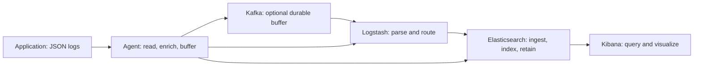

# ELK Stack — SRE Expert Checklist

A log line can exist on an application node, be acknowledged by a collector, and still be absent from Kibana. Each stage has its own durability, visibility, and failure behavior. An expert SRE should be able to explain those boundaries, measure the gaps between them, and recover without silently discarding evidence.

This guide covers all thirteen sections of the supplied checklist. It assumes familiarity with Linux, HTTP, distributed systems, and Kubernetes. Examples target modern self-managed Elastic Stack deployments unless stated otherwise; they are teaching examples, not production defaults. No project version is pinned. Check the exact release, deployment type, integration version, and subscription before applying settings: Elastic Cloud Serverless exposes different operational controls from a self-managed cluster.

Use each section as a study checklist: explain the mechanism, identify a failure mode, and describe the evidence that would confirm your diagnosis. Elasticsearch requests in `http` blocks use Kibana Dev Tools syntax and require appropriate privileges.

## Contents

1. [Fundamentals & Architecture](#1-fundamentals--architecture)
2. [Elasticsearch Architecture & Internals](#2-elasticsearch-architecture--internals)
3. [Elasticsearch Data Management](#3-elasticsearch-data-management)
4. [Elasticsearch Search & Querying](#4-elasticsearch-search--querying)
5. [Logstash & Ingestion Pipelines](#5-logstash--ingestion-pipelines)
6. [Beats, Elastic Agent & Log Collection](#6-beats-elastic-agent--log-collection)
7. [Kibana & Visualization](#7-kibana--visualization)
8. [Performance & Capacity Planning](#8-performance--capacity-planning)
9. [High Availability & Disaster Recovery](#9-high-availability--disaster-recovery)
10. [Kubernetes & Cloud-Native Deployment](#10-kubernetes--cloud-native-deployment)
11. [Security & Access Control](#11-security--access-control)
12. [Monitoring & Troubleshooting](#12-monitoring--troubleshooting)
13. [Expert Interview Scenarios](#13-expert-interview-scenarios)

## 1. Fundamentals & Architecture

### ELK, Elastic Stack, and centralized logging

**ELK** names Elasticsearch, Logstash, and Kibana. Elasticsearch stores and searches indexed documents; Logstash receives and transforms events; Kibana provides investigation, visualization, and management interfaces backed by Elasticsearch. **Elastic Stack** includes the broader ecosystem, including Beats, Elastic Agent, Fleet, and integrations. A deployment can use Elasticsearch and Kibana without Logstash when agents and ingest pipelines supply the required processing.

Centralized logging preserves searchable evidence beyond individual process and machine lifetimes. It also creates a shared dependency: a noisy application or expensive investigation can affect everyone. Define tenant boundaries, retention, ingestion budgets, access controls, and failure isolation before selecting components.

An **unstructured** message such as `checkout failed for order 42` requires parsing to recover fields. A **structured** JSON event gives stable fields such as `service.name`, `log.level`, and `trace.id`. JSON syntax alone does not establish consistent semantics: the same field must have a compatible type and meaning across services.

### The event path



The arrows show alternative deployment paths, not a requirement to send each event along every branch. Collection reads files or accepts network events. Processing decodes, validates, redacts, enriches, and routes them. Indexing builds searchable structures. Storage retains those structures and original document content according to policy. Querying retrieves and aggregates events; visualization presents the results. Acknowledgment at one stage does not prove successful completion of later stages.

An **agent** runs near the source and understands local files, process identity, and container metadata. A **collector** centralizes receipt, transformation, or forwarding and can serve many agents. A **push** path sends events to a receiver; a **pull** path retrieves them from a source API or storage system. File tailing locally reads a file, but Filebeat normally pushes the resulting events downstream. Pulling an API requires checkpointing and pagination; pushing requires receiver availability, buffering, and sender backpressure handling.

### ECS, JSON logging, and correlation

The [Elastic Common Schema](https://www.elastic.co/docs/reference/ecs) defines shared field names and types. Keep business-specific fields in controlled namespaces. For example:

```json
{
  "@timestamp": "2026-10-31T12:00:00.000Z",
  "message": "Payment provider timed out",
  "log": { "level": "error" },
  "service": { "name": "checkout", "environment": "production" },
  "event": { "id": "evt-7842", "dataset": "checkout.application" },
  "trace": { "id": "0af7651916cd43dd8448eb211c80319c" },
  "transaction": { "id": "b7ad6b7169203331" }
}
```

Propagate trace context across HTTP, RPC, and asynchronous messages, then emit its identifiers in logs. A request ID can correlate a local workflow, but it is not automatically a distributed trace. Retain event time separately from ingest time, commonly `@timestamp` and `event.ingested`, so ingestion lag remains measurable. Validate client-supplied identifiers and never treat them as authorization or put credentials into them.

### ELK, EFK, Loki, and OpenSearch

| Stack | Architecture and useful fit | Trade-off to explain |
| --- | --- | --- |
| ELK / Elastic Stack | Lucene-based search, field analytics, Kibana, broad integrations | Indexing, mappings, lifecycle, and subscription choices require operational care |
| EFK | Elasticsearch and Kibana with Fluentd, often Fluent Bit at the edge | Changes collection and processing; Elasticsearch storage and search constraints remain |
| Grafana Loki | Log streams selected by labels, with log content stored in compressed chunks | Query cost depends on selected streams and scanned content; label cardinality matters |
| OpenSearch | Independent Lucene-based search and analytics engine with OpenSearch Dashboards | Plugins, APIs, clients, security, and upgrade paths diverge from Elasticsearch |

Loki supports content filtering and parsing even though its core index is based on stream labels; it is not limited to searching label values. OpenSearch is not a drop-in replacement for every modern Elastic feature. Compare actual workloads and operating requirements rather than assuming a universally cheaper or faster engine. See [Loki's architecture overview](https://grafana.com/docs/loki/latest/get-started/) and [OpenSearch's introduction](https://docs.opensearch.org/latest/getting-started/).

## 2. Elasticsearch Architecture & Internals

### Nodes, indices, documents, and shards

A cluster consists of nodes sharing a cluster identity and coordinated metadata. An **index** groups documents with mappings and settings. It is partitioned into **primary shards**, each an independent Lucene index. A **replica shard** is another copy of a primary's data, placed on another node. Two primaries with one replica each produce four shard copies. Replicas improve availability and can serve searches; they also consume disk, indexing CPU, and network bandwidth.

| Role | Responsibility | Operational implication |
| --- | --- | --- |
| Master-eligible | Participate in elections; an elected master manages cluster state | Protect CPU, heap, disk latency, and connectivity from application workloads |
| Data | Hold shards and execute indexing/search work | Capacity depends on storage, shard distribution, and workload |
| Ingest | Execute ingest pipeline processors | Heavy parsing competes for CPU unless isolated |
| Coordinating | Route requests and combine results | Large bulk requests and aggregations can exhaust coordinator resources |

Every node coordinates requests that reach it. `node.roles: []` creates a coordinating-only node; this does not make it resource-free. Specialized data roles support tiers, and other features use roles such as `transform`, `ml`, and `remote_cluster_client`. Explicit role lists must include everything the deployment needs. See [node settings](https://www.elastic.co/docs/reference/elasticsearch/configuration-reference/node-settings).

### Lucene structures

An **inverted index** maps a term to documents containing it. A **postings list** stores matching document identifiers and, depending on field options, frequencies and positions. An analyzer might turn `Payment provider timed out` into searchable tokens. Exact values and numeric/date queries use appropriate field-specific structures; Elasticsearch is not simply a hash table of JSON documents.

Lucene writes immutable **segments**. Searches inspect the relevant segments, and background merges combine segments while reclaiming deleted-document space. An update generally marks the old Lucene document deleted and indexes a replacement; it is not an in-place field edit. Sorting and aggregations commonly use **doc values**, a column-oriented on-disk representation, while `_source` supplies document content. Avoid enabling heap-heavy fielddata on `text` as a substitute for a properly mapped `keyword` field.

### Indexing: routing, replication, acknowledgment, refresh, and flush

1. A receiving node resolves the write target and arranges any configured ingest processing before indexing. Processors can transform fields and, where supported, change the destination.
2. Each document is routed to a primary shard, normally using a hash of its ID or supplied routing value. The primary validates the operation against mappings, indexes it locally, and forwards it to replicas in the replication group.
3. Each participating copy records operations in its translog. With default `request` durability, success waits for the required translog persistence on the primary and participating replicas. Replica failures must be handled through the replication protocol; inspect operation results rather than assuming the configured replica count was available.
4. A **refresh** opens newly written data for search. An acknowledged event can therefore remain absent from a search until refresh. A real-time document GET has different visibility behavior from search.
5. A **flush** performs a Lucene commit and starts a new translog generation. Recovery can replay acknowledged operations that are not yet in the last Lucene commit.

`wait_for_active_shards` is a precondition on available copies before starting a write; it is not a permanent guarantee that all configured copies survive the operation. Inspect failures and choose durability requirements explicitly. Switching translog durability to `async` creates a window in which acknowledged writes can be lost after a crash. See [translog durability](https://www.elastic.co/docs/reference/elasticsearch/index-settings/translog).

**Near-real-time search** means visibility follows refresh rather than each acknowledgment. Stack deployments commonly use a one-second refresh interval, subject to search-idle behavior and configuration; Serverless has different defaults and constraints. `refresh=wait_for` waits for visibility rather than routinely forcing a refresh. Forcing refresh per event produces small segments and extra merge work. See [refresh behavior](https://www.elastic.co/docs/reference/elasticsearch/rest-apis/refresh-parameter).

### Cluster state, coordination, and split-brain prevention

Cluster state describes membership, mappings, settings, and shard routing; it does not contain all log documents. The elected master publishes changes through a coordination protocol. Modern coordination, introduced in Elasticsearch 7 and often called **Zen2**, uses terms, voting configurations, and majority agreement to prevent competing partitions from independently advancing the same cluster state. Do not apply old `discovery.zen.minimum_master_nodes` advice to current versions.

Three master-eligible voting nodes tolerate one failure because two remain a majority. Quorum concerns the current voting configuration, not the number of data nodes or shard replicas. Voting-only nodes can vote but cannot become elected master. A partition without a majority cannot elect a master; some reads may remain possible depending on configuration and routing, but normal cluster operation is impaired.

Discovery seed hosts locate potential peers. `cluster.initial_master_nodes` bootstraps a new cluster once; remove it after formation and never reintroduce it during ordinary restarts or recovery. Accidentally bootstrapping a replacement cluster can create an incompatible cluster UUID and serious data-loss risk. See [cluster bootstrapping](https://www.elastic.co/docs/deploy-manage/distributed-architecture/discovery-cluster-formation/modules-discovery-bootstrap-cluster).

### Allocation, recovery, and health

**Allocation** chooses nodes for shard copies subject to roles, disk watermarks, awareness rules, filters, and limits. **Rebalancing** redistributes work and storage. **Recovery** builds or catches up a copy from another copy or a snapshot. **Relocation** transfers a shard to another node while maintaining service through the protocol. All consume resources, so excessive concurrent recovery can slow both ingestion and queries.

| Health | Meaning | First interpretation |
| --- | --- | --- |
| Green | All primary and replica shards assigned | Redundancy is assigned; latency and completeness still need separate checks |
| Yellow | All primaries assigned; at least one replica unassigned | Data is available, but some redundancy is missing |
| Red | At least one primary unassigned | Some data is unavailable; identify affected indices immediately |

A single-node cluster with one configured replica is normally yellow because the primary and its replica cannot share a node. A red cluster can still answer queries for healthy shards; partial results must not be mistaken for a complete history.

### Heap, GC, and the filesystem cache

JVM heap holds structures such as indexing buffers, cluster metadata, and query state. Garbage collection reclaims unreachable objects; sustained high old-generation occupancy and long pauses indicate pressure. Elasticsearch also needs native memory, thread stacks, and filesystem cache for Lucene data. Giving nearly all RAM to heap can make disk access and overall latency worse.

Prefer automatic heap sizing when appropriate. If overriding it, keep equal minimum and maximum heap, allocate no more than 50% of memory available to the node, and account for container limits and compressed object pointer thresholds. An old universal claim such as “always set 31 GB” is not a sizing method. See [JVM settings](https://www.elastic.co/docs/reference/elasticsearch/jvm-settings).

## 3. Elasticsearch Data Management

### Mappings and field types

A mapping determines how a JSON field is indexed. **Dynamic mapping** adds fields from incoming documents, which helps discovery but lets unexpected payloads change the schema. **Explicit mapping** establishes types before ingestion. Once indexed, incompatible type changes generally require a new index and reindexing; editing a template affects future indices, not all existing data.

| Type | Appropriate use | Common mistake |
| --- | --- | --- |
| `text` | Analyzed human language such as `message` | Expecting a `term` query to analyze the supplied phrase |
| `keyword` | Service names, IDs, status labels, exact filtering | Using unconstrained values for huge aggregations |
| Numeric | Counts, durations, byte sizes | Storing values as strings and losing numerical semantics |
| `date` | Event and ingestion timestamps | Ignoring timezone, units, or malformed date formats |
| `object` | Ordinary structured fields | Assuming arrays of objects preserve pairwise associations |
| `nested` | Arrays whose fields must match within the same array element | Forgetting extra internal documents and nested query cost |

For `[{"name":"alice","role":"reader"},{"name":"bob","role":"admin"}]`, a plain object representation can match `alice` and `admin` across different elements. A nested mapping preserves the association when queried with a nested query. Use it when that relationship is required, not for every JSON object.

### Analyzers, tokenizers, and normalizers

An analyzer applies character filters, a tokenizer, and token filters to `text`. Index and search analysis must produce compatible tokens. A tokenizer defines boundaries; filters can lowercase, remove terms, or apply language processing. A normalizer transforms a `keyword` value while keeping it a single token, such as case normalization for exact matching. Validate examples with `_analyze`; analyzer behavior can explain a “missing” document even when ingestion succeeded.

### Templates, aliases, and data streams

**Component templates** hold reusable mapping and setting fragments. **Composable index templates** select index patterns and combine components at index creation. Resolve priorities deliberately, especially when built-in integration templates overlap. **Aliases** provide stable names and can support write-index selection or an atomic cutover during reindexing. A filtered alias is a query convenience, not a tenant security boundary.

A **data stream** presents one logical name over backing indices for append-oriented time-series data. Events require `@timestamp`; new writes normally target the current write index. **Rollover** creates the next backing index based on size, age, or document conditions. Data streams simplify log retention without forcing one daily index per service. Frequent updates or last-write-wins document workflows may fit ordinary indices and aliases better. See [data streams](https://www.elastic.co/docs/manage-data/data-store/data-streams).

### Lifecycle, tiers, and retention

**Index Lifecycle Management (ILM)** moves indices through configured hot, warm, cold, frozen, and delete phases and can perform rollover and other actions. Phase age after rollover is generally based on rollover time rather than the timestamp inside each event. **Data stream lifecycle** provides a stream-oriented mechanism for rollover, retention, and supported lifecycle operations. They are distinct managers; configure which owns each backing index rather than assuming both policies independently execute. ILM availability also differs by deployment type. See [ILM](https://www.elastic.co/docs/manage-data/lifecycle/index-lifecycle-management) and [data stream lifecycle](https://www.elastic.co/docs/manage-data/lifecycle/data-stream).

| Tier | Typical workload | Design consequence |
| --- | --- | --- |
| Hot | Active writes and frequent recent searches | Prioritize indexing throughput and low storage latency |
| Warm | Older, less frequently queried indices | Favor capacity while retaining acceptable search performance |
| Cold | Infrequent historical searches | Consider fully mounted searchable snapshots where supported |
| Frozen | Rare historical investigation | Partially mounted searchable snapshots trade cache misses and repository access for lower local storage |

**Searchable snapshots** allow searches against snapshot-backed indices with local storage or cache behavior depending on the tier. Their repository is an active dependency; deleting required snapshots or losing repository access can affect availability. Regular cold indices still need their ordinary redundancy policy. Snapshot-backed storage can change replica requirements, but this must be justified by recovery objectives, not assumed for all cold data. See [searchable snapshots](https://www.elastic.co/docs/deploy-manage/tools/snapshot-and-restore/searchable-snapshots).

Retention is not an exact per-document deletion deadline. Index-based removal and lifecycle scheduling can retain events longer than their nominal period, especially with late arrivals. Include snapshots, Kafka, quarantine storage, and exports in deletion requirements. **Downsampling** aggregates suitable time-series metric data, commonly TSDS, into statistical summaries. It is not a way to shrink arbitrary raw logs while preserving every event; preserve raw evidence when investigations require it. See [the downsample lifecycle action](https://www.elastic.co/docs/reference/elasticsearch/index-lifecycle-actions/ilm-downsample).

### Sizing shards and preventing mapping explosion

Too many small shards waste metadata, heap, file handles, and scheduling work. Very large shards prolong recovery and can concentrate load. Elastic's general starting guidance is roughly 10–50 GB per shard and fewer than 200 million documents, but benchmarks and recovery requirements determine the final choice. Do not use obsolete universal shards-per-GB-of-heap rules. See [shard sizing](https://www.elastic.co/docs/deploy-manage/production-guidance/optimize-performance/size-shards).

**Mapping explosion** occurs when arbitrary keys become fields, for example an object keyed by user ID. Each new field expands mappings and can increase cluster-state and memory costs. Use explicit schemas, appropriate `dynamic` behavior, field-count limits, and `flattened` for suitable arbitrary key-value collections. `dynamic: false` keeps unknown fields in source without indexing them; `dynamic: strict` rejects unexpected fields. Monitor rejections and quarantine them. Raising the field limit alone postpones the problem.

## 4. Elasticsearch Search & Querying

### Query DSL and search semantics

The Query DSL is Elasticsearch's JSON query interface. A `bool` combines clauses: `must` requires matches with scoring, `should` expresses optional or required alternatives depending on the surrounding bool, `filter` requires matches without scoring, and `must_not` excludes them. Set `minimum_should_match` explicitly when alternatives must match; `should` clauses do not always mean a required OR.

```http
GET logs-checkout-*/_search
{
  "size": 20,
  "query": {
    "bool": {
      "filter": [
        { "term": { "service.name": "checkout" } },
        { "range": { "@timestamp": { "gte": "now-15m", "lt": "now" } } }
      ],
      "must": [
        { "match": { "message": "payment timeout" } }
      ]
    }
  }
}
```

`term` searches an exact indexed term and is appropriate for a correctly mapped `keyword`; `match` analyzes input for full-text search. `range` selects ordered values such as timestamps. Exact filtering on `log.level` and a full-text search of `message` solve different questions. Inspect the mapping before changing the query.

In **query context**, Elasticsearch computes relevance scores where applicable. In **filter context**, it only evaluates whether a document matches; qualifying results can benefit from query caching, subject to eligibility and segment reuse. This does not mean every filter is cached. The shard request cache is separate and can cache eligible whole-shard responses, often aggregation requests with `size: 0`. Frequently changing indices, refreshes, and moving time boundaries affect reuse.

### Aggregations

**Terms** aggregations group values, **date histograms** group time intervals, **metric** aggregations calculate values such as count, average, or percentiles, and **pipeline** aggregations derive results from other buckets or metrics. For incident analysis, group errors by service over time before examining example documents.

Distributed terms aggregations may return approximate top-bucket counts, and cardinality/percentile implementations also have accuracy trade-offs. Bound bucket counts and inspect documented error information. A calendar-day histogram has different behavior from a fixed 24-hour interval across daylight saving changes. Set timezones deliberately. Aggregating a keyword is generally preferable to loading fielddata on text. See [aggregations](https://www.elastic.co/docs/explore-analyze/query-filter/aggregations).

### ES|QL, KQL, and Lucene query syntax

| Language | Execution model | Example |
| --- | --- | --- |
| Query DSL | JSON API for queries, filters, and aggregations | The `_search` request above |
| KQL | Kibana filter language; no independent aggregation pipeline | `service.name: "checkout" and log.level: "error"` |
| Lucene query syntax | Text query syntax exposed in supported interfaces; supports features such as fuzzy and regex searches | `service.name:checkout AND log.level:error` |
| ES\|QL | Elasticsearch piped language for filtering, transforming, and aggregating tabular results | `FROM logs-* \| WHERE log.level == "error" \| STATS errors = COUNT(*) BY service.name` |

Escaping, field types, case handling, functions, and supported features differ. Do not paste one language into another interface and expect equivalent behavior. ES|QL capabilities evolve; check the deployed release, especially when correlating datasets. See [KQL](https://www.elastic.co/docs/reference/query-languages/kql), [Lucene syntax in Kibana](https://www.elastic.co/docs/explore-analyze/query-filter/languages/lucene-query-syntax), and [ES|QL](https://www.elastic.co/docs/explore-analyze/query-filter/languages/esql).

### Distributed search, pagination, and optimization

In a conventional distributed query, the coordinating node sends work to one selected copy of each relevant shard. The **query phase** finds local top matches and aggregation contributions; the coordinator merges them. The **fetch phase** retrieves requested content for selected hits. Broad index patterns increase shard fan-out, and the slowest shard can dominate latency. Search thread pools and queues are finite, so excessive concurrency becomes queueing and rejected requests.

Deep `from`/`size` pagination makes shards retain candidates that will be discarded. Use **`search_after`** with a stable sort and tie-breaker for sequential traversal. Add a **Point in Time (PIT)** to keep a consistent view across refreshes; use the latest returned PIT ID and sort values, and close the PIT when finished. PITs retain resources and can delay reclamation of old segments. They do not provide arbitrary random page access. See [pagination](https://www.elastic.co/docs/reference/elasticsearch/rest-apis/paginate-search-results).

Narrow index and time selection first. Custom **routing** can reduce fan-out when all operations use the same routing key, but a dominant tenant can create a hot shard and a missing routing value can omit expected results. **Index sorting** can accelerate compatible searches and filters at the cost of indexing work and reduced flexibility. Use `_profile` on a bounded representative query; its overhead means it is not a faithful end-to-end latency measurement.

Leading wildcards, broad regular expressions, scripts, large bucket trees, and unbounded high-cardinality aggregations can be expensive. Restrict workload shape and concurrency before increasing limits. Circuit breakers reject estimated memory-heavy work but do not account for every allocation or guarantee protection from out-of-memory failure. See [circuit breakers](https://www.elastic.co/docs/reference/elasticsearch/configuration-reference/circuit-breaker-settings).

## 5. Logstash & Ingestion Pipelines

### Inputs, filters, outputs, and codecs

A Logstash pipeline accepts events through **inputs**, transforms them through **filters**, and sends them through **outputs**. **Codecs** encode or decode the representation at an input or output boundary. Inputs include Beats protocol, Kafka, TCP, and HTTP, with plugin-specific acknowledgment and concurrency behavior. TCP provides a byte stream, so define framing; a successful socket write does not prove durable indexing. HTTP receivers need authentication, payload limits, and meaningful response handling.

| Filter | Use | Failure or cost to anticipate |
| --- | --- | --- |
| Grok | Extract fields from irregular text using patterns | Expensive regex and mismatch failures |
| Dissect | Split predictable delimiter-based records | Breakage when the input layout varies |
| Mutate | Rename, remove, or convert fields | Invalid conversion and accidental destructive edits |
| Date | Parse event time into the intended timestamp field | Wrong timezone, missing year, or format mismatch |
| JSON | Decode JSON stored in a field | Malformed JSON and conflicts with existing fields |

Prefer application JSON when possible. Use Dissect for stable layouts and reserve Grok for variable structure that requires it. Preserve enough source context to diagnose parsing failures while protecting sensitive data. Test pipeline configuration and representative good, malformed, and oversized events with the installed plugins.

### Ingest pipelines versus Logstash

Elasticsearch **ingest pipelines** run processors before indexing, close to storage, and work well for direct agent ingestion and supported transformations. Logstash runs independently and offers inputs, outputs, routing, buffering, and plugins beyond Elasticsearch processors. Heavy processing in ingest nodes consumes cluster resources; separate Logstash adds another service to operate. Choose the smallest path that meets transformation and reliability requirements. Validate ingest processors through `_ingest/pipeline/_simulate` before rollout.

### Workers, batches, and backpressure

`pipeline.workers` controls filter/output concurrency; `pipeline.batch.size` controls how many events a worker handles per batch. The approximate in-flight event count grows with workers multiplied by batch size, but actual heap also includes expanded events, plugins, and buffers. CPU-bound filters and output-bound pipelines need different tuning. More workers cannot fix slow storage or a throttled downstream service.

Larger batches can amortize network overhead but increase memory, payload size, and latency. A blocked output fills downstream queues and propagates **backpressure** upstream. Isolate critical pipelines when one output can otherwise block unrelated traffic. Measure worker utilization, event duration, input/output rates, queue growth, and downstream response codes before changing concurrency.

### Persistent queues, dead-letter queues, and delivery guarantees

A **persistent queue (PQ)** stores queued events locally on disk and can replay unacknowledged work after a crash. Its protection depends on checkpoints, disk durability, acknowledgment-capable inputs, and queue capacity. A PQ is not replicated: losing its disk can lose queued events. When it fills, compatible inputs slow or stop; UDP cannot be made reliably backpressured by adding a PQ. See [persistent queues](https://www.elastic.co/docs/reference/logstash/persistent-queues).

A **dead-letter queue (DLQ)** retains certain events that cannot be processed, rather than serving as a general outage buffer. The documented support covers Elasticsearch output failures such as document-level 400/404 errors and conditional evaluation errors. A Grok failure tag does not automatically send an event to the DLQ; route parsing failures explicitly to controlled quarantine storage. Monitor, repair, replay, and clean up DLQs. See [DLQ behavior](https://www.elastic.co/docs/reference/logstash/dead-letter-queues).

Retries commonly produce **at-least-once** delivery: a sender can replay an event when the receiver persisted it but its acknowledgment was lost. Generated Elasticsearch IDs then create duplicates. A stable event ID can make repeated writes idempotent for the intended index and operation, but data-stream `create` conflicts need explicit handling and duplicate prevention across rollovers requires additional design. Hashing message text alone can collapse legitimate repeated events.

Ordering is not generally preserved across multiple workers, batches, retries, and destinations. Configure ordered single-worker processing where required and supported, or carry sequence numbers and reconstruct the order later. A bulk request can return HTTP 200 while individual operations failed; inspect each item and retry only retryable failures. Handle 429 overload with bounded concurrency and exponential backoff with jitter, while separating permanent mapping errors.

### Kafka as an outage buffer

Kafka decouples collection from processing using durable, retained partitions. Partition keys distribute load and preserve order only within a partition. A consumer group shares partitions among consumers, so adding consumers beyond partition count does not increase active readers. Partitioning solely by a huge tenant can create a hot partition.

Set producer acknowledgments, replication, minimum in-sync replicas, retention, and consumer offset behavior according to the loss budget. A committed Kafka offset is not proof of Elasticsearch indexing unless the consumer's handoff and acknowledgment behavior establish that guarantee. Even a Kafka-to-PQ handoff depends on PQ durability. Kafka transactions do not automatically make writes to an external Elasticsearch destination exactly once. Retention must cover the outage, delayed consumers, and recovery time; monitor both byte growth and age of the oldest unread event.

## 6. Beats, Elastic Agent & Log Collection

### Collector choices and management

**Filebeat** ships logs, **Metricbeat** gathers metrics, and **Auditbeat** collects supported audit and integrity telemetry. Their modules and platform requirements vary. **Elastic Agent** packages multiple collection capabilities and integrations under one agent. **Fleet-managed mode** distributes policies and integration assets through Fleet infrastructure; **standalone mode** uses locally managed configuration. Fleet Server manages agents and is not a mandatory proxy for every data event. Check supported outputs and integration behavior for the chosen mode. See [Elastic Agent](https://www.elastic.co/docs/reference/fleet).

Consolidating agents reduces configuration fragmentation but increases the importance of policy testing, staged rollout, and resource isolation. Avoid simultaneously running old and new collectors over the same paths unless duplicates are an intentional migration trade-off.

### Harvesting, offsets, registries, and multiline events

A file harvester reads file content and tracks progress. Filebeat's registry persists state such as file identity and acknowledged progress so restarts can resume. Persist the registry and queue directories across collector replacement where appropriate. Deleting state can cause replay; retaining stale identity can also cause mistakes after source reuse.

Choose file identity deliberately. Inode/device identity, path identity, and fingerprint identity have different failure modes. Modern `filestream` defaults differ from older Filebeat releases; do not carry assumptions across major upgrades. Inode reuse can make a new file resemble an old file, while changing fingerprint settings can trigger rereads. See [rotation and identity behavior](https://www.elastic.co/docs/reference/beats/filebeat/file-log-rotation).

Assemble **multiline** stack traces close to the source before events from different files or containers are interleaved. Bound line counts, bytes, and timeout so a bad start pattern cannot buffer an entire file. Decode container framing before applying application multiline rules when the integration requires that order.

Rename-based rotation with sufficient retained files gives collectors time to finish reading. Copy-and-truncate rotation has a race where newly written lines can be lost. Premature deletion, small rotation windows, aggressive close settings, and collector backlog can all remove unread data. A healthy collector process does not prove it has caught up.

### Kubernetes, Docker, journald, syslog, and OpenTelemetry

Run node-local collectors as **DaemonSets** when they must read every node's container logs. Mount the intended host paths read-only and persist collector state; limit other privileges. Kubernetes usually exposes container logs under host paths such as `/var/log/containers` with symlinks to pod log files. Parse the actual runtime format: CRI records are not identical to Docker JSON records. Enrich events with namespace, pod UID, container identity, node, and bounded workload metadata; pod names alone are not stable identities.

The Docker JSON logging driver wraps application text in JSON metadata. Decode the wrapper, then decode application JSON if needed. **journald** collection uses journal fields and cursor/checkpoint behavior; preserve state and confirm permissions. **Syslog** requires agreement on transport, framing, timestamp, and hostname interpretation. UDP syslog can lose or reorder packets without acknowledgments; use an appropriate reliable transport when loss is unacceptable.

An **OpenTelemetry Collector** can receive, process, and export logs alongside metrics and traces. OTLP export and Elasticsearch-oriented exporters have version-specific schemas, supported fields, and retry behavior; validate compatibility instead of assuming arbitrary OTLP is ECS-shaped. Bound batch processors and sending queues, configure persistence where supported, and check whether upstream acknowledgment occurs before or after durable storage. See [OpenTelemetry Collector resiliency](https://opentelemetry.io/docs/collector/resiliency/).

### Buffering and recovery

Agents have finite memory or disk queues, configured per product and version. Full queues cause blocking, backoff, or dropping depending on the source and receiver. Provision buffer disk separately from application safety margins. Watch file descriptors, CPU, queue age, disk space, retransmissions, and dropped-event counters. An agent can recover perfectly from a restart and still lose logs if the application rotated them away during the outage.

## 7. Kibana & Visualization

### Architecture, Discover, and data views

Kibana is a server application that queries Elasticsearch and stores internal configuration in Elasticsearch system indices. Multiple Kibana instances need compatible configuration, shared encryption keys where required, and suitable session/load-balancer behavior. Browser-to-Kibana success does not establish Kibana-to-Elasticsearch connectivity or authorization.

**Discover** explores documents through a **data view** selecting indices, aliases, or data streams and optionally a time field. A wrong time range, timezone assumption, field mapping, or data view can hide successfully indexed events. Verify the document directly in Elasticsearch before debugging chart rendering. Runtime fields can simplify exploration but move computation into query execution.

### Queries, Lens, dashboards, and drilldowns

Use KQL for document filtering, Lucene syntax where its features are required, and ES|QL for supported piped transformations and aggregation. **Lens** builds visualizations from fields and aggregations. Dashboards combine panels and controls; **drilldowns** carry context into another view or application. Preserve time range and service/trace filters so an incident workflow reaches the relevant evidence.

Show error counts alongside traffic and ingestion lag. Missing events should not become an apparent zero-error interval. State units, timezone, aggregation interval, and percentile meaning. Avoid dashboards that fan out hundreds of expensive queries on every refresh. Correlate logs across services with exact trace/request ID filters, then widen time and service scope when context propagation is incomplete.

### Saved objects, spaces, permissions, and automation

Dashboards, data views, and related configurations are **saved objects**. **Spaces** organize them and scope Kibana feature privileges, but a space alone does not prevent direct access to Elasticsearch data. Combine Kibana privileges with index/data-stream privileges and any supported document/field controls. See [Kibana Spaces](https://www.elastic.co/docs/deploy-manage/manage-spaces).

Export/import saved objects and use supported APIs for provisioning. Keep dependencies, stable identifiers, migration behavior, and target-version compatibility under review. Store intentional exports and configuration in Git, parameterize environment-specific references, and validate imports in staging. Do not edit Kibana system indices directly or commit credentials with exported objects.

### Alerting, rules, connectors, and actions

A **rule** evaluates a condition on a schedule. A **connector** configures an external service, and an **action** invokes it when the rule's action conditions match. Rule execution depends on Kibana task processing, Elasticsearch availability, credentials/API-key privileges, and connector reachability. Detect late or failed execution separately from the monitored condition.

Configure grouping, recovery notifications, suppression, and action frequency so one incident does not create thousands of messages. Protect connector secrets and restrict outbound destinations. An alert about “no logs” must distinguish an idle application from a broken pipeline using an independent signal. See [Kibana alerting](https://www.elastic.co/docs/explore-analyze/alerts-cases/alerts).

## 8. Performance & Capacity Planning

### Measure the workload before sizing

Measure events per second, raw bytes per second, event-size distribution, indexed primary bytes, replicas, query concurrency, and retention by dataset. Track p95/p99 indexing and search latency alongside **event-to-searchable latency**. An Elasticsearch indexing timer excludes time waiting in an agent, Kafka, or Logstash queue.

Large bursts, stack traces, extra fields, and parsing expansion matter more than average event size alone. Sample representative production-shaped data to measure the indexed-to-raw storage ratio; compression does not imply indexed storage is always smaller than source logs.

### A worked storage estimate

For ordinary replicated indices, estimate:

```text
retained_primary_bytes = raw_bytes_per_day × indexed_primary_to_raw_ratio × retention_days
retained_copy_bytes    = retained_primary_bytes × (1 + replica_count)
provisioned_disk       = retained_copy_bytes / target_utilization
```

Hypothetically, 2 TB/day × 0.8 × 30 days gives 48 TB of primary data. One replica gives 96 TB of shard data; a planned 70% utilization gives roughly 137 TB of provisioned disk. All units here are decimal. This is a baseline for this assumed storage model, not a complete bill: add recovery space, merges, translogs, growth, skew, and other disk consumers. Calculate each tier separately when replicas, compression, or snapshot mounting differ.

If nodes must survive one zone's loss without exceeding safe utilization, model the remaining zones explicitly. Disk headroom alone does not prove that surviving CPU, I/O, network, or shard placement can sustain peak ingestion. Derive node count from the strongest of storage, write throughput, query throughput, and recovery constraints.

### Indexing and search trade-offs

Bulk indexing amortizes request overhead. Increase batch size and client concurrency gradually until measured throughput plateaus or latency, heap, rejection rate, or disk pressure worsens. Bound both event count and bytes because one large event can dominate a batch. Reuse connections and inspect per-item results.

A longer refresh interval reduces refresh and merge work but delays search visibility. Disabling refresh temporarily can help controlled bulk loads, but restore it afterward and account for hidden data. Temporarily reducing replicas increases exposure and is appropriate only when the source can safely replay and the loss risk is accepted. Forcing merges on actively written indices can create large segments and heavy I/O; reserve it for justified read-only lifecycle operations. See [indexing performance](https://www.elastic.co/docs/deploy-manage/production-guidance/optimize-performance/indexing-speed).

### Heap, shards, thread pools, and storage

Shard count and field count create overhead even when traffic is low. Measure post-GC heap, allocation rate, old-generation pressure, segment counts, and coordinator memory. Reduce unnecessary indices, fields, buckets, and concurrent work before increasing heap. JVM memory is only part of container memory consumption.

Thread pools and queues are admission controls, not spare compute. Sustained queue growth and 429 rejections indicate demand exceeding service rate or a downstream constraint. Enlarging queues often increases tail latency and memory without improving capacity. Pool names and write/bulk coordination behavior vary by release; read `_nodes/stats/thread_pool` for the deployed cluster.

Segment merging competes with reads, writes, and recovery for disk bandwidth and temporary space. SSD performance includes sustained throughput, IOPS, latency, and cloud volume limits, not merely the storage label. Compression can reduce bytes while consuming CPU. Benchmark the configured codec and workload rather than transferring an old compression ratio to every dataset.

### Disk watermarks and blocked writes

The low watermark restricts some allocations, the high watermark triggers relocation pressure, and flood stage protects a nearly full disk by setting `index.blocks.read_only_allow_delete` on affected indices. Exact thresholds, headroom caps, tier exceptions, and release behavior must be checked. Relocation cannot succeed if all eligible nodes are also full or awareness rules leave nowhere to move.

Stop the growth cause, add usable capacity, or delete approved expired **whole indices** through supported APIs. Document deletion can require more space before merges reclaim bytes; never remove Lucene files manually. In modern releases flood-stage blocks normally clear after usage falls below the appropriate threshold; verify rather than repeatedly clearing blocks on a still-full disk. See [disk allocation settings](https://www.elastic.co/docs/reference/elasticsearch/configuration-reference/cluster-level-shard-allocation-routing-settings).

## 9. High Availability & Disaster Recovery

### Quorum and fault domains

For a substantial production cluster, a common design uses three dedicated master-eligible nodes spread across three failure domains. Separate their control-plane workload from bulk indexing and queries. A majority of the voting configuration must remain connected; three nodes spread 2–1 across two zones do not tolerate loss of either zone symmetrically.

Use shard allocation awareness to reflect zones, and enough replicas and capacity to survive the stated failure. Ordinary node separation does not imply zone separation. **Forced awareness** can deliberately leave replicas unassigned rather than concentrate all copies in the surviving zone. That protects placement expectations but does not create missing capacity. Test real loss and recovery, including network, DNS, storage, and certificate dependencies.

Frequent mapping changes, shard creation, node churn, and slow master disks can destabilize cluster-state publication even when data-node CPU looks healthy. Protect the control plane and control schema churn. During a network partition, restore connectivity to the existing voting majority; do not try to make both partitions independently writable.

### Snapshots, SLM, and restore scope

Register a supported snapshot repository outside the cluster's data disks and verify permissions and reachability. **Snapshot Lifecycle Management (SLM)** schedules snapshots and retention; monitor completion, failures, and the age of the latest successful backup. Use supported repository operations and a single writer for a shared repository; register other readers appropriately. See [snapshot and restore](https://www.elastic.co/docs/deploy-manage/tools/snapshot-and-restore).

Snapshots reuse immutable segment data and are incremental in storage. They capture shard states over the snapshot interval rather than a single atomic instant across every shard. Copying Elasticsearch data directories, even with filesystem snapshots, is not a supported substitute for a cluster snapshot. Replicas do not protect against replicated deletion, and snapshots do not replace live availability.

Index snapshots include mappings and index metadata. Cluster state and **feature states** cover additional items such as templates, policies, Kibana data, and security feature data when included. Node configuration files, external secrets, certificates, repository registration, and some surrounding infrastructure require separate recovery arrangements. Restoring global state or security feature state can replace configuration and credentials, so define scope and maintain tested administrative access. See [snapshot contents and exclusions](https://www.elastic.co/docs/deploy-manage/tools/snapshot-and-restore#snapshot-contents).

### CCR, CCS, RPO, and RTO

**Cross-cluster replication (CCR)** asynchronously replicates selected leader indices to follower indices. Lag determines part of the achievable RPO, and failover/failback requires an explicit procedure. CCR is not a backup: unwanted changes can propagate. It also does not automatically copy every cluster configuration and security artifact.

**Cross-cluster search (CCS)** searches remote clusters without replicating their data. Define behavior when a remote is unavailable and surface partial or skipped results. Both features have release, security, and subscription considerations. See [CCR](https://www.elastic.co/docs/deploy-manage/tools/cross-cluster-replication) and [CCS](https://www.elastic.co/docs/solutions/search/cross-cluster-search).

**RPO** is the acceptable data-loss window; derive it from successful snapshot coverage, replication lag, and retained replay sources. **RTO** is the acceptable recovery duration, including provisioning, authentication, restore bandwidth, shard recovery, and validation. A snapshot existing in storage does not prove either target; measure full restore drills.

### Draining and upgrading

For planned removal, use supported node shutdown or allocation controls as appropriate to the platform. Confirm enough eligible capacity and wait for relocation before deleting storage. A restart and a permanent removal have different allocation objectives; blindly draining every restart can create avoidable I/O.

Plan upgrades with the exact version compatibility matrix, supported path, plugins, clients, index creation versions, and deprecation checks. Back up and test restores first. For supported rolling upgrades, follow the documented order—typically tiered data nodes from frozen through hot, other relevant data nodes, non-master nodes, and master-eligible nodes last—and validate each step. Mixed versions are temporary; downgrade is unsupported. See [the rolling upgrade procedure](https://www.elastic.co/docs/deploy-manage/upgrade/deployment-or-cluster/elasticsearch).

“Zero downtime” is an objective that requires redundancy, spare capacity, compatible clients, retries, and tested behavior. It is not a guarantee for every upgrade path or every request. A failed upgrade may require a fresh compatible cluster restored from the pre-upgrade snapshot rather than reusing upgraded data paths with old binaries.

## 10. Kubernetes & Cloud-Native Deployment

### ECK and Kubernetes primitives

**Elastic Cloud on Kubernetes (ECK)** is an operator that reconciles Elastic resources and handles operations such as TLS setup, rolling configuration changes, and cluster orchestration. It reduces manual coordination but does not remove storage, sizing, backup, or failure-domain responsibilities. See [ECK](https://www.elastic.co/docs/deploy-manage/deploy/cloud-on-k8s).

Elasticsearch needs stable data storage and node identity; StatefulSets and PVCs provide Kubernetes building blocks. Headless services can expose individual pod DNS identities for discovery. With ECK, manage desired behavior through supported custom resources rather than editing operator-generated StatefulSets. A running pod with a fresh empty volume is not a recovered shard copy.

**PodDisruptionBudgets** constrain cooperating voluntary disruptions, not node crashes, every eviction, or every controller action. Anti-affinity and topology spread distribute pods across hosts and zones, while Elasticsearch awareness distributes shard copies. Both layers must agree. Overly strict scheduling can leave replacement pods pending when a zone is lost.

### Storage, resources, and bootstrap checks

Choose storage classes using latency, throughput, durability, binding mode, and zone constraints. Local disks can provide strong performance but tie recovery to node loss and replica/snapshot design. Network storage simplifies some reattachment cases but adds service limits and latency. Ensure the filesystem and volume behavior meet Elastic's requirements. PVC expansion requires support from the storage class, driver, filesystem, and orchestration workflow; do not assume shrinking is supported.

Set CPU and memory requests from measured demand. CPU limits can throttle ingestion even when host CPU is idle. Memory limits must accommodate heap, native usage, and other charged memory; an OOM kill can occur without a Java heap exception. Verify automatic JVM sizing against the pod's actual resource constraints.

Production bootstrap checks include virtual-memory mapping limits such as `vm.max_map_count`, file descriptors, and other OS settings. Required values can change across releases and storage modes, so use the target-version checks. Apply node-level changes through approved infrastructure configuration; an unprivileged container often cannot set host kernel parameters. See [bootstrap checks](https://www.elastic.co/docs/deploy-manage/deploy/self-managed/bootstrap-checks).

### Autoscaling, collectors, and GitOps

Adding pods does not immediately add usable throughput: PVC provisioning, scheduling, shard relocation, and cache warming take time. Scale down only after safe evacuation and capacity checks. ECK autoscaling capabilities and licensing differ from a simple Kubernetes HPA; CPU-based HPA alone is a poor control loop for stateful shard placement.

Run Filebeat or Elastic Agent DaemonSets with Kubernetes metadata enrichment and narrowly scoped RBAC. Bound enrichment labels and annotations to avoid field growth and leaked secrets. Handle new nodes, taints, log path changes, collector upgrades, and durable state placement deliberately.

Helm can package installation and configuration; Argo CD can reconcile reviewed Git state. Keep operator-managed resources under operator ownership, avoid competing reconcilers, protect secrets, and stage disruptive changes. Pin compatible operator, stack, integration, and chart versions. Separate orchestration upgrades from application version changes when that improves observability of failures.

Self-managed clusters expose OS, JVM, storage, and lifecycle responsibilities. Elastic Cloud Hosted manages more of that infrastructure; Serverless uses a different operational model. Compare control requirements, regional availability, workload limits, network access, subscription cost, and the team's ability to operate the system, rather than assuming identical settings apply everywhere.

## 11. Security & Access Control

### Secure every connection and identity

Use TLS on the Elasticsearch **transport layer** between nodes and the **HTTP layer** used by clients. Mutual TLS authenticates both parties where configured; verify trust roots and hostnames rather than disabling verification to fix a certificate error. Secure agent-to-collector, collector-to-Elasticsearch, and Kibana connections as well. Encryption on one hop does not protect the others.

**RBAC** assigns users or service identities roles containing cluster, index/data-stream, and application privileges. Use separate identities for ingestion, lifecycle administration, dashboards, and recovery. Prefer scoped, expiring API keys for workloads where supported; revoke and rotate them. Template or pipeline management privileges should not be granted to every log producer merely for convenience.

LDAP can integrate enterprise directory authentication, while OIDC and SAML support identity-provider-based login. Authentication establishes identity; role mappings establish authorization. Check realm, Kibana, API, and subscription support and preserve an emergency access method independent of the failing identity provider. See [Elastic security](https://www.elastic.co/docs/deploy-manage/security).

### Isolation, encryption at rest, and secret management

Kibana Spaces separate saved content and feature permissions. Index-level privileges enforce access to data; supported **document-level security** and **field-level security** can narrow read access further. Validate role combinations because privileges are additive and another broad role can defeat an intended restriction. DLS/FLS are not a substitute for safe write isolation. See [document and field security](https://www.elastic.co/docs/deploy-manage/users-roles/cluster-or-deployment-auth/controlling-access-at-document-field-level).

Multi-tenancy can use tenant-specific indices/data streams, shared storage with enforced document controls, or separate clusters. More indices improve some isolation boundaries but increase shard overhead. Tenant-supplied payloads must not choose arbitrary destination indices or ingest pipelines; derive and authorize routing from trusted identity.

Encryption at rest usually involves the deployment's storage and key-management facilities, including snapshot repositories. Keep secrets in supported keystores or a secret manager, not Git, events, or shell history. Rotate certificates with overlapping trust where needed and validate every client and node. Watch expiration before rotation becomes an outage.

### Auditing, PII, and least privilege

Enable supported **audit logging** and monitor authentication failures, privilege changes, and unusual access. Route security evidence to protected storage with independent retention. Audit events can contain sensitive information and add volume, so scope collection according to documented behavior and compliance needs.

Redact or tokenize sensitive data before it enters the durable pipeline whenever possible. Redaction after Kafka or a PQ does not remove the original secret from those buffers. Apply limits and parsers defensively to untrusted logs; arbitrary JSON fields, oversized events, pathological regex input, and forged routing metadata all cross trust boundaries.

Enforce authenticated ingestion, payload/rate limits, network policies, and narrow egress. Allow only required traffic such as agent-to-collector and Kibana-to-Elasticsearch. Retention compliance must account for primary storage, replicas, snapshots, quarantine, exports, and legal holds. Test controls with representative restricted identities rather than only an administrator.

## 12. Monitoring & Troubleshooting

### Start with scope and read-only evidence

Establish whether the failure affects all data, one index, one tenant, one zone, or only the Kibana view. Compare event time, source volume, queue age, accepted writes, indexing errors, and search visibility. Preserve logs and cluster identity before making changes. The following requests are diagnostic; the allocation example uses a hypothetical index and should be replaced with an affected one:

```http
GET /_cluster/health
GET /_cat/nodes?v&h=name,ip,node.role,master,heap.percent,cpu,load_1m
GET /_cat/shards?v&h=index,shard,prirep,state,unassigned.reason,node
GET /_cluster/pending_tasks
GET /_nodes/stats/jvm,process,fs,thread_pool,indices,breaker
GET /_nodes/hot_threads
GET /_cluster/allocation/explain
{
  "index": "logs-checkout-000123",
  "shard": 0,
  "primary": true
}
```

CAT APIs suit interactive human inspection; use structured JSON APIs for automation. Scope heavy statistics and hot-thread requests when the cluster is already stressed. Allocation explain reports decision reasons such as disk limits, placement filters, or missing valid copies; `unassigned.reason` alone is not a complete diagnosis.

### Symptoms, evidence, and next steps

| Symptom | Evidence to inspect | Likely next step |
| --- | --- | --- |
| Unassigned replica | Eligible nodes, awareness, disk, allocation explain | Restore eligible capacity or correct placement rules |
| Unassigned primary | Valid shard copies, node history, recovery status, snapshots | Recover a valid copy or restore; avoid destructive allocation |
| High heap and GC pauses | Post-GC occupancy, fielddata, shards, buckets, breakers | Reduce memory-heavy work and unnecessary metadata |
| High search latency | Slow logs, shard fan-out, queues, hot threads, disk latency | Narrow queries and resolve the actual saturated resource |
| High ingestion latency, low CPU | Queue age, Kafka lag, output retries, disk/network latency | Resolve waiting, throttling, or constrained concurrency |
| Flood-stage block | Disk by eligible node, watermarks, growth source | Restore headroom before verifying block removal |
| Missing events in Kibana | Direct search, time filter, mappings, permissions, parsing failures | Fix the first stage at which evidence disappears |
| Duplicate events | Stable event IDs, collector overlap, registry history, retries | Correct identity/checkpoint handling and replay semantics |

### Slow logs and component metrics

Elasticsearch **search slow logs** expose slow shard-level work, while **indexing slow logs** highlight slow document indexing. They do not represent complete client or pipeline latency. Enable thresholds deliberately and protect log contents: query bodies and source data can contain secrets. Correlate them with client timing, queueing, merges, recovery, GC, and storage telemetry. Profiling a bounded query helps distinguish inefficient query execution from time spent waiting elsewhere.

Logstash monitoring should include per-pipeline input/output rates, worker utilization, processing duration, PQ bytes/events, queue growth, DLQ size, and output failures. Agent monitoring should include queue fill, oldest pending event, retries, harvesters, registry persistence errors, dropped events, and resource usage. Metric names vary by release; confirm semantics before writing alerts.

For Kibana failures, distinguish DNS/TLS/connectivity errors from authentication, missing privileges, unavailable indices, failed saved-object migrations, task backlog, and expensive panel queries. Inspect server logs and Elasticsearch responses. Increasing an HTTP timeout can hide the symptom while keeping resource consumption high.

Use Elastic Stack self-monitoring and/or validated Prometheus exporters with Grafana. Exporters may be third-party and require tightly scoped credentials. Keep an external health and alerting path so the same cluster outage does not remove all diagnostics. Infrastructure CPU graphs alone cannot establish that log ingestion is complete.

### Lag, skew, loss, and duplicates

Compute ingestion lag from a trustworthy event timestamp to ingest/visibility time and inspect its distribution by source. Clock skew can produce negative lag or put events outside dashboards; compare NTP health and collection timestamps. Track Kafka offsets, agent/PQ age, and stage rates to locate accumulated delay rather than inferring it from one global average.

Inject a low-volume identifiable canary through the production collection path and verify its searchable arrival within an objective. Compare source and destination counts over closed windows with allowance for late data and retries. A canary proves that path works for that event, not that every source is complete. Use per-source sequence numbers or durable source records when stronger loss detection is required.

## 13. Expert Interview Scenarios

An effective answer names assumptions and user impact, gathers evidence, chooses a reversible mitigation, and then validates recovery and data completeness. Explain what could be lost before proposing any destructive operation.

### 1. Explain the complete lifecycle of a log event

Start with application buffering and structured emission, then describe local file persistence, collector framing and multiline handling, enrichment, queueing, parsing/redaction, and optional Kafka. Follow the event through index selection, ingest processing, shard routing, replication, translog persistence, refresh, and Kibana's time-filtered query. At each acknowledgment, state exactly which later failures can still lose or hide the event. End with correlation and an event-to-searchable latency objective.

### 2. Explain indexing and searching internally

Describe mappings and analysis before inverted indices, postings, doc values, and immutable segments. Explain why an update creates replacement Lucene data, why refresh differs from flush, and how the translog supports recovery. For search, follow shard selection, local query execution, result merging, and fetch. Connect extra shards to scheduling/fan-out overhead and extra replicas to search concurrency and write cost.

### 3. Design centralized logging for 1,000+ Kubernetes nodes

Ask for bytes/sec, bursts, event sizes, tenant boundaries, retention, query workload, acceptable loss, and regional failures; node count alone is insufficient. Use node-local collectors, durable state, bounded queues, controlled schemas, and metadata enrichment. Introduce regional Kafka buffering if required by the outage budget, horizontally scaled processing, appropriate data streams, and zone-aware Elasticsearch tiers. Separate the control plane, isolate noisy tenants, and test collector upgrades, disk exhaustion, and downstream outage. Capacity-test the whole path using representative logs and queries.

### 4. Diagnose a red cluster with unassigned primary shards

Identify affected indices and whether queries return partial data. Inspect allocation explain, node departure history, disk, placement filters, and shard recovery errors. Restore the missing node or another valid copy where possible; otherwise restore a snapshot or replay a durable source into a safe target. Preserve damaged data before repair attempts. Allocating an empty primary or forcing a stale copy can permanently discard data; it is a last-resort, explicitly authorized recovery decision, not a routine health fix.

### 5. Recover from failed master election or a network partition

Check the current voting configuration, reachable master-eligible nodes, transport TLS, DNS, publish addresses, disk latency, and GC pauses. Restore connectivity and enough original voting members with their persistent data. Do not reset bootstrap settings or create a competing cluster. If the voting majority is permanently lost, follow the exact disaster procedure, understanding that unsafe bootstrap can lose acknowledged cluster state. Verify one cluster UUID, stable publications, and healthy shard routing after recovery.

### 6. Explain why replicas do not necessarily increase indexing throughput

Each write is processed by the primary and replicated, so more replicas add work, translog persistence, and network traffic. They can improve search capacity and availability, but they do not divide the primary's write stream into independent partitions. More primary shards may distribute indexing when they address a measured bottleneck and sufficient hardware exists; they also increase overhead. Check hot shards, routing skew, storage, and processing before changing counts.

### 7. Buffer a multi-hour Elasticsearch outage

Suppose a hypothetical source emits 50,000 events/sec at 1 KB each: that is 50 MB/sec, or 720 GB for four hours before serialization, compression, replication, and safety margins. Size Kafka or other durable queues for the actual representation and retained recovery window. With three Kafka copies, the uncompressed payload alone is about 2.16 TB. Preserve upstream rotation windows as well.

If Elasticsearch recovers at 100 MB/sec while live traffic remains 50 MB/sec, only 50 MB/sec drains the backlog; clearing 720 GB takes another four hours. Retention must cover the oldest unread data throughout catch-up. Set overload priorities and alerts before storage exhaustion, test failure of a queue node, and verify replay for gaps and duplicates.

### 8. Diagnose missing or duplicated logs after Filebeat restarts

Check whether registry and disk queue state survived, whether input IDs or file identity settings changed, and whether two collectors read the same files. Compare rotation policy, inode reuse, fingerprint behavior, retained source files, acknowledgment history, and destination IDs. Replayed unacknowledged events can be expected under at-least-once delivery; unread rotated-away files indicate loss. Repair configuration and test a controlled restart/rotation cycle before broad deployment. Do not delete the registry as a generic reset.

### 9. Reduce heap usage and excessive shard overhead

Separate transient query allocation from high post-GC occupancy. Count shards, indices, mapped fields, segments, fielddata, and large aggregations. Reduce future small-index creation through data streams and size-based rollover; consolidate existing data through supported reindex/shrink workflows where suitable. Remove expired indices through approved retention and restrict dynamic fields and query bucket sizes. Validate heap, GC, latency, and recovery time after each change; merely increasing heap can starve the filesystem cache.

### 10. Diagnose rising ingestion latency with low CPU

Measure queue age and rates at every stage. Look for slow disk/fsync, cloud volume throttling, network loss, DNS/TLS stalls, Kafka consumer imbalance, output backoff, watermarks, blocked writes, or single-pipeline limits. Inspect per-node and per-pod CPU because fleet averages can hide one saturated worker or CPU throttling. Increase workers only when evidence shows concurrency is the limiting factor and downstream capacity can absorb the load.

### 11. Design hot/warm/cold retention for 100 TB+ of logs

Clarify whether 100 TB means daily input or total retained data, then define investigation latency and retention per dataset. Hypothetically, keep frequently searched recent logs hot, an intermediate window warm, and older evidence in cold/frozen searchable snapshots where supported. Calculate each tier's primary bytes, replicas or snapshot-backed footprint, utilization, and failure headroom separately. Test rollover, lifecycle transitions, cold-cache searches, repository outage, and restore throughput. Do not apply metric downsampling to raw forensic logs.

### 12. Recover from watermarks and blocked writes

Identify affected nodes and indices, then stop unnecessary growth and restore eligible disk capacity. Check whether placement constraints prevent relocation; adding capacity in the wrong tier or zone may not help. Remove only approved expired whole indices or expand storage through supported procedures. Once usage is safely reduced, verify allocation and write blocks, then replay the backlog at a controlled rate. Confirm retention and capacity planning prevent the same event during recovery merges.

### 13. Optimize a query causing CPU and heap pressure

Capture a bounded reproduction, mappings, selected indices, time range, concurrency, slow logs, and breaker evidence. Narrow the data selection, use exact filters on keyword/date fields, reduce wildcard/script work and buckets, and return only needed fields. Replace deep pagination with PIT plus `search_after` where appropriate. Profile representative shards, including skewed ones. Compare result semantics, error bounds, and latency under realistic concurrency; increasing breaker limits can convert a rejected query into a node failure.

### 14. Design a multi-region architecture with failure isolation

Prefer independent regional collection, buffering, and Elasticsearch clusters rather than a latency-sensitive cluster stretched across distant regions. Use CCS for a global view when its failure behavior is acceptable, CCR for selected replication needs, and appropriately isolated snapshots for recovery. Keep regional ingest functional when the global UI or another region fails. Define remote-cluster authentication, lag, data residency, costs, and failover/failback ownership; surface incomplete cross-region results explicitly.

### 15. Execute a zero-downtime cluster upgrade

Verify the supported version path, index compatibility, clients, plugins, ECK/operator requirements, subscriptions, and deprecations. Take and restore-test a pre-upgrade snapshot, then rehearse with representative traffic. Confirm green health, spare capacity, stable masters, and replayable ingestion before proceeding. Use the target-version rolling procedure and documented node order, one safe step at a time, restoring temporary allocation settings and checking health between steps. Monitor errors, latency, lag, and elections. State the stop criteria and snapshot-based recovery path; an in-place downgrade is not available.

### 16. Restore production logs after data loss

Determine the lost range and latest complete usable snapshot, protect the repository, and provision a compatible recovery target. Restore selected indices under separate names or into an isolated cluster first where possible; choose global and feature state explicitly. Recover templates, policies, pipelines, security, and Kibana configuration through the appropriate mechanisms, with external secrets restored separately. Validate counts, sample events, mappings, time coverage, permissions, and query behavior. Replay retained events with a deliberate duplicate policy, then switch aliases or clients and measure achieved RPO/RTO. Follow the [snapshot restore procedure](https://www.elastic.co/docs/deploy-manage/tools/snapshot-and-restore/restore-snapshot) for target-version prerequisites and naming conflicts.

### 17. Compare ELK, OpenSearch, and Loki at scale

Start with required full-text and field analytics, query selectivity, retention, tenant isolation, integrations, operational staffing, and commercial constraints. Elastic and OpenSearch both require disciplined Lucene shard/mapping management, while their features and operational APIs have diverged. Loki's stream-label model can reduce index footprint but broad content scans and high-cardinality streams still cost resources. Benchmark ingestion, representative investigations, cold historical access, failure recovery, and total operating cost. Choose the system whose measured behavior meets the requirements, including the team's ability to operate it during an incident.
