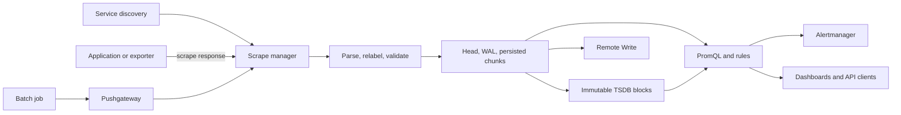

# Prometheus & Metrics — SRE Expert Checklist

A dashboard can show healthy targets while users experience failures. A scrape can succeed while a critical metric disappears, and a plausible p99 graph can hide an incorrect aggregation. Preparing for an expert SRE interview means explaining how measurements become decisions and where that chain can break.

This guide follows all twelve sections of the supplied checklist. It assumes basic Linux, HTTP, and Kubernetes knowledge. Examples use hypothetical services and sizing numbers. Product features, defaults, and metric names vary by release; use the documentation and `promtool` shipped with your deployed version. Native histograms and Remote Write protocol compatibility deserve particular attention during upgrades.

## Contents

1. [Metrics Fundamentals](#1-metrics-fundamentals)
2. [Prometheus Architecture & Internals](#2-prometheus-architecture--internals)
3. [Metrics Collection & Service Discovery](#3-metrics-collection--service-discovery)
4. [PromQL — Query Language](#4-promql--query-language)
5. [Histograms, Latency & Quantiles](#5-histograms-latency--quantiles)
6. [Cardinality & Performance](#6-cardinality--performance)
7. [Recording & Alerting Rules](#7-recording--alerting-rules)
8. [High Availability & Distributed Storage](#8-high-availability--distributed-storage)
9. [Kubernetes & Cloud-Native Monitoring](#9-kubernetes--cloud-native-monitoring)
10. [Security & Production Operations](#10-security--production-operations)
11. [Observability & Troubleshooting](#11-observability--troubleshooting)
12. [Expert Interview Scenarios](#12-expert-interview-scenarios)

## 1. Metrics Fundamentals

### Metrics, logs, traces, and observability

**Metrics** describe numerical measurements over time: requests, queue depth, CPU usage, latency distributions. Their aggregation makes fleet-wide questions inexpensive when dimensions remain bounded. **Logs** record individual events with contextual detail. **Traces** connect work across service boundaries, exposing the path and timing of a request. A metric can reveal rising latency, a trace can identify the slow dependency, and a log can explain its error.

**Monitoring** measures known conditions and detects deviations. **Observability** is the ability to infer internal behavior from a system's outputs, including investigating questions that were not anticipated when dashboards were built. Collecting all three signal types does not guarantee useful observability: missing context, inconsistent identities, and poor instrumentation can still prevent diagnosis.

### White-box and black-box monitoring

White-box monitoring inspects internal state, such as a worker queue or database connection pool. Black-box monitoring exercises externally visible behavior, such as completing an HTTPS request through DNS, routing, TLS, and the application. Internal metrics explain mechanisms; external probes identify failures that internal process health can miss. Run probes from relevant user locations and distinguish probe infrastructure failure from service failure.

### Golden Signals, RED, and USE

| Method | Signals | How to use it |
| --- | --- | --- |
| Golden Signals | Latency, traffic, errors, saturation | Start with service health and user impact |
| RED | Rate, errors, duration | Instrument request-driven services and RPC boundaries |
| USE | Utilization, saturation, errors | Inspect each resource: CPUs, disks, network links, pools |

Utilization measures how busy a resource is; saturation measures demand it cannot immediately serve. An average CPU value can hide one saturated core. Separate successful-request latency from fast failures so errors do not make the service appear faster. These principles are developed in Google's [monitoring distributed systems chapter](https://sre.google/sre-book/monitoring-distributed-systems/).

### SLIs, SLOs, SLAs, and budgets

An **SLI** is a defined service-quality measurement, such as successful eligible requests divided by all eligible requests. An **SLO** specifies its target and window, such as 99.9% success over a rolling 30 days. An **SLA** is an agreement with specified consequences; its measurement and exclusions can differ from internal objectives.

Define eligibility before calculating a ratio: whether client errors count, which routes matter, where measurement happens, and how retries are represented. Server-side instrumentation cannot observe requests that fail before reaching the server. A latency SLI should define whether failed requests also count as bad rather than allowing fast errors to qualify as good.

For a request-based 99.9% SLO, the **error budget** permits a bad-event fraction of `1 - 0.999 = 0.001`. With ten million eligible requests, that permits ten thousand bad requests. **Burn rate** is observed bad-event fraction divided by the permitted fraction. A 1% error ratio burns this budget at 10 times its sustainable rate. A request budget is not automatically equivalent to a number of downtime minutes.

### Metric types

| Type | Meaning | Typical query or trap |
| --- | --- | --- |
| Counter | Accumulated events; normally increases until reset | Apply `rate()` or `increase()`; restarts reset it |
| Gauge | Current level that can rise and fall | Queue depth, temperature, in-flight requests; use levels or gauge functions |
| Classic histogram | Cumulative bucket counters plus count and sum | Aggregate bucket rates before estimating quantiles |
| Native histogram | Distribution encoded in histogram samples | Check support across clients, transport, storage, and queries |
| Summary | Count, sum, and optionally client-calculated quantiles | Quantiles cannot generally be merged across instances |
| Info metric | Metadata convention, usually a value of `1` with descriptive labels | `build_info{version="1.2.3"} 1`; useful for bounded metadata joins |

An info metric is not a general-purpose string database. Changing metadata labels creates new series. For float samples, the TSDB does not enforce counter versus gauge semantics, so `rate()` on a gauge can run and still be meaningless. See [metric types](https://prometheus.io/docs/concepts/metric_types/).

### Names, units, labels, and cardinality

Prefer names such as `http_requests_total`, `http_request_duration_seconds`, and `process_resident_memory_bytes`. Use base units, one measured quantity per family, and labels for bounded dimensions such as method, status, and route template. A route `/users/{id}` is bounded; raw `/users/182746` paths can grow with users. Avoid embedding label values in metric names. Keep colon-separated names for recording rules by convention. See [metric and label naming](https://prometheus.io/docs/practices/naming/).

Each distinct metric name and complete label set identifies a series. Potential combinations multiply: 100 routes × 5 methods × 10 status values × 50 instances gives 250,000 series before histogram buckets. Only observed combinations exist, but unbounded labels make even observed counts dangerous. Never use request IDs, session tokens, or email addresses as ordinary metric dimensions.

### Pull, push, instrumentation, exporters, and collectors

Pull collection lets Prometheus schedule requests and record scrape failure. Push collection sends measurements to a receiver, which helps when network direction or workload lifetime prevents scraping. Push introduces its own delivery, buffering, identity, and freshness questions. It does not inherently provide better reliability.

A scrape usually reads cumulative state. If a counter increases 100 times between successful scrapes, those increments remain visible; individual event timing is lost. A brief gauge spike can disappear between scrapes. Logs or event streams are better when every event must be retained. A process restart between scrapes can also lose unobserved counter increments, so metrics are unsuitable as an exact billing ledger.

**Instrumentation** records application behavior using a client library. An **exporter** translates another system's state into metrics, such as operating-system counters. A **collector** receives or scrapes telemetry, transforms or batches it, and forwards it. Prefer application instrumentation for application semantics; infrastructure exporters cannot infer whether a checkout completed correctly.

## 2. Prometheus Architecture & Internals

### Components and the measurement path

The Prometheus server discovers targets, scrapes endpoints, stores samples, evaluates PromQL and rules, and exposes an HTTP API. Exporters expose measurements. Alertmanager receives alerts and manages notifications. Pushgateway retains pushed groups for later scraping; it does not replace the Prometheus TSDB.



Discovery supplies candidate targets and metadata. Target relabeling selects targets and sets scrape identity. The scrape manager schedules requests, parses the negotiated exposition format, applies metric relabeling, and appends accepted samples. Invalid timestamps, duplicate identities, parsing failures, and configured limits can interrupt this path. Scrape health and metric correctness need separate checks.

### Time-series identity and timestamps

`http_requests_total{job="checkout",instance="10.0.1.4:8080",method="GET"}` identifies one series. The metric name is represented internally by `__name__`. Changing any identifying label creates another series. A sample contains a timestamp and either a float value or a native histogram value. Prometheus normally supplies scrape timestamps; explicitly exported timestamps require careful clock and staleness handling. The [data model](https://prometheus.io/docs/concepts/data_model/) defines these identities.

### Head, WAL, chunks, and blocks

Recent data lives in the mutable **Head**, with in-memory structures and memory-mapped completed Head chunks. The **write-ahead log (WAL)** supports recovery after restart; it is not a second long-term database. Samples are compressed into chunks. Head compaction produces immutable blocks, conventionally starting with two-hour ranges, with chunk files, an index, and metadata.

Background compaction merges blocks. Time or size retention removes eligible old blocks; deletion is asynchronous and needs disk headroom. Tombstones mark deleted time ranges before physical cleanup. Head garbage collection removes obsolete series structures after truncation; application garbage collection is a separate Go runtime concern. See [local storage](https://prometheus.io/docs/prometheus/latest/storage/).

### Inverted index, postings lists, and retrieval

An inverted index maps a label pair such as `job="checkout"` to a **postings list** of series references. A selector intersects or combines relevant lists, resolves matching series, then reads chunks overlapping the requested time range. A **symbol table** stores repeated label strings compactly. This avoids scanning every sample just to identify a service, but a broad selector can still match millions of series.

PromQL then decodes samples, calculates functions, matches vectors, and aggregates results. A query returning ten lines can process an enormous input set. The [TSDB index format](https://github.com/prometheus/prometheus/blob/main/tsdb/docs/format/index.md) documents the on-disk structures.

### Staleness, gaps, and lookback

An instant selector searches backward for a recent sample, with a default lookback of five minutes. A stale marker ends eligibility for that series before lookback would otherwise expire. Removed targets and series that disappear from scrape results become stale; range functions ignore stale markers and can still process real samples in their selected range. See [staleness behavior](https://prometheus.io/docs/prometheus/latest/querying/basics/#staleness).

A missing value is not zero. It can mean no events have ever created a labeled series, failed collection, relabel filtering, target disappearance, or stale data. Explicit timestamps and restarts complicate the exact timing. Avoid solving a missing-data incident by increasing lookback until an old value appears current.

### Scheduling and process resources

`scrape_interval` controls observation frequency; rule-group intervals control calculation frequency. They are independent schedules. Evaluating every five seconds against 30-second scrapes does not create new measurements. It can repeatedly evaluate the same samples and shorten the practical number of observations in a rate window.

Prometheus runs many activities inside one Go process: discovery, per-target scrape loops, appends, query execution, rule groups, compaction, WAL work, and remote delivery. CPU contention in one subsystem can delay another. Memory includes series metadata, chunks, query working sets, remote-write queues, Go heap, and mapped files; resident memory is broader than heap alone. Persistent-volume latency can make ingestion or WAL replay the bottleneck even when CPU remains available.

## 3. Metrics Collection & Service Discovery

### HTTP exposition and protocol negotiation

Applications commonly expose `/metrics` over HTTP. Prometheus text exposition includes metadata and samples, for example:

```text
# HELP http_requests_total Completed HTTP requests.
# TYPE http_requests_total counter
http_requests_total{method="GET",code="200"} 1234
```

This snippet is Prometheus text format. OpenMetrics adds a defined protocol with metadata, exemplars, and framing such as the `# EOF` terminator in OpenMetrics 1.0 text. Set the correct content type and negotiate a format supported by both sides. Different text and protobuf formats carry different histogram capabilities; an HTTP 200 response with the wrong format can still fail ingestion. See [exposition formats](https://prometheus.io/docs/instrumenting/exposition_formats/).

### Discovery options

| Discovery | Source of targets | Operational concern |
| --- | --- | --- |
| Static | Addresses in configuration | Simple, but manual changes need deployment or reload |
| File | Watched JSON/YAML target files | Generate and replace files atomically |
| DNS | Supported DNS records | TTLs and DNS failure affect freshness; identity needs stable labels |
| Kubernetes | API watches for resource metadata | RBAC, selectors, API reachability, and relabeling determine targets |

Kubernetes pod discovery exposes pod-related targets and metadata. Service discovery can monitor a Service endpoint but does not necessarily scrape every backend. Endpoint and EndpointSlice discovery expose service backends; node discovery exposes node addresses. Prefer the resource and endpoint role supported by the cluster and deployed Prometheus version, including EndpointSlice migration where applicable.

### Scrape configuration

```yaml
global:
  scrape_interval: 30s
  evaluation_interval: 30s
  external_labels:
    cluster: production-eu
    replica: prometheus-a

scrape_configs:
  - job_name: checkout
    scrape_timeout: 10s
    static_configs:
      - targets: ["checkout-1.internal:8080", "checkout-2.internal:8080"]
        labels:
          service: checkout
    relabel_configs:
      - source_labels: [__address__]
        target_label: instance
    metric_relabel_configs:
      - source_labels: [__name__]
        regex: "debug_.*"
        action: drop
```

The timeout must not exceed the scrape interval. The example's target relabeling explicitly sets the address-based instance label; Prometheus also supplies that default when `instance` remains unset. Treat the debug-family drop as an example policy, not a filter to copy without checking consumers.

### Three relabeling boundaries

| Configuration | When it runs | Typical purpose |
| --- | --- | --- |
| `relabel_configs` | Before scraping a discovered target | Keep selected targets, change address/path, preserve discovery metadata |
| `metric_relabel_configs` | On scraped samples before local ingestion | Drop unwanted metric families or transform labels |
| `write_relabel_configs` | Before sending to a remote-write destination | Select the remotely retained subset |

Discovery labels beginning `__meta_` are temporary unless copied into retained labels. Metric relabeling does not apply to automatically generated scrape series such as `up`. Remote filtering does not reduce local ingestion. Removing a label can collapse distinct series into the same identity and cause collisions rather than meaningful aggregation.

With default `honor_labels: false`, configured target labels win collisions and conflicting scraped labels are renamed with `exported_` prefixes. With `honor_labels: true`, scraped labels win and conflicting server labels are not attached. `external_labels` identify data sent to external systems; they are not automatically attached to every locally stored series. Use them deliberately for HA, federation, and remote storage. See the [configuration reference](https://prometheus.io/docs/prometheus/latest/configuration/configuration/).

### Exporters and Pushgateway

**Node Exporter** reports host operating-system state. **kube-state-metrics** reports Kubernetes object state, such as desired and available replicas. **cAdvisor**, commonly accessed through kubelet endpoints, reports container resource activity. **Blackbox Exporter** actively probes endpoints and reports results. None substitutes for application business metrics.

Pushgateway is useful for service-level batch jobs whose short lifetimes prevent reliable scraping. Push a last-success timestamp and result metrics under a stable grouping key. Plan deletion when groups become obsolete: pushed metrics can outlive the job indefinitely. A healthy scrape of Pushgateway proves gateway reachability, not job success. Avoid per-run identifiers and replacing normal service discovery with a shared gateway. See [when to use Pushgateway](https://prometheus.io/docs/practices/pushing/).

### Collectors, native histograms, and exemplars

The [OpenTelemetry Prometheus receiver](https://github.com/open-telemetry/opentelemetry-collector-contrib/tree/main/receiver/prometheusreceiver) scrapes Prometheus endpoints into Collector pipelines. It is stateful: identical configurations on multiple replicas can duplicate scrapes unless ownership is coordinated. Scaling the Collector deployment alone does not shard target ownership.

[Grafana Alloy](https://grafana.com/docs/alloy/latest/introduction/) combines OpenTelemetry collection with Prometheus pipelines. Choose a collector based on required signals, discovery, processing, delivery, and buffering semantics. Confirm how metric names, resource attributes, temporality, and histogram layouts survive conversions.

Native histograms encode a distribution in each histogram sample. Their stable support starts with Prometheus 3.8, but scraping still requires explicit configuration in Prometheus 3.x. Check `scrape_native_histograms`, `always_scrape_classic_histograms`, and remote transport support for the deployed version. Do not assume exposing classic and native forms means both are stored. The [native histogram specification](https://prometheus.io/docs/specs/native_histograms/) tracks these changes.

An **exemplar** links a measurement to contextual data such as a trace ID without adding that ID to every series' identity. Exemplars are sampled context, not complete traces; enable compatible exposition, storage, and visualization, and apply privacy controls to exemplar labels too.

## 4. PromQL — Query Language

### Types, selectors, and aggregation

An **instant vector** has one selected sample per matching series at an evaluation time. A **range vector** contains samples over a preceding interval for each series. A **scalar** is one number; strings have limited use in expressions. A range query evaluates an expression repeatedly at a configured step; it is different from the range-vector selector `metric[5m]`.

```promql
http_requests_total{job="checkout",code=~"5..",method!="OPTIONS"}
sum by (service) (rate(http_requests_total[5m]))
topk(5, sum by (route) (rate(http_requests_total[5m])))
```

Matchers include `=`, `!=`, `=~`, and `!~`; regexes are fully anchored. A matcher that accepts an empty value can also select series where that label is absent. `by(...)` retains selected grouping labels; `without(...)` removes specified ones. Explicit grouping helps preserve tenant or cluster boundaries.

`sum`, `avg`, `min`, `max`, `count`, and `topk` aggregate across input series at each evaluation time. `count` counts series, not requests. Averages of instance averages usually misweight traffic: calculate a global numerator divided by a global denominator instead. See [PromQL basics](https://prometheus.io/docs/prometheus/latest/querying/basics/) and [operators](https://prometheus.io/docs/prometheus/latest/querying/operators/).

### Changes over time

| Function | Intended input | Meaning |
| --- | --- | --- |
| `rate(counter[5m])` | Counter | Average per-second increase, accounting for observed resets |
| `irate(counter[5m])` | Counter | Per-second change from the final two samples; more volatile |
| `increase(counter[1h])` | Counter | Estimated increase across the selected interval |
| `delta(gauge[1h])` | Gauge | Extrapolated difference between first and last observations |
| `deriv(gauge[1h])` | Float gauge | Per-second linear-regression slope |
| `avg_over_time(gauge[1h])` | Range | Mean of samples within each series |
| `max_over_time(gauge[1h])` | Range | Maximum observed sample within each series |
| `quantile_over_time(0.95, gauge[1h])` | Float range | Quantile of observed sample values within each series |

Time aggregations give samples equal weight; they are not automatically time-weighted. A p95 of sampled queue lengths is different from a p95 of request latency observations. `rate()` and `increase()` extrapolate toward range boundaries, so increases can be fractional and need not equal a literal count of events. See the [function reference](https://prometheus.io/docs/prometheus/latest/querying/functions/).

Always calculate per-series counter rates before aggregating. If one instance resets while another grows, aggregating raw counters first can hide the reset or invent a larger one. For the usual rate functions, fewer than two usable samples produces no rate. Use a range containing several scrapes; around four scrape intervals is a useful starting heuristic, then account for jitter, gaps, traffic volume, and required responsiveness.

### Histogram functions

Classic histogram quantiles use `histogram_quantile()` over bucket rates while retaining `le`. For a native counter histogram, `rate()` produces a distribution of per-second observations; `histogram_count()` extracts its count and `histogram_sum()` extracts its sum. These functions operate on native histogram samples rather than classic `_count` or `_sum` float series.

```promql
histogram_count(rate(http_request_duration_seconds[5m]))
histogram_sum(rate(http_request_duration_seconds[5m]))
```

The first expression measures requests per second; the second measures observed duration per second. Their ratio gives mean latency. Mixed float/histogram samples and incompatible histogram layouts can cause omitted results or query warnings; inspect API annotations during migrations.

### Binary operators and vector matching

Arithmetic combines values; comparisons filter by default, while `bool` comparisons return zero or one for matched elements. Missing matches remain missing even with `bool`. Set operators `and`, `or`, and `unless` operate on series membership: intersection, union, and exclusion. They are not scalar Boolean shortcuts.

Matching normally uses labels other than the metric name. `on(...)` selects the matching key; `ignoring(...)` removes labels from it. For arithmetic and comparison, `group_left` permits many left-side series to match one right-side series, and `group_right` permits the reverse. The one side must be unique for the key; these modifiers do not authorize arbitrary many-to-many arithmetic joins.

```promql
rate(http_requests_total[5m])
  * on (cluster, instance) group_left (version)
    build_info
```

This enriches each request-rate series with a version only if `build_info` has exactly one matching series for each `(cluster, instance)` and its value is one. Check uniqueness before adding a join; excluding `cluster` can accidentally join unrelated instances.

### Historical comparisons and subqueries

```promql
rate(http_requests_total[5m] offset 1w)
http_requests_total @ 1609459200
max_over_time((sum by (service) (rate(http_requests_total[5m])))[1h:1m])
```

`offset` shifts a selector in time. `@` fixes its evaluation timestamp. A subquery evaluates an inner instant expression over a range at a chosen resolution, allowing a range function over derived values. The last example finds the largest observed service request rate across a one-hour subquery. Nested subqueries can multiply work; record a frequently reused inner expression instead.

### Missing metrics and aggregation correctness

`absent(metric{job="checkout"})` detects an empty selector; `absent_over_time(metric{job="checkout"}[10m])` detects no samples across a window. `present_over_time(metric[10m])` returns one for each series with a sample in that window. These do not enumerate unknown identities that never existed. Compare observed inventory against expected inventory when detecting one missing member of a fleet.

```promql
sum by (service) (rate(http_requests_total{code=~"5.."}[5m]))
/
sum by (service) (rate(http_requests_total[5m]))
```

This error ratio requires aligned populations and labels. If an error series is never initialized, the numerator can disappear. Where absence is defined as zero errors, a denominator-shaped zero can fill it: `(errors or on(service) (0 * requests)) / requests`, where `errors` and `requests` represent the corresponding recorded rates. If traffic is zero, explicitly define no-traffic behavior; do not manufacture healthy traffic by blindly clamping the denominator.

Optimize by narrowing selectors, preserving only needed labels, and recording reusable expensive calculations. Retain dimensions needed for future ratios and histograms. Removing a label during aggregation is irreversible; a recording rule containing only the service total cannot later answer per-route questions.

## 5. Histograms, Latency & Quantiles

### Classic histogram mechanics

For each ordinary label combination, a classic histogram emits cumulative `_bucket{le="..."}` counters, `_count`, and `_sum`. A 0.2-second observation increments every bucket whose boundary is at least 0.2, increments count, and adds 0.2 to sum. The `+Inf` bucket includes every observation. With `B` emitted bucket series, including `+Inf`, the usual representation uses `B + 2` series per label combination, before optional creation metadata.

For nonnegative durations, sum and count behave as counters. A sum that includes negative observations need not be monotonic. Summary count and sum can be aggregated for a mean, but its precomputed quantiles cannot generally produce a fleet quantile. Histograms move quantile estimation to query time; summaries calculate configured quantiles in the client. See [histograms and summaries](https://prometheus.io/docs/practices/histograms/).

### Correct fleet quantiles and means

```promql
# Classic histogram: combine observation populations before estimating p99.
histogram_quantile(
  0.99,
  sum by (service, le) (rate(http_request_duration_seconds_bucket[5m]))
)
```

```promql
# Native histogram: the histogram sample carries its bucket structure.
histogram_quantile(
  0.99,
  sum by (service) (rate(http_request_duration_seconds[5m]))
)
```

```promql
sum by (service) (rate(http_request_duration_seconds_sum[5m]))
/
sum by (service) (rate(http_request_duration_seconds_count[5m]))
```

The third expression is a traffic-weighted mean from a classic histogram. Averaging instance p99 values or taking their maximum does not calculate the global p99. Classic bucket layouts must be compatible across the population; summing different boundary sets creates a misleading combined distribution.

### Resolution and approximation error

Classic quantile estimation interpolates within the bucket containing the requested quantile. A large gap from 0.3 to 5 seconds allows a large value error around the tail. Place boundaries around operational thresholds, then add resolution where diagnosis requires it. A summary's configured error concerns quantile rank, while histogram resolution bounds where within a bucket the value can lie.

Native histograms commonly use exponential schemas and sparse bucket encoding. Higher resolution can improve tail detail but increases sample size and processing. Compatible exponential schemas can be reconciled at lower resolution; incompatible layouts require checking warnings and supported operations. Native histograms reduce the series explosion of classic buckets but do not make distributions free. See the [native histogram specification](https://prometheus.io/docs/specs/native_histograms/).

### Interpreting percentiles and Apdex

p50 approximates the median, p95 the value below which roughly 95% of observations fall, and p99 the corresponding 99% boundary. A p99 of 800 ms does not mean the slowest request took 800 ms. It says little about the magnitude of the slowest 1%. Low traffic makes high percentiles unstable; percentile graphs also depend on window length and the measured population.

For Apdex, classify requests as satisfied at or below `T`, tolerating above `T` through `4T`, and frustrated above `4T`. The score is `(satisfied + 0.5 * tolerating) / total`. With cumulative histogram buckets at both boundaries, this becomes `(bucket(T) + bucket(4T)) / (2 * count)`. Define how failed requests are counted; fast failures should not improve satisfaction.

### Latency SLOs from bucket ratios

For a duration-only SLI with a boundary at exactly 0.3 seconds:

```promql
sum by (service) (rate(http_request_duration_seconds_bucket{le="0.3"}[5m]))
/
sum by (service) (rate(http_request_duration_seconds_count[5m]))
```

This directly estimates the fraction of observations at or below 300 ms without quantile interpolation. For an objective that also requires success, instrument or select a matching success population for the numerator while keeping all eligible requests in the denominator. Over the SLO window, divide good-event totals by eligible-event totals; an unweighted average of five-minute ratios biases windows with unequal traffic.

## 6. Cardinality & Performance

### Series count, sample rate, and churn

Cardinality counts distinct series; ingestion rate counts samples per second. One million stable float series scraped every 15 seconds produces approximately 66,667 samples/second. At 60 seconds it produces about 16,667, but the system still maintains one million active identities. Increasing the interval therefore reduces sample work much more directly than series metadata cost.

**Churn** creates and retires identities rapidly, for example through pod UID or deployment-hash labels. A fixed simultaneous series count with high churn can still enlarge indexes, WAL traffic, replay time, and remote-write caches. Bound application dimensions and evaluate whether ephemeral infrastructure labels are necessary for each metric family.

### Resource and query costs

Head metadata and labels consume memory; chunks and queries add working sets. WAL writes need sustained throughput and recovery capacity. Compaction reads and writes blocks while queries read historical chunks. Reserve capacity for restart replay, peak queries, and overlapping compaction work instead of sizing only for steady ingestion.

Queries become expensive through wide selectors, long ranges, fine steps, regex expansion, subqueries, and joins with large intermediate results. `topk(10, ...)` can still scan all candidates. Record repeated aggregations and choose dashboard resolution appropriate to the displayed interval. Recording every possible combination merely shifts the overload into rule evaluation.

### Limits and safe filtering

Use per-scrape sample and label limits to constrain bad targets, but understand failure behavior: exceeding a configured limit can fail the scrape rather than silently retain a useful prefix. Body-size limits and target limits add other safeguards. Filter unnecessary families at instrumentation or scrape ingestion; write relabeling protects only the remote destination.

Never delete `user_id` from a per-user counter and assume the remaining counters have been summed. They can collapse into duplicate identities in one scrape. Change instrumentation to aggregate before exposition, or drop the family and replace it with a bounded one.

### Capacity planning and analysis

Use observed active series, series creation/removal rates, sample ingestion, histogram sizes, label lengths, and query concurrency. Estimate a lower-level storage budget as:

```text
samples_per_second ≈ scraped_series / scrape_interval_seconds
compressed_sample_bytes ≈ samples_per_second × retention_seconds × measured_bytes_per_sample
total_disk ≈ compressed samples + indexes + WAL + Head chunks + compaction headroom
```

Hypothetically, one million float series at 15 seconds retained for 15 days produces 86.4 billion samples. If measured compressed sample storage averages two bytes/sample, that component alone is about 172.8 GB in decimal units. This excludes indexes, WAL, and headroom; native histogram samples require their own measurements. Local retention settings are not a hard cap on filesystem use.

```bash
promtool tsdb analyze /path/to/offline-tsdb
promtool tsdb list /path/to/offline-tsdb
```

Use a snapshot or offline copy for reproducible analysis and check command flags against the installed release. The TSDB status API also exposes useful label and series counts. Start with problematic jobs and families instead of running unbounded fleet-wide queries. See [promtool commands](https://prometheus.io/docs/prometheus/latest/command-line/promtool/).

## 7. Recording & Alerting Rules

### Recording rules and scheduling

Recording rules evaluate expressions and store their results as new series. A name such as `service:http_requests:rate5m` communicates retained level, source, and operation. Load rule files through the main configuration's `rule_files` setting, for example `rule_files: ["rules.yml"]`. Every new output series has ingestion and retention cost; new rules do not automatically backfill history.

Rules in a group share a schedule and normally evaluate sequentially, allowing an earlier recording rule to feed a later rule. Separate groups do not provide dependency ordering. Long evaluations can miss scheduled iterations and leave gaps. Watch group duration relative to its interval. See [recording rules](https://prometheus.io/docs/prometheus/latest/configuration/recording_rules/).

```yaml
groups:
  - name: checkout
    interval: 30s
    rules:
      - record: service:http_requests:rate5m
        expr: sum by (service) (rate(http_requests_total[5m]))
      - alert: CheckoutTargetDown
        expr: up{job="checkout"} == 0
        for: 5m
        keep_firing_for: 2m
        labels:
          severity: warning
          team: checkout
        annotations:
          summary: "Checkout target {{ $labels.instance }} cannot be scraped"
          description: "Scraping has failed for at least five minutes; inspect target health and networking."
```

This is a scrape-health example, not proof of a user-facing outage. Production alerting should include user-impact signals and a real runbook location.

### Alert state, identity, and actionability

An expression result creates an alert instance for its label set. Without `for`, it can fire on the first matching evaluation. With `for`, it remains pending until the condition persists across evaluations for that duration. `keep_firing_for` can keep a firing alert active after the expression stops matching, reducing premature resolution during brief gaps. It does not distinguish missing data from recovery. See [alerting rules](https://prometheus.io/docs/prometheus/latest/configuration/alerting_rules/).

When the condition clears and any `keep_firing_for` period expires, the alert becomes inactive and a previously firing alert resolves. Whether a resolved notification is delivered also depends on receiver configuration. A query evaluation error is not evidence of recovery; monitor evaluation failures separately.

Keep identity labels stable: service, cluster, severity, and owner are useful routing dimensions. Put changing values and explanatory text in annotations; a changing label can create a new alert and restart pending time. A useful page names the impact, gives the operator an action, and reaches someone who can act. Use tickets for slower problems that do not justify interrupting sleep.

### Alertmanager notification control

**Grouping** batches related alerts. **Deduplication** avoids repeated notifications for the same alert state. **Routing** chooses receivers through label matchers. `group_wait`, `group_interval`, and `repeat_interval` affect when notifications arrive; they do not change the Prometheus condition.

A **silence** suppresses matching notifications for a bounded period. **Inhibition** suppresses dependent symptoms when a matching source alert is active, such as node loss suppressing individual pod symptoms. **Mute intervals** schedule quiet periods. Keep rules narrow enough that a broad cluster failure does not suppress an unrelated service incident. These controls are described in [Alertmanager concepts](https://prometheus.io/docs/alerting/latest/alertmanager/).

### Multi-window, multi-burn-rate alerts

For a 99.9% availability SLO over 30 days, an illustrative page policy detects 14.4× burn in both one hour and five minutes, or 6× burn in both six hours and 30 minutes. The longer window detects meaningful budget consumption; the shorter window checks that the problem is continuing. Assuming roughly constant eligible traffic, these correspond to about 2% of the budget consumed in one hour and 5% in six hours. See Google's [SLO alerting workbook](https://sre.google/workbook/alerting-on-slos/).

```promql
(
  service:http_error_ratio:rate1h > 14.4 * 0.001
  and on (cluster, service)
  service:http_error_ratio:rate5m > 14.4 * 0.001
)
or
(
  service:http_error_ratio:rate6h > 6 * 0.001
  and on (cluster, service)
  service:http_error_ratio:rate30m > 6 * 0.001
)
```

The four names above are prerequisite recording rules, each computed from error rates divided by total eligible-request rates over the named window. Preserve the same `(cluster, service)` population in all four. Thresholds are examples, not universal policy. For sparse traffic, combine a deliberate minimum-event policy, synthetic probes, and an explicit no-traffic decision. Long `for` durations on top of long windows can delay detection unnecessarily.

### Flapping, hysteresis, and No Data

Use smoothing and `for` where a transient threshold crossing has little meaning. `keep_firing_for` delays clearing but is not true amplitude hysteresis. True hysteresis has different entry and exit thresholds and needs a deliberate stateful design. Avoid hiding sustained harm with excessive smoothing.

Prometheus alerting does not automatically turn an empty expression into a No Data alert. Use separate absence, expected-inventory, rule-failure, and scrape-health checks. A dead Prometheus cannot page about its own death; a continuously firing watchdog checked by an independent receiver or monitoring system can expose that blind spot.

## 8. High Availability & Distributed Storage

### Independent replicas and deduplication

An HA pair normally scrapes the same targets independently, writes separate local disks, and evaluates rules independently. Use a shared cluster identity and a unique replica label when sending data outward. Neither replica replicates its local TSDB into the other. Place replicas across failure domains and avoid sharing one volume.

Query or ingestion deduplication must understand the replica label. Summing both copies doubles request rates. Before alerts reach Alertmanager, remove only the replica identity from otherwise equivalent alert labels so they deduplicate. Preserve region and cluster identities. Send alerts to all relevant Alertmanager replicas; do not rely on a load balancer to deliver each alert to only one member.

### Federation, Remote Read, and distributed queries

Prometheus federation scrapes selected series from another Prometheus `/federate` endpoint, often to build a hierarchy of regional aggregates. It is useful for a limited global view but does not automatically copy full history. Overlapping scrape populations and label collisions can duplicate or corrupt the global interpretation.

Remote Read lets a Prometheus query obtain samples from a remote source. It does not automatically delegate all PromQL computation or create a scalable distributed query engine. Systems such as Thanos and Mimir add routing, fan-out, caching, query splitting, and distributed execution with their own completeness and failure semantics.

### Remote Write delivery and failure

Remote Write sends samples asynchronously to compatible storage. A WAL reader feeds per-destination shard queues, with batching, retries, and adaptive parallelism. If a shard fills, WAL reading can stall. Increasing queue capacity consumes memory and does not create durable retention. More shards help only if the network and receiver have capacity. See [remote-write tuning](https://prometheus.io/docs/practices/remote_write/).

Remote Write v1 uses the established write request format. V2 changes encoding and metadata handling, supports richer data such as native histograms and created timestamps, and defines response headers reporting written counts. Select the protobuf message supported by the receiver and test interoperability; v2 is not a guarantee of exactly-once storage. Consult the [v2 specification](https://prometheus.io/docs/specs/prw/remote_write_spec_2_0/).

Retryable network and server failures differ from permanent rejection for invalid samples or authorization. Rate-limit retry behavior is configurable. Backlog recovery also requires capacity above ongoing ingestion. If ingestion is `I`, backlog is `B`, and achievable send throughput is `S > I`, approximate catch-up time is `B / (S - I)`.

Ordinary server Remote Write is bounded by WAL availability; local TSDB retention is not its replay queue. Prometheus documents potential loss after a receiver outage of roughly two hours in the usual server path as unsent WAL data is compacted away. Agent retention and other collectors have different bounds. Verify the exact mode and configuration rather than promising an outage duration. Lost remote data may require a separate, supported backfill from retained local blocks; restoring connectivity alone does not resend arbitrary history.

### Agent mode

Prometheus Agent retains scraping, discovery, relabeling, and remote delivery with a specialized WAL, while omitting local PromQL querying, normal TSDB block storage, and rule evaluation. It reduces local responsibilities but depends on remote storage for queries and alert evaluation. Use server mode when local querying and alerting must survive a remote-backend outage. Confirm retention and launch flags in the deployed version's [Agent Mode documentation](https://prometheus.io/docs/prometheus/latest/prometheus_agent/).

### Long-term storage architectures

| System | Main components and path | Decision implications |
| --- | --- | --- |
| Thanos | Sidecar exposes local Prometheus data and uploads blocks; Store Gateway serves object-storage blocks; Querier merges stores; Compactor compacts and can downsample; Receive ingests Remote Write | Extends independent Prometheus servers; object upload delay and query deduplication matter |
| Grafana Mimir | Distributors validate/route ingestion; ingesters serve recent data and build blocks; queriers and store-gateways read recent/object data; query frontends schedule and accelerate queries | Central multi-tenant platform with distributed operation and tenant limits |
| VictoriaMetrics | Single-node deployment combines roles; cluster separates `vminsert`, `vmstorage`, and `vmselect` | Start with operational simplicity where appropriate; cluster adds independent role scaling and failure considerations |

These are different operating models rather than interchangeable Prometheus binaries. Compare existing local alerts, tenancy, query compatibility, durability, cost, and staff capacity using [Thanos components](https://thanos.io/tip/components/), [Mimir architecture](https://grafana.com/docs/mimir/latest/references/architecture/), and [VictoriaMetrics cluster documentation](https://docs.victoriametrics.com/victoriametrics/cluster-victoriametrics/).

Mimir's [ingest-storage architecture](https://grafana.com/docs/mimir/latest/get-started/about-grafana-mimir-architecture/about-ingest-storage-architecture/) introduces Kafka or a Kafka-compatible durable log between ingestion and processing; the classic architecture uses a different write path. State which deployment architecture you are discussing. VictoriaMetrics replication and deduplication require explicit design; do not assume its cluster uses the same object-storage block architecture as Thanos or Mimir.

Object storage provides economical durable history, but recent data can still depend on local disks or ingestion logs until uploaded. Define upload delay, recovery point objective, replication, bucket permissions, and deletion policies. Deduplication removes redundant observations according to a defined identity; it does not merge arbitrary independently measured business events.

### Regions and failure isolation

Keep collection and critical alerting local to each region, with a global view for comparison. Bound cross-region dependencies so a central query outage does not stop local detection. Replicate or export the data needed for disaster investigation, but account for egress cost, identity consistency, delayed delivery, and remote throttling. Multi-region dashboards are not proof of multi-region alert availability.

## 9. Kubernetes & Cloud-Native Monitoring

### Operator resources and kube-prometheus-stack

The Prometheus Operator reconciles custom resources into workloads and configuration. `Prometheus` describes servers; `PrometheusAgent` describes collection agents. `ServiceMonitor` selects Services and scrape endpoints; `PodMonitor` selects pods directly; `Probe` configures probes through a prober; `PrometheusRule` defines recording and alerting rules. Creating a monitor does nothing unless an applicable instance selects it. See the [Operator design](https://prometheus-operator.dev/docs/getting-started/design/).

`kube-prometheus-stack` packages the Operator and a monitoring stack, typically including Prometheus, Alertmanager, Grafana, Node Exporter, kube-state-metrics, rules, and dashboards. Enabled components depend on chart values. Treat Helm chart version, CRD compatibility, and rule changes as part of the upgrade surface.

Selection has several layers: Prometheus selects monitor objects and their namespaces; monitors select Services or pods and their namespaces; endpoint configuration selects ports and paths. A ServiceMonitor's port commonly refers to the named Service port, which must map correctly to the target. RBAC controls API discovery, while network policy and endpoint credentials control actual scraping.

### Kubernetes measurement sources

| Question | Useful source | Interpretation |
| --- | --- | --- |
| Is a node under CPU, memory, or disk pressure? | Node Exporter, kubelet metrics | Physical resource pressure and host behavior |
| What CPU/memory does a container consume? | Kubelet/cAdvisor | Runtime consumption, throttling, working set |
| Are desired deployment replicas available? | kube-state-metrics | Desired and observed Kubernetes object state |
| Is HPA making sensible decisions? | HPA object state plus metrics API/adapter data | Desired/current replicas, limits, missing metrics |
| Is KEDA scaling from the expected trigger? | KEDA operator/scaler metrics plus source backlog | Trigger health, lag, desired scaling, external dependency |

kube-state-metrics does not replace usage measurements. A pod can be Running while its application fails. A container memory working-set metric is not identical to every notion of application heap or memory limit enforcement. Compare the actual source definitions and cgroup behavior before drawing conclusions.

### Blackbox probes and multi-cluster identity

Blackbox Exporter modules can probe HTTP, DNS, TCP, and TLS behavior. Prometheus scrapes the exporter with a target parameter; relabeling must preserve the probed destination as the visible instance while routing the scrape to the exporter. `up=1` can coexist with `probe_success=0`: the exporter responded successfully and reported a failed probe. Monitor certificate expiry, expected response content, and probe latency from meaningful locations.

Attach stable cluster and region identity before combining data. Namespace names repeat across clusters; a namespace label is not a tenant security boundary. Enforce tenant identity through trusted ingestion and query layers rather than permitting arbitrary clients to choose authoritative labels.

### Managed services and collection choices

[Azure Monitor managed service for Prometheus](https://learn.microsoft.com/en-us/azure/azure-monitor/metrics/prometheus-metrics-overview) provides managed ingestion, storage, and querying integrated with Azure monitoring. [Amazon Managed Service for Prometheus](https://docs.aws.amazon.com/prometheus/latest/userguide/what-is-Amazon-Managed-Service-Prometheus.html) provides managed Prometheus-compatible workspaces integrated with AWS identity. Both reduce backend operation while leaving collection configuration, useful instrumentation, access policy, quotas, and cost control with the customer. Check regional availability, supported protocols, histogram handling, retention, and alerting integration for the chosen service.

Choose Prometheus Agent for a focused scrape-and-forward role; OpenTelemetry Collector for pipelines spanning telemetry signals and transformations; Alloy when its combined Prometheus and OpenTelemetry components fit the environment. A full Prometheus server remains useful for autonomous local rules. Compare buffering and target ownership explicitly before replacing one collector with another.

## 10. Security & Production Operations

### Protect collection, queries, and administrative endpoints

Use TLS for transport confidentiality and server identity, mTLS where client certificate identity is required, and suitable authentication at scrapers and APIs. Authentication does not by itself authorize a tenant to read only its own series. Prometheus is not a native fine-grained multi-tenant authorization boundary; enforce that boundary in an appropriate gateway and storage/query platform. See the [Prometheus security model](https://prometheus.io/docs/operating/security/).

Restrict network reachability to scrape endpoints, query APIs, reload endpoints, and administrative APIs. Expensive queries can exhaust resources even for read-only users. Protect tokens in secrets and mounted files rather than metric labels or repository configuration. Avoid exposing raw user identifiers, URLs with credentials, or sensitive operational metadata through metrics and exemplars.

Treat target discovery and probe configuration as trusted input: arbitrary destinations can cause collectors to contact internal endpoints. Constrain discovery writers, permitted probe targets, outbound network access, and authoritative labels. In a multi-tenant backend, authenticate tenants before injecting tenant headers and strip client-supplied headers at the trust boundary.

### Reloads, upgrades, and GitOps

Validate configuration and rules before requesting a reload. Prometheus supports `SIGHUP`; the HTTP `/-/reload` path requires lifecycle support to be enabled. Check reload status and effective configuration afterward. Some changes require a process restart rather than reload; chart reconciliation alone is not evidence that the running process accepted configuration.

Roll HA replicas one at a time and check readiness, WAL replay, rules, scrape coverage, and remote delivery before proceeding. Read release notes for storage and query changes and verify rollback compatibility. Do not attach two servers to the same TSDB directory.

With Helm and Argo CD, review the rendered manifests and values, manage CRD upgrades deliberately, and keep secret material outside ordinary values files. A Git revert can restore configuration but cannot undo deleted historical data or an incompatible storage migration. Use staged rollout and observable acceptance criteria.

### Backups, retention, and recovery

Use a supported TSDB snapshot for a consistent local backup; snapshot creation requires the administrative API to be enabled and protected. A snapshot on the same failed disk is not a disaster-recovery copy. Store copies in another failure domain and separately back up configuration, rules, credentials references, and notification routing. Test restore against an isolated instance.

Define recovery point and recovery time objectives for both recent and historical data. Reserve disk for WAL growth, Head data, compaction overlap, and cleanup delay. Decreasing retention destroys eligible history after cleanup; increasing it cannot recover already deleted blocks. Maintain independent external checks and an incident access path when the cluster, identity provider, DNS, or monitoring backend fails.

### Validation tools

```bash
promtool check config prometheus.yml
promtool check rules rules.yml
promtool test rules rules.test.yml
```

The first two validate configuration/rule syntax and related checks. Rule tests exercise expected results at specified evaluation times. Include resets, absent input, zero traffic, label preservation, and pending/firing timing where they affect an alert. Parsing a rule does not establish that its SLI measures the intended user experience.

## 11. Observability & Troubleshooting

### Monitor the pipeline itself

| Signal | What to inspect |
| --- | --- |
| `up` | Scrape success per target; not overall application health |
| `scrape_duration_seconds` | Timeouts, exporter slowness, and proximity to interval |
| `scrape_samples_scraped` | Unexpected growth or disappearance before metric relabeling |
| `scrape_samples_post_metric_relabeling` | Difference caused by ingestion filtering |
| `prometheus_tsdb_head_series` | Active Head population and abrupt cardinality changes |
| `prometheus_tsdb_head_series_created_total` / `prometheus_tsdb_head_series_removed_total` | Churn rates and identity lifecycle |
| WAL/compaction metrics and storage logs | Persistence failures, corruption, slow checkpoints, failed compactions |
| `prometheus_rule_evaluation_failures_total` | Failed recording or alert expressions |
| `prometheus_rule_group_iterations_missed_total` | Groups unable to meet their schedule |
| `prometheus_engine_query_duration_seconds` | Query latency and pressure; combine with query logs |
| `prometheus_remote_storage_samples_pending` | Queued unsent samples; interpret with send lag and throughput |
| Remote-write retried/failed sample counters | Transient delivery problems versus permanent rejection |

Use the actual process `/metrics` output to confirm names, labels, and types for the deployed release. Not every WAL or remote-write problem has the same metric across versions. Rate cumulative failure counters and correlate them with logs, receiver responses, disk latency, and changes.

### Missing targets versus missing metrics

1. Check discovery: does the candidate exist, and can the service account list/watch its resource?
2. Check target relabeling: was it dropped, or did address/path/port transformation point elsewhere?
3. Check the target page and last scrape error, including TLS, authentication, timeout, parsing, and limits.
4. Inspect the endpoint response from the scraper's network context. Does the metric family and exact label set exist?
5. Check metric relabeling, renamed labels, exposition changes, explicit timestamps, and whether a labeled child is initialized only after its first event.
6. Query local raw samples over a suitable time range, then inspect rate-window length and vector matching.
7. If local data exists but remote data does not, check write relabeling, tenant routing, send lag, rejection logs, and query deduplication.

This order isolates collection, storage, and query behavior. `up=1` only rules out some scrape failures; it does not guarantee any particular metric was emitted or retained.

### Duplicate and out-of-order samples

A series identity should have one authoritative chronological sample stream. Duplicate timestamp errors arise when the same identity receives incompatible values at one timestamp. Out-of-order samples arrive behind the newest accepted timestamp beyond any configured tolerance. Causes include overlapping scrape jobs, two collectors writing the same remote identity, destructive relabeling, exported timestamp bugs, and delayed delivery from conflicting writers.

Compare the final label sets and timestamps at the failing ingestion layer. Preserve meaningful source identity and configure HA deduplication intentionally. A supported out-of-order ingestion window can admit legitimate delayed samples at a resource cost; it does not repair an invalid identity model. Avoid changing timestamp tolerances before identifying the producer.

### OOM, CPU, and disk saturation

For OOM, first distinguish container termination at a limit from host pressure, then correlate memory with Head series, churn, query concurrency, and remote queues. Stop or bound the producer of an exploding label dimension; reduce expensive query pressure if that caused the working-set spike. A shorter retention usually does little for immediate Head cardinality pressure. Increasing a memory limit can buy time but does not bound unbounded labels.

For high CPU, identify whether scrape parsing, compression, queries, rules, garbage collection, or remote encoding dominates. Use available query logs and protected profiling endpoints where appropriate. For disk pressure, separate throughput saturation, latency, capacity exhaustion, and corruption. Compaction needs free space to make progress; keep an emergency reserve and avoid deleting live data files without a recovery plan.

### APIs, pages, and blind spots

Use `/api/v1/query` and `/api/v1/query_range` for evaluated expressions, `/api/v1/targets` for target state, `/api/v1/rules` for rules, and `/api/v1/status/tsdb` for TSDB statistics. Inspect warnings and response status, not just returned values. The [HTTP API reference](https://prometheus.io/docs/prometheus/latest/querying/api/) defines these interfaces.

UI routes vary by release. Target, service-discovery, rule, and status views are commonly known as `/targets`, `/service-discovery`, `/rules`, and `/status`; use the running UI's navigation when routes differ. Cross-check an empty global dashboard against regional sources and external probes before concluding that the fleet is idle.

Self-scraping helps observe Prometheus while it runs. Independent monitoring must detect Prometheus loss, Alertmanager failure, notification delivery failure, and regional isolation. Test the full alert-to-notification path periodically, including whether the on-call team can access runbooks when the primary platform is down.

## 12. Expert Interview Scenarios

### 1. Explain a metric's complete lifecycle

Start with the event definition: the application increments a bounded counter or observes a duration. A client library exposes it; discovery finds the endpoint; target relabeling establishes identity; a scheduled scrape negotiates and parses the response. Metric relabeling and validation determine accepted samples. Head, WAL, and chunks retain recent data; compaction creates blocks. Queries select series through indexes and evaluate samples. Rules record derived series or produce alerts, and Remote Write optionally forwards measurements. Name the failure boundaries: emission, discovery, scrape, ingestion, storage, query, and notification.

### 2. Explain storage and retrieval for millions of series

Separate identity lookup from sample decoding. Postings lists identify matching series; time ranges identify relevant blocks and chunks. Compression reduces sample storage, while label metadata and active structures still consume memory. Query cost depends on matched inputs and time coverage, not only output count. A million stable series and a million rapidly changing series have different operational costs.

### 3. Design monitoring for 1,000+ Kubernetes nodes across regions

Ask for series per node, workload count, application dimensions, scrape intervals, retention, tenant requirements, and alert latency before choosing shard counts. As a hypothetical baseline, 10,000 node/container series per node gives ten million series; at 30 seconds that is roughly 333,333 samples/second before application and control-plane metrics. HA duplicate collection adds capacity requirements.

Partition collection by region and cluster, shard within those domains when measurement justifies it, and replicate each shard across zones. Provide regional rule evaluation and notifications, a durable global historical store, and explicit deduplication. Load-test ingestion, expensive queries, restart replay, and one-replica failure. Leave headroom for rollout churn and the loss of a zone; do not size solely from node count.

### 4. Diagnose missing metrics despite healthy targets

`up=1` proves the scrape completed successfully. Confirm the metric is in the response, then trace ingestion filters, label changes, conditional instrumentation, protocol migration, and timestamps. Query the raw series before applying rate, aggregation, or a join. Compare local and remote views. A disappearing classic `_bucket` family after native histogram migration is a different problem from a missing ServiceMonitor selection.

### 5. Explain unexpected `rate()` after a counter reset

Inspect raw per-instance samples and `resets(counter[window])`. Prometheus corrects observed decreases as resets and extrapolates across range boundaries; it cannot reconstruct every event before an unobserved restart. Check scrape gaps, multiple resets, reused identities, wrong metric type, and aggregation before rate. A fractional `increase()` is expected from estimation. A spike can indicate two producers alternating under one identity rather than a real traffic surge.

### 6. Calculate fleet p99 correctly

Determine whether the source is classic or native and whether every instance measures the same population. For classic histograms, rate each bucket series, sum by service and `le`, then apply `histogram_quantile(0.99, ...)`. For native histograms, rate and aggregate histogram samples before the function. Validate compatible layouts and sufficient observations. Explain why instance summary quantiles cannot supply the missing aggregate distribution.

### 7. Diagnose a cardinality-driven OOM

Correlate memory growth with Head series creation and label statistics. Find the family and recent change introducing IDs, raw paths, or unbounded error strings. Stop the growth through a safe family drop or instrumentation fix, preserving essential alerts. Do not merely strip an identity label if that creates collisions. Let truncation and garbage collection retire old series; plan any restart around WAL replay and available memory. Establish an instrumentation review and measured cardinality budget afterward.

### 8. Design HA with long-term retention

Choose independent local Prometheus replicas with short operational retention and either block upload through Thanos or Remote Write to a compatible distributed backend. Define cluster/replica labels, deduplication, object-storage durability, recent-data protection, and rule ownership. Verify that one dead replica does not remove alerting and that a backend outage does not disable required local operations. Test rates and alerts for double counting before declaring HA complete.

### 9. Troubleshoot Remote Write backlog and historical gaps

Establish the sender's mode and WAL retention behavior. Compare ingestion, pending samples, send timestamp lag, retries, permanent failures, and receiver throttling. Fix authentication or rejection causes before increasing parallelism. Measure whether recovery throughput exceeds ingestion and estimate catch-up time. If the outage exceeded retained unsent data, identify the exact gap and evaluate supported backfill from another retained copy. A drained queue alone does not prove complete history.

### 10. Explain duplicate or out-of-order samples

Locate the rejection at local ingestion or the remote receiver. Inspect the exact final identity, timestamps, and writers. Look for overlapping jobs, stripped labels, missing replica identity, collector duplication, clock problems, or explicit timestamps. Restore one coherent identity per source and intentional HA handling. Only then evaluate whether legitimate late data requires an out-of-order window.

### 11. Design SLO-based alerts

Define eligible and bad events, a target, and a window. Record compatible numerator and denominator rates for short and long windows. Derive burn thresholds from how much budget warrants a page or ticket, then combine each long window with a shorter confirmation window. Account for sparse traffic, no traffic, missing telemetry, and notification latency. Explain how an operator acts on the alert and how tests establish its label and timing behavior.

### 12. Optimize a query over billions of samples

Identify selected series, range, step, nested evaluations, and join sizes. Start with a narrow representative interval to inspect correctness. Reduce unnecessary dimensions and repeated scans; move reusable aggregation into recording rules while retaining required SLO labels and histogram boundaries. In a distributed backend, examine query splitting, caching, shard balance, and fetched data. Compare the optimized result against the original on a bounded interval, including resets and missing-series behavior.

### 13. Compare Prometheus, Thanos, Mimir, and VictoriaMetrics

Prometheus provides autonomous collection, local storage, PromQL, and rules. Thanos adds a global view and long-term storage around Prometheus or a Receive ingestion path. Mimir offers a central distributed, multi-tenant metrics platform with operational complexity that depends on its architecture. VictoriaMetrics offers a compact single-node path and a separate cluster design with MetricsQL/PromQL compatibility to validate. Choose from measured workloads, tenant boundaries, durability needs, query semantics, and team capacity rather than claiming a universal performance winner.

### 14. Recover from corruption or persistent-volume loss

Preserve logs and an untouched copy of damaged data before attempting repairs. Fail over to a healthy independent replica for operational visibility. Determine whether corruption affects WAL, a block, or the underlying filesystem; follow recovery procedures for the exact release on a copy. Restore a tested snapshot or remote history where possible. Removing a corrupt block or WAL segment can restore availability but loses its data, so scope that loss and document it. An empty replacement instance restores scraping, not history.

### 15. Keep monitoring operational during regional failure

Run external probes and notification paths outside the affected region. Retain local collection and alerting in surviving regions with independent credentials, DNS access, and sufficient capacity. Provide a global data path whose availability does not require the failed region, while explicitly surfacing partial-query results. Replicate critical configuration, runbooks, and required history across failure domains. Test the loss of network routes, identity systems, and the central dashboard together; a regional application outage often affects the monitoring dependencies too.
